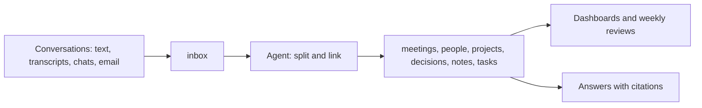
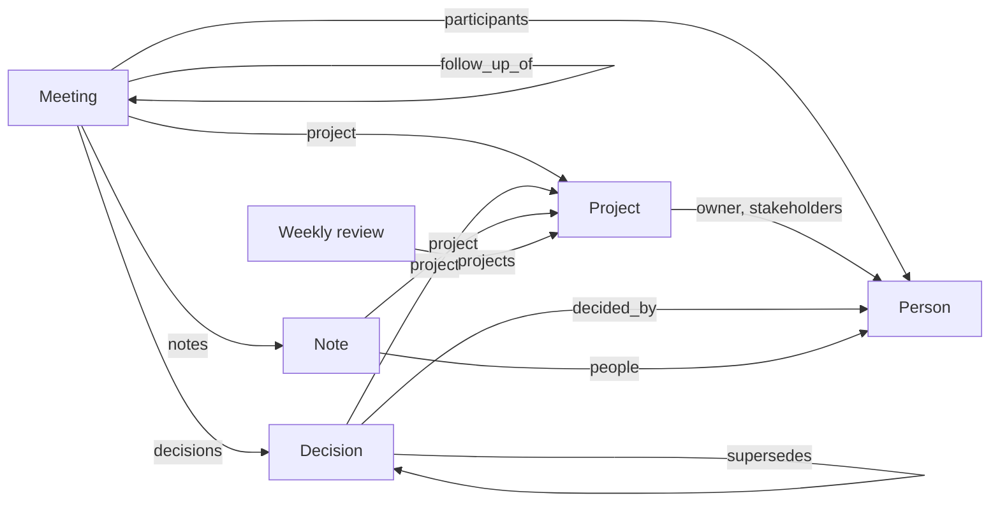

# Knowledge-Hub

**A personal business knowledge base, kept as plain Markdown and maintained by AI agents.**

You paste in conversations. The agent turns them into linked notes about meetings, people, projects, decisions, and tasks, and later answers your questions from those notes.

[Quick start](#quick-start) · [What to say](#what-to-say-to-the-agent) · [Find things](#find-things) · [For AI agents](#for-ai-agents) · [How it works](#how-it-works) · [Setup](#setup)

> [!WARNING]
> This vault holds real conversations and personal data. Your notes **stay on your machine**: [`.gitignore`](.gitignore) publishes only the template (see [Using this as a template](#using-this-as-a-template)). Never force-add private files, and do not send vault content to external services other than the configured MCP tools.

---

## Choose your path

| You are... | Start with | Then |
| ---------- | ---------- | ---- |
| **The vault owner** | [Quick start](#quick-start) | Use the [example prompts](#what-to-say-to-the-agent) and [browse by intent](#find-things) |
| **An AI agent** | [`AGENTS.md`](AGENTS.md) (mandatory) | Use the [routing table](#for-ai-agents) to pick the skill for the request |
| **Maintaining the agent setup** | [`.ai/AI.md`](.ai/AI.md) | Edit [skills](.ai/skills/Skills.md), [templates](.ai/templates/AI_Templates.md), or [MCP setup](.ai/mcp/MCP.md) |

---

## Quick start

Five minutes from an empty vault to your first linked notes:

1. **Introduce yourself.** Say `Set up my profile` (or run `/setup-me` in Cursor). The agent asks for your name, the names you appear under in transcripts, your email, company, role, and timezone, and saves them to `people/Me.md`. It does this automatically before your first request if the profile is missing.
2. **Open the repo in an AI agent** that reads [`AGENTS.md`](AGENTS.md), such as Cursor, Codex, Copilot, or Claude.
3. **Paste a conversation** (meeting notes, a transcript, a chat, or an email thread) and say `Add this`.
4. **Check the result.** The agent reports which notes it created or updated. Open the [meeting index](meetings/Meetings.md) or the [Open Tasks](dashboards/Open_Tasks.md) dashboard to see them.
5. **Ask a question**, for example `What did we agree with Anna about pricing?`. Answers come from the vault only, with links to the notes they came from.

> [!TIP]
> Not ready to process something yet? Drop the file into [`inbox/`](inbox/Inbox.md) and say `Process the inbox` later.

---

## What to say to the agent

Plain language works. These prompts are good starting points:

| I want to... | Say | What happens |
| ------------ | --- | ------------ |
| **Set up my profile** | `Set up my profile`, or `/setup-me` in Cursor | A short interview, then `people/Me.md` with your name, transcript names, email, company, role, and timezone |
| **Save a conversation** | `Add this` + pasted text or an attached file | A meeting note, linked to its people, projects, decisions, and tasks |
| **Clear the inbox** | `Process the inbox` | Every file in `inbox/` is filed, then moved to `inbox/_processed/` |
| **Save a fact or idea** | `Save this: the client's fiscal year starts in April` | A standalone note in `notes/`, linked to its people and projects |
| **Recall the past** | `What did we agree with Anna about pricing?` | An answer from the vault, with the notes it cites |
| **Understand a decision** | `Why did we pick fixed price?` | The decision record: context, options, and consequences |
| **Check a project** | `What's open on Client X?` | Open tasks, follow-ups, and recent activity |
| **Prepare for a meeting** | `Brief me before my call with John` | Recent meetings and open tasks involving John, with citations |
| **Add a task** | `Add a task to call John on Monday` | A task line with an owner and due date |
| **Update a task** | `Mark the proposal task done` | The task is updated where it lives |
| **Review the week** | `Write the weekly review` | A new entry in the [journal](journal/Journal.md) |

The agent never invents facts, dates, or commitments. Anything it is unsure about goes under **Open Questions** in the note, so check that section after a capture.

---

## Find things

Browse by what you are trying to do. Every folder has an index page that lists its notes and links back here.

**See what needs attention**

- [Open Tasks](dashboards/Open_Tasks.md): everything not done yet, across meetings and standalone tasks
- [Follow-Ups](dashboards/Follow_Ups.md): tasks waiting on others, meetings needing review, and proposed decisions
- [Active Projects](dashboards/Active_Projects.md): projects in progress
- [Journal](journal/Journal.md): weekly reviews

**Look something up**

| Folder | One note per... | Holds |
| ------ | --------------- | ----- |
| [Meetings](meetings/Meetings.md) | conversation | Summary, discussion, decisions, and action items, by year: [2026](meetings/2026/2026.md) |
| [People](people/People.md) | person | Company, role, interaction history, and open tasks. The owner's note is `people/Me.md` (local only) |
| [Projects](projects/Projects.md) | project or client engagement | Status, timeline, decisions, and open tasks |
| [Decisions](decisions/Decisions.md) | decision | Context, options considered, the decision, and consequences |
| [Notes](notes/Notes.md) | piece of standalone information | Reference facts, ideas, findings, and records that are not a conversation |
| [Tasks](tasks/Tasks.md) | (single file) | Tasks that did not come from a meeting. Meeting tasks stay in their meeting note |

**Add or learn**

- [Inbox](inbox/Inbox.md): raw input waiting to be filed, and the [processed archive](inbox/_processed/Processed.md)
- [Study](study/Study.md): study notes and interview cheat sheets (see [Study archive](#study-archive))

> [!NOTE]
> Dashboards are Dataview queries. They show results in Obsidian with the Dataview plugin. GitHub shows the query source instead.

---

## For AI agents

[`AGENTS.md`](AGENTS.md) is the authoritative instruction file. The section below is a quick map, not a replacement.

<b>Agent quick map</b>: reading order, skill routing, and non-negotiable rules

 

**Read before acting**

1. [`AGENTS.md`](AGENTS.md): mandatory rules and the skill index.
2. [setup-owner](.ai/skills/setup-owner/SKILL.md): check that `people/Me.md` is complete. If it isn't, run this skill before anything else.
3. [vault-conventions](.ai/skills/vault-conventions/SKILL.md): before creating or editing any note in `meetings/`, `people/`, `projects/`, `decisions/`, `notes/`, `tasks/`, `journal/`, or `dashboards/`.
4. [md-note-structure](.ai/skills/md-note-structure/SKILL.md): before creating or editing any note under `study/`.
5. The skill that matches the request, from the table below.

**Route each request to a skill**

| The user wants to... | Skill | Writes to |
| -------------------- | ----- | --------- |
| Set up or update their profile, or `people/Me.md` is missing or incomplete (check first) | [setup-owner](.ai/skills/setup-owner/SKILL.md) | `people/Me.md` |
| Add, save, record, or file anything, or process `inbox/` | [capture-input](.ai/skills/capture-input/SKILL.md) | `meetings/`, `people/`, `projects/`, `decisions/`, `notes/`, `tasks/` |
| Add, complete, cancel, or reassign a task | [extract-tasks](.ai/skills/extract-tasks/SKILL.md) | The note where the task lives |
| Create or update a person or project | [update-entities](.ai/skills/update-entities/SKILL.md) | `people/`, `projects/` |
| Record, revisit, or supersede a decision | [log-decision](.ai/skills/log-decision/SKILL.md) | `decisions/` |
| Ask about past conversations, people, projects, decisions, or tasks | [query-knowledge](.ai/skills/query-knowledge/SKILL.md) | Nothing (answer only, with citations) |
| Write the weekly review | [weekly-review](.ai/skills/weekly-review/SKILL.md) | `journal/` |
| Create a study note | [new-note](.ai/skills/new-note/SKILL.md) | `study/<topic>/` and its topic index |

**Non-negotiable rules** (full text in [`AGENTS.md`](AGENTS.md))

- **Template first.** Copy the note's [template](.ai/templates/AI_Templates.md). Keep front-matter keys in template order, and bump `updated` on every edit.
- **Reciprocal links.** When one note references another, the other links back.
- **Indexes and breadcrumbs.** Creating, renaming, or deleting a note updates its folder index in the same change. Every file except this one has a breadcrumb under its H1.
- **Faithfulness.** Never invent facts, dates, numbers, or commitments. Uncertain items go under Open Questions.
- **Vault-only answers.** Answer questions from the notes, and cite the notes used.
- **Privacy.** Do not send vault content to external services other than the configured MCP tools.

**Not notes** (never validated): `inbox/`, `Clippings/`, this README and every folder index file, `AGENTS.md`, `.obsidian/`, and everything under `.ai/`. `test-tasks/` is git-ignored build output and not part of the vault.

---

## How it works

<b>How notes link to each other</b>

 

Each note's front matter holds typed reference keys, so the graph can be followed from any note:

Links are kept reciprocal: a meeting's `decisions` match each decision's `source`, a meeting's `notes` match each note's `meetings`, and a project's `owner` and `stakeholders` match each person's `projects`. On top of that, every file has a breadcrumb back to this page, and each folder index links down to its notes. Full key definitions are in section 2 of [vault-conventions](.ai/skills/vault-conventions/SKILL.md).

---

## Study archive

A separate archive of study notes and interview cheat sheets. It follows its own structure rules in [md-note-structure](.ai/skills/md-note-structure/SKILL.md).

| Topic | Notes |
| ----- | ----- |
| [.NET](study/dotnet/DotNet.md) | [.NET 10](study/dotnet/DotNet_10_Interview_Cheat_Sheet.md) · [EF Core](study/dotnet/EF_Core_Interview_Cheat_Sheet.md) · [Multi-threading](study/dotnet/Multi_Threading_Interview_Cheat_Sheet.md) |
| [Databases](study/databases/Databases.md) | [SQL and PostgreSQL](study/databases/SQL_PostgreSQL_Interview_Cheat_Sheet.md) |
| [Algorithms](study/algorithms/Algorithms.md) | [Standard algorithms](study/algorithms/Standard_Algorithms.md) |
| [AWS](study/aws/AWS.md) | [Solutions Architect Associate (SAA-C03)](study/aws/AWS_Solutions_Architect_Associate_SAA-C03_Cheat_Sheet.md) · [Solutions Architect Professional (SAP-C02)](study/aws/AWS_Solutions_Architect_Professional_SAP-C02_Cheat_Sheet.md) |

---

## Setup

1. **Protect the vault.** Run `.ai/scripts/protect-vault.ps1` once after cloning. It enables a pre-commit hook that refuses private content and stops local edits to folder index pages from being staged.
2. **Set up your profile.** Say `Set up my profile` or run `/setup-me`. The agent interviews you and writes `people/Me.md`, so it can recognize you in transcripts. The file stays on your machine.
3. **Open the vault in Obsidian** (optional) and install the Dataview plugin to see live [dashboards](dashboards/Dashboards.md).
4. **Connect your tools** (optional): calendar, Slack, or Microsoft 365 MCP servers, as described in [`.ai/mcp/MCP.md`](.ai/mcp/MCP.md).
5. **Start capturing** with the [quick start](#quick-start).

### Using this as a template

This repository is safe to publish. [`.gitignore`](.gitignore) is an allowlist: only the shared parts are tracked, and everything you capture stays local.

| Published | Stays on your machine |
| --------- | --------------------- |
| `README.md`, `AGENTS.md`, `.ai/` (skills, templates, scripts, MCP example), `.assets/`, `study/`, `.githooks/`, `.cursor/rules`, `.cursor/commands`, `.cursor/skills` | Every note in `meetings/`, `people/`, `projects/`, `decisions/`, `notes/`, `tasks/`, `journal/`, and `inbox/`, including `people/Me.md` |
| The empty skeleton: each private folder's index page and `.gitkeep`, and the dashboard queries | Any new root folder (`Clippings/`, `.obsidian/`), `.env`, keys, `mcp.json`, and audio or video files |

To change a published skeleton page on purpose, run `.ai/scripts/protect-vault.ps1 -Undo`, edit and commit with `ALLOW_SKELETON=1`, then run the script again.
