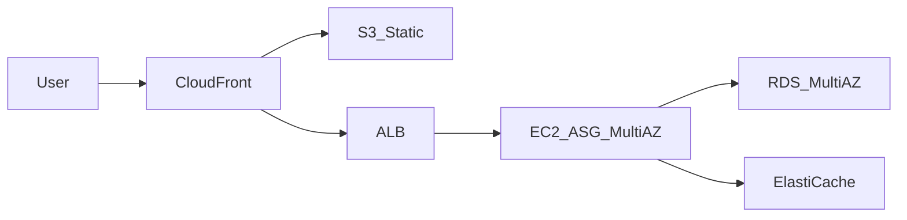
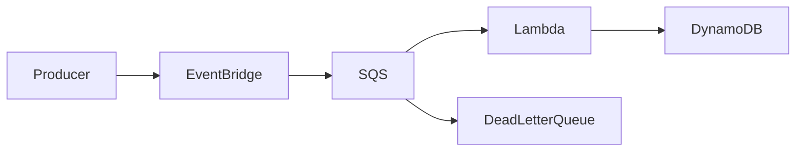
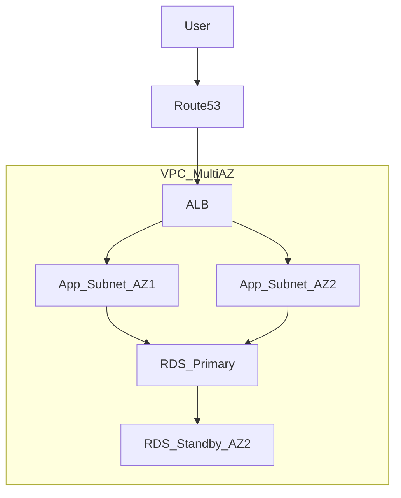

# AWS Solutions Architect: Services, Architecture, and the SAA-C03 Exam

A course-style guide to the AWS platform, written to teach the services properly before turning to certification. Part I explains how AWS itself works. Part II teaches ten service families in depth — what each service is, how it works internally, the specifics and limits that change decisions, when to use it, and the classic mistake. Parts III and IV cover architecting and engineering practice. Part V is everything specific to the **AWS Certified Solutions Architect – Associate (SAA-C03)** exam, including 60 questions with distractor analysis and an 8-week plan aligned to the [official exam guide](https://docs.aws.amazon.com/aws-certification/latest/solutions-architect-associate-03/solutions-architect-associate-03.html).

> Exam note: SAA-C03 is the current Associate exam (live since August 2022, still active in 2026). It validates your ability to design solutions using the **AWS Well-Architected Framework** — secure, resilient, high-performing, and cost-optimized.

> Currency note: content reviewed against AWS service changes through **mid-2026**, including the Amazon QuickSight → **Amazon Quick** rebrand, **QLDB** end of support, **Snowball Edge** restriction to existing customers, and newer services (Aurora DSQL, S3 Express One Zone, S3 Tables/Vectors, VPC Lattice). See [What Changed Recently](#what-changed-recently-20242026) for the delta and how much of it the exam actually asks about.

---

## Content

**[Part I — Foundations](#part-i--foundations)**

1. [How to Use This Guide](#how-to-use-this-guide)
   - [Reading the Abbreviations](#reading-the-abbreviations)
2. [How AWS Works](#how-aws-works)
   - [The Account and the API](#the-account-and-the-api)
   - [Regions, Availability Zones, and the Edge](#regions-availability-zones-and-the-edge)
   - [The Shared Responsibility Model](#the-shared-responsibility-model)
   - [How AWS Charges You](#how-aws-charges-you)
   - [Blast Radius and Least Privilege](#blast-radius-and-least-privilege)
3. [The Well-Architected Framework](#the-well-architected-framework)

**[Part II — The Services in Depth](#part-ii--the-services-in-depth)**

4. [Chapter 1: Identity, Access, and Security](#chapter-1-identity-access-and-security)
   - [IAM in Depth](#iam-in-depth)
   - [Federation and Human Access](#federation-and-human-access)
   - [Organizations and Multi-Account Guardrails](#organizations-and-multi-account-guardrails)
   - [Application Identity: Cognito and Directory Service](#application-identity-cognito-and-directory-service)
   - [Edge and Network Protection](#edge-and-network-protection)
   - [Encryption and KMS](#encryption-and-kms)
   - [Secrets and Configuration](#secrets-and-configuration)
   - [Detection, Audit, and Compliance](#detection-audit-and-compliance)
   - [Data Protection and Governance](#data-protection-and-governance)
5. [Chapter 2: Compute](#chapter-2-compute)
   - [EC2: The Foundation](#ec2-the-foundation)
   - [Auto Scaling and Load Balancing](#auto-scaling-and-load-balancing)
   - [Lambda and Serverless Compute](#lambda-and-serverless-compute)
   - [Containers: ECS, EKS, Fargate, and ECR](#containers-ecs-eks-fargate-and-ecr)
   - [Batch and Specialized Compute](#batch-and-specialized-compute)
6. [Chapter 3: Application Integration](#chapter-3-application-integration)
   - [Amazon SQS](#amazon-sqs)
   - [Amazon SNS](#amazon-sns)
   - [Amazon EventBridge](#amazon-eventbridge)
   - [AWS Step Functions](#aws-step-functions)
   - [API Gateway and AppSync](#api-gateway-and-appsync)
7. [Chapter 4: Storage](#chapter-4-storage)
   - [Amazon S3 in Depth](#amazon-s3-in-depth)
   - [Amazon EBS in Depth](#amazon-ebs-in-depth)
   - [Amazon EFS and FSx](#amazon-efs-and-fsx)
   - [Instance Store, Storage Gateway, and AWS Backup](#instance-store-storage-gateway-and-aws-backup)
8. [Chapter 5: Databases](#chapter-5-databases)
   - [Choosing a Database](#choosing-a-database)
   - [DynamoDB Essentials](#dynamodb-essentials)
   - [Amazon RDS in Depth](#amazon-rds-in-depth)
   - [Amazon Aurora in Depth](#amazon-aurora-in-depth)
   - [ElastiCache and MemoryDB](#elasticache-and-memorydb)
   - [Redshift and Purpose-Built Databases](#redshift-and-purpose-built-databases)
9. [Chapter 6: Networking and Content Delivery](#chapter-6-networking-and-content-delivery)
   - [VPC Anatomy](#vpc-anatomy)
   - [Security Groups and NACLs](#security-groups-and-nacls)
   - [Connecting to the Internet](#connecting-to-the-internet)
   - [VPC Endpoints and PrivateLink](#vpc-endpoints-and-privatelink)
   - [Connecting VPCs and On-Premises](#connecting-vpcs-and-on-premises)
   - [Route 53](#route-53)
   - [CloudFront and Global Accelerator](#cloudfront-and-global-accelerator)
10. [Chapter 7: Analytics and Streaming](#chapter-7-analytics-and-streaming)
    - [Streaming Ingestion](#streaming-ingestion)
    - [Storage, Cataloging, and Transformation](#storage-cataloging-and-transformation)
    - [Query and Visualization](#query-and-visualization)
11. [Chapter 8: Observability and Operations](#chapter-8-observability-and-operations)
    - [CloudWatch](#cloudwatch)
    - [Systems Manager](#systems-manager)
    - [Infrastructure as Code and Deployment](#infrastructure-as-code-and-deployment)
    - [Governance and Cost Visibility Tooling](#governance-and-cost-visibility-tooling)
12. [Chapter 9: Migration and Transfer](#chapter-9-migration-and-transfer)
13. [Chapter 10: Cost Management and Pricing](#chapter-10-cost-management-and-pricing)
    - [Optimizing Storage Cost](#optimizing-storage-cost)
    - [Optimizing Compute Cost](#optimizing-compute-cost)
    - [Optimizing Database Cost](#optimizing-database-cost)
    - [Optimizing Network Cost](#optimizing-network-cost)
    - [Seeing and Controlling Spend](#seeing-and-controlling-spend)

**[Part III — Architecting with the Services](#part-iii--architecting-with-the-services)**

14. [Resilience and Disaster Recovery](#resilience-and-disaster-recovery)
15. [Service Selection Decision Trees](#service-selection-decision-trees)
16. [Architecture Pattern Library](#architecture-pattern-library)
17. [Quotas and Limits That Matter](#quotas-and-limits-that-matter)

**[Part IV — Engineering Practice](#part-iv--engineering-practice)**

18. [For Software Engineers: SDK, IaC, and Code Patterns](#for-software-engineers-sdk-iac-and-code-patterns)
    - [Credentials and SDK Setup](#e1-credentials-and-sdk-setup)
    - [IAM Policies as Code](#e2-iam-policies-as-code)
    - [S3 from Application Code](#e3-s3-from-application-code)
    - [DynamoDB Access Patterns and Optimistic Concurrency](#e4-dynamodb-access-patterns-and-optimistic-concurrency)
    - [SQS Consumers, Idempotency, and Poison Messages](#e5-sqs-consumers-idempotency-and-poison-messages)
    - [Retries, Timeouts, and Backoff](#e6-retries-timeouts-and-backoff)
    - [Lambda Performance and Cold Starts](#e7-lambda-performance-and-cold-starts)
    - [Configuration and Secrets](#e8-configuration-and-secrets)
    - [Observability in Code](#e9-observability-in-code)
    - [Infrastructure as Code Options](#e10-infrastructure-as-code-options)
    - [CI/CD Without Long-Lived Keys](#e11-cicd-without-long-lived-keys)
    - [Local Development and Testing](#e12-local-development-and-testing)
    - [Cost-Aware Coding](#e13-cost-aware-coding)

**[Part V — Exam Preparation (SAA-C03)](#part-v--exam-preparation-saa-c03)**

19. [Exam at a Glance](#exam-at-a-glance)
20. [What Changed Recently (2024–2026)](#what-changed-recently-20242026)
21. [Exam Domain Map](#exam-domain-map)
22. [Foundational Q&A (15 Questions)](#foundational-qa-15-questions)
23. [Associate Scenario Q&A (25 Questions)](#associate-scenario-qa-25-questions)
24. [Architect Judgment Q&A (10 Questions)](#architect-judgment-qa-10-questions)
25. [Engineering Practice Q&A (10 Questions)](#engineering-practice-qa-10-questions)
26. [8-Week Study Plan](#8-week-study-plan)
27. [Pattern Recognition Cheat Sheet](#pattern-recognition-cheat-sheet)
28. [Rapid Answers](#rapid-answers)
29. [Self-Check Checklist](#self-check-checklist)

**[Part VI — Reference](#part-vi--reference)**

30. [References and Practice Resources](#references-and-practice-resources)
31. [Glossary and Abbreviations](#glossary-and-abbreviations)
    - [AWS Services and Features](#aws-services-and-features)
    - [AWS Concepts and Acronyms](#aws-concepts-and-acronyms)
    - [General Computing Terms](#general-computing-terms)
    - [Patterns Named in This Guide](#patterns-named-in-this-guide)

---

# Part I — Foundations

## How to Use This Guide

[↑ Content](#content)

This guide is written as a course, not as a flashcard deck. It teaches the AWS platform first and the exam second, because the candidates who struggle with SAA-C03 are almost never the ones who lacked a service list — they are the ones who could name S3 storage classes but could not say *why* One Zone-IA is cheaper, and therefore could not tell when it was the wrong answer.

**The six parts, and what each is for:**

| Part | Contents | Read it when |
|------|----------|--------------|
| **I — Foundations** | How the platform itself works: accounts, the API model, Regions and zones, shared responsibility, pricing mechanics, and the Well-Architected Framework | First, and in order. Everything later assumes it |
| **II — The Services in Depth** | Ten chapters teaching each service family properly: what each service is, how it works, its real specifics and limits, when to use it, and the classic mistake | The main body. Read a whole chapter at a time; the services in a family only make sense against each other |
| **III — Architecting with the Services** | Putting them together: resilience and disaster recovery, decision trees, reference architectures, and the quotas that force design changes | After Part II, or dip into the decision trees whenever you are stuck choosing |
| **IV — Engineering Practice** | Working code: SDK patterns, IAM policies as code, idempotent consumers, retries, IaC, CI/CD, local testing, cost-aware coding | If you write software. This is the part that turns knowledge into judgment |
| **V — Exam Preparation** | Everything exam-specific: format and tactics, recent changes, the domain-to-chapter map, 60 questions with distractor analysis, and an 8-week plan | When you have a test date |
| **VI — Reference** | Official documentation links, and a complete glossary of every abbreviation used | Continuously |

**How to read a service section.** Each one answers the same five questions in the same order, so you can skim for the one you need: *what it is*, *how it works* (the mental model), *the specifics* (limits, pricing dimensions, behaviors), *when to choose it and when not to*, and *the classic mistake*. The "how it works" material is there deliberately — you cannot reason about a service whose mechanism is a black box, and every genuinely hard AWS decision turns on a mechanism detail.

**If you are here only for the exam,** you can read Part V first and treat Part II as the reference it points into. That works, and it is slower than it looks: the exam asks you to choose between two services that both function, which is a question about mechanism, not about names.

**A note on what this guide covers.** It goes deeper than SAA-C03 requires in several places — quotas, cost mechanics, SDK behavior, operational failure modes. That is intentional. The fastest way to remember which service an exam question wants is to have hit the limit that makes the alternative impossible.

### Reading the Abbreviations

AWS documentation and exam questions are dense with acronyms, and this guide follows the same convention: each abbreviation is expanded the first time it appears in a section, then used in short form. Every abbreviation used anywhere in this file is also defined in the [Glossary and Abbreviations](#glossary-and-abbreviations) at the end, including general computing terms (not just AWS product names).

Four abbreviations are genuinely ambiguous and worth settling now, because AWS reuses them:

| Abbreviation | Meaning 1 | Meaning 2 | How to tell |
|--------------|-----------|-----------|-------------|
| **WAF** | **W**eb **A**pplication **F**irewall — the service that inspects HTTP requests | **W**ell-**A**rchitected **F**ramework — the design methodology | Firewall meaning appears with ALB/CloudFront; framework meaning appears with "pillars." This guide writes "AWS WAF" for the firewall and spells out "Well-Architected Framework" |
| **SG** | Security group (instance-level firewall) | — | Always the firewall |
| **AZ** | Availability Zone (one or more data centers) | — | Never "Amazon Zone" |
| **IA** | Infrequent Access (an S3 storage class tier) | — | Appears as a suffix: Standard-IA, One Zone-IA |

**Naming conventions in AWS itself:** services prefixed **"Amazon"** are generally standalone products (Amazon S3, Amazon EC2), while **"AWS"** prefixes tend to be features or tools that support other services (AWS Backup, AWS Config). The exam does not test this distinction, and AWS is not perfectly consistent about it, so do not read meaning into it — but it explains why the prefixes look arbitrary.

---

## How AWS Works

[↑ Content](#content)

Before any individual service makes sense, five things about the platform itself need to be true in your head. Almost every "surprising" AWS behavior — a permission that does not work, a bill nobody expected, a resource that cannot be reached — traces back to one of them.

### The Account and the API

**Everything in AWS is an API call.** There is no other way to do anything. The console is a web application that calls the same APIs your code calls; the CLI and the SDKs are thin clients over the same surface. When you drag a slider in the console, it issues something like `ec2:ModifyVolume` on your behalf.

Three consequences follow, and they shape the whole platform:

1. **Every action is authorizable.** Because each action is a named API operation (`s3:GetObject`, `rds:DeleteDBInstance`), IAM can allow or deny it individually. This is why AWS permissions are so fine-grained, and why an IAM policy is a list of API operations rather than roles like "admin" or "reader."
2. **Every action is auditable.** CloudTrail records API calls, so "who deleted the database" is an answerable question — including when the answer is "a script using a role."
3. **Everything is automatable.** Anything the console can do, code can do. This is the technical basis for Infrastructure as Code, and the reason manual console changes are considered a smell in mature teams: they are invisible to the code that is supposed to define reality.

**The account is the fundamental container.** An AWS account is not a user login — it is an isolated space holding resources, its own IAM, its own service quotas, and its own bill. Two accounts share nothing unless you explicitly connect them. This makes the account the strongest isolation boundary AWS offers, which is why real organizations run dozens or hundreds of them rather than one large one.

Within an account, the **root user** (the email address the account was created with) has unrestricted power that cannot be limited by IAM policy. It should have hardware multi-factor authentication enabled, no access keys, and be used essentially never — a handful of tasks genuinely require it (closing the account, changing support plans), and the rest of the time you work as an IAM role.

**Control plane versus data plane** is a distinction worth learning early because it explains resilience behavior. The *control plane* is the API that creates and changes things (`RunInstances`, `CreateBucket`); the *data plane* is the path that serves traffic (an instance handling requests, `GetObject` reading a bucket). Data planes are deliberately built to be simpler and more available than control planes. That is why AWS reliability guidance says to avoid depending on control-plane calls during a failover: your recovery plan should not need to *create* anything at the worst possible moment.

**Service quotas** (historically "limits") cap how much of a service one account may use — 1,000 concurrent Lambda executions, 5 VPCs per Region, and hundreds more. Some are adjustable on request, some are fixed. Quotas are per account *and* per Region, which is one of several reasons a busy production workload does not share an account with an experimental one.

### Regions, Availability Zones, and the Edge

AWS infrastructure is a hierarchy, and knowing which level a service lives at tells you what kind of failure it survives.

| Concept | Definition | What it is for |
|---------|------------|----------------|
| **Region** | A geographic area (for example `eu-central-1`, Frankfurt) containing isolated AWS facilities, with its own service endpoints | Data residency and sovereignty; surviving failures larger than one data center |
| **Availability Zone (AZ)** | One or more discrete data centers within a Region, with independent power, cooling, and networking | Surviving the loss of a data center while staying inside one Region |
| **Edge Location** | A CDN (Content Delivery Network) cache point used by CloudFront — hundreds worldwide, far more numerous than Regions | Serving cached content close to users |
| **Local Zone** | An extension of a Region placed near a large population center | Single-digit millisecond latency for a specific city |
| **Wavelength Zone** | AWS infrastructure inside a telecom provider's 5G (fifth-generation mobile) network | Mobile and IoT (Internet of Things — connected devices such as sensors and cameras) workloads at the carrier edge |

**How the hierarchy nests:** a Region contains multiple Availability Zones (usually three or more); an Availability Zone contains one or more data centers. Zones within a Region are close enough for synchronous replication (single-digit millisecond round trips) yet far enough apart that a flood, fire, or power failure should not take out two. That single fact is the engineering basis for nearly every high-availability design: **spread across AZs to survive component and data-center failure; spread across Regions to survive a regional disaster or to satisfy data-residency law.**

**Every service sits at one of three scopes**, and mixing them up causes real outages:

| Scope | Examples | Practical implication |
|-------|----------|-----------------------|
| **Global** | IAM, Route 53, CloudFront, AWS Organizations, Billing | One namespace for the whole account; no Region selector. Certificates for CloudFront must live in `us-east-1` specifically |
| **Regional** | S3, DynamoDB, SQS, Lambda, RDS (the service) | The service spans AZs automatically; you do not choose a zone, and AWS handles zone redundancy for you |
| **Zonal** | EC2 instances, EBS volumes, RDS instances, subnets | The resource lives in exactly one AZ. *You* are responsible for spreading these across zones |

The mental shortcut: if you had to pick a subnet when creating it, it is zonal and its availability is your problem. If you only picked a Region, AWS is already spreading it for you.

**Region identifiers worth recognizing:** `us-east-1` (N. Virginia), `us-west-2` (Oregon), `eu-west-1` (Ireland), `eu-central-1` (Frankfurt), `ap-southeast-1` (Singapore). `us-east-1` matters disproportionately: it is the oldest and largest Region, several global services are actually operated there, and it is where new services usually launch first. It is also, for the same reasons, the Region whose incidents make the news.

**AZ names are per-account.** Your `eu-central-1a` and another account's `eu-central-1a` are probably different physical zones — AWS randomizes the mapping so that customers do not all crowd into "zone a." When you genuinely need two accounts to agree on a zone (shared VPCs, latency-sensitive placement), use the **AZ ID** (`euc1-az1`), which is consistent across accounts.

### The Shared Responsibility Model

AWS describes this as security **of** the cloud (theirs) versus security **in** the cloud (yours).

| AWS responsibility | Customer responsibility |
|--------------------|-------------------------|
| Hardware, global infrastructure, hypervisor, managed-service patching | Data, IAM policies, encryption choices, OS (operating system) patching on EC2, security groups, application code |
| Physical security of data centers | Client-side encryption, network configuration inside your VPC (Virtual Private Cloud), backup and retention decisions |

**The line moves with the service model** — "shared" is not a fixed split. The more managed the service, the less you own:

| You run | You patch the OS? | You patch the runtime? | You own data, access policy, and backups? |
|---------|-------------------|------------------------|-------------------------------------------|
| EC2 (virtual machine) | Yes | Yes | Yes |
| RDS (managed database) | No | No — AWS patches the engine in your maintenance window | Yes |
| Lambda (serverless function) | No | No | Yes |
| S3 (object storage) | No | No | Yes |

Notice that the last column never changes. **Access control and data classification are always yours**, at every level of abstraction, and no amount of managed service removes that. This is why the large majority of real cloud breaches are misconfigured permissions and public storage rather than unpatched infrastructure — AWS has largely solved the part it owns.

A useful corollary: **durability is AWS's job, and recoverability is yours.** S3 will not lose your object, but it will faithfully store the empty file your buggy deployment wrote over it, and it will faithfully delete what your credentials told it to delete. Versioning, backups, and immutability are customer-side controls precisely because the threat is your own mistakes and your own compromised credentials.

### How AWS Charges You

Cost is an architectural property, not an accounting afterthought, so it is worth understanding the meter before studying the services. Almost all AWS pricing is a combination of five dimensions:

| Dimension | Meaning | Typical examples |
|-----------|---------|------------------|
| **Time** | Resource-hours or millisecond-duration while provisioned | EC2 instance-hours, RDS instance-hours, NAT gateway hours, provisioned IOPS |
| **Storage** | GB-month of data at rest | S3, EBS volumes, snapshots, backups, log retention |
| **Requests** | Per-operation charges | S3 `PUT`/`GET`, Lambda invocations, API Gateway calls, KMS `Decrypt`, DynamoDB request units |
| **Data transfer** | GB moved across a boundary | Out to the internet, between AZs, between Regions |
| **Provisioned capacity** | Reserved throughput whether used or not | DynamoDB provisioned mode, Kinesis shards, provisioned concurrency |

**The four charges that surprise people**, all of them architectural:

1. **Data transfer.** Inbound from the internet is free. Traffic within one AZ over private addresses is free. Crossing AZs costs a small amount per GB *in both directions*. Crossing Regions costs more. Egress to the internet costs the most. A chatty microservice mesh spread across three AZs pays for every hop.
2. **Idle provisioned resources.** An EBS volume left behind by a terminated instance, an unused Elastic IP, an idle NAT gateway, a provisioned-capacity DynamoDB table serving no traffic — all bill continuously. Nothing about "the cloud" makes forgotten resources free.
3. **Per-request costs at scale.** A million tiny S3 objects cost far more in requests than one large object holding the same bytes. The same applies to KMS decryption on every object read and `PutMetricData` on every custom metric.
4. **The NAT gateway.** It charges per hour *and* per GB processed. Sending large volumes to S3 through a NAT gateway rather than a (free) gateway VPC endpoint is one of the most common six-figure mistakes in the industry.

**Commitment discounts** cut the time dimension: Reserved Instances and Savings Plans exchange a one- or three-year commitment for 30–70% off, and Spot Instances offer up to 90% off in return for accepting interruption. These are billing constructs, not capacity reservations — buying one does not reserve hardware, it discounts what you run. Chapter 10 covers the mechanics.

### Blast Radius and Least Privilege

Two habits underlie every well-built AWS environment, and they are worth naming before the services that implement them.

**Blast radius** is the set of things that break when one thing fails or is compromised. Good AWS design is largely the practice of making that set small and *predictable*: separate accounts so a compromised credential cannot reach production, separate Availability Zones so a data-center failure removes capacity rather than service, separate queues per consumer so one slow subscriber does not block the rest.

**Least privilege** means granting the minimum permissions needed, then verifying that assumption with evidence rather than intent. Concretely, on AWS it means: prefer roles with temporary credentials over long-lived access keys; scope policies by action *and* resource *and* condition rather than granting `*`; and use IAM Access Analyzer and the "last accessed" data to remove permissions that are never exercised. Least privilege is a process, not a configuration — permissions accrete unless something actively prunes them.

---

## The Well-Architected Framework

[↑ Content](#content)

AWS's Well-Architected Framework is the vocabulary the whole platform is designed and reviewed against. It is worth learning as a working design tool rather than as exam trivia: it gives you six specific questions to ask about any architecture, and it is the standard language for arguing about a trade-off in a design review.

| Pillar | The question it asks | Where it shows up in practice |
|--------|----------------------|-------------------------------|
| **Operational Excellence** | Can we run, observe, and evolve this safely? | Infrastructure as Code, observability, runbooks, safe deployments, post-incident review |
| **Security** | Can we protect the data and the systems? | Least-privilege IAM, encryption, network isolation, edge protection, audit trails |
| **Reliability** | Can it recover from failure, and do we know that it can? | Multi-AZ, auto scaling, backups, DR strategy, decoupling, tested failover |
| **Performance Efficiency** | Are we using the right resources for the workload? | Right-sizing, caching, matching the storage tier and database type to the access pattern |
| **Cost Optimization** | Are we spending only where it creates value? | Purchase commitments, lifecycle policies, endpoint versus NAT, eliminating idle capacity |
| **Sustainability** | Are we minimizing the resources consumed to do the work? | Graviton, serverless, scaling to zero, efficient data formats and storage tiers |

**Why pillars rather than a checklist.** The pillars exist because these goals genuinely conflict. Encrypting everything with customer-managed keys improves security and increases cost. Running in three Availability Zones improves reliability and triples cross-zone data-transfer charges. Caching aggressively improves performance and introduces staleness. An architecture is *well-architected* when its trade-offs are deliberate, documented, and matched to the workload's actual requirements — not when every pillar is maximized, which is impossible.

**How the framework is used in the real world:** as a structured review. You walk a workload through the pillars, record the answers, and produce a list of risks rated high, medium, or low. AWS provides the **Well-Architected Tool** to run and store these reviews, along with **Lenses** — pillar questions specialized for particular workload types (serverless, SaaS, machine learning, financial services). The value is not the score; it is the discovery that nobody has ever tested the failover, or that the retention policy contradicts the compliance requirement.

**The trade-off pairs that come up most often**, and the question that resolves each:

| Tension | The resolving question |
|---------|------------------------|
| Security versus cost | Is this data regulated or does it identify a person? If yes, security sets the floor and cost optimizes above it |
| Reliability versus cost | What does an hour of downtime actually cost the business? That number, not engineering taste, sets the DR strategy |
| Performance versus consistency | Can this read tolerate being a second stale? Most reads can; the ones that cannot are usually a small, identifiable set |
| Operational simplicity versus control | Does the team have the capacity to operate this well at 3 a.m.? Managed services trade some control for exactly that |

---

# Part II — The Services in Depth

This part is the core of the guide: what each major AWS service actually is, how it works internally to the depth that changes your decisions, the specifics and limits that matter, and where teams get it wrong. It is organized by service family rather than by exam domain, so everything about S3 or DynamoDB is in one place.

Each chapter follows the same shape. A short **orientation** explains the problem space and how the services in it relate. Then each service gets treated individually: what it is, the mental model of how it works, the specifics worth memorizing, when to choose it and when not to, and the classic mistake. Chapters end with **how to choose** — the decision that the family exists to serve.

| Chapter | Family | The central question |
|---------|--------|----------------------|
| 1 | [Identity, Access, and Security](#chapter-1-identity-access-and-security) | Who may do what, and how is data protected? |
| 2 | [Compute](#chapter-2-compute) | Where does code run, and how does it scale? |
| 3 | [Application Integration](#chapter-3-application-integration) | How do components talk without depending on each other? |
| 4 | [Storage](#chapter-4-storage) | Where do bytes live, and at what cost and latency? |
| 5 | [Databases](#chapter-5-databases) | Which data model and consistency guarantee fits? |
| 6 | [Networking and Content Delivery](#chapter-6-networking-and-content-delivery) | How do packets reach the right place, privately and quickly? |
| 7 | [Analytics and Streaming](#chapter-7-analytics-and-streaming) | How is data ingested, transformed, and queried at scale? |
| 8 | [Observability and Operations](#chapter-8-observability-and-operations) | How do you know what the system is doing, and change it safely? |
| 9 | [Migration and Transfer](#chapter-9-migration-and-transfer) | How does existing workload get here? |
| 10 | [Cost Management and Pricing](#chapter-10-cost-management-and-pricing) | What does this cost, and who pays for it? |

---

## Chapter 1: Identity, Access, and Security

[↑ Content](#content)

**Orientation.** This chapter comes first because on AWS, identity *is* the perimeter. In a traditional data center the network was the primary control — inside the firewall was trusted, outside was not. On AWS every resource is reachable through a public API endpoint, and what stops the world from reading your database is not a wall but an authorization decision on every single call. Get identity right and a misconfigured network is survivable. Get identity wrong and a perfect network topology will not save you.

The services in this chapter divide into five jobs:

| Job | Services |
|-----|----------|
| **Decide who may do what** | IAM, STS, Organizations (SCPs), IAM Identity Center |
| **Authenticate your application's end users** | Cognito, Directory Service |
| **Protect data with cryptography** | KMS, CloudHSM, ACM, Secrets Manager, Parameter Store |
| **Filter hostile traffic** | AWS WAF, Shield, Network Firewall |
| **Detect, prove, and correct** | CloudTrail, Config, GuardDuty, Inspector, Macie, Security Hub, IAM Access Analyzer |

---

### IAM in Depth

[↑ Content](#content)

**What it is.** IAM (Identity and Access Management) is the authorization engine in front of every AWS API call. It is global (not per Region), free, and it evaluates every request — including the ones the console makes on your behalf and the ones AWS services make to each other.

**The four primitives.**

| Primitive | Purpose |
|-----------|---------|
| **User** | A long-lived identity for a human, with a password for console access and optionally access keys for programmatic access. Avoid for applications, and increasingly avoid for humans too |
| **Group** | A collection of users, so permissions are attached once rather than per person. Groups cannot be nested, and a group is not a principal — you cannot grant a group access to a resource |
| **Role** | An identity with **no permanent credentials**, assumed to obtain temporary credentials from **STS** (Security Token Service). Used by EC2, Lambda, other accounts, and federated humans |
| **Policy** | A JSON (JavaScript Object Notation) document declaring what is allowed or denied |

**How it works: the request context.** Every API call arrives at IAM carrying a bundle of facts — who the principal is, which action, which resource, the source IP, whether the call came over TLS, which VPC endpoint it entered through, the time of day, what tags the principal and resource carry. IAM evaluates all applicable policies against that context and returns allow or deny. Understanding this is what makes `Condition` blocks intuitive: conditions are simply assertions about the request context.

**Anatomy of a policy statement**, with every element named:

```json
{
  "Version": "2012-10-17",
  "Statement": [{
    "Sid": "ReadTeamReportsOverTLSOnly",
    "Effect": "Allow",
    "Action": ["s3:GetObject", "s3:ListBucket"],
    "Resource": [
      "arn:aws:s3:::reports-bucket",
      "arn:aws:s3:::reports-bucket/team-${aws:PrincipalTag/TeamId}/*"
    ],
    "Condition": {
      "Bool": { "aws:SecureTransport": "true" }
    }
  }]
}
```

- **`Version`** is a policy-language version, always `2012-10-17`. It is not a date you change.
- **`Sid`** is an optional human-readable label, useful in audits.
- **`Effect`** is `Allow` or `Deny`.
- **`Action`** names API operations as `service:Operation`, and supports wildcards (`s3:Get*`).
- **`Resource`** names targets by **ARN** (Amazon Resource Name). Note the two entries above: bucket-level actions such as `ListBucket` act on the *bucket* ARN, while object-level actions act on the *object* ARN with `/*`. Getting this wrong is the single most common reason an S3 policy silently fails.
- **`Condition`** constrains the request context. Here it refuses unencrypted requests.
- **`${aws:PrincipalTag/TeamId}`** is a **policy variable**, substituted at evaluation time. One policy can serve every team, which is how you avoid writing a policy per tenant.

**Reading an ARN** is worth five minutes because it appears everywhere: `arn:partition:service:region:account-id:resource`. The partition is `aws` (or `aws-cn`, `aws-us-gov`). Region and account are left empty for globally scoped services, which is why S3 ARNs have two colons together: `arn:aws:s3:::bucket-name`.

**The four policy types**, and where each fits:

| Type | Attached to | Purpose |
|------|-------------|---------|
| **Identity-based** | A user, group, or role | The everyday grant: "this principal may do these things" |
| **Resource-based** | An S3 bucket, SNS topic, SQS queue, KMS key, Lambda function | Grants access *from the resource's side*, including to principals in other accounts. This is how cross-account access works without any role in between |
| **Permission boundary** | A user or role | A ceiling on maximum permissions. Lets you safely delegate IAM administration: a developer may create roles, but never one more powerful than the boundary |
| **SCP** (Service Control Policy) | An **OU** (Organizational Unit — a folder of accounts) or account in AWS Organizations | An organization-wide cap. Filters what IAM inside the account is permitted to grant |

**How AWS actually decides.** This algorithm answers most "why is it denied" questions:

1. **Default deny.** With no policy at all, nothing is permitted.
2. **Explicit `Deny` wins, always.** Any deny anywhere in any applicable policy ends the evaluation.
3. **An `Allow` must exist** in an identity-based policy, or in a resource-based policy, or both.
4. **Boundaries and SCPs must also permit it.** They cannot grant, only fail to block.

So `AccessDenied` has two very different causes: *no allow exists* (fixable by granting) or *a deny exists* (not fixable by granting — you must find and change the deny). Learning to tell them apart saves hours. The `sts:AssumeRole` case adds one wrinkle: for cross-account role assumption, **both** the role's trust policy and the caller's identity policy must allow it. One side alone is never enough.

**Roles: how the mechanism actually works.** A role has two policies, and confusing them is the classic beginner error:

- A **trust policy** (a resource-based policy on the role) naming *who may assume it* — an AWS service such as `lambda.amazonaws.com`, another account, or a federated identity provider.
- One or more **permission policies** saying *what it may do once assumed*.

When an EC2 instance has an instance profile, the instance metadata service hands out temporary credentials for that role, automatically rotated before expiry. Nothing is stored on disk, and nothing needs deploying. The same pattern applies to Lambda execution roles and ECS task roles. This is the mechanism that makes "never embed access keys" practical advice rather than a slogan.

**Specifics worth memorizing.**

| Item | Value |
|------|-------|
| STS credential lifetime | 15 minutes to 12 hours; **1 hour default**. Role chaining caps at 1 hour |
| Managed policies per role/user | 10 attached (soft limit, raisable to 20) |
| Inline policy size | 2,048 characters for a user, 10,240 for a role |
| Access keys per user | 2 — deliberately, so you can rotate without downtime |
| Policy evaluation caching | None you can rely on; changes take effect within seconds |
| IAM scope | Global; `us-east-1` endpoint. Changes propagate eventually — a brand-new role may fail for a few seconds |

**When to use what.** Roles for anything automated, always. IAM Identity Center for humans. IAM users only for the narrowing set of cases with no alternative — a legacy tool that cannot do federation, or a break-glass account. If you find yourself creating an IAM user for a new application in 2026, something has gone wrong.

**The classic mistakes.** Attaching `AdministratorAccess` "temporarily" and never revisiting it. Writing `"Resource": "*"` because scoping was hard. Granting `iam:PassRole` broadly, which lets a user hand a powerful role to a service and thereby escalate to it — this is the most under-appreciated privilege-escalation path in AWS. Forgetting the bucket-versus-object ARN distinction. And using long-lived access keys in CI, which is what OIDC federation exists to eliminate.

---

### Federation and Human Access

[↑ Content](#content)

**What it is.** Federation means trusting an external identity system to authenticate people, so AWS never holds a password for your employees. **IAM Identity Center** (formerly AWS SSO) is the front door: one sign-in that lists every account and role a person may use.

**How it works.** Your **IdP** (Identity Provider — Microsoft Entra ID, Okta, Google Workspace, or Identity Center's own directory) authenticates the person and issues a signed assertion using **SAML** (Security Assertion Markup Language) or **OIDC** (OpenID Connect). AWS validates the signature, maps the assertion to a **permission set** (a reusable policy template Identity Center provisions into each account as a role), and issues temporary credentials. Access is granted by assigning *groups* to *permission sets* in *accounts* — three dimensions that scale far better than per-person policies.

**STS `AssumeRole`** is the underlying primitive for everything cross-account: it exchanges your current identity for temporary credentials elsewhere. Two variants matter:

- **`AssumeRoleWithWebIdentity`** — for OIDC tokens, including GitHub Actions and mobile apps. This is what makes keyless CI/CD possible.
- **`AssumeRoleWithSAML`** — for SAML assertions from an enterprise IdP.

**The external ID.** When granting a third party (a monitoring vendor, a consultancy) access to your account, put a unique **external ID** in the trust policy that the vendor must present. Without it, the vendor's own credentials could be tricked by *another* of their customers into accessing your account — the **confused deputy** problem. Any question involving a third-party SaaS vendor assuming a role in your account is testing this.

**Why temporary credentials matter so much.** STS credentials expire on their own. A leaked long-lived access key stays valid until a human notices and revokes it, which historically has taken weeks. A leaked one-hour token is usually worthless by the time it surfaces in a log. Same permissions, radically different incident.

**When not to federate:** almost never, but note that Identity Center is a Region-pinned service (you enable it in one Region) and that break-glass access must survive its unavailability — so keep one heavily protected IAM user or role with hardware MFA for the case where federation itself is broken.

---

### Organizations and Multi-Account Guardrails

[↑ Content](#content)

**What it is.** AWS Organizations groups many accounts under one **management account**, giving consolidated billing and central policy. It is the foundation of every serious AWS environment, and the Associate exam tests the concept while the [Professional guide](AWS_Solutions_Architect_Professional_SAP-C02_Cheat_Sheet.md) goes deep on operating it.

| Component | What it does |
|-----------|--------------|
| **Management account** | Owns the organization, billing, and policies. Runs no workloads, because SCPs cannot restrict it |
| **OU** (Organizational Unit) | A folder of accounts. Policies attach here and are inherited, which is what makes the structure worth designing |
| **SCP** (Service Control Policy) | A permission ceiling for accounts in scope — deny-only |
| **RCP** (Resource Control Policy) | A permission ceiling on *your resources*, including against external principals |
| **Consolidated billing** | One bill, and volume discounts and commitments shared across accounts |
| **Control Tower** | Automates a **landing zone** — the baseline multi-account setup with logging, guardrails, and an account factory for vending new accounts |

**Why multiple accounts rather than one large one.** The account is AWS's strongest isolation boundary, and it separates three things at once: IAM (a compromised dev credential cannot reach production), service quotas (a runaway test job cannot exhaust production's Lambda concurrency), and billing (cost attribution needs no tagging discipline). The price is that everything cross-account — networking, deployment, log aggregation — requires deliberate plumbing.

**The consistent gotcha:** SCPs *cannot grant permissions*. An SCP allowing `s3:*` grants nothing; it merely fails to block it. Each account still needs its own IAM policies. Combine this with the fact that SCPs do not apply to the management account, and you have the two facts that most SCP questions turn on.

---

### Application Identity: Cognito and Directory Service

[↑ Content](#content)

**The distinction that matters most.** IAM governs who may call *AWS APIs* — your engineers and your workloads. Cognito governs who may log into *your product* — your customers. A question about 500,000 mobile users signing in with Google is Cognito. A question about the application needing to write to S3 is an IAM role. Confusing the two is a classic distractor.

**Amazon Cognito** has two halves that are frequently mixed up:

| Component | What it does |
|-----------|--------------|
| **User pool** | A user directory. Handles sign-up, sign-in, password reset, MFA, and social/enterprise federation, and returns **JWTs** (JSON Web Tokens — signed tokens carrying identity claims). This is *authentication* |
| **Identity pool** (federated identities) | Exchanges a token (from a user pool, Google, Apple, or SAML) for temporary AWS credentials, so a mobile app can talk to S3 or DynamoDB directly under a scoped IAM role. This is *authorization to AWS* |

A common architecture uses only the user pool: the app authenticates, receives a JWT, and API Gateway validates it with a Cognito authorizer. You add an identity pool only when clients need to reach AWS services directly.

**AWS Directory Service** covers Microsoft Active Directory needs:

| Option | Use when |
|--------|----------|
| **AWS Managed Microsoft AD** | You need a real, AWS-managed Active Directory in the cloud — domain-joined EC2 Windows instances, Amazon FSx, RDS SQL Server Windows authentication |
| **AD Connector** | You want AWS services to authenticate against your *existing* on-premises AD without replicating it. A proxy, holding no directory data |
| **Simple AD** | A small, low-cost Samba-based directory for basic needs; no trust relationships with real AD |

**The pattern to recognize:** "existing on-premises Active Directory, users must keep their current credentials" → AD Connector for AWS service authentication, or Identity Center federated to AD for console access. "Domain-joined Windows servers in AWS with no on-premises dependency" → AWS Managed Microsoft AD.

---

### Edge and Network Protection

[↑ Content](#content)

**What it is.** Three services filter hostile traffic before it reaches your application, each operating at a different layer of the network stack. They are complementary, not alternatives, and knowing which layer each one sees is what makes the choice obvious.

| Service | Protects against | Where it sits |
|---------|------------------|---------------|
| **AWS WAF** (Web Application Firewall) | **SQLi** (SQL injection — smuggling database commands through input fields), **XSS** (cross-site scripting — injecting malicious JavaScript), bad bots, and rate-based flooding | Layer 7, attached to CloudFront, an ALB, API Gateway, AppSync, or Cognito |
| **AWS Shield Standard** | Common network and transport-layer **DDoS** (Distributed Denial of Service — flooding a target from many machines at once) | Automatic and free on every account, at the AWS network edge |
| **AWS Shield Advanced** | Sophisticated and sustained DDoS, plus **cost protection** that refunds attack-driven scaling charges | Paid (a significant monthly commitment); adds 24/7 access to the **SRT** (Shield Response Team) and detailed attack diagnostics |
| **AWS Network Firewall** | **IDS/IPS** (Intrusion Detection System / Intrusion Prevention System), domain-name filtering, and deep packet inspection | Inside your VPC, inspecting traffic between subnets, to the internet, and across VPCs |

**Layer 4 versus Layer 7, because every choice here depends on it.** These refer to the OSI (Open Systems Interconnection) network model. **Layer 4** is the transport layer — TCP and UDP, where a device sees IP addresses and ports but not content. **Layer 7** is the application layer — HTTP, where a device can read URLs, headers, cookies, and request bodies. So AWS WAF can block a SQL-injection string because it reads Layer 7 content, and a security group cannot, because it only sees Layer 4 ports. The same distinction explains why an ALB can route by URL path and an NLB cannot.

**How AWS WAF works.** You build a **web ACL** (Access Control List) containing ordered rules, and attach it to a supported resource. Each rule inspects part of the request and takes an action — `Allow`, `Block`, `Count`, or `CAPTCHA`. Rules come from three sources:

- **AWS Managed Rule Groups** — maintained by AWS, covering the OWASP-style common threats, known bad inputs, IP reputation lists, and bot control. Start here; hand-writing SQL-injection signatures is not a good use of anyone's time.
- **Rate-based rules** — block an IP exceeding *N* requests in a five-minute window. The simplest effective defense against credential stuffing and scraping.
- **Custom rules** — match on headers, query strings, body, country, or a regex pattern.

The operationally important feature is **`Count` mode**: a rule that counts instead of blocking, so you can measure what it *would* have blocked before enabling it. Deploying a managed rule group straight to `Block` in production is how teams discover that a legitimate client sends something that looks like an attack.

**Specifics worth knowing.**

| Item | Value |
|------|-------|
| Web ACL capacity | 5,000 **WCUs** (WAF Capacity Units) per web ACL — complex rules consume more |
| Request body inspection | Up to 8 KB by default on ALB/API Gateway, 64 KB configurable on CloudFront |
| Pricing | Per web ACL per month, per rule, and per million requests inspected |
| Shield Advanced | 1-year commitment, roughly $3,000/month, covering the whole organization |

**When to use which.** Shield Standard is already on and needs no decision. Add AWS WAF whenever you expose an HTTP endpoint publicly — the managed rule groups alone justify it. Add Shield Advanced when a DDoS attack would cause material revenue loss, when you need the cost-protection guarantee, or when compliance requires a documented DDoS response capability. Add Network Firewall when you need egress filtering (allowing only specific domains out) or centralized inspection of east-west traffic, which is a common regulated-industry requirement.

**The classic mistake:** attaching AWS WAF to the ALB while leaving the ALB reachable directly, so an attacker who discovers the ALB's DNS name bypasses CloudFront and its protections. If CloudFront is in the path, restrict the ALB's security group to CloudFront's managed prefix list, and verify a custom header that only CloudFront adds.

---

### Encryption and KMS

[↑ Content](#content)

Encryption is discussed in two states, and a requirement almost always means one specific state:

| State | Meaning | Mechanism | Key management |
|-------|---------|-----------|----------------|
| **At rest** | Data sitting on a disk | S3 **SSE** (Server-Side Encryption), EBS volume encryption, RDS encryption | AWS-managed key, or a **CMK** (Customer Managed Key) held in **KMS** (Key Management Service) |
| **In transit** | Data crossing a network | **TLS** (Transport Layer Security — the protocol behind HTTPS, formerly called SSL) | Certificates from **ACM** (AWS Certificate Manager), or imported certificates |

**The three S3 server-side encryption modes**, since the suffixes are easy to mix up:

| Mode | Who holds the key | When to choose it |
|------|-------------------|-------------------|
| **SSE-S3** | AWS, entirely managed, invisible to you | The default; adequate whenever you have no key-control requirement |
| **SSE-KMS** | You, as a key in KMS | You need an audit trail of key usage, key-level permissions, or cross-account key sharing |
| **SSE-C** | You, passed with every request ("C" = customer-provided) | Rare; you must supply the key on every call and AWS stores nothing |

**KMS key types:**

| Type | Characteristics |
|------|-----------------|
| **AWS managed** | Free, automatically rotated, usable only by the one service that created it |
| **Customer managed (CMK)** | Full control — your own key policy, configurable rotation, and it appears in your KMS console. Carries a monthly charge plus per-request cost |
| **AWS owned** | Shared across many AWS customers, completely invisible to you |

**Envelope encryption — the mechanism behind all of it.** KMS never encrypts your actual data. Instead:

1. Your service asks KMS to generate a **data key**. KMS returns it twice: once in plaintext, once encrypted under your KMS key.
2. The service encrypts your data with the plaintext data key, then discards the plaintext from memory.
3. The **encrypted** data key is stored alongside the ciphertext.
4. To read the data, the service sends the encrypted data key to KMS, which decrypts it (this is the `Decrypt` call you see in CloudTrail), and the service uses the result to decrypt the data.

This design exists for two reasons: KMS can only directly encrypt 4 KB, and pushing terabytes through an API would be impossibly slow and expensive. It also explains the practical consequences that show up on bills and in incident reviews:

- **Every read triggers a KMS API call**, which costs money and is subject to a request quota. **S3 Bucket Keys** cache a bucket-level key and cut KMS requests by orders of magnitude on high-volume buckets — enable them by default.
- **The KMS key policy is a hard dependency of your data.** Delete or disable the key and the data is unrecoverable; KMS enforces a 7-to-30-day waiting period on key deletion precisely because this is irreversible.
- **Cross-account access needs three alignments**: the resource policy, the caller's IAM policy, and the KMS key policy. Teams routinely fix the first two and get a confusing `AccessDenied` from the third.

**Key rotation, precisely.** For an AWS-managed key, rotation is automatic and annual. For a customer-managed key, you can enable automatic annual rotation, which creates new key *material* while keeping the same key ID and ARN — old data stays readable because KMS retains previous material. Rotation therefore does not re-encrypt existing data, and nothing in your application changes. This is a common misconception worth being precise about.

**KMS versus CloudHSM.** KMS is a multi-tenant managed service whose keys live in FIPS 140-3 validated hardware that AWS operates. **CloudHSM** gives you single-tenant, dedicated hardware security modules that *you* control, where AWS has no access to the keys at all. Choose CloudHSM only when a regulator demands single-tenant custody or you need a cryptographic operation KMS does not offer; it costs far more and you own availability and backups of the cluster.

**ACM** (AWS Certificate Manager) handles TLS certificates. Public certificates are free, auto-renewing, and can be attached to CloudFront, ALB, NLB, and API Gateway — but **cannot be exported**, so they cannot be installed on an EC2 instance you manage yourself. Certificates for CloudFront must be issued in `us-east-1` regardless of where the rest of the workload runs.

**The classic mistake:** using one KMS key for everything. Key policies are your blast-radius control for encrypted data — separate keys per environment and per data classification let you revoke access to one dataset without touching the others.

---

### Secrets and Configuration

[↑ Content](#content)

**What it is.** Two services store values your application needs at runtime, and the choice between them is a recurring real decision.

| Service | What it is | Cost model |
|---------|-----------|------------|
| **AWS Secrets Manager** | Purpose-built secret store with built-in **rotation**, cross-Region replication, and native integration for RDS, Redshift, and DocumentDB credentials | Per secret per month, plus per 10,000 API calls |
| **SSM Parameter Store** | General-purpose configuration and secret store, part of Systems Manager. `SecureString` parameters are KMS-encrypted | Standard tier free; Advanced tier per parameter per month |

**How rotation actually works in Secrets Manager.** You attach a rotation Lambda (AWS provides ready-made ones for the supported databases) and a schedule. On each rotation the function creates a new credential, tests it, then marks it current using **staging labels** — `AWSCURRENT` for the live version and `AWSPREVIOUS` for the one before. Clients that fetch by label pick up the new value automatically, and the overlap window means in-flight connections do not break. This is the detail that makes "rotation with no downtime and no code changes" a genuine claim rather than marketing.

**Which to choose.**

| Requirement | Answer |
|-------------|--------|
| Automatic credential rotation with no custom code | Secrets Manager |
| Lowest cost for hundreds of configuration values | Parameter Store (Standard tier, free) |
| Database credentials for RDS/Aurora | Secrets Manager — the integration is the point |
| Feature flags and environment configuration | Parameter Store, or **AppConfig** for validated, gradual rollout of configuration changes |
| Hierarchical config fetched as a set | Parameter Store — `GetParametersByPath` retrieves a whole subtree |

**Engineering specifics.** Both services are API calls, and both count against request quotas — so **cache in memory** with a TTL rather than fetching per request. Secrets Manager charges per API call, and a busy Lambda that fetches its database password on every invocation is both slow and needlessly expensive. Parameter Store's Standard tier caps values at 4 KB and enforces a default 40 transactions-per-second limit, which surprises high-concurrency workloads.

**Environment variables** deserve a mention because they are what people reach for first. They are fine for non-sensitive configuration, but Lambda environment variables are visible to anyone with `lambda:GetFunctionConfiguration`, and they cannot be rotated without a deployment. Use them for the *name* of a secret, not the secret.

---

### Detection, Audit, and Compliance

[↑ Content](#content)

**Orientation.** Prevention fails eventually, so AWS provides a detection layer. These services divide cleanly by the question each answers.

| Service | The question it answers | How it works |
|---------|------------------------|--------------|
| **CloudTrail** | Who called which API, when, from where? | Records management-plane API calls to S3 and/or CloudWatch Logs. On by default for 90 days of event history; a **trail** is what gives you long retention |
| **AWS Config** | What did this resource's configuration look like at time T, and does it comply? | Records configuration snapshots and evaluates **rules**; keeps a configuration timeline per resource |
| **Amazon GuardDuty** | Is something malicious happening right now? | Machine learning and threat intelligence over CloudTrail, VPC Flow Logs, and **DNS** (Domain Name System) query logs — no agents |
| **Amazon Inspector** | Do my workloads have known vulnerabilities? | Continuous scanning of EC2, container images in ECR, and Lambda functions against **CVE** (Common Vulnerabilities and Exposures) databases |
| **Amazon Macie** | Is sensitive data sitting where it should not be? | Machine learning classification of S3 objects, finding PII, credentials, and financial data |
| **Security Hub** | What is my overall posture, in one place? | Aggregates findings from the above plus partners, and scores against standards such as CIS and PCI DSS |
| **IAM Access Analyzer** | Can anything outside my organization reach my resources? | Automated reasoning over resource policies; also finds unused access to prune |

**The distinction that matters most: CloudTrail versus Config.** CloudTrail records *actions* ("at 14:02 this role called `ModifyDBInstance`"). Config records *states* ("between Tuesday and Thursday this database was publicly accessible"). Compliance questions asking "prove the resource was configured correctly for the whole audit period" need Config; questions asking "who made the change" need CloudTrail. Real investigations use both: Config tells you when the drift began, CloudTrail tells you who caused it.

**CloudTrail specifics that show up repeatedly.**

- **Management events** (control-plane calls) are recorded by default. **Data events** — S3 object-level `GetObject`, Lambda `Invoke`, DynamoDB item access — are high-volume and *not* recorded unless you enable them, at additional cost. "We do not know who downloaded the file" almost always means data events were off.
- **Log file validation** produces a digest file so you can prove logs were not tampered with — the answer whenever a question says "tamper-evident."
- An **organization trail** collects every account's activity into one bucket in a separate account, which is the standard pattern: the account that generates logs should not be able to delete them.

**Detective controls versus preventive controls.** A preventive control (an IAM policy, an SCP, Block Public Access) stops the action. A detective control (Config, GuardDuty) reports it after the fact. Prefer preventive where the control can be expressed that way — nothing to remediate is cheaper than remediating well — and use detection for what cannot be prevented, such as credential misuse by a legitimate principal.

**Config's remediation loop** is worth knowing as a pattern: a Config rule detects non-compliance, EventBridge routes the finding, and an SSM Automation document or Lambda fixes it. Start any such automation in alert-only mode; automatically "fixing" a resource someone configured deliberately causes an outage that looks like a mystery.

---

### Data Protection and Governance

[↑ Content](#content)

**What it is.** The controls that protect data from deletion, corruption, and ransomware — as opposed to the controls that protect it from being read.

**AWS Backup** centralizes backup policy across services: EBS, EFS, FSx, RDS, Aurora, DynamoDB, S3, Storage Gateway, and more. You define a **backup plan** (schedule, retention, lifecycle to cold storage, cross-Region and cross-account copy) and apply it by resource tag, so newly created resources inherit protection automatically instead of relying on someone remembering.

The feature that matters most is **Vault Lock**, which makes backups immutable in WORM (Write Once, Read Many) fashion. In *compliance* mode, once the lock's cooling-off period ends, nobody can shorten retention or delete a recovery point — not an administrator, not AWS Support, not the root user. This exists because modern ransomware deliberately targets backups first, and a backup that an attacker holding admin credentials can delete is not a backup.

**S3 data-protection features**, which are separate from AWS Backup and often the actual answer:

| Feature | What it does |
|---------|--------------|
| **Versioning** | Keeps every prior version of an object. A delete becomes a *delete marker*, and the data is still there |
| **MFA Delete** | Requires **MFA** (Multi-Factor Authentication) to permanently remove a version or disable versioning |
| **Object Lock** | WORM retention for a fixed period or indefinitely (a *legal hold*). *Governance* mode allows override by specially privileged users; *compliance* mode allows nobody, including root. Requires versioning, and can only be enabled on bucket creation unless AWS Support intervenes |
| **Replication** (CRR/SRR) | Asynchronous copies to another Region or bucket, optionally to another account — which is what makes a copy an attacker cannot reach |
| **Lifecycle policies** | Transition versions to cheaper tiers and expire old ones, since versioning otherwise accumulates cost silently |

**S3 secure-by-default, and why old study material is now wrong.** New buckets already have the protections that older questions treat as work to be done:

| Default | Consequence |
|---------|-------------|
| **Block Public Access enabled** | Public exposure now requires deliberately disabling protection at both the account and bucket level |
| **ACLs disabled** (bucket owner enforced) | Access is governed by bucket policies and IAM, not per-object **ACLs** (Access Control Lists — the legacy per-object mechanism that predates bucket policies) |
| **SSE-S3 applied to all new objects** | The remaining design decision is *which key*, not whether to encrypt |

**The mistake to avoid:** treating versioning as a backup. Versioning protects against overwrite and deletion within the same bucket, under the same credentials, in the same account and Region. A backup worth the name lives somewhere the compromised credential cannot reach — a different account, ideally with a vault lock. "Cross-account, cross-Region, immutable" is the phrase to reach for whenever ransomware resilience is the requirement.

---

### How to Choose in This Chapter

| Requirement | Reach for |
|-------------|-----------|
| An application needs AWS API access | IAM role (instance profile, task role, or execution role) — never access keys |
| Employees need console access to many accounts | IAM Identity Center federated to the corporate IdP |
| A third-party vendor needs access to your account | Cross-account role with an **external ID** in the trust policy |
| Your product's customers need to sign in | Cognito user pool |
| Windows servers in AWS need domain join | AWS Managed Microsoft AD |
| Encryption with an auditable key usage trail | SSE-KMS with a customer-managed key, plus S3 Bucket Keys for cost |
| Single-tenant key custody required by a regulator | CloudHSM |
| Database credentials that must rotate automatically | Secrets Manager |
| Hundreds of config values, lowest cost | Parameter Store, Standard tier |
| Block SQL injection on a public endpoint | AWS WAF with managed rule groups, in `Count` mode first |
| Guaranteed DDoS response and cost protection | Shield Advanced |
| Only these domains may be reached outbound | Network Firewall |
| Prove a resource stayed compliant all quarter | AWS Config |
| Find out who deleted the resource | CloudTrail |
| Detect compromised credentials in use | GuardDuty |
| Find PII sitting in S3 | Macie |
| Ransomware-resilient backups | AWS Backup with Vault Lock, copied cross-account |
| Prove nobody can alter records for 7 years | S3 Object Lock in compliance mode |

---

## Chapter 2: Compute

[↑ Content](#content)

**Orientation.** AWS compute is a ladder of abstraction. At the bottom you get a virtual machine and own everything above the hypervisor; at the top you hand over a function and own only the code. Every step up removes operational work and removes control, and the entire chapter is about locating a given workload on that ladder.

| Level | Service | You manage | AWS manages |
|-------|---------|-----------|-------------|
| Virtual machine | **EC2** | OS, patching, scaling, capacity | Hardware, hypervisor, network |
| Container orchestration on your instances | **ECS/EKS on EC2** | The instances, cluster capacity | The control plane |
| Container without instances | **ECS/EKS on Fargate** | The container image and task size | Everything below the container |
| Function | **Lambda** | The code and its configuration | Everything else, including scaling |

The instinct to reach for the highest rung is usually right, and the exceptions are specific: licensing tied to a machine, a process that runs longer than Lambda allows, a workload needing a GPU or a specific kernel, or an existing application nobody is authorized to change.

---

### EC2: The Foundation

[↑ Content](#content)

**What it is.** EC2 (Elastic Compute Cloud) rents virtual machines by the second. Everything else in AWS compute is either built on it or defined in contrast to it, so it is worth understanding properly even if you never provision one by hand.

**How to read an instance name**, using `m7g.2xlarge`:

- **`m`** — the family, indicating what it is optimized for.
- **`7`** — the generation. Higher is newer, and newer is almost always better value per dollar, not just faster.
- **`g`** — attribute suffixes: `g` for Graviton (ARM), `i` for Intel, `a` for AMD, `d` for local NVMe storage, `n` for enhanced networking, `e` for extra memory or storage.
- **`2xlarge`** — the size. Sizes roughly double as they climb (`large`, `xlarge`, `2xlarge`, `4xlarge`), and so do both resources and price.

**The families, and what actually distinguishes them** — the ratio of CPU to memory:

| Family | Optimized for | Typical workloads |
|--------|---------------|-------------------|
| **T** | Burstable — a low CPU baseline plus credits for spikes | Dev/test, low-traffic sites, anything mostly idle |
| **M** | General purpose — balanced CPU and memory | Application servers, small databases, most things |
| **C** | Compute — more CPU per unit of memory | Batch processing, video encoding, gaming servers, HPC |
| **R** | Memory — more RAM per unit of CPU | In-memory caches, large databases, real-time analytics |
| **X, z** | Extreme memory | SAP HANA, very large in-memory datasets |
| **I, D** | Storage — large, fast local disks | NoSQL databases, data warehouses, distributed file systems |
| **G, P, Inf, Trn** | Accelerators — **GPU** (Graphics Processing Unit) or purpose-built AI chips | ML training and inference, rendering |

**The T-family credit mechanism**, because it causes real production surprises. A `t3.medium` has a CPU baseline of 20%. While running below baseline it accrues credits; while above it spends them. Run out and the instance either throttles hard (`standard` mode) or keeps running with a surcharge (`unlimited` mode, the default for T3 and later). This makes T-family excellent for spiky, mostly-idle workloads and a bad choice for steady load — "the application runs at a consistent 80% CPU" is never a T-family answer.

**Graviton.** The `g` suffix means AWS Graviton, AWS's own **ARM64** processor, currently Graviton4 (M8g, R8g, C8g). It typically delivers better price-performance than equivalent x86 instances and uses less energy. For managed runtimes (Lambda, Fargate, RDS, ElastiCache, OpenSearch) switching architecture is a configuration change. For your own containers it means a multi-architecture build — for .NET, publish with `--arch arm64` and use an `arm64` base image. The usual blocker is a native dependency with no ARM build.

**AMIs and instance lifecycle.** An **AMI** (Amazon Machine Image) is the template an instance boots from: a root volume snapshot plus metadata. The practical patterns are *golden AMIs* (bake dependencies in with EC2 Image Builder so instances start fast and identically) versus *bootstrapping* (a minimal AMI plus **user data**, a script run at first boot). Golden AMIs start faster and are more repeatable; bootstrapping is more flexible. Production Auto Scaling groups generally want golden AMIs, because a five-minute boot script defeats the purpose of scaling out.

Instance states matter for billing and data:

| Action | Compute billed? | Root EBS volume | Instance store |
|--------|-----------------|-----------------|----------------|
| **Stop** | No | Preserved (and still billed for storage) | **Lost** |
| **Stop-hibernate** | No | Preserved, with RAM written to it | Lost |
| **Reboot** | Yes (never stops) | Preserved | Preserved |
| **Terminate** | No | Deleted if `DeleteOnTermination`, else orphaned and billing | Lost |

**Storage attached to an instance:** EBS volumes are network-attached and survive termination; **instance store** is physically attached NVMe, faster and free, and irretrievably gone when the instance stops. Never put anything on instance store that you cannot regenerate.

**Placement groups** control physical placement:

| Type | Behavior | Use when |
|------|----------|----------|
| **Cluster** | Packs instances onto nearby hardware in one AZ | Lowest inter-node latency for tightly coupled HPC — accepting that one hardware failure can hit the whole group |
| **Spread** | Each instance on distinct underlying hardware, max 7 per AZ per group | Maximum isolation for a few critical instances |
| **Partition** | Instances grouped into partitions that share no hardware | Large replica-aware systems such as **HDFS** (Hadoop Distributed File System) or Kafka |

**Metadata and credentials.** Every instance can reach `169.254.169.254`, the **IMDS** (Instance Metadata Service), to learn about itself and to fetch credentials for its attached role. Always require **IMDSv2**, which uses a session token; IMDSv1's simple GET request was exploitable through **SSRF** (Server-Side Request Forgery) attacks, where a tricked application fetched the instance's credentials and handed them to an attacker. This is not theoretical — it is the mechanism behind several well-known breaches.

**The classic mistakes:** running an old instance generation because a runbook said so (newer generations are usually cheaper *and* faster); leaving orphaned EBS volumes and Elastic IPs billing after termination; picking instance size by guesswork instead of Compute Optimizer; and treating an instance as a pet that must be repaired rather than cattle to be replaced.

---

### Auto Scaling and Load Balancing

[↑ Content](#content)

**What it is.** An **ASG** (Auto Scaling Group) maintains a desired number of healthy instances across Availability Zones, replacing failures automatically. An **ELB** (Elastic Load Balancer) distributes traffic across them. Together they are the mechanism behind almost every "highly available and scalable" answer.

**How an ASG works.** It has a **launch template** (which AMI, instance type, security groups, user data), a minimum, maximum, and desired capacity, and a set of subnets — one per AZ. It runs health checks, and when an instance fails it terminates and replaces it. Critically, the ASG spans AZs, so specifying three subnets in three zones gives you zone-failure tolerance without further work.

**Scaling policies, in the order you should consider them:**

| Policy | How it decides | Use when |
|--------|----------------|----------|
| **Target tracking** | Holds a metric at a target (for example average CPU at 60%, or `ALBRequestCountPerTarget` at 1,000) | The default choice — simplest and self-correcting |
| **Step scaling** | Adds or removes a specific count per alarm threshold breached | You need different responses to "a bit busy" and "extremely busy" |
| **Simple scaling** | One adjustment, then a cooldown | Legacy; target tracking supersedes it |
| **Scheduled** | Changes capacity at a time of day | Predictable patterns — office hours, nightly batch, known campaign |
| **Predictive** | Machine learning forecasts load and pre-scales | Recurring daily/weekly cycles where warm-up time matters |

**The subtlety that causes real incidents:** scaling *out* takes time — instance launch, boot, application start, health check pass. If that takes four minutes and your traffic doubles in one, you are under-provisioned for three minutes no matter how good the policy is. The mitigations are pre-warming (scheduled or predictive scaling), faster boots (golden AMIs), and **warm pools** (pre-initialized stopped instances). Lambda and Fargate exist partly because they sidestep this problem entirely.

**Lifecycle hooks** pause an instance during launch or termination so you can run setup or drain connections — the mechanism behind graceful shutdown. **Termination protection** and **instance scale-in protection** stop the ASG from killing something specific.

**The load balancer family**, which is a frequently tested comparison:

| Balancer | OSI layer | Routing capability | Choose when |
|----------|-----------|--------------------|-------------|
| **ALB** (Application Load Balancer) | 7 (HTTP/HTTPS) | Path, hostname, header, query string, source IP; native WAF, Cognito authentication, redirects, fixed responses | Any HTTP workload — the default |
| **NLB** (Network Load Balancer) | 4 (TCP/UDP/TLS) | By port only; preserves the client source IP; provides a **static IP per AZ**; handles millions of requests per second at very low latency | Non-HTTP protocols, static IP or IP allowlisting requirements, extreme performance, or a PrivateLink endpoint service |
| **GWLB** (Gateway Load Balancer) | 3 (IP) | Transparently routes traffic through third-party appliances | Inserting firewall or inspection appliances into the path |
| **CLB** (Classic Load Balancer) | 4 and 7 | Minimal | Legacy only; never for new work |

**Target groups** are where a balancer's health checks live, and the health check is the part people get wrong. A health check hitting `/` that returns 200 as long as the web server is up will happily route traffic to an instance whose database connection is dead. A useful health endpoint verifies the dependencies the instance actually needs — while not being so strict that a slow dependency causes every instance to be marked unhealthy at once, which converts a degradation into an outage.

**Connection draining** (deregistration delay, 300 seconds by default) lets in-flight requests finish before an instance is removed. **Cross-zone load balancing** is on by default and free for ALB; for NLB it is off by default and incurs cross-AZ data transfer charges when enabled — a small but real cost distinction.

---

### Lambda and Serverless Compute

[↑ Content](#content)

**What it is.** Lambda runs your function in response to an event, scales automatically from zero to thousands of concurrent executions, and bills per millisecond of execution with no charge when idle. It is the highest rung of the compute ladder.

**How it works, because the execution model explains everything else.** Lambda maintains **execution environments** — small, isolated sandboxes (Firecracker microVMs). On an invocation:

1. If a warm environment is free, it runs your handler immediately (a **warm start**, single-digit milliseconds of overhead).
2. If not, Lambda creates one: downloads your code, starts the runtime, and runs your **initialization code** — everything outside the handler function. This is a **cold start**.

Two consequences follow directly. First, code outside the handler runs once per environment, not once per request, which is why SDK clients and database connections belong there. Second, an environment handles exactly **one request at a time** — concurrency is achieved by having many environments, not threads. That is why "1,000 concurrent executions" means 1,000 environments.

**Cold start mitigation, in order of cost-effectiveness:**

| Lever | Effect |
|-------|--------|
| **Less initialization work** | Fewer dependencies, lazy loading. Free, and usually the largest single win |
| **More memory** | Memory is the CPU dial — CPU scales linearly with it. More memory often makes a function *cheaper* by finishing sooner |
| **ARM64 (Graviton)** | Roughly 20% lower price per millisecond for compatible functions |
| **SnapStart** | Snapshots an initialized environment and restores from it. Available for Java, .NET, and Python; dramatically cuts cold starts for runtimes with expensive initialization |
| **Provisioned concurrency** | Keeps *N* environments initialized and warm. Eliminates cold starts, but bills for the reservation whether used or not |
| **Native AOT / trimming** | **AOT** (Ahead-Of-Time compilation) produces a native binary, cutting startup for .NET |

**Concurrency controls**, and the difference that matters:

- **Reserved concurrency** *caps* a function's concurrency. Its purposes are protecting a downstream system (a database that cannot take 1,000 simultaneous connections) and stopping one function from consuming the account's entire concurrency pool.
- **Provisioned concurrency** *pre-warms* a number of environments. It is about latency, not limits.

The account default of **1,000 concurrent executions per Region** is shared across all functions and is a soft limit. Without reserved concurrency, one runaway function can throttle every other function in the account — a genuine and common outage cause.

**Specifics worth memorizing.**

| Item | Value |
|------|-------|
| Maximum timeout | 15 minutes |
| Memory | 128 MB to 10,240 MB; CPU scales with it |
| Synchronous response payload | 6 MB (use response streaming or an S3 presigned URL for more) |
| Asynchronous invocation payload | 256 KB |
| Deployment package | 50 MB zipped direct upload, 250 MB unzipped, 10 GB as a container image |
| `/tmp` ephemeral storage | 512 MB to 10,240 MB |
| Environment variables | 4 KB total |
| Concurrency | 1,000 per Region by default (soft) |

**Invocation models,** which determine retry behavior and are therefore worth being precise about:

| Model | Examples | On failure |
|-------|----------|------------|
| **Synchronous** | API Gateway, ALB, direct `Invoke` | The caller receives the error; retries are the caller's problem |
| **Asynchronous** | S3 events, SNS, EventBridge | Lambda retries twice with delays, then sends the event to a **DLQ** or on-failure destination |
| **Poll-based** | SQS, Kinesis, DynamoDB Streams | Lambda's poller retries per the source's semantics; SQS returns messages after the visibility timeout |

**When not to use Lambda.** Work longer than 15 minutes. Sustained high-throughput steady load, where always-on containers are cheaper. Workloads needing a GPU, a large local dataset, or specific kernel features. Applications with expensive per-connection setup against a database that cannot pool (though RDS Proxy addresses this). And any case where the team cannot restructure the code into event-driven units — Lambda is not a lift-and-shift target.

---

### Containers: ECS, EKS, Fargate, and ECR

[↑ Content](#content)

**What it is.** Containers package an application with its dependencies into an image that runs identically anywhere. AWS gives you a registry, two orchestrators, and two ways to provide the compute underneath.

| Piece | Role |
|-------|------|
| **ECR** (Elastic Container Registry) | Stores container images, with vulnerability scanning and lifecycle policies |
| **ECS** (Elastic Container Service) | AWS-proprietary orchestrator: schedules **tasks** (one or more containers) as part of **services** that maintain a desired count |
| **EKS** (Elastic Kubernetes Service) | Managed upstream Kubernetes: AWS runs the control plane, you run workloads as pods |
| **Fargate** | A *compute engine*, not an orchestrator. Runs ECS tasks or EKS pods with no instances for you to manage |
| **EC2 launch type** | The alternative to Fargate: you run and scale the container host instances yourself |

**ECS versus EKS, framed as the decision it actually is.** Both run containers reliably. ECS has far less to learn and operate: no control-plane version upgrades to plan, no add-on compatibility matrix, and native integration with ALB, IAM, and CloudWatch out of the box. EKS gives you the Kubernetes API and its very large ecosystem, plus genuine portability across clouds and on-premises — in exchange for real operational work (cluster upgrades, add-on management, custom resources) and an hourly control-plane charge per cluster.

The honest rule: if a team has no existing Kubernetes investment and no multi-cloud requirement, ECS on Fargate delivers the same outcome for a fraction of the operational cost. If the organization already runs Kubernetes, or portability is a genuine constraint rather than an aspiration, EKS is right.

**Fargate versus EC2 launch type.**

| Consideration | Fargate | EC2 launch type |
|---------------|---------|-----------------|
| Instance management | None | You patch, scale, and right-size the hosts |
| Pricing | Per vCPU-second and GB-second of the task | Per instance-hour, whether tasks fill it or not |
| Density and cost at scale | Simpler but a premium per unit | Cheaper if you can pack instances well, and Spot-eligible |
| GPU, custom kernel, privileged mode | Not available | Available |
| Startup time | Tens of seconds | Fast if the host is already running |

**IAM for containers is two distinct roles**, and conflating them is a frequent source of over-permissioned tasks:

- The **task execution role** is used by the ECS agent to pull the image from ECR and write logs to CloudWatch.
- The **task role** is what *your application code* uses to call AWS APIs.

Your application's S3 permissions belong on the task role, never the execution role.

**Networking mode.** Use `awsvpc`, which gives each task its own ENI and therefore its own security group and private IP. This makes container networking behave like instance networking — with the caveat that ENIs consume subnet IP addresses quickly, so size subnets generously.

**Specifics worth knowing:** ECR images can be scanned on push against CVE databases; lifecycle policies expire untagged images before they accumulate cost. EKS charges per cluster-hour for the control plane, which makes many small clusters expensive and pushes teams toward namespace-based multi-tenancy. Fargate tasks cannot use instance store, and Fargate supports EFS for shared persistent storage.

---

### Batch and Specialized Compute

[↑ Content](#content)

**AWS Batch** manages queued batch computing: you submit jobs with resource requirements, and Batch provisions compute (EC2 or Fargate, on-demand or Spot), runs the jobs respecting dependencies and priorities, and scales the environment back to zero when the queue empties. Choose it over hand-rolled ASG orchestration whenever work is genuinely batch — scientific computing, media rendering, financial risk runs, large ETL. Its natural pairing is Spot, since batch work usually tolerates interruption.

**Other compute worth recognizing**, mainly so you can eliminate them as distractors:

| Service | What it is | When it is the answer |
|---------|-----------|----------------------|
| **Elastic Beanstalk** | A managed platform that provisions EC2, ASG, ELB, and deployment tooling from your application bundle | A team wants a deployed web application without learning the underlying services; you retain access to the resources it creates |
| **App Runner** | Container or source to running HTTPS service, fully managed with scale-to-zero | The simplest path for a containerized web service with no infrastructure ownership |
| **Lightsail** | Fixed-price bundles of compute, storage, and transfer | Small predictable workloads, simple websites; predictable billing matters more than flexibility |
| **Outposts** | AWS-managed racks in *your* data center, running AWS APIs locally | Data residency or single-digit-millisecond latency to on-premises systems that cannot move |
| **Local Zones / Wavelength** | AWS infrastructure near a metro area or inside a 5G network | Latency-sensitive workloads for a specific city or mobile network |
| **EC2 Dedicated Hosts** | A physical server dedicated to you, with visible sockets and cores | Per-socket or per-core software licensing (Windows Server, Oracle) that requires it |
| **Dedicated Instances** | Instances on hardware not shared with other accounts | Isolation requirements without license-level host control |

**Dedicated Hosts versus Dedicated Instances** is a small but favorite distinction: both give single-tenant hardware, but only a Dedicated *Host* exposes the physical socket and core count and lets you keep instances pinned to the same host — which is exactly what per-core licensing audits require.

---

### How to Choose in This Chapter

| Requirement | Reach for |
|-------------|-----------|
| Event-driven work, under 15 minutes, spiky traffic | Lambda |
| Containerized service, least operational overhead | ECS on Fargate |
| Kubernetes API or existing Kubernetes investment required | EKS |
| Steady high-throughput containers, cost-sensitive | ECS/EKS on EC2, with Spot for tolerant tiers |
| Legacy application, cannot be modified | EC2, with ASG and ALB added around it |
| Queued jobs with dependencies, scale to zero | AWS Batch on Spot |
| Per-core licensed commercial software | EC2 Dedicated Host |
| GPU for ML training or inference | EC2 P/G family, or SageMaker for the managed path |
| Tightly coupled HPC needing lowest inter-node latency | EC2 in a cluster placement group |
| Deploy a web app with no infrastructure decisions | Elastic Beanstalk or App Runner |
| Latency to on-premises systems that cannot move | Outposts or Local Zones |

---

## Chapter 3: Application Integration

[↑ Content](#content)

**Orientation.** Integration services exist to remove *temporal coupling* — the requirement that two components be healthy at the same moment. When service A calls service B directly and B is down, A fails. Put a queue between them and A succeeds, B catches up later, and the failure becomes a latency problem instead of an outage. That single shift is what "decoupled architecture" means, and it is why these services appear in so many resilience answers.

The family divides by delivery semantics, which is the only distinction that really matters:

| Service | Semantics | Mental model |
|---------|-----------|--------------|
| **SQS** | One consumer processes each message | A work queue — tasks to be done |
| **SNS** | Every subscriber receives each message | A broadcast — news to be told |
| **EventBridge** | Every matching rule receives each event | A router — content-based delivery with filtering |
| **Step Functions** | Orchestrated sequence with state | A workflow — steps, branches, retries, and compensation |
| **API Gateway / AppSync** | Synchronous request/response | A managed front door for HTTP or GraphQL APIs |

**Queue versus publish/subscribe, stated plainly:** in a **queue** each message is consumed once, so adding consumers drains the backlog faster. In **pub/sub** each message goes to every subscriber, so adding subscribers means more copies delivered. "Fan-out" is the term for one message reaching many destinations.

---

### Amazon SQS

[↑ Content](#content)

**What it is.** A fully managed message queue with effectively unlimited throughput, storing messages until a consumer processes and deletes them.

**How it works.** A producer sends a message. A consumer **receives** it, which does not delete it — instead the message becomes invisible to other consumers for the **visibility timeout**. The consumer must explicitly **delete** it after successful processing. If the consumer crashes or the timeout expires first, the message becomes visible again and is delivered to someone else.

This is the whole design, and three important properties fall out of it:

1. **Delivery is at-least-once**, so duplicates are possible and consumers must be **idempotent** — processing the same message twice must have the same effect as processing it once.
2. **A message that always fails will be redelivered forever** unless you configure a **redrive policy** sending it to a **DLQ** (Dead Letter Queue) after *N* attempts. Such a message is a *poison message*, and a DLQ is what stops it blocking the queue indefinitely.
3. **The visibility timeout must exceed your processing time.** If processing takes 90 seconds and the timeout is 30, the message is redelivered while still being worked on — producing the duplicate processing that teams then blame on SQS.

**Standard versus FIFO queues:**

| | Standard | FIFO |
|--|----------|------|
| Ordering | Best-effort | Strictly ordered within a **message group ID** |
| Delivery | At-least-once | Exactly-once processing, via a 5-minute deduplication window |
| Throughput | Effectively unlimited | 300 messages/second, or 3,000 with batching; higher with high-throughput mode |
| Use when | Almost always | Order genuinely matters — financial transactions, sequential state changes |

The FIFO detail that matters in practice: ordering is guaranteed *per message group ID*, not across the queue. Choosing the group ID is a real design decision, because it also sets your parallelism ceiling — one group means one consumer at a time. Use something like customer ID, so ordering holds per customer while different customers process concurrently.

**Specifics worth memorizing.**

| Item | Value |
|------|-------|
| Message size | 256 KB (use the **claim check** pattern for more: store the payload in S3, send the key) |
| Retention | 4 days default, 1 minute to 14 days configurable |
| Visibility timeout | 30 seconds default, up to 12 hours |
| Long polling | `ReceiveMessageWaitTimeSeconds` up to 20 seconds — reduces empty responses and cost |
| Delay queues | Up to 15 minutes delay before a message becomes visible |
| In-flight messages | 120,000 standard, 20,000 FIFO |

**Always enable long polling.** With short polling (the default of 0), a consumer polling an empty queue returns immediately and you pay for a request that did nothing — a tight loop of billable no-ops. Setting the wait to 20 seconds cuts both cost and latency.

**When not to use SQS:** when multiple independent consumers each need every message (that is SNS or EventBridge), when you need to replay history (Kinesis or MSK), or when you need sub-millisecond delivery.

---

### Amazon SNS

[↑ Content](#content)

**What it is.** A publish/subscribe service. Publishers send to a **topic**; SNS pushes each message to every **subscription** — SQS queues, Lambda functions, HTTPS endpoints, email, SMS, or mobile push.

**How it works.** SNS is *push*-based, which is the key difference from SQS: it delivers to subscribers rather than waiting to be polled. Delivery to AWS-native targets is retried with a policy; delivery to HTTPS endpoints is retried on a schedule and then, if configured, sent to a DLQ.

**The SNS-to-SQS fan-out pattern** is one of the most useful shapes in AWS, and worth understanding rather than memorizing. A topic publishes to several queues, one per consuming team:

```
                    ┌──> SQS queue A ──> Orders service
Order event ──> SNS ├──> SQS queue B ──> Analytics service
                    └──> SQS queue C ──> Fraud service
```

Why insert a queue rather than subscribing Lambda functions directly? Because the queue gives each consumer its own buffer and its own retry state. A broken analytics consumer backs up only queue B; orders and fraud carry on. Subscribe Lambda directly and a failing consumer loses messages or hammers the topic's retry logic. This is the standard answer whenever a question describes multiple teams needing the same events with independent processing.

**Message filtering** lets a subscription declare a filter policy on message attributes, so a subscriber receives only relevant messages. This is much cheaper than delivering everything and discarding at the consumer.

**FIFO topics** exist and can only deliver to FIFO SQS queues, preserving ordering end to end.

**Specifics:** 256 KB message size; 12.5 million subscriptions per topic; 100,000 topics per account by default. Standard topics deliver at least once and may deliver out of order.

---

### Amazon EventBridge

[↑ Content](#content)

**What it is.** A serverless event bus that routes events based on their *content*, with a schema registry, built-in SaaS integrations, and a scheduler. Think of it as SNS with content-based routing and a much richer matching language.

**How it works.** Events (JSON documents) arrive on a **bus**. **Rules** match them with **event patterns** and forward matching events to up to five **targets** each. Unlike SNS, matching inspects the event body:

```json
{
  "source": ["payments"],
  "detail-type": ["PaymentFailed"],
  "detail": {
    "amount": [{ "numeric": [">", 1000] }],
    "currency": ["EUR", "USD"]
  }
}
```

That rule fires only for failed payments over 1,000 in two currencies. Achieving the same with SNS would require the publisher to set exactly the right message attributes in advance — the difference is that EventBridge lets *consumers* decide what is interesting, which is why it suits event-driven architectures where you cannot predict future subscribers.

**What EventBridge gives you beyond routing:**

| Capability | Why it matters |
|------------|----------------|
| **Default bus with AWS service events** | Hundreds of AWS services emit events automatically — EC2 state changes, ECS task transitions, Config compliance changes. This is how most automation is triggered |
| **Custom buses** | Your own domain events, isolated per application or per bounded context |
| **Partner event sources** | SaaS products (Datadog, Zendesk, Shopify) publish directly into your bus |
| **Schema registry and discovery** | Infers event schemas and generates typed code bindings |
| **EventBridge Scheduler** | Cron and one-off scheduled invocations at scale — the modern replacement for CloudWatch Events rules |
| **Archive and replay** | Retain events and replay them to reprocess after fixing a bug |
| **Input transformer** | Reshape the event before it reaches the target, avoiding glue code |
| **Pipes** | Point-to-point integration from a source (SQS, Kinesis, DynamoDB Streams) to a target with optional filtering and enrichment |

**SNS versus EventBridge**, the comparison that comes up constantly. SNS is simpler, cheaper at very high throughput, has lower latency, and supports SMS, email, and mobile push. EventBridge has content-based filtering, AWS service events, SaaS integrations, scheduling, archive and replay, and a much higher rule-to-target flexibility. The practical guidance: SNS for high-volume, well-known fan-out (especially SNS-to-SQS); EventBridge when routing decisions depend on event content, when the source is an AWS service or SaaS product, or when you want replay.

**Specifics:** 256 KB event size; default throughput in the thousands of events per second (soft); at-least-once delivery; five targets per rule; 300 rules per bus by default.

---

### AWS Step Functions

[↑ Content](#content)

**What it is.** A managed orchestrator that runs a **state machine** defined in JSON, coordinating multiple services with built-in retries, error handling, branching, parallelism, and human approval steps.

**Why it exists.** Without it, multi-step business processes get implemented as a chain of Lambda functions that invoke each other. That works until step three fails: now you need retry logic, timeout handling, partial rollback, and some way to see where an execution stopped — all hand-written, in every function, and with the workflow's state hidden inside code. Step Functions makes the workflow an explicit, inspectable, versioned artifact.

**The state types** are the vocabulary worth knowing: `Task` (do work), `Choice` (branch), `Parallel` (concurrent branches), `Map` (fan out over a collection), `Wait` (delay), `Pass`, `Succeed`, and `Fail`. `Retry` and `Catch` blocks attach to states declaratively, which removes the most repetitive and most frequently wrong code in distributed systems.

**Standard versus Express workflows:**

| | Standard | Express |
|--|----------|---------|
| Duration | Up to 1 year | Up to 5 minutes |
| Execution model | Exactly-once | At-least-once |
| Pricing | Per state transition | Per invocation and duration — much cheaper at high volume |
| History | Full execution history in the console | CloudWatch Logs only |
| Use for | Long-running business processes, human approval, order fulfilment | High-volume event processing, streaming ingestion |

**Direct SDK integrations** let a `Task` call over 200 AWS services without a Lambda in between — writing to DynamoDB, starting a Glue job, publishing to SNS. Every Lambda you remove this way is code you no longer maintain, and the pattern is worth reaching for deliberately.

**The saga pattern** is what Step Functions is really for in transactional systems: since distributed transactions across services are not possible, you model a sequence of steps each with a **compensating action**, and use `Catch` to run the compensations in reverse on failure. Booking a trip — reserve flight, reserve hotel, charge card — with cancellation of the earlier steps if a later one fails, is the canonical example.

---

### API Gateway and AppSync

[↑ Content](#content)

**What they are.** Managed front doors for APIs. **API Gateway** handles REST and WebSocket APIs; **AppSync** handles GraphQL.

**API Gateway** terminates TLS, authenticates and authorizes, throttles, caches, transforms, and then routes to a backend (Lambda, an HTTP endpoint, or an AWS service directly). It comes in three flavors:

| Type | Characteristics |
|------|-----------------|
| **HTTP API** | Newer, roughly 70% cheaper, lower latency, JWT authorizers. Fewer features. The default for a straightforward Lambda-backed API |
| **REST API** | The full-featured original: request/response transformation, API keys and usage plans, caching, WAF integration, private endpoints, request validation |
| **WebSocket API** | Bidirectional persistent connections for chat, live updates, collaborative editing |

**The specifics that shape designs:**

| Item | Value |
|------|-------|
| Integration timeout | **29 seconds** — the hard ceiling that forces long work to become asynchronous |
| Payload size | 10 MB |
| Default throttle | 10,000 requests per second per account, 5,000 burst |
| Caching | REST APIs only, 0.5 GB to 237 GB, per stage |

That 29-second timeout is worth internalizing. Any operation that might take longer must return `202 Accepted` with a status URL, do the work asynchronously, and let the client poll or receive a notification. Trying to hold the request open is the most common serverless API design error.

**Authorization options:** IAM (for AWS-to-AWS calls), Cognito user pools, a Lambda authorizer (any custom scheme), or JWT authorizers on HTTP APIs. **Usage plans with API keys** are for *identifying and metering* third-party consumers, not for authenticating users — a distinction the exam tests.

**AppSync** serves GraphQL, letting a client fetch exactly the fields it needs in one request rather than making several REST calls. It resolves fields against DynamoDB, Aurora, OpenSearch, Lambda, or HTTP sources, and it has first-class **subscriptions** for real-time updates over WebSockets. Choose it when clients are mobile or single-page applications with varied data needs — the classic case being a mobile screen that needs three related entities and would otherwise make three round trips over a slow network.

---

### How to Choose in This Chapter

| Requirement | Reach for |
|-------------|-----------|
| Buffer work so a slow consumer cannot fail the producer | SQS |
| Guarantee processing order for a customer's events | SQS FIFO with the customer ID as the group ID |
| Multiple teams need the same event independently | SNS fan-out to one SQS queue per team |
| Route events by their content, not just their topic | EventBridge |
| React to an AWS service event (instance stopped, task failed) | EventBridge default bus |
| Scheduled or cron-style invocation at scale | EventBridge Scheduler |
| Replay events after fixing a consumer bug | EventBridge archive and replay, or Kinesis retention |
| Multi-step process with retries, branching, and rollback | Step Functions Standard |
| Very high-volume short workflows | Step Functions Express |
| Managed REST front door for Lambda, cheapest | API Gateway HTTP API |
| API keys, usage plans, request transformation, caching | API Gateway REST API |
| Bidirectional real-time connections | API Gateway WebSocket API |
| Mobile clients needing flexible queries and live updates | AppSync |
| Handle a message that keeps failing | A DLQ with a redrive policy |
| Message larger than 256 KB | Claim check: payload in S3, key in the message |

---

## Chapter 4: Storage

[↑ Content](#content)

**Orientation.** Storage choices are among the hardest to reverse — data is heavy, migrations are slow, and applications encode assumptions about how they reach their data. So the first question is never "which service" but "which *type* of storage does this application actually need," and there are only three answers.

| Type | How data is addressed | Analogy | Can multiple machines share it? |
|------|-----------------------|---------|-------------------------------|
| **Object** | A flat key-value store; you `GET` or `PUT` a whole object by key over HTTP | A valet desk — hand over a ticket, receive the whole car | Yes, unlimited readers and writers |
| **Block** | Raw fixed-size blocks that an operating system formats with a file system | A bare hard drive plugged into one machine | Normally no — one attachment at a time |
| **File** | A shared directory hierarchy over a network protocol | A shared network drive | Yes, that is the point |

The decisive question between them is usually *how the application writes*. Object storage replaces whole objects; it cannot modify byte 4,000 of a 10 GB file in place. A database, which does exactly that constantly, therefore needs block storage. An application expecting file locks and directory traversal needs file storage. Everything else — and it is most things — belongs in object storage, which is cheaper, more durable, and infinitely scalable.

| Service | Type | Access | Best for |
|---------|------|--------|----------|
| **S3** (Simple Storage Service) | Object | HTTP/API; effectively unlimited capacity | Static assets, backups, data lakes, anything not requiring in-place updates |
| **EBS** (Elastic Block Store) | Block | Attached to one EC2 instance (io2 Multi-Attach is the exception) | Boot volumes, databases running on EC2 |
| **EFS** (Elastic File System) | File, using **NFS** (Network File System — the standard Linux/Unix protocol) | Many Linux instances, containers, and Lambda functions concurrently | Shared file storage, content management, lift-and-shift of applications expecting a file system |
| **FSx** | Managed file | Four flavors: Windows File Server (**SMB** — Server Message Block, the Windows protocol), Lustre, NetApp ONTAP, OpenZFS | **HPC** (High Performance Computing), Windows workloads, migrating existing file servers |
| **Storage Gateway** | Hybrid | Presents on-premises file, volume, or tape interfaces backed by AWS storage | Hybrid access during a migration |
| **Instance Store** | Block | Ephemeral local **NVMe** (Non-Volatile Memory Express — the directly attached SSD interface) | Scratch data needing extreme **IOPS** (Input/Output Operations Per Second) |

**"POSIX semantics"** in a requirement means the application expects real file-system behavior — file locking, permissions, partial in-place updates, directory traversal. **POSIX** (Portable Operating System Interface) is the Unix standard defining it. S3 cannot provide it, which is why "multiple instances need shared POSIX access" always points to EFS rather than S3, however tempting S3's price is.

---

### Amazon S3 in Depth

[↑ Content](#content)

**What it is.** Object storage with effectively unlimited capacity, eleven nines of durability, and a flat namespace. It is the most important service in AWS — the substrate for data lakes, backups, static websites, logs, and machine learning datasets.

**How it works.** A **bucket** is a container with a globally unique name (globally across all AWS customers, which is why good names are taken). Inside it, objects are identified by a **key** — the full path-like string `reports/2026/q1/summary.pdf`. There are no real directories; the slashes are part of the key, and the console renders them as folders as a convenience. Each object carries data, metadata, a version ID if versioning is on, and a storage class.

Understanding the flat namespace explains two things that otherwise seem arbitrary: listing "a directory" is really a prefix scan (which is why listing millions of objects is slow and why you paginate), and renaming is a copy plus a delete (there is no rename operation, because there is nothing to rename).

**Consistency.** Since December 2020, S3 provides **strong read-after-write consistency** for all operations, including overwrites and deletes, at no cost. Older study material describing eventual consistency for overwrites is out of date, and this genuinely changes designs — you no longer need to work around a just-written object not being readable.

**Performance, and the request-rate facts that matter.** S3 scales automatically to at least **3,500 `PUT`/`COPY`/`POST`/`DELETE`** and **5,500 `GET`/`HEAD`** requests per second **per prefix**. There is no bucket-level limit worth planning around; you scale by spreading keys across prefixes. This is why key design matters for high-throughput workloads: `logs/2026-08-27/...` concentrates a day's writes on one prefix, while `logs/a3f/2026-08-27/...` with a hashed component spreads them.

For large objects, **multipart upload** splits a file into parts uploaded in parallel, and is required above 5 GB. It is also more resilient: a failed part is retried alone rather than restarting a 40 GB upload. The matching read optimization is a **byte-range fetch**, retrieving parts of an object in parallel. Note the operational trap: incomplete multipart uploads keep billing until removed, so every production bucket should have a lifecycle rule aborting them after a few days.

**S3 features grouped by what they are for:**

| Purpose | Feature | Notes |
|---------|---------|-------|
| **Serve content** | Static website hosting | Serves a bucket as a website; production setups front it with CloudFront for TLS, caching, and custom domains |
| | **Presigned URLs** | A time-limited URL carrying *your* permissions, so a browser can upload or download directly without credentials and without proxying bytes through your servers |
| **Trigger work** | Event notifications | Fire to Lambda, SQS, SNS, or EventBridge on object creation, deletion, or restore — the foundation of most serverless data pipelines |
| **Organize access** | **Access Points** | Named endpoints each with their own policy, so a shared bucket can grant different teams different views without one enormous bucket policy |
| | Object Lambda Access Points | Transform data on the fly during `GET` — redact PII, convert formats — with no second copy |
| **Optimize cost** | Lifecycle policies, Intelligent-Tiering, Storage Lens | Covered below and in Chapter 10 |
| **Analyze** | S3 Tables, S3 Metadata, S3 Vectors | Managed Apache Iceberg tables, queryable object metadata, and native vector search |
| **Protect** | Versioning, Object Lock, MFA Delete, replication | Covered in [Data Protection and Governance](#data-protection-and-governance) |
| **Bulk operate** | S3 Batch Operations | Copy, tag, or invoke Lambda across billions of objects from an inventory report |

**Presigned URLs deserve emphasis** because they solve a problem teams routinely solve badly. Uploading a 500 MB file through your API means your compute handles 500 MB of traffic, ties up a connection, and hits API Gateway's 10 MB payload limit. A presigned URL lets the browser talk to S3 directly: your service only signs a URL. The signature carries the permissions of whoever signed it — so an over-permissioned signing role becomes an over-permissioned URL.

**Storage classes** are S3's main cost lever. In these names **IA** means **Infrequent Access**, and **Glacier** is the archive family. "Minimum storage duration" is the period you are billed for even if you delete sooner — a real trap for short-lived data.

| Class | Access pattern | Min storage duration |
|-------|----------------|----------------------|
| **Standard** | Frequent | None |
| **Intelligent-Tiering** | Unknown or changing — S3 moves objects between tiers for you | None |
| **Express One Zone** | Very frequent, latency-critical, stored in a single AZ | 1 hour |
| **Standard-IA** | Infrequent, but needs multi-AZ durability | 30 days |
| **One Zone-IA** | Infrequent, and recreatable if the AZ is lost | 30 days |
| **Glacier Instant Retrieval** | Archive, retrieved in milliseconds | 90 days |
| **Glacier Flexible Retrieval** | Archive, retrieved in minutes to hours | 90 days |
| **Glacier Deep Archive** | Archive, retrieved in 12+ hours | 180 days |

**Choosing between them:** the deciding inputs are *access frequency*, *retrieval latency tolerance*, and *whether the data can be recreated*. Express One Zone inverts the usual trade: you pay more per GB but far less per request, so it wins for millions of small reads and loses for cold bulk storage. One Zone classes are only safe when losing an AZ means "regenerate," not "data loss."

**Two numbers behind the classes.** *Durability* is the probability an object survives — S3 Standard is designed for **11 nines** (99.999999999%), meaning statistically you would expect to lose one object out of ten million roughly every ten thousand years. *Availability* is the probability it is retrievable right now, which is a much lower 99.9%–99.99% depending on class. Archive tiers keep the same durability but trade away availability and retrieval speed, which is why they are cheaper. The One Zone classes are the only ones that reduce *durability scope*, because they hold data in one Availability Zone instead of three.

**Lifecycle policies** are how objects move between these classes automatically ("transition to Standard-IA after 30 days, Glacier after 90, delete after 7 years"). Transitions cost a small per-object fee, so moving millions of tiny objects to a cheaper tier can cost more than it saves — Intelligent-Tiering exists precisely so you do not have to make that calculation by hand.

**S3 feature layers built on top of buckets:**

| Feature | Purpose |
|---------|---------|
| **S3 Tables** | Managed Apache Iceberg tables (an open table format for large analytic datasets) — analytics without hand-managing metadata files |
| **S3 Metadata** | Queryable tables of object metadata, for finding objects at scale |
| **S3 Vectors** | Native storage and search of *vector embeddings* — numeric representations of text or images used for **RAG** (Retrieval-Augmented Generation, where an AI model retrieves your documents before answering) and semantic search |
| **Storage Lens** | Organization-wide storage usage and optimization metrics |
| **Object Lock** | WORM (Write Once, Read Many) retention — governance vs compliance mode |
| **Replication** — **CRR** (Cross-Region Replication) and **SRR** (Same-Region Replication) | Automatic copies to another Region or another bucket in the same Region; add **Replication Time Control** for a contractual **SLA** (Service Level Agreement) on replication lag |

**Why SRR exists when CRR sounds more useful:** same-Region replication is for separating *accounts or purposes*, not geography — for example replicating production logs into a locked-down audit account, or keeping a copy with different encryption. Cross-Region replication is for surviving the loss of a Region and for serving users closer to the data.

**Two replication facts that surprise people:** replication requires versioning on both buckets, and it is **not retroactive** — only objects written after you enable it are copied. Existing objects need S3 Batch Replication. Also, deletes are not replicated by default, which is usually what you want for a backup copy.

**The classic S3 mistakes.** Using S3 for something needing in-place updates or POSIX semantics. Storing millions of tiny objects and paying more in requests than in storage. Leaving incomplete multipart uploads billing forever. Enabling versioning without a lifecycle rule, so old versions accumulate invisibly. Assuming replication protects existing data. And routing high-volume S3 traffic from a private subnet through a NAT gateway instead of a free gateway VPC endpoint.

---

### Amazon EBS in Depth

[↑ Content](#content)

**What it is.** Network-attached block storage for EC2. A volume lives in one Availability Zone, attaches to one instance at a time (with one exception), and survives instance termination if you tell it to.

**How it works, and why "network-attached" matters.** EBS volumes are not local disks; they are storage accessed over the network, replicated within their Availability Zone. This gives durability an instance store cannot (the volume survives host failure) and means throughput is bounded by the instance's EBS bandwidth as well as the volume's own limits. On smaller instance types the *instance* is often the bottleneck, not the volume — which is why provisioning 16,000 IOPS on a small instance can deliver less than expected. **EBS-optimized** instances (the default on current generations) give EBS dedicated bandwidth.

**Volume types.** The codes decode as **gp** = general purpose (SSD), **io** = provisioned IOPS (SSD), **st** = throughput-optimized (**HDD**, a spinning hard disk), **sc** = cold (HDD). **MiB/s** is mebibytes per second, measuring *throughput* (bulk data moved), while IOPS measures *operations* (how many separate reads and writes).

| Type | Use case | Performance shape |
|------|----------|-------------------|
| **gp3** | General purpose — the default choice | Baseline 3,000 IOPS / 125 MiB/s, independently scalable to 16,000 IOPS / 1,000 MiB/s |
| **io2 / io2 Block Express** | Mission-critical databases needing sustained high IOPS | Highest durability and IOPS; supports **Multi-Attach** (one volume attached to several instances) |
| **st1** | Throughput-optimized HDD — big data, log processing | Strong sequential throughput, poor random access |
| **sc1** | Cold HDD — infrequently accessed data | Cheapest block storage per GB |

**IOPS versus throughput, since the exam tests the distinction:** a database doing many small random reads is IOPS-bound, so it wants gp3 or io2. A log processor streaming large sequential files is throughput-bound, so st1 is both adequate and much cheaper. Choosing an expensive SSD for a sequential workload wastes money; choosing HDD for a random workload produces a support ticket.

**Engineering note:** gp3 decouples IOPS and throughput from capacity, which is why "migrate gp2 → gp3" is almost always both faster and cheaper. gp2 tied performance to volume size (3 IOPS per GB), so teams provisioned a 1 TB volume to store 100 GB purely to buy IOPS they can now request directly.

**Snapshots, and how they really behave.** A snapshot is an incremental, point-in-time backup stored in S3 (in AWS's own buckets, not yours). "Incremental" means only changed blocks are stored after the first snapshot — but deleting an old snapshot never breaks a newer one, because AWS retains any blocks still referenced. This is the detail people get wrong when planning retention: you cannot reclaim space by reasoning about which snapshot "owns" a block.

Other snapshot behaviors worth knowing:

- Snapshots are **Region-scoped**, so copying one to another Region is the standard way to make an EBS-backed workload survive a regional failure.
- Restoring creates a new volume that is available immediately but **lazily loaded** from S3, so the first read of each block is slow. **Fast Snapshot Restore** eliminates this for latency-sensitive restores, at a per-snapshot-per-AZ cost.
- **Data Lifecycle Manager** automates snapshot creation and retention, and AWS Backup does it centrally alongside other services.
- A snapshot of an encrypted volume is encrypted, and volumes created from it are encrypted. You cannot un-encrypt by restoring.

**Other EBS specifics.**

| Item | Detail |
|------|--------|
| Elastic Volumes | Size, type, and IOPS can be changed **live**, with no detach and no downtime (then extend the file system in the OS) |
| Encryption | AES-256 via KMS, with a negligible performance cost. Account-level "encrypt by default" is available and should be on |
| Multi-Attach | io1/io2 only, up to 16 instances in the same AZ — and it requires a cluster-aware file system. It does not make an ordinary file system shareable |
| Volume scope | One Availability Zone. To move a volume to another AZ, snapshot it and restore there |
| Free tier trap | A volume keeps billing when its instance is stopped, and after termination if `DeleteOnTermination` was false |

---

### Amazon EFS and FSx

[↑ Content](#content)

**Amazon EFS** is a managed NFS file system that many clients mount simultaneously. Unlike EBS it is **Regional** — accessible from every AZ — and it grows and shrinks automatically with no capacity to provision. It can be mounted by EC2, ECS and EKS containers, and even Lambda functions, which makes it the standard answer for shared state that must behave like a file system.

Its configuration choices are worth knowing because they change both cost and behavior:

| Choice | Options | Guidance |
|--------|---------|----------|
| Storage class | Standard, Infrequent Access, Archive | Enable lifecycle management to move untouched files down automatically; IA is roughly 90% cheaper per GB with a per-access charge |
| Availability | Regional (multi-AZ) or One Zone | One Zone is significantly cheaper and appropriate for dev, or for data you can regenerate |
| Performance mode | General Purpose or Max I/O | General Purpose has lower latency and is right unless you have thousands of concurrent clients |
| Throughput mode | Bursting, Provisioned, or Elastic | Elastic is the modern default — it scales with demand and bills for what you use |

**Amazon FSx** is four separate managed file systems under one name, and the exam mostly tests which one to pick:

| Flavor | Protocol | Choose it for |
|--------|----------|---------------|
| **FSx for Windows File Server** | SMB | Windows workloads needing Active Directory integration, NTFS permissions, and DFS — the answer whenever a Windows file server is being migrated |
| **FSx for Lustre** | Lustre (POSIX) | HPC and ML training needing hundreds of GB/s; can link to an S3 bucket and present it as a file system, loading data lazily |
| **FSx for NetApp ONTAP** | NFS, SMB, iSCSI | Teams already running ONTAP on-premises who want the same snapshots, cloning, and deduplication features |
| **FSx for OpenZFS** | NFS | ZFS features — snapshots, clones, compression — for Linux workloads |

**The recognizable patterns:** "Windows, SMB, Active Directory" → FSx for Windows. "Compute cluster reading training data from S3 at extreme throughput" → FSx for Lustre. "Linux instances sharing files, minimal operations" → EFS.

---

### Instance Store, Storage Gateway, and AWS Backup

[↑ Content](#content)

**Instance store** is physically attached NVMe SSD on the host. It is the fastest storage available and it is free, because it is part of the instance price. The trade is absolute: the data disappears when the instance stops, hibernates, or its host fails. Legitimate uses are scratch space, caches, temporary processing files, and replicated data stores where the cluster itself provides durability (Cassandra, some Kafka configurations). Anything else is a data-loss incident waiting for a maintenance event.

**AWS Storage Gateway** bridges an on-premises data center to AWS storage, presenting a local interface backed by the cloud:

| Type | Presents | Used for |
|------|----------|----------|
| **S3 File Gateway** | NFS/SMB share | On-premises applications writing files that land as S3 objects |
| **FSx File Gateway** | SMB share | Low-latency on-premises access to FSx for Windows |
| **Volume Gateway** | iSCSI block volumes | Backing up on-premises volumes to AWS; *cached* mode keeps hot data local, *stored* mode keeps all data local with async backup |
| **Tape Gateway** | Virtual tape library | Replacing physical tape backup while keeping existing backup software |

Tape Gateway is worth remembering specifically: "we have a tape-based backup process and existing backup software we cannot replace" is a scenario with exactly one intended answer.

**AWS Backup** is the central policy layer over all of this — see [Data Protection and Governance](#data-protection-and-governance) in Chapter 1 for how backup plans, tag-based assignment, and Vault Lock work.

---

### How to Choose in This Chapter

| Requirement | Reach for |
|-------------|-----------|
| Static assets, backups, data lake, logs | S3 (Standard, with lifecycle rules) |
| Unknown or changing access pattern | S3 Intelligent-Tiering |
| Archive, retrieval in hours, cheapest possible | S3 Glacier Deep Archive |
| Archive that must still be read in milliseconds | S3 Glacier Instant Retrieval |
| Boot volume or a database on EC2 | EBS gp3 |
| Sustained very high IOPS with the highest durability | EBS io2 Block Express |
| Sequential big-data reads, cost-sensitive | EBS st1 |
| Extreme IOPS on regenerable data | Instance store |
| Many Linux instances sharing files | EFS (Elastic throughput, lifecycle to IA) |
| Windows file server with Active Directory | FSx for Windows File Server |
| HPC or ML cluster reading from S3 at extreme throughput | FSx for Lustre |
| Direct browser upload of large files | S3 presigned URL with multipart upload |
| Different teams needing different views of one bucket | S3 Access Points |
| Replace on-premises tape backup | Storage Gateway (Tape Gateway) |
| One policy protecting EBS, RDS, DynamoDB, and EFS together | AWS Backup with tag-based assignment |

---

## Chapter 5: Databases

[↑ Content](#content)

**Orientation.** AWS offers more than a dozen databases because the right data model depends on the access pattern, and no single engine is good at everything. The choice is driven by three questions, in this order: *what shape is the data and how will it be queried*, *what consistency does the business actually require*, and *how much operational work is the team able to absorb*.

**ACID** (Atomicity, Consistency, Isolation, Durability) is the guarantee set relational databases provide: a transaction either completes fully or rolls back, never leaves data in a contradictory state, is not corrupted by concurrent transactions, and survives a crash once committed. **NoSQL** ("not only SQL") describes engines that relax some of these — usually immediate consistency across replicas — in exchange for horizontal scale.

The trade-off underneath is worth stating once, because it explains the whole category. A relational database scales by getting bigger (vertically), because joins and transactions require coordination. A key-value store scales by adding partitions (horizontally), because it refuses to do the operations that require coordination. Neither is better; they have made different promises.

### Choosing a Database

| Need | Service |
|------|---------|
| Relational, complex joins, ACID | **RDS** (Relational Database Service) / **Aurora** |
| Serverless relational, intermittent (can scale to zero) | **Aurora Serverless v2** |
| Distributed SQL, multi-Region strongly consistent writes | **Aurora DSQL** |
| Key-value, document, unpredictable scale | **DynamoDB** |
| In-memory cache | **ElastiCache** (Valkey / Redis OSS / Memcached) |
| Data warehouse / analytics | **Redshift** |
| Document (MongoDB-compatible) | **DocumentDB** |
| Wide-column (Cassandra-compatible) | **Keyspaces** |
| Graph | **Neptune** |
| Time series | **Timestream** |
| Ledger / immutable | ~~QLDB~~ — **deprecated** (support ended July 2025); build verifiable history on Aurora/DynamoDB instead |

**Cache engine choice:** Valkey is the default for new caches (an open-source fork of Redis, cheaper on ElastiCache). Redis **OSS** (Open Source Software) for existing Redis workloads needing feature parity. Memcached only for simple, shardable, non-persistent caching with no replication.

---

### DynamoDB Essentials

[↑ Content](#content)

**What it is.** A fully managed key-value and document database with single-digit-millisecond latency at effectively any scale, no servers, and no capacity ceiling. It is not "a NoSQL option" so much as a different bargain: give up ad-hoc queries and joins, and receive predictable performance that does not degrade as the table grows from a megabyte to a petabyte.

**How it works, because everything else follows from this.** A table is spread across **partitions**, and the **partition key** of each item is hashed to decide which partition holds it. Reads and writes therefore go directly to one partition without any scan or coordination — which is why latency is constant regardless of table size, and why the operations DynamoDB refuses to do (arbitrary joins, queries on unindexed attributes) are precisely the ones that would require touching many partitions.

Two consequences dominate DynamoDB design:

1. **The partition key determines your performance.** If most traffic targets one key value, you have a **hot partition**, and no amount of provisioned capacity fixes it. A good partition key has high cardinality and even access — customer ID, not `status` or the current date.
2. **You design the table around the queries, not the data.** This is the reverse of relational modeling. You enumerate access patterns first, then choose keys and indexes that serve them. Arriving with a normalized schema and hoping to query it later is the single most common DynamoDB failure.

**Keys and indexes.**

| Concept | Meaning |
|---------|---------|
| **Partition key** | Determines the partition. Alone, it is the whole primary key and must be unique |
| **Sort key** | Optional second part; items sharing a partition key are stored ordered by it, enabling range queries (`begins_with`, `between`) — this is how you model one-to-many |
| **GSI** (Global Secondary Index) | A different partition key *and* sort key, with its own capacity and eventual consistency. Can be added at any time — the flexible option |
| **LSI** (Local Secondary Index) | Same partition key, different sort key. Supports strongly consistent reads, but **must be created with the table** and cannot be added later |

**Capacity, and the modern default.** An **RCU** (Read Capacity Unit) is one strongly consistent read of up to 4 KB per second — an eventually consistent read costs half an RCU, so one RCU buys two of them. A **WCU** (Write Capacity Unit) is one write of up to 1 KB per second. On-demand mode uses the equivalent **RRUs and WRUs** billed per request rather than per second.

Since the November 2024 price cut (on-demand throughput down 50%, global-table replicated writes down 67%), **on-demand is the right default for most workloads** — it removes capacity planning entirely and costs less than over-provisioning. Provisioned mode with auto scaling now earns its place only for very steady, high-volume traffic. Two related features: a **maximum throughput** cap on an on-demand table bounds runaway cost, and **warm throughput** shows the instantaneous capacity a table can absorb, so you can pre-warm before a launch or migration spike rather than being throttled by it.

**Features worth knowing by name.**

| Feature | What it does |
|---------|--------------|
| **Streams** | A time-ordered log of every item change, retained 24 hours. The standard trigger for Lambda, for **CQRS** (Command Query Responsibility Segregation) read models, and for outbox-style event publishing |
| **TTL** (Time To Live) | Free, automatic expiry of items past a timestamp you store. The cheapest way to keep a table — and its cost — bounded |
| **Global Tables** | Multi-Region, multi-active replication, eventually consistent between Regions with last-writer-wins conflict resolution |
| **DAX** | A write-through in-memory cache speaking the DynamoDB API, turning millisecond reads into microsecond reads with almost no code change |
| **Transactions** | `TransactWriteItems` and `TransactGetItems` give ACID across up to 100 items, at double the capacity cost |
| **PITR** | Point-in-time recovery to any second in the last 35 days |
| **Table classes** | Standard, or Standard-IA for data rarely read — cheaper storage, more expensive requests |

**Read consistency.** Reads are **eventually consistent** by default: they may briefly return a slightly stale value, and cost half as much. A **strongly consistent** read always reflects the latest committed write, costs double, cannot be served by a GSI, and is not available across Regions in Global Tables. "Must read its own write immediately" is asking for strong consistency.

**Specifics worth memorizing.**

| Item | Value |
|------|-------|
| Maximum item size | **400 KB** — store larger payloads in S3 and keep the key in the item |
| `Query` / `Scan` response | 1 MB per call, then paginate |
| Partition throughput ceiling | 3,000 RCU and 1,000 WCU per partition |
| Transaction scope | 100 items |
| `BatchWriteItem` | 25 items per call |
| GSIs per table | 20 (soft) |

**`Query` versus `Scan`, since it is the most consequential API choice:** `Query` uses the key to read only matching items. `Scan` reads **every item in the table** and then filters, so it costs capacity proportional to table size, not to results returned. A filter expression does not reduce the cost — the items were already read. A `Scan` in a production request path is almost always a modeling error, and the fix is an index, not more capacity.

**The classic mistakes.** Modeling relationally and discovering later that the query you need requires a scan. Choosing a low-cardinality partition key. Using `Scan` with a filter and wondering why it is slow and expensive. Storing large blobs inline instead of in S3. And adding capacity to fix a hot partition, which does not work because the limit is per partition.

---

### Amazon RDS in Depth

[↑ Content](#content)

**What it is.** RDS runs six relational engines for you — MySQL, PostgreSQL, MariaDB, Oracle, SQL Server, and Db2 — handling provisioning, patching, backups, and failover. You still own schema design, query performance, and the data.

**Multi-AZ versus read replicas.** This is the single most tested distinction in AWS databases, and the reason is that both create a second copy, for opposite purposes.

| | Multi-AZ | Read replica |
|--|----------|--------------|
| Replication | **Synchronous** | **Asynchronous** |
| Readable? | **No** (in the classic instance deployment) | **Yes** |
| Purpose | Availability — automatic failover | Performance — offload read traffic |
| Failover | Automatic, 60–120 seconds, DNS record repoints | Manual promotion, and it breaks replication |
| Cross-Region? | No (same Region, different AZ) | Yes — which makes it a DR tool as well |
| Cost | Roughly double, for a standby you cannot use | Per replica, but the capacity is usable |

The mental shortcut: **Multi-AZ is insurance, read replicas are capacity.** "Reduce load on the primary" means replicas. "Survive an AZ failure with minimal downtime" means Multi-AZ. Production systems normally run both, and a question offering both as separate options is usually testing whether you know they solve different problems.

**Multi-AZ DB cluster deployments** are a third, newer option: two *readable* standbys with semi-synchronous replication and faster failover (typically under 35 seconds). It closes the gap between the two columns above, at higher cost.

**How failover actually works**, because it explains what your application must handle: RDS repoints the endpoint's DNS record to the standby. Your connection string does not change, but existing connections are dropped and must be re-established. Applications therefore need connection retry logic and short DNS caching — a JVM caching DNS forever is a classic cause of "failover completed but the application stayed down."

**Backups and recovery.**

| Mechanism | Behavior |
|-----------|----------|
| **Automated backups** | Daily snapshot plus transaction logs, enabling **PITR** (Point-In-Time Recovery) to any second within the retention window. Retention is 1–35 days; setting 0 disables backups |
| **Manual snapshots** | Kept until you delete them, and they survive deletion of the instance |
| **Restore behavior** | A restore always creates a **new instance** with a new endpoint. There is no in-place rollback, which matters when planning a recovery runbook |

**Other specifics that shape designs.** Storage can be scaled up but never down. **Storage autoscaling** avoids the 3 a.m. disk-full page. **Performance Insights** is the built-in tool for finding the query causing load, and it is free for seven days of history. Encryption must be enabled at creation — to encrypt an existing unencrypted instance you snapshot, copy the snapshot with encryption, and restore. **RDS Proxy** pools connections, which matters enormously for Lambda: each execution environment would otherwise open its own connections, and a spike to 500 concurrent functions can exhaust a database allowing a few hundred. RDS Proxy also shortens failover, because client connections stay up while the backend is replaced.

**When not to use RDS:** when you need more write throughput than one instance can provide (consider DynamoDB or sharding), when the workload is analytical rather than transactional (Redshift), or when you need multi-Region active-active writes (Aurora DSQL).

---

### Amazon Aurora in Depth

[↑ Content](#content)

**What it is.** Aurora is AWS's own reimplementation of the MySQL and PostgreSQL engines, wire-compatible with both, built on a purpose-designed distributed storage layer. It is typically several times faster than the equivalent RDS engine and costs somewhat more per instance-hour.

**How it works, because this is what justifies the price.** Aurora separates compute from storage. The storage layer is a distributed, self-healing service that keeps **six copies of your data across three Availability Zones**, and it acknowledges a write once four of six copies have it. Compute instances are stateless in the sense that they hold no authoritative data — which produces the properties Aurora is known for:

- **A replica can be promoted in seconds**, because it does not need to catch up; it already reads the same shared storage.
- **Adding a read replica is fast and cheap**, since no data is copied.
- **Storage grows automatically** in 10 GB increments up to 128 TB, with nothing to provision.
- **Repair is continuous** — lost copies are rebuilt in the background from the surviving ones.
- **Backups have no performance impact**, being taken at the storage layer.

**The Aurora variants**, which are genuinely different products and a common source of confusion:

| Variant | What it is | Choose when |
|---------|-----------|-------------|
| **Aurora provisioned** | Instances you size, with up to 15 read replicas | Predictable production load |
| **Aurora Serverless v2** | Capacity measured in **ACUs** (Aurora Capacity Units) that scale in fine increments, and **can scale to zero** | Variable, intermittent, or unpredictable load; dev and test environments |
| **Aurora Global Database** | One primary Region plus up to five read-only secondary Regions, replicated at the storage layer with typically sub-second lag | Cross-Region DR with low RPO, and global low-latency reads. **Only one Region accepts writes** |
| **Aurora DSQL** | Serverless *distributed* SQL, PostgreSQL wire-compatible, with **active-active multi-Region strongly consistent writes** | The genuine answer to multi-Region write requirements — at the cost of a reduced PostgreSQL feature surface (no foreign keys, limited extensions), so it is not a drop-in for an existing schema |

**Features worth knowing by name.** A **cluster endpoint** always points at the writer and a **reader endpoint** load-balances across replicas — using the reader endpoint for read traffic is how you actually get the benefit of replicas. **Aurora Auto Scaling** adds replicas based on load. **Fast database cloning** creates a copy-on-write clone in minutes regardless of size, which is the right way to give a test environment production-like data. **Backtrack** (MySQL-compatible) rewinds the cluster in place to a point in time without a restore, which is a genuinely different capability from PITR. **Aurora I/O-Optimized** switches billing from per-I/O to a higher instance price, and is cheaper once I/O exceeds roughly 25% of your Aurora spend.

**The classic mistake:** pointing all traffic at the cluster endpoint, so read replicas sit idle while the writer saturates. The second most common is assuming Aurora Global Database gives multi-Region writes — it does not, and that distinction is precisely why Aurora DSQL exists.

---

### ElastiCache and MemoryDB

[↑ Content](#content)

**What it is.** ElastiCache is managed in-memory caching. Its purpose is to answer reads in microseconds and to remove load from a database — a cache hit is both faster and dramatically cheaper than a database read.

**The engines.**

| Engine | Characteristics |
|--------|-----------------|
| **Valkey** | An open-source fork of Redis; the default for new caches and the cheapest option on ElastiCache |
| **Redis OSS** | Rich data structures (sorted sets, streams, geospatial), replication, persistence, transactions, pub/sub, Lua scripting |
| **Memcached** | Simple key-value only, multi-threaded, horizontally shardable, **no replication and no persistence** |
| **ElastiCache Serverless** | No node sizing; scales automatically and bills per GB-hour and per request |

**Memcached versus Redis/Valkey** comes down to one question: do you need anything beyond a plain cache? If you need replication, failover, persistence, sorted sets, leaderboards, rate limiting, or pub/sub, it is Redis or Valkey. Memcached remains reasonable only for a simple, shardable, disposable cache — and in practice Valkey is chosen anyway.

**MemoryDB** is the important sibling: a **durable** in-memory database with multi-AZ transaction-log persistence, Redis-compatible. ElastiCache is a cache you can afford to lose; MemoryDB is a primary database that happens to be in memory. If a question says "in-memory *and* durable, as the system of record," it is MemoryDB, not ElastiCache.

**Caching strategies**, which are the actual design decision:

| Strategy | How it works | Trade-off |
|----------|--------------|-----------|
| **Lazy loading / cache-aside** | On a miss, read the database and populate the cache | Only cached data is ever requested data; but every miss pays full latency, and stale entries persist until TTL |
| **Write-through** | Write to cache and database together | Cache is always fresh; but writes are slower and you cache data nobody may read |
| **TTL on everything** | Every entry expires | The pragmatic default — bounds staleness without invalidation logic |

The failure mode to know is the **thundering herd**: a popular key expires, and a thousand concurrent requests all miss and hit the database simultaneously. Mitigations are jittered TTLs, a short lock so only one request refreshes, or proactive refresh before expiry.

**DAX** (DynamoDB Accelerator) is the DynamoDB-specific equivalent — a write-through cache speaking the DynamoDB API, so existing code needs almost no change. Use DAX for DynamoDB and ElastiCache for everything else.

---

### Redshift and Purpose-Built Databases

[↑ Content](#content)

**Amazon Redshift** is a data warehouse: a columnar, **MPP** (Massively Parallel Processing) database for analytical queries over terabytes to petabytes. The distinction from RDS is **OLTP versus OLAP** — **OLTP** (Online Transaction Processing) means many small reads and writes of individual rows, which is what RDS and Aurora do; **OLAP** (Online Analytical Processing) means scanning and aggregating enormous numbers of rows, which is what Redshift does. Running analytics on your transactional database is the mistake this separation exists to prevent.

Features worth recognizing: **Redshift Serverless** removes cluster sizing and bills per **RPU** (Redshift Processing Unit) second. **Redshift Spectrum** queries data in S3 directly, so cold data need not be loaded. **Zero-ETL integrations** replicate from Aurora and RDS into Redshift continuously, removing the pipeline that used to be hand-built. **AQUA** and result caching accelerate repeated queries. Distribution and sort keys are the main performance lever, and getting them wrong is the usual cause of a slow warehouse.

**Redshift versus Athena** is a frequent comparison: Athena is serverless, per-query, and ideal for intermittent ad-hoc SQL over S3; Redshift is provisioned (or serverless with warm capacity) and better for sustained, complex, concurrent analytical workloads with joins across large tables. Cost crosses over roughly where query volume becomes continuous.

**The purpose-built engines**, each existing because a general-purpose database serves its access pattern badly:

| Service | Data model | Natural use case |
|---------|-----------|------------------|
| **DocumentDB** | Document, MongoDB-compatible | Existing MongoDB applications wanting a managed service |
| **Keyspaces** | Wide-column, Cassandra-compatible | Existing Cassandra workloads; serverless scaling |
| **Neptune** | Graph (property graph and RDF) | Relationships as first-class queries — fraud rings, social graphs, recommendations, knowledge graphs |
| **Timestream** | Time series | IoT telemetry and metrics, with time-based retention tiers and interpolation functions built in |
| **OpenSearch Service** | Search and log analytics | Full-text search, log exploration, observability dashboards |
| ~~**QLDB**~~ | Ledger | **Deprecated** — support ended July 2025. Build verifiable history on Aurora or DynamoDB with hash-chained records |

**How to recognize the graph case**, since it is the one most often missed: when the *relationships* are what you query — "find accounts within three hops of this known fraudulent one" — a relational database needs recursive joins that degrade badly, while a graph database traverses natively. If a question describes multi-hop relationship traversal, it is Neptune.

---

### How to Choose in This Chapter

| Requirement | Reach for |
|-------------|-----------|
| Relational with joins and transactions | RDS, or Aurora for better performance and faster failover |
| Relational, variable or intermittent load, scale to zero | Aurora Serverless v2 |
| Multi-Region *strongly consistent writes* | Aurora DSQL |
| Cross-Region DR for a relational database, sub-second RPO | Aurora Global Database |
| Survive an AZ failure automatically | Multi-AZ deployment |
| Offload read traffic | Read replicas, queried through the reader endpoint |
| Key-value or document at unpredictable scale | DynamoDB on-demand |
| Single-digit-millisecond reads dropping to microseconds | DAX in front of DynamoDB |
| Cache to relieve a relational database | ElastiCache (Valkey) |
| In-memory *and* durable as system of record | MemoryDB |
| Analytical queries over terabytes | Redshift (or Redshift Serverless) |
| Occasional ad-hoc SQL over S3 files | Athena |
| Existing MongoDB or Cassandra application | DocumentDB or Keyspaces |
| Multi-hop relationship queries | Neptune |
| IoT or metric time series | Timestream |
| Full-text search or log analytics | OpenSearch Service |
| Lambda exhausting database connections | RDS Proxy |

---

## Chapter 6: Networking and Content Delivery

[↑ Content](#content)

**Orientation.** Networking is where AWS most resembles a data center, and it is the area where a wrong assumption causes the most confusing failures — because a misconfigured route or security group produces a timeout, which looks identical to an application bug. The chapter builds from the inside out: the anatomy of a VPC, the two firewall layers, how traffic reaches the internet, how it reaches AWS services privately, how VPCs connect to each other and to your data center, and finally how users reach you from around the world.

### VPC Anatomy

[↑ Content](#content)

**What it is.** A **VPC** (Virtual Private Cloud) is your own isolated virtual network in one Region, defined by a **CIDR** (Classless Inter-Domain Routing) block such as `10.0.0.0/16`. Every account gets a default VPC per Region, and every production environment should use a deliberately designed one instead.

**The components, in the order you create them:**

| Component | Role |
|-----------|------|
| **VPC** | The network boundary and its IP range. Spans all AZs in the Region |
| **Subnet** | A slice of the VPC CIDR bound to **exactly one AZ**. This is the zonal unit you distribute resources across |
| **Route table** | Rules deciding where traffic for a destination goes. Associated with subnets |
| **Internet gateway (IGW)** | The VPC's connection to the public internet. One per VPC |
| **NAT gateway** | Outbound-only internet access for private subnets |
| **ENI** (Elastic Network Interface) | The virtual network card. Instances, load balancers, Lambda-in-VPC, and interface endpoints all get one |

**The single most useful fact in AWS networking:** there is no setting called "public subnet." A subnet is public *because its route table sends `0.0.0.0/0` to an internet gateway*. That is the entire difference. A private subnet has no such route, which is why nothing on the internet can initiate a connection to it — not because of a firewall, but because no path exists.

```
Internet → IGW → Public subnet (ALB, NAT GW) → Private subnet (app) → Private subnet (database)
```

**CIDR and subnet sizing**, which must be decided before the first deployment because it cannot be undone. A `/16` gives 65,536 addresses; a `/24` gives 256. AWS reserves **five addresses per subnet** (network address, VPC router, DNS, future use, broadcast), so a `/24` yields 251 usable. Plan a `/16` VPC with `/20` subnets per AZ, leaving room to grow: EKS pods and Lambda-in-VPC consume addresses far faster than teams expect, and you cannot shrink a subnet later. Critically, **do not overlap CIDR ranges** with your on-premises network or with VPCs you may one day need to connect — overlapping ranges cannot be peered or routed together at all, and re-addressing a live network is a project nobody wants.

### Security Groups and NACLs

[↑ Content](#content)

Two firewall layers protect a VPC, and the difference between them comes down to one word.

| Layer | Stateful? | Scope | Default | Rules |
|-------|-----------|-------|---------|-------|
| **Security group** (SG) | **Yes** | Attached to an ENI (so, per instance or per load balancer) | Deny all inbound, allow all outbound | Allow rules only |
| **NACL** (Network Access Control List) | **No** | Applied to an entire subnet | Allow all in both directions | Allow *and* deny rules, evaluated in numbered order |

**What "stateful" means, since the whole comparison depends on it.** A stateful firewall remembers that it allowed an outbound request, so the matching reply is automatically permitted. A stateless one evaluates every packet independently, so allowing a request out does **not** allow the response back in — you must write both directions, including the high-numbered **ephemeral ports** (roughly 1024–65535) that clients use for replies. Forgotten ephemeral-port rules are the classic NACL bug, and the reason security groups are the everyday tool while NACLs are reserved for coarse subnet-wide denials such as blocking a hostile IP range.

**The security group feature that matters most:** a security group rule can reference *another security group* instead of an IP range. "The application tier may reach the database tier on 5432" then stays correct forever as instances are created and destroyed, with no CIDR maintenance. This is the idiomatic way to express tier-to-tier access, and hard-coded IP ranges between tiers is a sign someone has not learned it yet.

### Connecting to the Internet

[↑ Content](#content)

**Inbound** traffic reaches a resource in a public subnet with a public IP or Elastic IP, usually a load balancer. **Outbound** from private subnets is where the design decision lies.

**NAT gateway** (Network Address Translation) lets private instances make outbound connections — package updates, third-party APIs — while remaining unreachable from outside. It is managed, scales automatically, and lives in **one AZ**. Deploy one per AZ in production, with each private subnet routing to the gateway in its own zone: a single NAT gateway means that when its zone fails, every other zone loses outbound connectivity, and it also means every cross-zone byte is billed.

The cost matters and is frequently underestimated: a NAT gateway bills per hour **and per GB processed**. High-volume traffic to S3 through a NAT gateway rather than a free gateway endpoint is one of the most common large cloud billing mistakes. A **NAT instance** (an EC2 instance doing the same job) is the legacy alternative — cheaper at tiny scale, but you own its patching, scaling, and availability, which is rarely worth it.

**Egress-only internet gateway** is the IPv6 equivalent of a NAT gateway: outbound-only, and needed because IPv6 addresses are globally routable, so a plain route to an internet gateway would make instances reachable.

### VPC Endpoints and PrivateLink

[↑ Content](#content)

**The problem they solve.** S3, DynamoDB, SQS, and every other AWS service have public API endpoints. By default, an instance in a private subnet reaching S3 goes out through the NAT gateway and across the internet — which costs money, adds latency, and means your data leaves the AWS network.

| Endpoint type | Covers | How it works | Cost |
|---------------|--------|--------------|------|
| **Gateway endpoint** | **S3 and DynamoDB only** | A route table entry sending traffic for the service's prefix list to the endpoint | **Free** |
| **Interface endpoint** (PrivateLink) | Almost every other AWS service | An ENI with a private IP in your subnet; DNS resolves the service name to it | Per hour per AZ, plus per GB |

Enable the gateway endpoints for S3 and DynamoDB in every VPC — they are free, they remove NAT charges, and they keep traffic on the AWS network. Interface endpoints cost money, so add them where the traffic volume or the compliance requirement justifies it.

**PrivateLink** is the same interface-endpoint technology used to expose *your own* service privately to other VPCs or accounts. You put an NLB in front of your service, create an **endpoint service**, and consumers create interface endpoints to it. The connection is one-directional and needs no route tables, no peering, and no overlapping-CIDR negotiation — which is precisely why SaaS vendors on AWS offer it. **A common gotcha:** interface endpoints need private DNS enabled to intercept the standard service hostname, and security groups on the endpoint ENI must allow HTTPS from your subnets.

### Connecting VPCs and On-Premises

[↑ Content](#content)

| Option | Topology | Strengths | Limitations |
|--------|----------|-----------|-------------|
| **VPC Peering** | One-to-one | Simple, no bandwidth charge beyond data transfer, no bottleneck | **Non-transitive** — A↔B and B↔C does not give A↔C. Cannot have overlapping CIDRs. Becomes unmanageable beyond a handful |
| **Transit Gateway** (TGW) | Hub-and-spoke | Transitive routing, connects thousands of VPCs plus on-premises, route tables for segmentation | Hourly per attachment plus per-GB charges; route table design becomes a real discipline |
| **VPC Lattice** | Application-layer mesh | Service-to-service connectivity across VPCs and accounts with its own auth policies; tolerates overlapping CIDRs | Newer; application-layer only, not a general network extension |
| **Site-to-Site VPN** | Encrypted tunnel over the internet | Set up in minutes, inexpensive, encrypted by default | Roughly 1.25 Gbps per tunnel, and internet-dependent latency |
| **Direct Connect** (DX) | Dedicated physical circuit | 1–100 Gbps, predictable latency, lower data-transfer cost at volume | Weeks to months lead time; one circuit is a single point of failure |

**Why peering stops scaling:** connecting *n* VPCs in a full mesh needs *n(n−1)/2* connections — 10 VPCs need 45. Transit Gateway replaces that with *n* attachments to a hub, which is the entire reason it exists.

**The standard hybrid answer is both DX and VPN:** Direct Connect as the primary path for predictable performance, with a Site-to-Site VPN as the encrypted backup, because a single physical circuit will eventually be cut. Note also that Direct Connect is **not encrypted by default** — it is private, which is not the same thing. Requirements saying "encrypted in transit" over DX mean running a VPN over it or using MACsec.

### Route 53

[↑ Content](#content)

**What it is.** AWS's DNS service — authoritative name serving, domain registration, and health checking. The name refers to port 53, which DNS uses.

**Record types worth knowing**, and one AWS-specific one that matters:

- **A / AAAA** map a name to an IPv4 / IPv6 address; **CNAME** maps a name to another name; **MX**, **TXT**, **NS** as usual.
- An **alias record** is Route 53's own extension: it points at an AWS resource (ALB, CloudFront distribution, S3 website, another record in the zone), is free to query, and — crucially — **works at the zone apex** where a CNAME is not permitted. "Point `example.com` itself at a load balancer" has exactly one correct answer, and it is an alias record.

**Routing policies** decide which answer Route 53 returns:

| Policy | Behavior | Use for |
|--------|----------|---------|
| **Simple** | One record, one answer | A single resource |
| **Weighted** | A defined percentage to each target | **A/B testing**, canary releases, gradual migration between environments |
| **Latency** | Whichever Region responds fastest for that user | Global performance |
| **Failover** | The standby only when the primary's health check fails | Active-passive DR |
| **Geolocation** | By the user's country or continent | Data residency, licensing, localized content |
| **Geoproximity** | By geographic distance, with an adjustable **bias** to shift load | Gradually shifting traffic between Regions |
| **Multivalue answer** | Several healthy records at once, client picks | Cheap redundancy — but not a load balancer: no capacity awareness, no connection draining |
| **IP-based** | By the client's IP block | ISP-specific routing decisions |

**Latency versus geolocation, a favorite distractor pair.** Geolocation answers "where is this user, legally?" while latency answers "what is actually fastest for this user?" A German user routed by geolocation always reaches Frankfurt even when it is degraded; the same user routed by latency may reach Ireland when that is quicker. Compliance requires geolocation; performance requires latency.

**Health checks** are what make failover real. They can monitor an endpoint, another health check (**calculated**), or a CloudWatch alarm — the last being how you fail over on a business metric rather than on a ping. Two facts matter: a health check on a private resource needs the CloudWatch-alarm form, since Route 53's checkers are on the public internet, and DNS-based failover is bounded by TTL and client caching, so it is measured in tens of seconds rather than instantly.

**Route 53 Resolver** handles hybrid DNS: **inbound endpoints** let on-premises systems resolve AWS names, **outbound endpoints** plus forwarding rules let AWS resolve on-premises names.

### CloudFront and Global Accelerator

[↑ Content](#content)

| Service | Purpose |
|---------|---------|
| **CloudFront** | The CDN — caches content at hundreds of edge locations. The **origin** (the authoritative source) is an S3 bucket, an ALB, API Gateway, or any HTTP server |
| **Global Accelerator** | Two static **anycast** IP addresses (the same address announced from many locations), pulling traffic onto the AWS backbone at the nearest edge. Works for TCP and UDP, not only HTTP |

**How CloudFront works.** A user resolves your name to the nearest edge location. On a cache hit, the edge serves the object and the origin never sees the request. On a miss, the edge fetches from the origin, caches according to the **cache policy** (which headers, cookies, and query strings form the cache key, plus TTLs), and serves it. Getting the cache key right is the whole game: including a header that varies per user means a cache hit rate near zero, which is the most common reason a CloudFront deployment fails to help.

Features that come up repeatedly:

- **OAC** (Origin Access Control) lets CloudFront — and only CloudFront — read a private S3 bucket, replacing the older OAI. This is the answer to "static content must not be reachable except through CloudFront."
- **Signed URLs and signed cookies** restrict access to paid or private content; signed cookies suit many files at once, signed URLs a single file.
- **Origin Shield** adds a regional caching layer in front of the origin, so many edges do not each fetch the same object.
- **CloudFront Functions** (lightweight, sub-millisecond, for header manipulation and redirects) and **Lambda@Edge** (heavier, full runtime, for request rewriting and personalization) run code at the edge.
- **Invalidations** clear cached objects early; **versioned object names** are the cheaper and safer alternative, since invalidations are rate-limited and eventually billed.

**CloudFront versus Global Accelerator.** CloudFront *caches*, so a hit never reaches your servers, and it only handles HTTP. Global Accelerator caches nothing — it improves the *path* and provides static IPs, and it works for any TCP or UDP protocol. So: cacheable web content is CloudFront; gaming, **VoIP** (Voice over Internet Protocol), IoT protocols, or a requirement for static IPs to allowlist is Global Accelerator. They are also used together, with CloudFront for assets and Global Accelerator for the API.

### How to Choose in This Chapter

| Requirement | Reach for |
|-------------|-----------|
| Private instances need outbound internet | NAT gateway, one per AZ |
| Private access to S3 or DynamoDB, no NAT cost | Gateway VPC endpoint (free) |
| Private access to other AWS services | Interface endpoint (PrivateLink) |
| Expose your own service privately to other accounts | PrivateLink endpoint service behind an NLB |
| Two VPCs need to talk | VPC Peering |
| Twenty VPCs plus on-premises need to talk | Transit Gateway |
| Services across accounts with overlapping CIDRs | VPC Lattice |
| Encrypted hybrid link in a hurry | Site-to-Site VPN |
| Predictable high bandwidth to on-premises | Direct Connect, with VPN backup |
| Point the zone apex at a load balancer | Route 53 alias record |
| Send 5% of traffic to a new version | Weighted routing |
| Route users to the nearest healthy Region | Latency routing plus health checks |
| Keep EU users' traffic in the EU | Geolocation routing |
| Cache static assets globally | CloudFront |
| Static IPs and non-HTTP protocol acceleration | Global Accelerator |
| Block SQL injection at the edge | AWS WAF on CloudFront |
| Only specific domains may be reached outbound | Network Firewall |

---

## Chapter 7: Analytics and Streaming

[↑ Content](#content)

**Orientation.** Analytics services split along one axis — *streaming* processes records continuously as they arrive (seconds of latency; fraud detection, live dashboards, alerting), while *batch* processes accumulated data on a schedule (minutes to hours; nightly reports, warehouse loads). A third mode, *interactive query*, runs ad-hoc SQL over whatever has already landed. Most real platforms use all three, arranged as a pipeline: ingest → store → transform → query → visualize.

### Streaming Ingestion

[↑ Content](#content)

| Service | What it is |
|---------|-----------|
| **Kinesis Data Streams** | A durable, replayable stream. You write consumers; records are retained 24 hours to 365 days and can be read repeatedly by independent consumers |
| **Amazon Data Firehose** (formerly Kinesis Data Firehose) | A managed delivery pipe into S3, Redshift, OpenSearch, or a partner endpoint. No consumer code, no replay |
| **Amazon MSK** (Managed Streaming for Apache Kafka) | Managed Kafka, for Kafka semantics and existing Kafka clients and tooling |
| **Kinesis Data Streams for DynamoDB / DynamoDB Streams** | A change stream of item-level modifications, for **CDC** (Change Data Capture) patterns |

**How Kinesis Data Streams works.** A stream is divided into **shards**, each supporting 1 MB/s or 1,000 records/s in and 2 MB/s out. Every record carries a **partition key** that determines its shard, and **ordering is guaranteed within a shard**. So the partition key is the same design decision as in DynamoDB or SQS FIFO: it sets both your ordering guarantee and your parallelism. **On-demand mode** removes shard management and scales automatically, which is now the sensible default unless throughput is steady and large.

Two consumer models matter: standard consumers *share* the 2 MB/s per shard, so five consumers each get a fraction, while **Enhanced Fan-Out** gives each consumer its own dedicated 2 MB/s via a push model at extra cost. "Adding a third consumer slowed the other two" is exactly the symptom Enhanced Fan-Out addresses.

**Data Streams versus Firehose, the pair most often confused.** Data Streams *retains* records, so multiple independent consumers can read the same data and you can replay after fixing a bug. Firehose is a one-way pipe with buffering (by size or time), optional format conversion to Parquet, and optional Lambda transformation — simpler and cheaper, but once delivered the data is gone from the pipe. "Multiple teams must process the same events independently" or "we need to reprocess last week" means Data Streams. "Just land this in S3 with no code" means Firehose.

**MSK versus Kinesis.** Choose MSK when you have existing Kafka producers and consumers, need Kafka-specific features (log compaction, exactly-once semantics with transactions, the Kafka Connect ecosystem), or want portability. Choose Kinesis when starting fresh on AWS and wanting less to operate. MSK Serverless removes broker sizing but retains Kafka's operational model.

### Storage, Cataloging, and Transformation

[↑ Content](#content)

| Service | Role |
|---------|------|
| **AWS Glue** | Serverless **ETL** (Extract, Transform, Load) running Spark or Python, plus the **Glue Data Catalog** — the metadata store that tells other services what tables exist and where |
| **Glue Crawlers** | Scan S3 and infer schemas and partitions into the catalog |
| **AWS Lake Formation** | Fine-grained permissions over a data lake — table, column, row, and cell level — enforced across Athena, Redshift, EMR, and Glue |
| **Amazon EMR** (Elastic MapReduce) | Managed Hadoop, Spark, Hive, Presto, and HBase clusters for large-scale processing, with Spot for the task nodes |
| **AWS DataSync** | Managed online transfer between on-premises storage and AWS, with verification and scheduling |

**The Glue Data Catalog is the piece that ties the platform together** and is easy to overlook. It is a Hive-compatible metastore that Athena, Redshift Spectrum, EMR, and Glue all read, so one table definition serves every query engine. Without it, each engine needs its own schema definitions and they drift.

**The data lake pattern in one paragraph:** raw data lands in S3 in an immutable "bronze" prefix; Glue jobs clean and conform it into "silver"; aggregated, business-ready tables become "gold." Glue Crawlers register each layer in the catalog, Lake Formation controls who sees which columns, and Athena or Redshift Spectrum queries it. The value is that storage is cheap and decoupled from compute, so any number of engines can read the same data without copies.

### Query and Visualization

[↑ Content](#content)

| Service | Role |
|---------|------|
| **Amazon Athena** | Serverless SQL directly over S3 files (Parquet, **ORC** — Optimized Row Columnar, JSON, CSV). Billed **per TB scanned**, with no infrastructure |
| **Amazon Redshift** | The provisioned or serverless data warehouse — see [Chapter 5](#redshift-and-purpose-built-databases) |
| **Amazon OpenSearch Service** | Search and log analytics with dashboards; the usual destination for application and infrastructure logs |
| **Amazon Quick** (formerly QuickSight) | **BI** (Business Intelligence) dashboards for non-engineers; the BI capability is now called "Quick Sight." **SPICE** is its in-memory engine, and per-session pricing suits occasional viewers |

**The two levers that dominate Athena cost**, and they are large enough to be architectural:

1. **Columnar format.** Converting CSV or JSON to **Parquet** typically cuts cost by an order of magnitude. Parquet stores each column together rather than each row, so a query touching 2 of 50 columns reads only those 2 — and it compresses well. Since Athena bills per byte scanned, this is a direct and permanent reduction.
2. **Partitioning.** Writing `s3://bucket/table/dt=2026-08-27/` lets a query filtered to one day skip every other day's files entirely. Partition projection avoids even having to list them.

A third, smaller lever: many small files are slow and expensive to scan, so compaction into files of roughly 128 MB to 1 GB helps materially.

### How to Choose in This Chapter

| Requirement | Reach for |
|-------------|-----------|
| Real-time ingest with custom processing and replay | Kinesis Data Streams |
| Land a stream in S3 or OpenSearch with no code | Amazon Data Firehose |
| Kafka semantics or existing Kafka clients | Amazon MSK |
| Several consumers each needing full stream throughput | Kinesis Enhanced Fan-Out |
| Serverless batch ETL | AWS Glue |
| Spark or Hadoop at large scale, cost-sensitive | EMR with Spot task nodes |
| Ad-hoc SQL over S3, intermittent use | Athena on Parquet, partitioned |
| Sustained complex analytics with high concurrency | Redshift |
| Query warehouse and lake together | Redshift Spectrum |
| Column- and row-level permissions across a data lake | Lake Formation |
| Log search and operational dashboards | OpenSearch Service |
| Business dashboards for non-technical users | Amazon Quick |
| Continuous replication from Aurora into the warehouse | Zero-ETL integration |
| Move on-premises file data to AWS on a schedule | DataSync |

---

## Chapter 8: Observability and Operations

[↑ Content](#content)

**Orientation.** These services answer two questions: *what is the system doing right now* and *how do I change it safely*. They are the least glamorous chapter and the one that separates teams who can operate what they built from teams who cannot.

### CloudWatch

[↑ Content](#content)

**What it is.** CloudWatch is four products under one name, and knowing which one a requirement needs is most of the skill.

| Component | What it holds | Notes |
|-----------|---------------|-------|
| **Metrics** | Numeric time series | AWS services publish them automatically. Standard resolution is 1 minute; **high-resolution** custom metrics go to 1 second. Retention is progressive — 15 months, aggregated as it ages |
| **Logs** | Log events in **log groups** and **log streams** | Retention defaults to *never expire*, which is a silent cost leak. Set it deliberately. **Logs Insights** queries them with its own query language |
| **Alarms** | Threshold or anomaly-detection state on a metric | Actions: SNS notification, Auto Scaling, EC2 action, or Systems Manager. **Composite alarms** combine several to cut noise |
| **Dashboards, Synthetics, RUM, ServiceLens** | Visualization and user-experience monitoring | **Synthetics** canaries probe endpoints on a schedule; **RUM** (Real User Monitoring) collects performance from real browsers |

**The gap that catches people:** memory usage and disk space are **not** default EC2 metrics, because the hypervisor cannot see inside the instance. They require the **CloudWatch agent**. "Alarm when memory exceeds 80%" therefore always involves installing the agent, and that is a deliberately tested detail.

**Metric filters** turn log content into metrics — count occurrences of `ERROR`, extract a latency value — which is how you alarm on something only visible in logs. The more efficient modern alternative is **EMF** (Embedded Metric Format): your application writes a specially structured JSON log line and CloudWatch extracts metrics from it automatically, giving you one write instead of a log write plus a `PutMetricData` call.

**AWS X-Ray** is the distributed tracing service: it follows one request across services, showing where the time went and which call failed. Metrics tell you *something* is slow; traces tell you *what*. For a request touching API Gateway, three Lambdas, DynamoDB, and an external API, traces are the only practical way to find the culprit.

### Systems Manager

[↑ Content](#content)

**What it is.** Systems Manager (SSM) is the operations toolbox for fleets of instances and for configuration. Its components are separately useful:

| Capability | What it does |
|------------|--------------|
| **Session Manager** | Shell access to an instance **without SSH, without a bastion host, without an open inbound port**, fully logged to CloudTrail and optionally S3 |
| **Patch Manager** | Scans and installs OS and application patches on a schedule, with baselines per environment |
| **Run Command** | Executes a command or script across a fleet, targeted by tag |
| **Automation** | Runbooks as code, used for remediation and routine operations |
| **Parameter Store** | Configuration and secrets — see [Chapter 1](#secrets-and-configuration) |
| **Inventory and Compliance** | What software is installed where, and what deviates from baseline |
| **Fleet Manager** | Browser-based instance management, including Windows RDP |

**Session Manager is the answer to a whole family of questions.** "Administrators need shell access to private instances without exposing SSH, with an audit trail" describes it precisely. It works through the SSM Agent making an *outbound* connection, which is why no inbound rule is needed and why a private instance needs either a NAT gateway or interface endpoints for SSM. It eliminates bastion hosts, key distribution, and the port 22 exposure that features in so many incident reports.

### Infrastructure as Code and Deployment

[↑ Content](#content)

| Tool | What it is |
|------|-----------|
| **CloudFormation** | AWS's declarative IaC service. YAML or JSON templates, managed as **stacks**, with change sets, drift detection, rollback, and **StackSets** for deploying across accounts and Regions |
| **AWS CDK** (Cloud Development Kit) | Define infrastructure in TypeScript, Python, Java, Go, or C#; synthesizes CloudFormation. Gives you loops, conditionals, types, and unit tests |
| **AWS SAM** (Serverless Application Model) | A CloudFormation extension with concise syntax for serverless resources, plus local invocation and debugging |
| **Terraform** | The third-party standard; multi-cloud, with its own state file that you must store and lock (usually S3 plus DynamoDB) |
| **CodePipeline / CodeBuild / CodeDeploy** | Managed CI/CD — orchestration, build, and deployment with blue/green and canary strategies |
| **Elastic Beanstalk** | Platform-as-a-service that generates the underlying resources for you |

**Why IaC is not optional in practice:** a console-built environment cannot be recreated reliably, reviewed in a pull request, or audited for drift. The DR strategies in Part III all assume you can rebuild infrastructure from code — "restore from backup" is meaningless if the infrastructure the backup restores into was assembled by hand and nobody remembers how.

**Deployment strategies** are worth naming because questions describe them without using the term:

| Strategy | Mechanism | Trade-off |
|----------|-----------|-----------|
| **In-place / rolling** | Replace instances in batches | Cheapest; a mixed-version window exists during rollout |
| **Blue/green** | Stand up a full new environment, shift traffic, keep the old one briefly | Fast, clean rollback; roughly double the resources during the switch |
| **Canary** | Send a small percentage to the new version, watch metrics, then ramp | Limits blast radius; needs good metrics and takes longer |
| **Feature flags** | Deploy the code dark, enable it by configuration | Decouples deploy from release; adds configuration state to manage |

"Zero downtime with immediate rollback" is blue/green. "Detect problems while affecting few users" is canary.

### Governance and Cost Visibility Tooling

[↑ Content](#content)

**AWS Config** and **CloudTrail** are covered in [Chapter 1](#detection-audit-and-compliance). The remaining operations services worth recognizing:

| Service | Role |
|---------|------|
| **Trusted Advisor** | Checks across cost, performance, security, fault tolerance, and quotas. The full check set requires Business support or higher |
| **Compute Optimizer** | Machine-learning right-sizing recommendations for EC2, ASGs, EBS, and Lambda based on observed utilization |
| **Service Quotas** | View and request quota increases; can alarm when you approach one |
| **Health Dashboard** | AWS-side events affecting *your* resources specifically, not just the public status page |
| **Resource Groups and Tag Editor** | Group and bulk-tag resources, which is what makes cost allocation and automation targeting possible |
| **Control Tower** | Automated landing zone with guardrails — see [Chapter 1](#organizations-and-multi-account-guardrails) |

**A tagging note, because everything above depends on it.** Tags drive cost allocation, backup assignment, patch targeting, and access control (through `aws:ResourceTag` conditions). A tagging standard that is enforced — by SCP, by Config rule, or by IaC module — is worth more than any single tool in this chapter. Retrofitting tags onto thousands of untagged resources is a project; requiring them from day one is a policy.

### How to Choose in This Chapter

| Requirement | Reach for |
|-------------|-----------|
| Alarm on CPU, requests, or queue depth | CloudWatch alarm on the published metric |
| Alarm on memory or disk usage | CloudWatch agent, then an alarm |
| Find why one request was slow across five services | X-Ray traces |
| Search application logs for a pattern | CloudWatch Logs Insights |
| Emit custom metrics cheaply from application code | EMF log lines |
| Shell into a private instance with no SSH and full audit | Session Manager |
| Patch a thousand instances on a schedule | Patch Manager |
| Fix a non-compliant resource automatically | Config rule plus SSM Automation |
| Deploy the same baseline to 50 accounts | CloudFormation StackSets |
| Infrastructure as code with real programming constructs | AWS CDK |
| Zero-downtime deploy with instant rollback | Blue/green via CodeDeploy |
| Right-size instances using real utilization data | Compute Optimizer |
| Know when you are about to hit a quota | Service Quotas alarms |

---

## Chapter 9: Migration and Transfer

[↑ Content](#content)

**Orientation.** Migration is a discipline with its own vocabulary, and the Associate exam tests service selection while the [Professional guide](AWS_Solutions_Architect_Professional_SAP-C02_Cheat_Sheet.md) covers wave planning and portfolio strategy. The framing everyone uses is the **6 R's**: **Rehost** (lift and shift unchanged), **Replatform** (move to a managed service with minimal change, such as self-managed MySQL to RDS), **Repurchase** (replace with SaaS), **Refactor** (rewrite for cloud-native), **Retire** (switch it off — routinely 10–20% of a portfolio), and **Retain** (leave it where it is for now).

| Service | What it moves | Notes |
|---------|---------------|-------|
| **AWS Application Migration Service** (MGN) | Whole servers, by block-level replication | The standard rehost tool. Continuous replication, then a short cutover window. Replaced the older SMS |
| **AWS Database Migration Service** (DMS) | Databases, with minimal downtime | Does an initial full load then ongoing **CDC** (Change Data Capture) replication, so cutover is brief |
| **AWS Schema Conversion Tool** (SCT) | Schemas and code between *different* engines | Needed only for heterogeneous migrations (Oracle to PostgreSQL); homogeneous ones need DMS alone |
| **AWS DataSync** | File and object data over the network | Between on-premises NFS/SMB/HDFS and S3, EFS, or FSx, with verification and scheduling |
| **AWS Transfer Family** | SFTP, FTPS, FTP access to S3 or EFS | For partners who will only ever use SFTP |
| **AWS Data Transfer Terminal** | Bulk data, physically | Bring drives to an AWS location for high-speed upload. Note the Snow Family has shrunk: Snowmobile retired, Snowcone discontinued, and **Snowball Edge is now available to existing customers only** |
| **AWS Elastic Disaster Recovery** (DRS) | Continuous replication for recovery, not migration | The same technology as MGN pointed at DR |
| **Application Discovery Service / Migration Hub** | Inventory, dependencies, and progress tracking | The assessment phase — you cannot plan waves without dependency data |
| **AWS Transform** | Agentic modernization of .NET, Java, VMware, and mainframe workloads | The modern successor to the Migration Hub Refactor tooling |

**The DMS pattern worth remembering in full**, because it is the most commonly examined migration flow: start DMS with full load plus CDC, let it replicate until lag is near zero, verify with data validation, then stop the application, let the last changes drain, and repoint the connection string. Downtime is minutes rather than hours, and it works while the source stays live. Add SCT only when the engines differ.

**Choosing online versus offline transfer** comes down to arithmetic, and it is worth doing rather than guessing: 100 TB over a saturated 1 Gbps link is about 9 days at perfect efficiency, and real throughput is lower. Compare against physical transfer including shipping and handling, and remember DataSync can run continuously in the background for weeks while the application keeps running — the elapsed time often matters less than the disruption.

---

## Chapter 10: Cost Management and Pricing

[↑ Content](#content)

**Orientation.** Cost is a design property. The mechanics were introduced in [How AWS Charges You](#how-aws-charges-you); this chapter covers the levers per service family and the tools for seeing and controlling spend. The recurring theme: the largest savings come from architecture (an endpoint instead of a NAT gateway, a lifecycle policy, the right storage class), not from haggling over instance prices.

### Optimizing Storage Cost

[↑ Content](#content)

- **S3 Lifecycle** — automatically transition objects to Infrequent Access or Glacier tiers, and expire old versions that versioning has been quietly accumulating.
- **Intelligent-Tiering** — lets S3 move objects between tiers based on observed access, for a small monitoring fee per object. Right when access patterns are unknown or varied; wrong for millions of tiny objects, where the monitoring fee can exceed the savings.
- **EBS** — choose gp3 over gp2; delete unattached volumes (a terminated instance often leaves its data volume behind, still billing); apply a snapshot lifecycle policy so snapshots do not accumulate forever.
- **Requester Pays** — shifts data-transfer and request costs to whoever downloads, used when publishing large datasets you do not want to subsidize.
- **Batch uploads** — S3 charges per request (`PUT`, `GET`), so writing one 100 MB file costs a fraction of writing 10,000 small ones. Aggregating small records before upload reduces both request cost and later query cost.

---

### Optimizing Compute Cost

[↑ Content](#content)

| Purchasing option | When |
|-------------------|------|
| **On-Demand** | Unpredictable or short-term workloads; no commitment, highest per-hour price |
| **RI** — **Reserved Instance** (1 or 3 years) | A steady baseline, committed to a specific instance family and Region |
| **Compute Savings Plans** (SP) | A flexible commitment expressed in dollars per hour, usable across EC2, Fargate, and Lambda |
| **EC2 Instance Savings Plans** | Deeper discount than Compute SP, but locked to one instance family in one Region |
| **Spot Instances** | Interruption-tolerant work — up to 90% off, because AWS may reclaim the capacity with two minutes' notice |
| **Graviton (ARM)** | Better price/performance for any workload that runs on ARM |

**Choosing a commitment, in one rule:** commit to your *baseline* and pay On-Demand or Spot for the *peaks*. Reserved Instances give the deepest discount but the least flexibility (change instance family and the discount stops applying). Savings Plans trade a few percentage points of discount for the freedom to change instance types and even services — which is usually worth it, since a three-year technology guess is rarely correct. Note that both RIs and Savings Plans are *billing* constructs, not capacity reservations: buying one does not reserve a machine, it discounts whatever you run.

- **Right-sizing** — compare CloudWatch metrics against instance size, and let **Compute Optimizer** recommend changes; **Cost Optimization Hub** consolidates those recommendations across accounts.
- **Auto Scaling** — scale in during low demand, and use scheduled scaling for predictable quiet hours such as nights and weekends.
- **Lambda/Fargate** — pay only for actual usage, with no idle EC2 instances billing overnight.

**Spot in practice:** handle the two-minute interruption notice (delivered through instance metadata, or as an EventBridge event) by draining in-flight work and checkpointing progress. Spot suits stateless workers, batch jobs, and **CI** (Continuous Integration — automated build and test) runners; it is unsafe for a stateful singleton with no restart path.

---

### Optimizing Database Cost

[↑ Content](#content)

- **Aurora Serverless v2** — can scale to zero, which makes it genuinely cheap for dev/test and intermittent workloads.
- **DynamoDB on-demand** — the default since the Nov 2024 price cut; add a maximum-throughput cap to bound runaway cost.
- **RDS Reserved Instances** / **Database Savings Plans** — production baseline commitments.
- **ElastiCache** — reduce RDS read load; a cache hit is far cheaper than a database read.
- **Stop/start RDS** — dev/test outside business hours (note: a stopped instance restarts automatically after 7 days).
- **DynamoDB TTL and table classes** — expire rows you no longer query; Standard-IA table class for rarely read data.

---

### Optimizing Network Cost

[↑ Content](#content)

**The general rule of AWS data transfer:** inbound from the internet is free, traffic within one Availability Zone using private addresses is free, crossing Availability Zones costs a small amount per GB in *both* directions, crossing Regions costs more, and going out to the internet costs the most. Nearly every network cost surprise is one of these boundaries being crossed more often than anyone realized.

| Cost trap | Mitigation |
|-----------|------------|
| NAT Gateway data processing charges | Use VPC endpoints for S3/DynamoDB so that traffic never reaches the NAT gateway |
| Cross-AZ data transfer | Co-locate tiers that talk constantly; reduce chatty cross-AZ calls |
| Cross-Region transfer | Replicate only what DR actually requires, not entire buckets by default |
| CloudFront origin fetches | Cache aggressively with correct headers; add **Origin Shield** (an extra caching layer that shields the origin from repeated fetches by multiple edge locations) |
| One NAT gateway for production HA | One NAT per AZ for reliability; a single shared NAT is a legitimate dev/test saving |

### Seeing and Controlling Spend

[↑ Content](#content)

| Tool | What it is for |
|------|----------------|
| **Cost Explorer** | Interactive trends, grouping by service, account, or tag, and forecasting |
| **AWS Budgets** | Threshold alerts on cost, usage, or commitment coverage — and **budget actions** that can apply a policy or stop resources when breached |
| **CUR** (Cost and Usage Report) | The raw, hourly, line-item billing data delivered to S3; queried with Athena or a BI tool. The only complete source for detailed chargeback |
| **Cost Anomaly Detection** | Machine-learning detection of unusual spend, which catches the runaway job before the month-end bill |
| **Cost Optimization Hub** | Consolidated, deduplicated savings recommendations across accounts — increasingly the answer where older material said Trusted Advisor |
| **Compute Optimizer** | Right-sizing recommendations from observed utilization |
| **S3 Storage Lens** | Storage usage and activity analytics, with recommendations |
| **Cost allocation tags** | Labels such as `Team=payments` that make spend attributable. **They must be explicitly activated in the billing console**, and they only apply from activation forward |

**The order that actually reduces a bill**, from largest effect to smallest: switch off what nobody uses (idle environments, orphaned volumes, forgotten endpoints); fix the architecture (endpoints instead of NAT, lifecycle policies, correct storage class, caching); right-size what remains; then commit with Savings Plans to the baseline that survived the first three steps. Committing first is the common mistake — a three-year commitment on over-provisioned instances locks in the waste.

### How to Choose in This Chapter

| Requirement | Reach for |
|-------------|-----------|
| Steady baseline compute for 1–3 years | Compute Savings Plans |
| Deepest discount, willing to fix the instance family | EC2 Instance Savings Plans or Reserved Instances |
| Interruption-tolerant batch or stateless workers | Spot Instances |
| Unknown access pattern in S3 | Intelligent-Tiering |
| Long-term archive, retrieval in hours acceptable | Glacier Deep Archive |
| Dev database that is idle most of the day | Aurora Serverless v2, scaling to zero |
| High-volume S3 traffic from a private subnet | Gateway VPC endpoint |
| Attribute spend to teams | Cost allocation tags plus CUR in Athena |
| Catch a runaway cost within days | Cost Anomaly Detection and Budgets |
| Find over-provisioned instances | Compute Optimizer |
| Stop dev environments overnight | Scheduled scaling, or an SSM Automation runbook |

---

# Part III — Architecting with the Services

Knowing the services individually is necessary and not sufficient. This part covers the decisions that span them: how to make a system survive failure, how to choose quickly under constraints, the reference shapes that recur, and the limits that force a design change whether you planned for them or not.

---

## Resilience and Disaster Recovery

[↑ Content](#content)

**The two numbers that define every conversation.** Mixing these up is the most common error in this area, so be precise:

- **RTO** — **Recovery Time Objective**: how long the system may be *down*. A measure of **time**.
- **RPO** — **Recovery Point Objective**: how much recent data you may *lose*. A measure of **data**, expressed as a time window — an RPO of one hour means losing up to the last hour of writes is acceptable.

A worked example makes the difference concrete. Nightly backups at 02:00 with a four-hour restore procedure give an RPO of up to 24 hours (a failure at 01:00 loses nearly a full day of writes) and an RTO of about four hours. Both numbers are set by the business, not by engineering, and the cost of the architecture rises steeply as either approaches zero. The right first question in any DR discussion is "what does an hour of downtime cost?" — the answer sizes everything else.

**The four strategies**, which are the standard AWS framing:

| Strategy | RTO | RPO | Cost | How it works |
|----------|-----|-----|------|--------------|
| **Backup and restore** | Hours | Hours | Lowest | Backups held in S3, cross-Region copies; infrastructure rebuilt from IaC after a failure |
| **Pilot light** | Tens of minutes | Minutes | Low | The data layer replicates continuously in the recovery Region; compute exists but is switched off until needed |
| **Warm standby** | Minutes | Minutes | Medium | A complete but scaled-down copy runs continuously, taking real traffic checks, and is scaled up on failover |
| **Active-active (multi-Region)** | Near zero | Near zero | Highest | Both Regions serve live traffic; failover is a routing change |

**Choosing between them is an arithmetic exercise, not a preference.** Multiply the cost of downtime by the plausible outage duration and compare it with the annual cost of the next tier up. Most workloads in a portfolio deserve backup and restore; a small number justify active-active. Applying one strategy uniformly across a portfolio is how organizations end up both over-spending and under-protected.

**Availability Zone failure versus Region failure.** Most resilience requirements are satisfied by multi-AZ, which is built into managed services and cheap. Multi-Region is genuinely expensive and complex — it forces you to confront data replication lag, split-brain, and cross-Region consistency. Ask whether the requirement is regional disaster survival, data residency, or global latency, because those have different answers.

**Eliminating single points of failure** is the practical exercise: name each component whose loss takes down the system, and give it a peer.

- **Multi-AZ** for RDS, ElastiCache, and NAT gateways. Deploy one NAT gateway *per* AZ in production — a single one leaves the other zones without outbound connectivity when its zone fails.
- **Auto Scaling across at least two, preferably three AZs**, so losing a zone removes capacity rather than the service.
- **Cross-Region replication** for data that must survive a Region.
- **Health checks plus automated routing**, because replication without automated redirection is only half a solution. Route 53 failover, or **Application Recovery Controller** for readiness checks and routing control at scale.
- **Decoupling with queues**, so a failed downstream component causes a backlog rather than an outage.

**Stateless versus stateful, and why it governs elasticity.** A **stateless** component keeps nothing that must survive its own restart, so any instance can serve any request and terminating one costs only capacity. A **stateful** one holds something — a session, an in-progress upload — that dies with it. Since Auto Scaling exists precisely to terminate and replace instances, statefulness fights elasticity. The fixes in order of preference: externalize state (ElastiCache, DynamoDB), shard so each instance owns a defined slice, or fall back to **sticky sessions** (the load balancer pins a user to one instance) — last, because the pinned user still loses their session when that instance goes away.

**Patterns that make failure survivable**, worth knowing by name because requirements describe them without naming them:

| Pattern | What it does |
|---------|--------------|
| **Retry with exponential backoff and jitter** | Retries transient failures at increasing intervals, with randomness so clients do not synchronize into a stampede |
| **Idempotency** | Makes repeated delivery harmless, which is required because most AWS messaging is at-least-once |
| **Circuit breaker** | Stops calling a failing dependency for a period, failing fast instead of exhausting threads |
| **Bulkhead** | Isolates resources per consumer, so one tenant's load cannot starve the others |
| **Graceful degradation** | Serves reduced functionality — cached data, a queued write — rather than an error |
| **Timeouts everywhere** | An unbounded wait is how one slow dependency becomes a total outage |

**Testing is the part that is usually skipped.** A DR plan that has never been executed is a hypothesis. **AWS Fault Injection Service** injects controlled failures — terminate instances, add latency, fail over a database — so you learn whether the design works before an incident does the experiment for you.

---

## Service Selection Decision Trees

[↑ Content](#content)

| Signal in question | Default direction |
|--------------------|-------------------|
| Static website / global read-heavy | S3 + CloudFront |
| Shared POSIX file system across EC2 | EFS |
| Block storage for single EC2 | EBS |
| Unpredictable key-value at scale | DynamoDB |
| Relational + complex joins | RDS/Aurora |
| Decouple producers/consumers | SQS (+ DLQ) |
| Fan-out notifications | SNS |
| Event routing with rules | EventBridge |
| Burst then idle compute | Lambda or Fargate |
| Steady 3-year baseline | Reserved Instances / Savings Plans |
| Spiky batch / fault-tolerant | Spot Instances |
| RTO minutes, RPO seconds (DB) | Multi-AZ + automated backup |
| Cross-region DR | Route 53 failover + replicated data |
| Hybrid on-prem file access | Storage Gateway or DataSync |
| Real-time stream processing | Kinesis Data Streams |
| Load stream to S3/Redshift | Amazon Data Firehose |
| Kafka semantics required | Amazon MSK |
| SQL on data lake | Athena (Parquet + partitions) |
| Secrets with auto-rotation | Secrets Manager |
| DDoS at edge | Shield + WAF on CloudFront/ALB |
| Bulk offline data transfer (new project) | DataSync, or Data Transfer Terminal for physical |
| Multi-Region strongly consistent writes | Aurora DSQL |
| Service-to-service across accounts | VPC Lattice or PrivateLink |

---

## Architecture Pattern Library

[↑ Content](#content)

### Static Site + Dynamic API



### Event-Driven Processing



### Multi-AZ Web Application



---

## Quotas and Limits That Matter

[↑ Content](#content)

Exam questions hide behind limits ("the payload is 5 MB," "processing takes 20 minutes"), and production incidents are usually a limit you did not know about. These are the ones worth memorizing. Treat all soft limits as increasable through Service Quotas; hard limits change the design.

A note on the units: **KB/MB/GB/TB** are kilo-, mega-, giga-, and terabytes; **RPS** is requests per second and **TPS** transactions per second; a **soft limit** can be raised by request through the Service Quotas console, while a **hard limit** cannot.

| Service | Limit | Why it matters |
|---------|-------|----------------|
| **Lambda** | 15 min max timeout | Longer work needs Step Functions, Fargate, or Batch |
| **Lambda** | 10,240 MB memory (CPU scales with it) | Memory is the CPU dial; more memory can be *cheaper* if it finishes faster |
| **Lambda** | 6 MB synchronous response payload | Bigger responses need response streaming or an S3 presigned URL |
| **Lambda** | 1,000 concurrent executions per Region (default, soft) | A traffic spike throttles other functions in the same account |
| **Lambda** | 512 MB–10,240 MB `/tmp` | Ephemeral scratch space only |
| **API Gateway** | 29 s integration timeout (REST default) | Anything slower must be asynchronous — return 202 and a status endpoint |
| **SQS** | 256 KB message size | Use the claim-check pattern: store the payload in S3, pass the key |
| **SQS** | 14 days max retention, 12 h max visibility timeout | Bounds how long a retry story can run |
| **SQS FIFO** | 300 messages/s (3,000 with batches of 10) per message group | Ordering costs throughput; choose group IDs carefully |
| **SNS** | 256 KB message size | Same claim-check rule |
| **DynamoDB** | 400 KB item size | Large blobs go to S3, with the pointer in the item |
| **DynamoDB** | ~3,000 RCU / 1,000 WCU per partition | The physics behind hot-partition throttling |
| **DynamoDB** | 1 MB per Query/Scan page | Always loop on `LastEvaluatedKey`; never assume one call returns everything |
| **S3** | 5 TB max object, 5 GB max single PUT | Above 5 GB requires multipart upload |
| **S3** | 10,000 parts per multipart upload | Drives part-size arithmetic for very large objects |
| **S3** | ~3,500 write / 5,500 read requests per second per prefix | Spread keys across prefixes for high-throughput workloads |
| **Kinesis** | 1 MB/s or 1,000 records/s write per shard; 2 MB/s shared read | Shard count is a capacity decision; enhanced fan-out gives each consumer its own 2 MB/s |
| **KMS** | 4 KB max direct encrypt | Use envelope encryption (data key encrypts data, KMS encrypts the data key) |
| **STS** | 1 h default role session, 12 h max | Long jobs must refresh credentials, which the SDKs do for you |
| **Step Functions** | Standard 1 year max execution; Express 5 min | Long-running orchestration vs high-volume short workflows |
| **EBS gp3** | 3,000 IOPS / 125 MiB/s baseline, up to 16,000 / 1,000 | Provision explicitly; do not size capacity to buy IOPS |

**How to use this in an exam:** when a stem mentions a number, check it against this table first. "Processing takes up to 30 minutes" eliminates every Lambda answer. "Messages are 2 MB" eliminates plain SQS. "Response must include a 50 MB report" points to presigned URLs.

---

# Part IV — Engineering Practice

## For Software Engineers: SDK, IaC, and Code Patterns

[↑ Content](#content)

The exam tests design choices; your job requires the code that implements them. This section covers what a solutions architect who still writes software needs at their fingertips.

Examples use the **AWS SDK for .NET** (**SDK** = Software Development Kit, the client libraries for calling AWS APIs from your language — chosen here to match the rest of this hub), the **AWS CLI** (Command Line Interface, the `aws` terminal command), and **IaC** (Infrastructure as Code — defining infrastructure in version-controlled files instead of clicking through the console) using CloudFormation, **CDK** (Cloud Development Kit), and Terraform. The concepts translate directly to any language's SDK.

### E1. Credentials and SDK Setup

[↑ Content](#content)

**The rule: never put access keys in code or config.** Every AWS SDK resolves credentials through a provider chain, and your job is to make sure the right link in that chain is populated.

| Environment | Credential source |
|-------------|-------------------|
| Local development | An SSO (Single Sign-On) profile via `aws sso login`, or a named profile in `~/.aws/credentials` |
| EC2 | An **instance profile** (a role attached to the instance), retrieved through **IMDSv2** (Instance Metadata Service version 2 — the session-authenticated metadata endpoint that replaced the older, forgeable version 1) |
| ECS / Fargate | A **task role** attached to the container task |
| Lambda | The function's **execution role** |
| EKS | **IRSA** (IAM Roles for Service Accounts — mapping a Kubernetes service account to an IAM role), or EKS Pod Identity |
| **CI/CD** (Continuous Integration / Continuous Delivery — automated build, test, and deploy pipelines) | **OIDC** (OpenID Connect) federation to an IAM role — no stored secrets |

**What a "provider chain" means:** the SDK tries credential sources in a fixed order — explicit code, environment variables, the shared credentials file, then the container or instance metadata endpoint — and uses the first that succeeds. This is why the same code runs unchanged on a laptop and in Lambda: only the populated link in the chain differs. It is also why a stale environment variable can silently override the profile you thought you were using, which the `sts get-caller-identity` check below catches immediately.

Register clients once through **DI** (dependency injection — the pattern where a container constructs and supplies your dependencies rather than each class creating its own) so credentials, retries, and Region all come from configuration:

```csharp
// Program.cs — AWSSDK.Extensions.NETCore.Setup
builder.Services.AddDefaultAWSOptions(builder.Configuration.GetAWSOptions());
builder.Services.AddAWSService<IAmazonS3>();
builder.Services.AddAWSService<IAmazonDynamoDB>();
builder.Services.AddAWSService<IAmazonSQS>();
```

```json
// appsettings.json — no credentials, only non-secret configuration
{
  "AWS": {
    "Region": "eu-central-1",
    "Profile": "dev-sso"
  }
}
```

Confirm which identity you are actually using before debugging a permission error — it is the wrong identity more often than the wrong policy:

```bash
aws sts get-caller-identity
```

**Deeper understanding:** SDK clients are thread-safe and expensive to construct because each one builds an HTTP handler and credential resolver. Create them once per process (singleton), never per request. Constructing an `AmazonS3Client` inside a request handler is the AWS equivalent of `new HttpClient()` per call, with the same socket-exhaustion outcome.

---

### E2. IAM Policies as Code

[↑ Content](#content)

Read policies as five questions: **who** (principal), **can do what** (action), **to which resource**, **under what conditions**, and **is anything explicitly denying it**. Explicit deny always wins; absence of allow is also deny.

Least-privilege policy for a service that reads only its own tenant's objects over TLS, from inside your organization:

```json
{
  "Version": "2012-10-17",
  "Statement": [
    {
      "Sid": "TenantScopedRead",
      "Effect": "Allow",
      "Action": ["s3:GetObject"],
      "Resource": "arn:aws:s3:::reports-prod/tenants/${aws:PrincipalTag/TenantId}/*",
      "Condition": {
        "Bool": { "aws:SecureTransport": "true" },
        "StringEquals": { "aws:PrincipalOrgID": "o-exampleorgid" }
      }
    },
    {
      "Sid": "DenyUnencryptedWrites",
      "Effect": "Deny",
      "Action": "s3:PutObject",
      "Resource": "arn:aws:s3:::reports-prod/*",
      "Condition": {
        "StringNotEquals": { "s3:x-amz-server-side-encryption": "aws:kms" }
      }
    }
  ]
}
```

Two mechanisms in that policy are worth internalizing:

- **Policy variables** (`${aws:PrincipalTag/TenantId}`) implement multi-tenant isolation with a single policy instead of one policy per tenant. This is the IAM equivalent of a query filter, and the same reasoning as the multitenancy discussion in [EF_Core_Interview_Cheat_Sheet.md](../dotnet/EF_Core_Interview_Cheat_Sheet.md).
- **Condition keys** (`aws:PrincipalOrgID`, `aws:SourceVpce`, `aws:SecureTransport`) are how you build a data perimeter without enumerating account IDs.

Verify before you ship, rather than discovering the gap in an audit:

```bash
# Would this call be allowed? Simulate instead of guessing.
aws iam simulate-principal-policy \
  --policy-source-arn arn:aws:iam::111122223333:role/report-service \
  --action-names s3:GetObject \
  --resource-arns "arn:aws:s3:::reports-prod/tenants/acme/summary.pdf"

# Find roles with unused permissions and public/cross-account exposure
aws accessanalyzer list-findings --analyzer-arn <arn>
```

---

### E3. S3 from Application Code

[↑ Content](#content)

**Presigned URLs** are the single most useful S3 pattern for application developers: the browser uploads or downloads directly, so your service never streams bytes and never needs a bigger instance.

```csharp
public async Task<string> CreateDownloadLinkAsync(string tenantId, string reportId)
{
    var request = new GetPreSignedUrlRequest
    {
        BucketName = "reports-prod",
        Key = $"tenants/{tenantId}/{reportId}.pdf",
        Verb = HttpVerb.GET,
        Expires = DateTime.UtcNow.AddMinutes(5)   // short-lived by default
    };

    return await _s3.GetPreSignedURLAsync(request);
}
```

Large uploads should use the transfer utility, which handles multipart, parallelism, and retries:

```csharp
var transfer = new TransferUtility(_s3);
await transfer.UploadAsync(new TransferUtilityUploadRequest
{
    BucketName = "ingest-prod",
    Key = objectKey,
    InputStream = stream,
    PartSize = 16 * 1024 * 1024,
    ServerSideEncryptionMethod = ServerSideEncryptionMethod.AWSKMS
});
```

Useful CLI equivalents for deployment and operations:

```bash
# Publish a static site with cache headers that let CloudFront actually cache
aws s3 sync ./dist s3://my-site --delete \
  --cache-control "public,max-age=31536000,immutable" \
  --exclude "index.html"
aws s3 cp ./dist/index.html s3://my-site/index.html \
  --cache-control "no-cache"

# Invalidate only what changed — invalidations beyond the free tier cost money
aws cloudfront create-invalidation --distribution-id E123EXAMPLE --paths "/index.html"
```

**Deeper understanding:** the `index.html` split above is the standard immutable-asset strategy. Fingerprinted bundles (`app.9f2a.js`) get a one-year cache; the HTML that references them must not be cached, or users keep loading the old bundle. Getting this wrong produces "the deploy didn't work" bug reports that are really cache-header bugs.

**Failure modes to expect:** an incomplete multipart upload keeps billing you for stored parts until aborted — add a lifecycle rule for `AbortIncompleteMultipartUpload`. Deleting an object in a versioned bucket only adds a delete marker, so storage cost does not drop until noncurrent versions expire.

---

### E4. DynamoDB Access Patterns and Optimistic Concurrency

[↑ Content](#content)

DynamoDB modeling inverts relational habits: you design from the **access patterns**, not from the entities. A single table with generic `PK`/`SK` attributes serves many patterns because the sort key encodes hierarchy.

| Access pattern | PK | SK |
|----------------|----|----|
| Get order by id | `ORDER#123` | `METADATA` |
| List items in an order | `ORDER#123` | `ITEM#<sku>` |
| List a customer's orders (newest first) | `CUSTOMER#42` | `ORDER#2026-08-24#123` |

Writes need concurrency control, and DynamoDB gives you it through **condition expressions** — the same optimistic-concurrency idea as a SQL version column ([SQL_PostgreSQL_Interview_Cheat_Sheet.md](../databases/SQL_PostgreSQL_Interview_Cheat_Sheet.md)), enforced by the database rather than by convention:

```csharp
var request = new PutItemRequest
{
    TableName = "Orders",
    Item = new Dictionary<string, AttributeValue>
    {
        ["PK"]      = new AttributeValue($"ORDER#{order.Id}"),
        ["SK"]      = new AttributeValue("METADATA"),
        ["Status"]  = new AttributeValue(order.Status),
        ["Version"] = new AttributeValue { N = (order.Version + 1).ToString() }
    },
    // Create only if absent, or update only if nobody else moved the version
    ConditionExpression = "attribute_not_exists(PK) OR #v = :expectedVersion",
    ExpressionAttributeNames = new() { ["#v"] = "Version" },
    ExpressionAttributeValues = new()
    {
        [":expectedVersion"] = new AttributeValue { N = order.Version.ToString() }
    }
};

try
{
    await _dynamo.PutItemAsync(request);
}
catch (ConditionalCheckFailedException)
{
    // Another writer won. Reload and retry, or surface a conflict to the caller.
    throw new ConcurrencyException(order.Id);
}
```

Never assume a query returned everything — 1 MB is a hard page limit:

```csharp
var results = new List<Dictionary<string, AttributeValue>>();
Dictionary<string, AttributeValue>? lastKey = null;

do
{
    var response = await _dynamo.QueryAsync(new QueryRequest
    {
        TableName = "Orders",
        KeyConditionExpression = "PK = :pk AND begins_with(SK, :prefix)",
        ExpressionAttributeValues = new()
        {
            [":pk"]     = new AttributeValue("CUSTOMER#42"),
            [":prefix"] = new AttributeValue("ORDER#")
        },
        ExclusiveStartKey = lastKey,
        Limit = 100
    });

    results.AddRange(response.Items);
    lastKey = response.LastEvaluatedKey?.Count > 0 ? response.LastEvaluatedKey : null;
}
while (lastKey is not null);
```

**Deeper understanding:** `Scan` reads the whole table and bills you for it — treat any `Scan` in a request path as a design defect, and use a GSI to turn it into a `Query`. Choose partition keys with high cardinality: `TenantId` looks natural until one tenant is 80% of traffic and you have a hot partition that no amount of provisioned capacity fixes.

---

### E5. SQS Consumers, Idempotency, and Poison Messages

[↑ Content](#content)

Standard SQS is **at-least-once** delivery, which means your consumer *will* see duplicates. Correctness comes from idempotent processing, not from hoping duplicates do not happen.

```csharp
// Lambda SQS handler with per-message failure reporting
public async Task<SQSBatchResponse> Handler(SQSEvent evt, ILambdaContext context)
{
    var failures = new List<SQSBatchResponse.BatchItemFailure>();

    foreach (var record in evt.Records)
    {
        try
        {
            await ProcessOnceAsync(record);
        }
        catch (Exception ex)
        {
            context.Logger.LogError($"messageId={record.MessageId} error={ex.Message}");
            // Only this message returns to the queue; the rest stay processed
            failures.Add(new SQSBatchResponse.BatchItemFailure
            {
                ItemIdentifier = record.MessageId
            });
        }
    }

    return new SQSBatchResponse(failures);
}
```

Idempotency enforced by a conditional write, so a duplicate is rejected by the database rather than double-charging a customer:

```csharp
private async Task ProcessOnceAsync(SQSEvent.SQSMessage record)
{
    var idempotencyKey = record.MessageAttributes["IdempotencyKey"].StringValue;

    try
    {
        await _dynamo.PutItemAsync(new PutItemRequest
        {
            TableName = "ProcessedMessages",
            Item = new Dictionary<string, AttributeValue>
            {
                ["Id"]        = new AttributeValue(idempotencyKey),
                ["ExpiresAt"] = new AttributeValue { N = DateTimeOffset.UtcNow
                                    .AddDays(7).ToUnixTimeSeconds().ToString() }
            },
            ConditionExpression = "attribute_not_exists(Id)"
        });
    }
    catch (ConditionalCheckFailedException)
    {
        return;   // Already handled — a duplicate delivery, not an error
    }

    await _payments.CaptureAsync(record.Body);
}
```

**Three settings that decide whether this works:**

| Setting | Rule |
|---------|------|
| **Visibility timeout** | Must exceed the consumer's worst-case processing time (a common rule of thumb is 6× the Lambda timeout) or the message is redelivered while still being processed |
| **`ReportBatchItemFailures`** | Must be enabled on the event source mapping, or one bad message retries the entire batch |
| **Redrive policy / `maxReceiveCount`** | Sends repeat offenders to a DLQ instead of retrying forever |

**Deeper understanding:** FIFO queues give ordering and deduplication but cost throughput (300 messages/s per message group). Most systems that "need ordering" actually need ordering *per entity* — use the entity id as the message group id, and you keep parallelism across entities. The TTL attribute on the idempotency table matters too: without it the table grows forever and you pay to store keys nobody will ever check again.

---

### E6. Retries, Timeouts, and Backoff

[↑ Content](#content)

Every AWS call can fail transiently. The SDKs retry for you, but only if you let them and only if your timeouts are sane.

```csharp
var config = new AmazonS3Config
{
    RegionEndpoint = RegionEndpoint.EUCentral1,
    RetryMode      = RequestRetryMode.Adaptive,  // Standard | Adaptive | Legacy
    MaxErrorRetry  = 5,
    Timeout        = TimeSpan.FromSeconds(10)    // per-request wall clock
};
```

For your own retry loops, exponential backoff **with jitter** is mandatory. Without jitter, every client that failed at the same instant retries at the same instant, and the retry storm keeps the dependency down:

```csharp
static async Task<T> WithBackoffAsync<T>(Func<Task<T>> action, int maxAttempts = 5)
{
    var random = Random.Shared;

    for (var attempt = 1; ; attempt++)
    {
        try
        {
            return await action();
        }
        catch (AmazonServiceException ex) when (IsTransient(ex) && attempt < maxAttempts)
        {
            // Full jitter: sleep a random duration in [0, 2^attempt * base)
            var ceiling = Math.Pow(2, attempt) * 100;
            await Task.Delay(TimeSpan.FromMilliseconds(random.NextDouble() * ceiling));
        }
    }

    static bool IsTransient(AmazonServiceException ex) =>
        ex.StatusCode is HttpStatusCode.ServiceUnavailable
                      or HttpStatusCode.InternalServerError
                      or (HttpStatusCode)429
        || ex.ErrorCode is "ThrottlingException" or "ProvisionedThroughputExceededException";
}
```

**Deeper understanding:** retries only help for *transient* faults. Retrying a `ConditionalCheckFailedException` or an `AccessDenied` just wastes time and multiplies load — classify errors before retrying. And retries must be bounded by the caller's deadline: an API Gateway integration dies at 29 seconds, so a retry budget of 5 attempts with 10-second timeouts is a guaranteed gateway timeout. Concurrency and cancellation mechanics for this kind of code are covered in [Multi_Threading_Interview_Cheat_Sheet.md](../dotnet/Multi_Threading_Interview_Cheat_Sheet.md).

---

### E7. Lambda Performance and Cold Starts

[↑ Content](#content)

| Lever | Effect | When to use |
|-------|--------|-------------|
| **Memory size** | Scales CPU and network proportionally | Tune with Lambda Power Tuning; more memory is often *cheaper* because duration drops |
| **Provisioned concurrency** | Pre-initialized environments, no cold start | Latency-sensitive user-facing APIs |
| **SnapStart** | Snapshots the initialized runtime | Java/.NET functions with heavy startup |
| **ARM64 (Graviton)** | Lower price per millisecond | Any ARM-compatible function |
| **Reserved concurrency** | Caps a function's concurrency | Protect a downstream database from a Lambda stampede |
| **Native AOT / trimming** | Smaller, faster-starting binary — **AOT** (Ahead-Of-Time compilation) produces native machine code at build time instead of compiling at startup | .NET functions where cold start dominates |

**What a "cold start" actually is:** when no warm execution environment is available, Lambda must download your code, start a runtime, and run your initialization before your handler executes. That extra latency is the cold start; subsequent invocations reuse the environment ("warm") and skip it. It matters for user-facing APIs and is irrelevant for a nightly batch job.

Structure the handler so expensive work happens once per execution environment, not once per invocation:

```csharp
public class Function
{
    // Static: reused across invocations in the same environment
    private static readonly IAmazonDynamoDB Dynamo = new AmazonDynamoDBClient();
    private static readonly HttpClient Http = new();

    public async Task<Response> Handler(Request request, ILambdaContext context)
    {
        // Per-invocation work only
        return await HandleAsync(request, context.RemainingTime);
    }
}
```

**Deeper understanding:** cold starts have two parts — AWS initializing the environment, and your code's static initialization. You only control the second, so move client construction, configuration parsing, and connection setup into static initializers. Two counter-intuitive points: putting a Lambda in a VPC no longer adds meaningful cold-start latency (that was fixed by the Hyperplane ENI change), and reserved concurrency is as much a *protection* mechanism as a cost control — it is how you stop a Lambda from exhausting an RDS connection pool. If you are connecting to RDS at all, put **RDS Proxy** in front of it.

---

### E8. Configuration and Secrets

[↑ Content](#content)

| Store | Best for | Notes |
|-------|----------|-------|
| **Secrets Manager** | Database credentials, API keys | Automatic rotation, cross-Region replication; per-secret monthly cost |
| **SSM Parameter Store** | Configuration, non-rotating secrets | Standard tier is free; `SecureString` uses KMS |
| **AppConfig** | Feature flags, runtime configuration | Validation and gradual rollout with automatic rollback |
| **Environment variables** | Non-secret settings, secret *references* | Visible in the console — never the secret value itself |

```csharp
// Cache secrets: a fetch per request adds latency and cost, and can throttle
private static readonly SecretsManagerCache Cache = new();

var connectionString = await Cache.GetSecretString("prod/orders/db");
```

```bash
# Parameter Store: cheap, hierarchical configuration
aws ssm put-parameter --name "/orders/prod/db-host" --value "orders.cluster-xyz.eu-central-1.rds.amazonaws.com" --type String
aws ssm get-parameters-by-path --path "/orders/prod" --with-decryption
```

**Deeper understanding:** rotation is only useful if the application picks up the new value. Cache with a TTL and handle an authentication failure by invalidating the cache and retrying once — otherwise rotation becomes a scheduled outage. Prefer **IAM authentication** for RDS and no password at all where the engine supports it; a credential that does not exist cannot leak.

---

### E9. Observability in Code

[↑ Content](#content)

You cannot operate a distributed system on `Console.WriteLine`. Three signals, three purposes:

| Signal | Purpose | AWS destination |
|--------|---------|-----------------|
| **Structured logs** | What happened, with searchable context | CloudWatch Logs (query with Logs Insights) |
| **Metrics** | Aggregate health, alarms, and **SLOs** (Service Level Objectives — the target you hold yourself to, such as "99.9% of requests under 300 ms") | CloudWatch Metrics, emitted via **EMF** (Embedded Metric Format — metrics written inside a log line, so CloudWatch extracts them without a separate API call) |
| **Traces** | Where the latency went across services | AWS X-Ray, or OpenTelemetry via **ADOT** (AWS Distro for OpenTelemetry — AWS's supported build of the vendor-neutral tracing standard) |

**Why traces exist separately from logs:** in a request that crosses an API Gateway, two Lambdas, and DynamoDB, logs tell you each component's story in isolation. A trace stitches them into one timeline with a shared **trace ID**, so "the endpoint is slow" becomes "84% of the time is one DynamoDB query." Propagating that correlation ID through every hop is what makes the whole thing work — which is why it appears in the logging example below.

Log JSON with correlation ids, not prose — a human-readable string is unqueryable at 3 a.m.:

```csharp
logger.LogInformation("{@LogData}", new
{
    Event      = "OrderProcessed",
    OrderId    = order.Id,
    TenantId   = tenantId,
    DurationMs = stopwatch.ElapsedMilliseconds,
    TraceId    = Environment.GetEnvironmentVariable("_X_AMZN_TRACE_ID")
});
```

```sql
-- CloudWatch Logs Insights: p95 latency for a specific event
fields @timestamp, DurationMs, OrderId
| filter Event = "OrderProcessed"
| stats pct(DurationMs, 95) as p95, count(*) as calls by bin(5m)
```

**Deeper understanding:** CloudWatch bills for ingestion and storage, so log volume is a cost decision — sample debug logs, keep errors complete, and set retention on every log group (the default is "never expire," which quietly becomes a large bill). Use **Embedded Metric Format** to emit metrics inside log lines rather than calling `PutMetricData` on a hot path, which costs both money and latency. **Powertools for AWS Lambda (.NET)** packages logging, tracing, metrics, and idempotency helpers so you are not rebuilding this per project.

---

### E10. Infrastructure as Code Options

[↑ Content](#content)

| Tool | Model | Choose when |
|------|-------|-------------|
| **CloudFormation** | Declarative **YAML** (YAML Ain't Markup Language — an indentation-based config format) or JSON, AWS-native | You want zero extra tooling and native **drift detection** (reporting where reality no longer matches the template) |
| **CDK** (Cloud Development Kit) | Real code (TypeScript, C#, Python) that generates CloudFormation | Reusable constructs and type safety matter; the team already writes code |
| **SAM** (Serverless Application Model) | A CloudFormation extension for serverless resources | Lambda- and API-centric projects, plus local invocation for testing |
| **Terraform** | Declarative **HCL** (HashiCorp Configuration Language), multi-cloud | You manage non-AWS resources too, or the organization already standardized on it |

**"Declarative" versus "imperative," since it explains the whole category:** a declarative tool describes the desired end state and lets the engine compute the changes needed to reach it, so re-running it is safe and converges to the same result (**idempotent**). An imperative script lists steps to perform, so running it twice may create two of everything. All four tools above are declarative — CDK looks imperative because you write code, but that code only *generates* a declarative template.

The same queue-with-DLQ in CDK, where a few properties encode several of this guide's lessons:

```typescript
const dlq = new sqs.Queue(this, 'OrdersDlq', { retentionPeriod: Duration.days(14) });

const queue = new sqs.Queue(this, 'Orders', {
  visibilityTimeout: Duration.seconds(180),          // > 6x consumer timeout
  enforceSSL: true,
  deadLetterQueue: { queue: dlq, maxReceiveCount: 5 },
});

processor.addEventSource(new SqsEventSource(queue, {
  batchSize: 10,
  reportBatchItemFailures: true,                      // partial batch failure
}));
```

And in Terraform:

```hcl
resource "aws_sqs_queue" "orders_dlq" {
  name                      = "orders-dlq"
  message_retention_seconds = 1209600
}

resource "aws_sqs_queue" "orders" {
  name                       = "orders"
  visibility_timeout_seconds = 180
  redrive_policy = jsonencode({
    deadLetterTargetArn = aws_sqs_queue.orders_dlq.arn
    maxReceiveCount     = 5
  })
}
```

**Deeper understanding:** the important discipline is not which tool you pick but that **nothing is created by hand**. Console-created resources have no review, no rollback, and no record of intent — and they are what makes drift detection useful in the first place. Keep state (Terraform state, CloudFormation stacks) separated per environment so a dev mistake cannot touch production.

---

### E11. CI/CD Without Long-Lived Keys

[↑ Content](#content)

Static `AWS_ACCESS_KEY_ID` secrets in a CI system are the most commonly leaked AWS credential. Use OIDC federation instead: the pipeline presents a short-lived identity token and assumes a role.

```yaml
# GitHub Actions — no stored AWS credentials
permissions:
  id-token: write     # required to request the OIDC token
  contents: read

jobs:
  deploy:
    runs-on: ubuntu-latest
    steps:
      - uses: actions/checkout@v4
      - uses: aws-actions/configure-aws-credentials@v4
        with:
          role-to-assume: arn:aws:iam::111122223333:role/github-deploy
          aws-region: eu-central-1
      - run: dotnet publish -c Release -r linux-arm64
      - run: aws cloudformation deploy --stack-name orders-prod --template-file packaged.yaml
```

The trust policy is where the security actually lives — scope it to your repository and branch, or any fork can assume your deployment role:

```json
{
  "Effect": "Allow",
  "Principal": { "Federated": "arn:aws:iam::111122223333:oidc-provider/token.actions.githubusercontent.com" },
  "Action": "sts:AssumeRoleWithWebIdentity",
  "Condition": {
    "StringEquals": { "token.actions.githubusercontent.com:aud": "sts.amazonaws.com" },
    "StringLike": { "token.actions.githubusercontent.com:sub": "repo:my-org/my-repo:ref:refs/heads/main" }
  }
}
```

**Deployment safety:** deploy with a strategy that can roll back automatically. CodeDeploy canary and linear deployments shift traffic gradually and revert when a CloudWatch alarm fires, which turns a bad release into a brief blip rather than an incident.

---

### E12. Local Development and Testing

[↑ Content](#content)

| Need | Approach |
|------|----------|
| Unit tests | Mock the `IAmazonS3` / `IAmazonDynamoDB` interfaces — this is why DI registration matters |
| Integration tests | **DynamoDB Local** (an AWS-provided local DynamoDB), **LocalStack** (a broader emulator covering many AWS services), or Testcontainers (spins up disposable Docker containers per test) |
| Serverless locally | `sam local invoke` / `sam local start-api` |
| Real-environment tests | An **ephemeral** (created per branch, destroyed after) stack in a sandbox account |

```csharp
// Point any client at a local emulator with ServiceURL
var dynamo = new AmazonDynamoDBClient(new AmazonDynamoDBConfig
{
    ServiceURL = "http://localhost:8000",
    AuthenticationRegion = "eu-central-1"
});
```

```bash
# Tail a deployed function's logs while you reproduce a bug
aws logs tail /aws/lambda/orders-processor --follow --since 10m

# Replay a DLQ back into the main queue after deploying a fix
aws sqs start-message-move-task \
  --source-arn arn:aws:sqs:eu-central-1:111122223333:orders-dlq \
  --destination-arn arn:aws:sqs:eu-central-1:111122223333:orders
```

**Deeper understanding:** emulators reproduce APIs, not behavior. They will not show you IAM denials, eventual consistency, throttling, or cross-AZ latency — which is exactly the class of bug that reaches production. Use emulators for fast feedback on logic, and a real sandbox account for anything involving permissions or scale.

---

### E13. Cost-Aware Coding

[↑ Content](#content)

Architecture decisions set your cost ceiling; code decides where in that range you land.

| Code-level decision | Cost effect |
|---------------------|-------------|
| `Scan` instead of `Query` | Reads (and bills for) the whole table |
| No pagination limit | Fetches and pays for data nobody displays |
| Chatty cross-AZ or cross-Region calls | Per-GB data transfer on every hop |
| NAT Gateway for S3/DynamoDB traffic | Per-GB processing that a free Gateway endpoint eliminates |
| `PutMetricData` per request | Per-metric API charges; use EMF instead |
| Uncompressed CSV in the data lake | Athena bills per byte scanned; Parquet cuts it dramatically |
| Missing log retention | Logs accumulate forever |
| Unbounded Lambda concurrency | A retry storm scales spend linearly |
| Fetching a secret per request | Secrets Manager API calls plus added latency |
| No S3 lifecycle rule | Old versions and incomplete uploads billed indefinitely |

**Deeper understanding:** cost is a non-functional requirement you can test. Put a **budget alarm** on every environment, tag resources so spend maps to a team, and review Cost Explorer after a feature ships the same way you review latency. The most expensive line item is usually not compute — it is data transfer and storage nobody has looked at since the launch.

---

# Part V — Exam Preparation (SAA-C03)

Everything up to here is AWS knowledge that stays useful long after the certificate. This part is specifically about passing SAA-C03: the format, the recent changes that make older study material wrong, a map from the exam's four domains back into the chapters, sixty questions with distractor analysis, and a study plan.

---

## Exam at a Glance

[↑ Content](#content)

| Fact | Value |
|------|-------|
| Exam code | SAA-C03 |
| Format | 65 questions (50 scored + 15 unscored), 130 minutes |
| Question types | Multiple choice (1 correct) and multiple response (2+ correct) |
| Passing score | 720 / 1000 (scaled) |
| Scoring model | Compensatory — pass overall; no per-domain pass required |
| Target candidate | About one year of hands-on experience designing AWS solutions |
| Framework | AWS Well-Architected Framework |

**Domain weights:**

| Domain | Weight |
|--------|--------|
| Design Secure Architectures | 30% |
| Design Resilient Architectures | 26% |
| Design High-Performing Architectures | 24% |
| Design Cost-Optimized Architectures | 20% |

**Exam tactics:**

- Unanswered counts as incorrect, and there is no penalty for guessing. Never leave a blank.
- "MOST cost-effective," "LEAST operational overhead," and "BEST" are precision words. The technically correct service may not be the best answer *under the stated constraint*.
- Multi-AZ is not multi-Region. Read carefully whether AZ-level or Region-level resilience is being asked for.
- Managed beats self-managed whenever the stem emphasizes operational overhead.
- Two answers usually work. The question is which one satisfies *every* constraint in the stem, including the one mentioned in passing.

**How to read a scenario question**, which is a skill worth practicing deliberately:

1. Find the **constraint words** first — cost, latency, downtime, compliance, operational overhead — before reading the options.
2. Note the **scope**: one AZ, one Region, multi-Region, global.
3. Eliminate options that violate a hard constraint (a service that cannot do the thing, a limit that makes it impossible).
4. Among survivors, choose the one that best serves the *emphasized* pillar.

---

## What Changed Recently (2024–2026)

[↑ Content](#content)

SAA-C03 has stayed live unusually long because its blueprint is **pattern-heavy and service-list-light**: decouple with a queue, cache at the edge, match the storage tier to the access pattern. New services slot into existing patterns rather than forcing a new exam version. Several changes still matter, either because older study material is now *wrong* or because you will meet them at work even if the exam does not ask.

### Renames and deprecations (older guides get these wrong)

| Change | What it means |
|--------|---------------|
| **Amazon QuickSight → Amazon Quick** | Rebranded 9 October 2025; the BI capability continues as **Quick Sight** inside Amazon Quick. APIs, SDKs, and dashboards unchanged. The official exam guide now writes "Amazon Quick"/"QuickSuite" — treat any of the names as the same BI answer |
| **Amazon QLDB deprecated** | End of support **31 July 2025**. Do not propose QLDB for new ledger workloads; use a verifiable design on Aurora or DynamoDB with hash-chained records |
| **Kinesis Data Firehose → Amazon Data Firehose** | Same service, renamed in 2024. "Kinesis Firehose" in older material is the same thing |
| **Snow Family shrunk** | Snowmobile retired (March 2024), Snowcone discontinued (Nov 2024), and **Snowball Edge is available to existing customers only** since 7 Nov 2025. New bulk-transfer answers are **DataSync** (online), **AWS Data Transfer Terminal** (physical drop-off), partner solutions, or **Outposts** for edge compute. Questions written before this still expect "Snowball" — know both the legacy answer and reality |
| **ElastiCache engines** | Now **Valkey**, Redis OSS, and Memcached, plus **ElastiCache Serverless**. Valkey is typically cheapest for new caches |
| **Shield DRT → SRT** | The Shield Advanced team is the Shield Response Team |

### Newer services worth knowing

| Service | What it is | Exam relevance |
|---------|------------|----------------|
| **Aurora DSQL** | Serverless distributed SQL (PostgreSQL wire-compatible), **active-active multi-Region with strong consistency**, GA May 2025 | Not on the blueprint, but it changes the honest answer to "multi-Region strongly consistent writes." Know it exists |
| **S3 Express One Zone** | Single-AZ storage class, single-digit millisecond latency, roughly 10× faster access than Standard, higher storage price and lower request price | Edge case; appears in latency-sensitive ML and analytics scenarios |
| **S3 Tables** | Managed Apache Iceberg tables in S3 | Data-lake scenarios; replaces hand-rolled Iceberg on S3 |
| **S3 Vectors** | Native vector storage and query in S3 | GenAI and **RAG** (Retrieval-Augmented Generation) scenarios — mostly future SAA-C04 territory |
| **S3 Metadata** | Queryable object metadata tables | Data discovery at scale |
| **VPC Lattice** | Application-layer service-to-service networking across VPCs and accounts, with auth policies | Edge case now; expect growth |
| **Cost Optimization Hub** | Consolidated, deduplicated right-sizing and savings recommendations | Increasingly the answer where older material said "Trusted Advisor" |
| **Database Savings Plans** | Commitment discounts for database services including DynamoDB (Dec 2025) | Cost questions beyond EC2 Savings Plans |
| **Graviton4** | M8g / R8g / C8g instance families | "Better price/performance for an ARM-compatible workload" answers |
| **Bedrock, Nova, Amazon Q** | Managed foundation models and AI assistants | Not on the SAA-C03 blueprint; expected to be first-class in SAA-C04 |

### Defaults that changed (and quietly fix old exam traps)

- **S3 Block Public Access is on by default** for new buckets, and **ACLs are disabled by default** (bucket owner enforced). "Someone made the bucket public by accident" now requires deliberately turning protections off.
- **S3 applies SSE-S3 encryption by default** to all new objects. The remaining decision is *which key*, not *whether* to encrypt.
- **DynamoDB on-demand is now the default recommendation** for most workloads after the November 2024 price cut (on-demand throughput −50%, global-table replicated writes −67%). Provisioned with auto scaling is now the exception for very steady high-volume traffic.
- **Aurora Serverless v2 can scale to zero**, making it a genuine dev/test and intermittent-workload answer.
- **DynamoDB warm throughput** exposes the instantaneous capacity a table can absorb and lets you pre-warm before a launch or migration spike.

### Is SAA-C04 coming?

As of mid-2026 no SAA-C04 has opened for registration. When it lands, expect explicit generative-AI services, more private-connectivity scenarios (VPC Lattice, PrivateLink), and sustainability treated as a first-class pillar. AWS normally overlaps versions for a few months, so studying SAA-C03 now is not wasted.

**How to use this section:** answer exam questions with the **blueprint-era** service (Snowball for offline bulk transfer, QuickSight for BI) while knowing current reality for real work. Where a question is ambiguous, the pattern — not the brand name — is what is being tested.

---

## Exam Domain Map

[↑ Content](#content)

The exam organizes knowledge by design goal; this guide organizes it by service family. This table maps between them, so you can revise by domain while reading chapters that keep each service in one place.

| Exam domain | Weight | Where the knowledge lives in this guide |
|-------------|--------|------------------------------------------|
| **1. Design Secure Architectures** | 30% | [Chapter 1](#chapter-1-identity-access-and-security) in full — IAM, federation, Organizations, KMS, secrets, AWS WAF/Shield, detection, data governance. Plus [Security Groups and NACLs](#security-groups-and-nacls) and [VPC Endpoints and PrivateLink](#vpc-endpoints-and-privatelink) from Chapter 6 |
| **2. Design Resilient Architectures** | 26% | [Chapter 3](#chapter-3-application-integration) for decoupling; [Auto Scaling and Load Balancing](#auto-scaling-and-load-balancing) from Chapter 2; [Amazon RDS in Depth](#amazon-rds-in-depth) and [Amazon Aurora in Depth](#amazon-aurora-in-depth) for Multi-AZ and replicas; [Resilience and Disaster Recovery](#resilience-and-disaster-recovery) for RTO/RPO and DR strategies; [Route 53](#route-53) for failover routing |
| **3. Design High-Performing Architectures** | 24% | [Chapter 2](#chapter-2-compute) for compute selection; [Chapter 4](#chapter-4-storage) for storage classes and volume types; [Chapter 5](#chapter-5-databases) for database selection, DynamoDB capacity, and caching; [Chapter 6](#chapter-6-networking-and-content-delivery) for endpoints, CloudFront, and Global Accelerator; [Chapter 7](#chapter-7-analytics-and-streaming) for ingestion and query |
| **4. Design Cost-Optimized Architectures** | 20% | [Chapter 10](#chapter-10-cost-management-and-pricing) in full, plus [How AWS Charges You](#how-aws-charges-you) for the pricing mechanics and [Optimizing Network Cost](#optimizing-network-cost) for the data-transfer traps |

**The cross-cutting material** that appears in every domain: [The Well-Architected Framework](#the-well-architected-framework) for choosing between two workable answers, [Quotas and Limits That Matter](#quotas-and-limits-that-matter) for the numbers that make an option impossible, and [Service Selection Decision Trees](#service-selection-decision-trees) for fast elimination.

---

## Foundational Q&A (15 Questions)

[↑ Content](#content)

### F1. What is the AWS shared responsibility model?

[↑ Content](#content)

**Best answer:** AWS secures the cloud (infrastructure, hardware, managed service foundations); the customer secures everything in the cloud (data, IAM, network config, encryption, guest OS on EC2).

**Why distractors fail:** "AWS handles all security" ignores customer IAM and data. "Customer handles everything" ignores physical data center security.

**Deeper understanding:** Responsibility shifts with abstraction — you patch EC2 OS; AWS patches Lambda runtime.

---

### F2. What is the difference between a Region and an Availability Zone?

[↑ Content](#content)

**Best answer:** A Region is a geographic area; an AZ is one or more isolated data centers within that Region. Multi-AZ deploys across AZs in one Region; multi-Region deploys across geographic Regions.

**Deeper understanding:** AZs have low-latency links within a Region but are designed to survive each other's failure. Regions are fully isolated for data residency and large-scale DR.

---

### F3. What is an IAM role vs an IAM user?

[↑ Content](#content)

**Best answer:** A user is a permanent identity with long-lived credentials. A role provides temporary credentials via STS and should be used by applications (EC2, Lambda) and federated humans.

**Deeper understanding:** Never embed access keys in code; use instance profiles and task roles.

---

### F4. What does "least privilege" mean in IAM?

[↑ Content](#content)

**Best answer:** Grant only the minimum permissions required to perform a task — specific actions on specific resources with conditions where possible.

**Deeper understanding:** Start with AWS managed job-function policies, then narrow. Use IAM Access Analyzer to find unused permissions.

---

### F5. Security group vs network ACL — when use which?

[↑ Content](#content)

**Best answer:** Security groups are stateful, instance-level firewalls (primary defense). NACLs are stateless, subnet-level filters for coarse deny rules or subnet boundaries.

**Why distractors fail:** NACLs alone cannot replace security groups for normal tier-to-tier rules because they are stateless and harder to maintain.

---

### F6. What is the difference between S3 durability and availability?

[↑ Content](#content)

**Best answer:** Durability (11 9s) means objects won't be lost. Availability (99.99% Standard) means objects are accessible when requested. One Zone-IA trades durability scope (single AZ) for lower cost.

---

### F7. What is a VPC and why use private subnets?

[↑ Content](#content)

**Best answer:** A VPC is your isolated network in AWS. Private subnets have no direct internet route; workloads access the internet via NAT Gateway and receive inbound traffic only through load balancers.

---

### F8. What is the difference between vertical and horizontal scaling?

[↑ Content](#content)

**Best answer:** Vertical scaling increases instance size (scale up). Horizontal scaling adds instances (scale out). AWS favors horizontal scaling with Auto Scaling and load balancers for elasticity.

---

### F9. What is Amazon SQS used for?

[↑ Content](#content)

**Best answer:** Decoupling components via a managed message queue — producers send messages; consumers poll and process asynchronously with retry and DLQ support.

---

### F10. What is the difference between Amazon SNS and Amazon SQS?

[↑ Content](#content)

**Best answer:** SNS is pub/sub fan-out (push to subscribers). SQS is a queue (pull-based, one consumer processes each message typically). Often combined: SNS → multiple SQS queues.

---

### F11. What is AWS KMS used for?

[↑ Content](#content)

**Best answer:** Creating and controlling encryption keys for encrypting data at rest across AWS services (S3, EBS, RDS, etc.) with audit trail via CloudTrail.

---

### F12. What is Multi-AZ for RDS?

[↑ Content](#content)

**Best answer:** Synchronous standby in another AZ; automatic failover for HA. Not for read scaling — use read replicas for that.

---

### F13. What is AWS CloudFront?

[↑ Content](#content)

**Best answer:** Global CDN that caches content at edge locations, reducing latency and origin load. Integrates with WAF and Shield for edge security.

---

### F14. What are Reserved Instances and Savings Plans?

[↑ Content](#content)

**Best answer:** Commitment-based discounts (1 or 3 years) for steady compute. RIs lock to instance family/Region; Savings Plans offer flexibility across instance types and services (Compute SP).

---

### F15. What is the Well-Architected Framework?

[↑ Content](#content)

**Best answer:** Six pillars (operational excellence, security, reliability, performance, cost optimization, sustainability) providing best practices for designing and evaluating cloud architectures.

---

## Associate Scenario Q&A (25 Questions)

[↑ Content](#content)

### A1. A web application must decrypt sensitive data using keys that never leave hardware security modules and require full audit control.

**Best answer:** Use AWS CloudHSM or KMS with custom key store (CloudHSM-backed CMKs) depending on compliance needs; encrypt data with KMS CMK; restrict key policy to specific roles.

**Why distractors fail:** AWS-managed keys offer less control. Storing keys in Secrets Manager does not provide HSM-level control.

**Deeper understanding:** CloudHSM = single-tenant HSM; KMS custom key store integrates with CloudHSM while keeping KMS API.

---

### A2. An API receives traffic spikes unpredictably. The team wants no server management and pay-per-use pricing.

**Best answer:** API Gateway + Lambda (+ DynamoDB or Aurora Serverless for persistence).

**Why distractors fail:** EC2 Auto Scaling requires server management. ECS on EC2 requires cluster management.

---

### A3. Order processing must survive payment service outages. Failed messages need retry and eventual isolation.

**Best answer:** API Gateway → SQS → Lambda consumer with DLQ after max receives.

**Why distractors fail:** SNS alone lacks consumer-side retry/DLQ. Direct Lambda invoke has no buffer when downstream fails.

**Deeper understanding:** Set visibility timeout > Lambda timeout; enable partial batch failure reporting.

---

### A4. A company needs to share AMI images with a partner AWS account without making them public.

**Best answer:** Modify launch permissions on the AMI to grant access to the partner account ID, or share via AWS Organizations/RAM for broader resource sharing.

---

### A5. Static website with global users; lowest latency for assets; HTTPS required.

**Best answer:** S3 static website (or REST endpoint) + CloudFront distribution + ACM certificate on CloudFront + Origin Access Control (OAC).

**Why distractors fail:** S3 alone has no global edge caching. ALB adds unnecessary cost for static content.

---

### A6. Database on EC2 needs shared file storage accessible from multiple instances simultaneously with POSIX semantics.

**Best answer:** Amazon EFS mounted on all EC2 instances.

**Why distractors fail:** EBS is block storage for one instance (except io2 multi-attach, limited). S3 is object storage, not POSIX.

---

### A7. Read-heavy reporting workload on RDS; primary must not be impacted.

**Best answer:** Create RDS read replicas; route reporting queries to replica endpoints.

**Why distractors fail:** Multi-AZ standby is not readable. ElastiCache helps but does not replace SQL reporting from replica.

---

### A8. Application requires sub-millisecond read latency for DynamoDB at scale.

**Best answer:** DynamoDB Accelerator (DAX) cluster in front of DynamoDB tables.

---

### A9. Regulatory requirement: audit all API calls across all accounts in an organization.

**Best answer:** CloudTrail organization trail in management account; logs to centralized S3 bucket with MFA delete and encryption.

---

### A10. Dev/test environment should minimize cost; brief daily usage; can tolerate interruption.

**Best answer:** Spot Instances with Auto Scaling or scheduled start/stop; or Fargate Spot for containers.

---

### A11. On-premises application needs low-latency access to S3 objects without changing application to use S3 API directly.

**Best answer:** AWS Storage Gateway (File Gateway or Volume Gateway) providing local cache with S3 backend.

---

### A12. VPC private subnets need outbound internet for patches; inbound internet not required.

**Best answer:** NAT Gateway in public subnet; route private subnet default route to NAT Gateway (not IGW).

**Why distractors fail:** IGW on private subnet exposes instances. NAT instance works but is not managed/HA by default.

---

### A13. Reduce S3 storage cost for logs accessed once after 30 days, then rarely; retrieval within milliseconds when needed.

**Best answer:** S3 Lifecycle transition to Glacier Instant Retrieval after 30 days.

**Why distractors fail:** Deep Archive has 12-hour retrieval. Standard-IA still costs more than Glacier tiers for archive patterns.

---

### A14. Highly available web tier across two AZs with SSL termination and path-based routing.

**Best answer:** Application Load Balancer (internet-facing) in public subnets spanning two AZs; target groups per path.

**Why distractors fail:** NLB is Layer 4 — no path routing. Classic Load Balancer is legacy.

---

### A15. Cross-account S3 access: Account B Lambda must read objects from Account A bucket.

**Best answer:** Bucket policy in Account A granting `s3:GetObject` to Account B Lambda execution role ARN (or role assumption via STS).

**Deeper understanding:** Resource-based policy on S3 OR IAM policy on role — both sides may need alignment; bucket policy is common for cross-account S3.

---

### A16. Real-time clickstream analytics with multiple consumers processing same stream independently.

**Best answer:** Kinesis Data Streams with enhanced fan-out or multiple consumer applications on shared stream.

**Why distractors fail:** SQS delivers each message to one consumer. Firehose is for delivery to destinations, not multiple custom consumers.

---

### A17. Protect public-facing API from SQL injection and rate-based attacks.

**Best answer:** AWS WAF on API Gateway or ALB with managed rule groups + rate-based rule.

**Why distractors fail:** Security groups filter network, not HTTP payloads. Shield protects DDoS, not application-layer SQLi.

---

### A18. Company migrating 50 TB data from on-premises to S3 over limited bandwidth link.

**Best answer (as the exam expects):** AWS Snowball Edge for the bulk seed; DataSync for ongoing incremental sync afterwards.

**Why distractors fail:** Direct upload over a constrained VPN for 50 TB takes weeks or months. Direct Connect solves bandwidth but has weeks of lead time and does not help a one-off transfer.

**Deeper understanding — current reality:** Snowball Edge has been restricted to **existing customers only** since 7 November 2025. For a new project today the answer is **DataSync** if the link can carry it within the deadline, **AWS Data Transfer Terminal** (bring drives to an AWS location) for offline bulk, or a partner solution. Do the arithmetic before choosing: 50 TB over a sustained 500 Mbps link is roughly 10 days of continuous transfer, which is often acceptable — offline transfer is only obviously better when the math exceeds the deadline.

---

### A19. DynamoDB table with unpredictable traffic; no capacity planning desired.

**Best answer:** On-demand capacity mode.

---

### A20. EC2 instances in private subnet need to call AWS S3 without traversing internet/NAT.

**Best answer:** VPC Gateway Endpoint for S3 (route table entry to S3 prefix list).

**Why distractors fail:** Interface endpoint works but Gateway endpoint for S3/DynamoDB is free and simpler.

---

### A21. Application session state must survive EC2 instance replacement in Auto Scaling group.

**Best answer:** Externalize sessions to ElastiCache (Redis) or DynamoDB; make instances stateless.

**Why distractors fail:** Sticky sessions on ALB tie user to instance — lost on termination.

---

### A22. RTO 4 hours, RPO 1 hour for RDS database; cost-sensitive DR.

**Best answer:** Automated backups + cross-Region snapshot copy; pilot light or backup-and-restore DR in secondary Region.

**Why distractors fail:** Active-active multi-Region exceeds cost requirement. Multi-AZ alone does not protect Region failure.

---

### A23. Lambda functions timing out connecting to RDS under high concurrency.

**Best answer:** Amazon RDS Proxy between Lambda and RDS for connection pooling.

---

### A24. Cost allocation by department for EC2, S3, and RDS resources.

**Best answer:** Activate cost allocation tags; apply consistent tag keys (e.g., `Department`, `Project`); analyze in Cost Explorer and CUR.

---

### A25. Fan-out email, SMS, and Lambda processing from a single order-placed event.

**Best answer:** Amazon SNS topic with subscriptions to email, SMS, and Lambda (or SNS → SQS → Lambda for buffering).

---

## Architect Judgment Q&A (10 Questions)

[↑ Content](#content)

### J1. Design a three-tier web app: secure, HA within one Region, cost-conscious for a startup.

[↑ Content](#content)

**Best answer:** VPC with public subnets (ALB + NAT) and private subnets (EC2 ASG + RDS Multi-AZ). CloudFront for static assets. Secrets Manager for credentials. Single NAT per AZ only if HA required — one shared NAT for dev cost savings.

**Trade-off matrix:**

| Choice | Benefit | Cost |
|--------|---------|------|
| RDS Multi-AZ | Automatic failover | ~2× DB instance cost |
| Single NAT | Lower cost | AZ failure loses outbound |
| Graviton EC2 | Lower compute cost | App must support ARM |

---

### J2. When would you choose Network Load Balancer over Application Load Balancer?

[↑ Content](#content)

**Best answer:** NLB for extreme TCP/UDP performance, static IP, or non-HTTP protocols. ALB for HTTP/HTTPS with path/host routing and WAF integration.

---

### J3. S3 vs EBS vs EFS — design storage for a video processing pipeline.

[↑ Content](#content)

**Best answer:** Source videos in S3 (durable, cheap). EC2 workers use instance store or EBS for scratch. Processed output back to S3 (Intelligent-Tiering). EFS only if multiple workers need shared POSIX access during processing.

---

### J4. How do you design for both security and cost when handling PII in S3?

[↑ Content](#content)

**Best answer:** Encrypt with CMK (KMS), block public access at account and bucket level, Macie for discovery, bucket policies restricting to VPC endpoints, lifecycle to Glacier for retention, CloudTrail data events for audit.

---

### J5. Explain when DynamoDB is wrong for a relational workload.

[↑ Content](#content)

**Best answer:** Complex joins, ad-hoc analytics, strong relational integrity across many tables, or unpredictable access patterns requiring flexible schema migrations — use RDS/Aurora instead.

---

### J6. Design decoupled order fulfillment with guaranteed at-least-once processing.

[↑ Content](#content)

**Best answer:** SQS standard queue (at-least-once) + idempotent consumers + DLQ for poison messages. Use FIFO + deduplication only if strict ordering required.

---

### J7. Minimize data transfer costs for a microservices architecture in one Region.

[↑ Content](#content)

**Best answer:** VPC endpoints for S3/DynamoDB; keep inter-service traffic in same AZ where possible; use private subnets; avoid NAT for AWS API calls; compress payloads.

---

### J8. Choose between Aurora and RDS PostgreSQL for a new SaaS product.

[↑ Content](#content)

**Best answer:** Aurora if you need faster failover, more read replicas, or serverless scaling. Standard RDS if simpler ops, smaller scale, or cost predictability at modest scale matters more.

---

### J9. How would you validate an SAA architecture design before production?

[↑ Content](#content)

**Best answer:** Well-Architected Review, load testing, failure injection (terminate AZ instance), DR drill, cost estimate via Pricing Calculator, security review (IAM Access Analyzer, public exposure scan).

---

### J10. A legacy monolith cannot be modified. How do you improve availability on AWS?

[↑ Content](#content)

**Best answer:** Lift-and-shift to EC2 with Multi-AZ ASG (min 1 per AZ), ALB health checks, RDS Multi-AZ, ElastiCache if sessions exist, CloudWatch alarms — improve infrastructure without code changes.

---

## Engineering Practice Q&A (10 Questions)

[↑ Content](#content)

These are the questions an interviewer asks after you pass the exam — the implementation half of each design decision.

### E-Q1. Your Lambda writes duplicate payment records occasionally. Why, and how do you fix it?

[↑ Content](#content)

**Cause:** SQS standard queues deliver at-least-once, and Lambda retries on failure. If the handler crashes after charging the card but before deleting the message, the charge repeats.

**Fix:** Make processing idempotent with a conditional write on an idempotency key (see [E5](#e5-sqs-consumers-idempotency-and-poison-messages)), enable `ReportBatchItemFailures` so one bad message does not replay a whole batch, and set the visibility timeout above the worst-case processing time.

**Deeper understanding:** exactly-once delivery does not exist across a network; exactly-once *effect* does, and it comes from idempotent writes. FIFO queues with deduplication narrow the window but do not remove the need — the dedup interval is 5 minutes, and retries can outlive it.

---

### E-Q2. A `Query` returns 60 items when the table has thousands. Is the code wrong?

[↑ Content](#content)

**Best answer:** Yes — it is ignoring pagination. DynamoDB returns at most 1 MB per page and sets `LastEvaluatedKey`; you must loop until it is empty.

**Deeper understanding:** the same bug exists in S3 `ListObjectsV2` (1,000 keys per page) and most `List*`/`Describe*` APIs. Prefer the SDK's paginators so the loop is not your problem, and never let a filter expression fool you: filters are applied *after* the read, so you pay for scanned items even when the result is empty.

---

### E-Q3. An API Gateway endpoint intermittently returns 504. The Lambda logs show success.

[↑ Content](#content)

**Best answer:** The work is exceeding API Gateway's 29-second integration timeout even though Lambda eventually finished. Convert to an asynchronous pattern: return `202 Accepted` with a job id, process via SQS/Step Functions, and expose a status endpoint or push completion via WebSocket/SSE.

**Deeper understanding:** retries inside the handler are a common hidden cause — five attempts with 10-second timeouts guarantees a gateway timeout. The retry budget must fit inside the caller's deadline, which means propagating a deadline, not just a cancellation token.

---

### E-Q4. Your service's p99 latency spikes whenever traffic grows, and RDS shows connection errors.

[↑ Content](#content)

**Best answer:** Connection exhaustion from many concurrent Lambda or container instances each opening its own pool. Add **RDS Proxy** for pooling, and set **reserved concurrency** on the function to cap how many callers can exist at once.

**Deeper understanding:** serverless compute and traditional connection pools are a structural mismatch — pools assume long-lived processes. Either pool outside the process (RDS Proxy) or use an HTTP-based data store (DynamoDB, Aurora Data API) where there is no connection to exhaust.

---

### E-Q5. How do you give a browser access to a 2 GB file in S3 without proxying it?

[↑ Content](#content)

**Best answer:** Generate a short-lived presigned GET URL and return it; the browser downloads directly from S3 (or CloudFront). For uploads, presign a PUT or use presigned POST with size and content-type conditions.

**Deeper understanding:** presigned URLs carry the *signer's* permissions, so sign with a narrowly scoped role, keep expiry short, and never generate them from a role that can read the whole bucket. Anyone holding the URL can use it until it expires — treat it as a bearer token.

---

### E-Q6. Your DynamoDB table throttles at 40% of provisioned capacity. Why?

[↑ Content](#content)

**Best answer:** A hot partition. Capacity is distributed across partitions (~3,000 RCU / 1,000 WCU each), so one popular key throttles while the table looks underused.

**Fix:** Increase key cardinality (add a suffix or shard id to the partition key), cache the hot item in DAX or ElastiCache, or switch to on-demand which adapts faster — but note it does not repeal the per-partition ceiling.

---

### E-Q7. A deployment succeeded, but users still see the old frontend.

[↑ Content](#content)

**Best answer:** Cache headers. Fingerprinted assets should be immutable with a long `max-age`, but `index.html` must be `no-cache` so it is revalidated, plus a CloudFront invalidation for the entry point (see [E3](#e3-s3-from-application-code)).

**Deeper understanding:** invalidations are eventually consistent and cost money beyond the free allowance, so design so you rarely need them — versioned filenames mean only one small file ever needs invalidating.

---

### E-Q8. How do you stop CI/CD from needing long-lived AWS keys?

[↑ Content](#content)

**Best answer:** OIDC federation. Register the CI provider as an IAM identity provider and let the pipeline assume a role with `sts:AssumeRoleWithWebIdentity`, scoping the trust policy to a specific repository and branch (see [E11](#e11-cicd-without-long-lived-keys)).

**Deeper understanding:** the trust policy condition is the entire control. A `sub` condition of `repo:my-org/*` lets any repo in the org deploy to production; pin the repository *and* the ref.

---

### E-Q9. Costs doubled after a feature launch with no traffic increase. Where do you look first?

[↑ Content](#content)

**Best answer:** Cost Explorer grouped by service, then by usage type. The usual culprits are data transfer (NAT Gateway processing, cross-AZ chatter), CloudWatch Logs ingestion from new debug logging, and DynamoDB read amplification from a `Scan` or a missing index.

**Deeper understanding:** none of those appear in a code review, which is why cost needs a dashboard and a budget alarm per environment, and tags that map spend to a team. A `Scan` added to a hot path is a performance bug and a billing bug simultaneously.

---

### E-Q10. Which parts of a design can you not test with LocalStack?

[↑ Content](#content)

**Best answer:** IAM authorization, eventual consistency, throttling and quota behavior, cross-AZ and cross-Region latency, and service-specific failure modes. Emulators verify that your API calls are well-formed, not that they will be permitted or fast.

**Deeper understanding:** the practical split is emulators for logic in unit and integration tests, and a real sandbox account with ephemeral per-branch stacks for anything involving permissions, scale, or failure injection. Fault Injection Simulator exists precisely because the interesting failures cannot be mocked.

---

## 8-Week Study Plan

[↑ Content](#content)

| Week | Focus | Read | Practice |
|------|-------|------|----------|
| 1 | Foundations and the design lens | [Part I](#part-i--foundations) in full | F1–F15 foundational Q&A; create an account and complete an IAM lab in the free tier |
| 2 | Identity and security | [Chapter 1](#chapter-1-identity-access-and-security) | A1, A9, A17; write and test a scoped S3 bucket policy; enable GuardDuty and Config |
| 3 | Compute and integration | [Chapter 2](#chapter-2-compute), [Chapter 3](#chapter-3-application-integration) | A3, A16, A25; build an ASG behind an ALB; wire SNS to two SQS queues with a DLQ |
| 4 | Storage and databases | [Chapter 4](#chapter-4-storage), [Chapter 5](#chapter-5-databases) | A5, A6, A7, A8, A18; lifecycle a bucket; model a DynamoDB table from access patterns |
| 5 | Networking and content delivery | [Chapter 6](#chapter-6-networking-and-content-delivery) | A19, A20; build a two-AZ VPC by hand; add an S3 gateway endpoint and watch NAT traffic drop |
| 6 | Resilience and DR | [Resilience and Disaster Recovery](#resilience-and-disaster-recovery), [Chapter 8](#chapter-8-observability-and-operations) | A22, J6; drill the four DR strategies against RTO/RPO numbers; set up an alarm and a canary |
| 7 | Cost, analytics, and migration | [Chapter 7](#chapter-7-analytics-and-streaming), [Chapter 9](#chapter-9-migration-and-transfer), [Chapter 10](#chapter-10-cost-management-and-pricing) | A10, A13, A24, J7; [E13](#e13-cost-aware-coding); run Athena over Parquet and compare with CSV |
| 8 | Mixed timed practice | [Exam Domain Map](#exam-domain-map), [Rapid Answers](#rapid-answers) | Two 65-question timed sets; review every wrong answer with distractor notes; drill the [quotas table](#quotas-and-limits-that-matter) |

**Daily routine (~60 min):**

1. Review 1 concept section (10 min)
2. Solve 2–3 scenario questions or hands-on lab (30 min)
3. Write "why distractors fail" notes (10 min)
4. Rapid Answers drill (10 min)

**Hands-on labs (free tier):**

- Create VPC with public/private subnets, NAT, security groups
- S3 static site + CloudFront + OAC, with correct cache headers ([E3](#e3-s3-from-application-code))
- Lambda + API Gateway + DynamoDB, deployed with CDK or SAM ([E10](#e10-infrastructure-as-code-options))
- SQS + DLQ + Lambda trigger with `ReportBatchItemFailures` and an idempotency table ([E5](#e5-sqs-consumers-idempotency-and-poison-messages))
- RDS Multi-AZ with read replica, plus RDS Proxy from a Lambda
- Deploy from GitHub Actions via OIDC — no stored keys ([E11](#e11-cicd-without-long-lived-keys))

**If you already write software:** work the [engineering section](#for-software-engineers-sdk-iac-and-code-patterns) in parallel rather than after. Implementing a pattern is the fastest way to remember which service the exam wants, because the limits that drive the exam answer are the same limits that break your code.

---

## Pattern Recognition Cheat Sheet

[↑ Content](#content)

When you see this → think this:

| Problem signal | Likely service/pattern |
|----------------|------------------------|
| "Decouple" / "buffer" / "async processing" | SQS |
| "Fan-out" / "notify many subscribers" | SNS |
| "Route events" / "event bus" / "schedule" | EventBridge |
| "Static content globally" | S3 + CloudFront |
| "Shared file system" / "NFS" | EFS |
| "Boot volume" / "single instance disk" | EBS |
| "Unpredictable NoSQL scale" | DynamoDB on-demand |
| "Complex SQL joins" | RDS/Aurora |
| "Read-heavy, don't hit primary" | Read replica or ElastiCache |
| "Sub-ms DynamoDB reads" | DAX |
| "No servers" / "pay per request" | Lambda |
| "Containers, no EC2 management" | Fargate |
| "Steady 3-year workload" | RI or Savings Plan |
| "Fault-tolerant batch" | Spot Instances |
| "HA database, same Region" | RDS Multi-AZ |
| "DR across Regions" | Route 53 failover + replication |
| "Audit API calls" | CloudTrail |
| "Encrypt at rest, key control" | KMS CMK |
| "Auto-rotate database password" | Secrets Manager |
| "Block public S3 exposure" | Block Public Access + bucket policy |
| "SQL injection" | WAF |
| "DDoS" | Shield (+ WAF for L7) |
| "Private S3 from VPC" | Gateway endpoint |
| "Hybrid cache for S3" | Storage Gateway |
| "50+ TB migration, slow link" | Snowball (exam) / DataSync or Data Transfer Terminal (reality) |
| "Real-time streaming" | Kinesis Data Streams |
| "ETL serverless" | Glue |
| "Query S3 with SQL" | Athena |
| "Connection exhaustion Lambda→RDS" | RDS Proxy |
| "Least operational overhead" | Managed service over self-managed |
| "Lowest cost dev/test" | Spot, single NAT, stop RDS, Aurora Serverless v2 |
| "Active-active writes in two Regions" | Aurora DSQL (or partition users by Region) |
| "Sub-second cross-Region replica lag" | Aurora Global Database |
| "Immutable backups / ransomware" | AWS Backup Vault Lock |
| "Reduce Athena cost" | Parquet + partitioning |
| "Cheapest new cache engine" | ElastiCache for Valkey |

---

## Rapid Answers

[↑ Content](#content)

| Question | One-line answer |
|----------|-----------------|
| SAA-C03 pass score? | 720 / 1000 |
| Exam duration? | 130 minutes, 65 questions |
| Domain 1 weight? | 30% — Secure Architectures |
| Multi-AZ vs read replica? | Multi-AZ = HA failover; replica = read scaling |
| SQS vs SNS? | Queue (pull) vs pub/sub (push) |
| SG vs NACL? | Stateful instance-level vs stateless subnet-level |
| S3 durability? | 11 9s (Standard) |
| NAT Gateway purpose? | Outbound internet from private subnets |
| Gateway endpoint services? | S3 and DynamoDB (free) |
| CloudFront vs Global Accelerator? | CDN cache vs anycast routing optimization |
| DynamoDB modes? | Provisioned (with auto scaling) or on-demand |
| RI vs Savings Plan? | RI = specific instance; SP = flexible $/hr commitment |
| Spot max discount? | Up to 90% off On-Demand |
| DR lowest cost? | Backup and restore |
| DR lowest RTO? | Active-active multi-Region |
| Encrypt S3 at rest? | SSE-S3, SSE-KMS, or SSE-C |
| Cross-account S3 access? | Bucket policy or role + IAM policy |
| Org-wide audit trail? | CloudTrail organization trail |
| Session state on ASG? | Externalize to ElastiCache/DynamoDB |
| WAF layer? | Layer 7 (HTTP/HTTPS) |
| Shield Standard cost? | Free, automatic |
| Secrets with rotation? | Secrets Manager |
| SQL on S3? | Athena |
| Real-time ingest? | Kinesis Data Streams |
| Hybrid file to S3? | Storage Gateway File Gateway |
| Lambda max timeout? | 15 minutes |
| EFS vs EBS? | Shared NFS vs block for one EC2 |
| Aurora storage? | 6 copies across 3 AZs, auto-growing |
| Block public S3? | On by default now; account + bucket Block Public Access |
| Cost allocation? | Tags + Cost Explorer + CUR |
| QuickSight today? | Renamed **Amazon Quick** (BI = Quick Sight) |
| QLDB? | Deprecated — support ended July 2025 |
| Kinesis Data Firehose today? | Renamed **Amazon Data Firehose** |
| Snowball for new projects? | Existing customers only — use DataSync or Data Transfer Terminal |
| Cheapest new cache engine? | ElastiCache for Valkey |
| DynamoDB default capacity mode? | On-demand (since the Nov 2024 price cut) |
| Multi-Region strongly consistent SQL? | Aurora DSQL |
| S3 max object / max single PUT? | 5 TB / 5 GB |
| DynamoDB max item size? | 400 KB |
| SQS max message size? | 256 KB (claim-check via S3 for larger) |
| API Gateway REST integration timeout? | 29 seconds (default) |
| Lambda max memory? | 10,240 MB (CPU scales with it) |
| Kinesis shard write limit? | 1 MB/s or 1,000 records/s |
| KMS direct encrypt limit? | 4 KB — use envelope encryption |
| Fix duplicate processing? | Idempotency key + conditional write |
| Avoid retry storms? | Exponential backoff **with jitter** |
| CI/CD without stored keys? | OIDC federation + `AssumeRoleWithWebIdentity` |
| Cut Athena cost? | Parquet + partitioning |

---

## Self-Check Checklist

[↑ Content](#content)

**Security**

- [ ] Shared responsibility — who patches what for EC2 vs RDS vs Lambda
- [ ] IAM: users, roles, policies, permission boundaries, SCPs (deny guardrails)
- [ ] Federation: IAM Identity Center, AssumeRole, cross-account access
- [ ] VPC: public/private subnets, SG vs NACL, NAT, endpoints
- [ ] Encryption: KMS CMK vs AWS-managed; at rest vs in transit (ACM/TLS)
- [ ] WAF vs Shield vs Network Firewall use cases

**Resilience**

- [ ] SQS (+ DLQ), SNS, EventBridge, Step Functions patterns
- [ ] Auto Scaling triggers and ALB health checks
- [ ] Multi-AZ vs multi-Region vs read replica
- [ ] DR strategies: backup/restore, pilot light, warm standby, active-active
- [ ] Route 53 routing policies (especially failover and weighted)

**Performance**

- [ ] S3 storage classes and lifecycle transitions
- [ ] EBS types (gp3, io2, st1, sc1) and instance store
- [ ] EC2 families and placement groups
- [ ] Lambda vs Fargate vs EC2 decision
- [ ] RDS vs Aurora vs DynamoDB vs ElastiCache
- [ ] CloudFront vs Global Accelerator
- [ ] Kinesis, Glue, Athena pipeline

**Cost**

- [ ] On-Demand vs RI vs SP vs Spot
- [ ] NAT Gateway and data transfer cost traps
- [ ] S3 tiering and Intelligent-Tiering
- [ ] VPC endpoints to avoid NAT for S3/DynamoDB
- [ ] Cost Explorer, Budgets, tagging

**Currency**

- [ ] Know the renames: Amazon Quick, Amazon Data Firehose
- [ ] Know the deprecations: QLDB, Snow Family restrictions
- [ ] Know the newer options: Aurora DSQL, S3 Express One Zone, VPC Lattice, Cost Optimization Hub
- [ ] Know the changed defaults: S3 BPA/ACLs/SSE-S3, DynamoDB on-demand

**Engineering**

- [ ] Explain the credential provider chain per runtime (EC2, Lambda, ECS, EKS, CI)
- [ ] Write a least-privilege policy with condition keys and policy variables
- [ ] Generate a presigned URL and explain its security properties
- [ ] Model a DynamoDB single-table access pattern and paginate correctly
- [ ] Implement an idempotent SQS consumer with partial batch failures
- [ ] Implement retry with exponential backoff and jitter inside a caller deadline
- [ ] Name the quotas that eliminate Lambda, plain SQS, or synchronous API answers
- [ ] Deploy via IaC with OIDC-based CI credentials

**Exam skills**

- [ ] Read constraint keywords: MOST, LEAST, MINIMUM downtime
- [ ] Explain why 2nd-best answer fails
- [ ] Complete 65-question timed practice with ≥80%

---

# Part VI — Reference

## References and Practice Resources

[↑ Content](#content)

### Official AWS

| Resource | URL |
|----------|-----|
| SAA-C03 Exam Guide | https://docs.aws.amazon.com/aws-certification/latest/solutions-architect-associate-03/solutions-architect-associate-03.html |
| Well-Architected Framework | https://docs.aws.amazon.com/wellarchitected/latest/framework/welcome.html |
| AWS Skill Builder | https://skillbuilder.aws/ |
| AWS Free Tier | https://aws.amazon.com/free/ |
| AWS Documentation | https://docs.aws.amazon.com/ |
| AWS Whitepapers (Overview of AWS, Storage Options, HA) | https://aws.amazon.com/whitepapers/ |
| What's New with AWS (track changes) | https://aws.amazon.com/new/ |
| Service Quotas reference | https://docs.aws.amazon.com/general/latest/gr/aws_service_limits.html |
| AWS Architecture Center (reference architectures) | https://aws.amazon.com/architecture/ |
| AWS Solutions Library | https://aws.amazon.com/solutions/ |
| AWS Pricing Calculator | https://calculator.aws/ |
| AWS Builders' Library (how AWS builds and operates) | https://aws.amazon.com/builders-library/ |

### Engineering References

| Resource | URL |
|----------|-----|
| AWS SDK for .NET Developer Guide | https://docs.aws.amazon.com/sdk-for-net/latest/developer-guide/welcome.html |
| Powertools for AWS Lambda (.NET) | https://docs.aws.amazon.com/powertools/dotnet/ |
| AWS CDK Developer Guide | https://docs.aws.amazon.com/cdk/v2/guide/home.html |
| AWS SAM Developer Guide | https://docs.aws.amazon.com/serverless-application-model/latest/developerguide/what-is-sam.html |
| Terraform AWS Provider | https://registry.terraform.io/providers/hashicorp/aws/latest/docs |
| Timeouts, retries, and backoff with jitter (Builders' Library) | https://aws.amazon.com/builders-library/timeouts-retries-and-backoff-with-jitter/ |
| DynamoDB best practices | https://docs.aws.amazon.com/amazondynamodb/latest/developerguide/best-practices.html |
| Serverless Land (patterns) | https://serverlessland.com/patterns |
| AWS Prescriptive Guidance | https://docs.aws.amazon.com/prescriptive-guidance/ |

### Practice (Third-Party)

| Resource | Best for |
|----------|----------|
| [Tutorials Dojo](https://tutorialsdojo.com/) | Practice exams aligned to SAA-C03 |
| [Jon Bonso on Udemy](https://www.udemy.com/user/jon-bonso/) | Timed practice tests with detailed explanations |
| [AWS Official Practice Question Sets](https://skillbuilder.aws/) | Free official-style questions |

### Books (Optional)

- *AWS Certified Solutions Architect Study Guide: Associate SAA-C03 Exam*, 4th Edition — Ben Piper & David Clinton (Sybex/Wiley)
- *AWS Certified Solutions Architect Associate SAA-C03 Exam Guide* — official exam guide PDF (free)

### Next Step

After scoring **80% or higher** on two consecutive timed practice exams, proceed to the [SAP-C02 Professional addendum](AWS_Solutions_Architect_Professional_SAP-C02_Cheat_Sheet.md).

---

## Glossary and Abbreviations

[↑ Content](#content)

Every abbreviation used in this guide, split into three tables: AWS service names, AWS-specific concepts, and general computing terms that AWS documentation assumes you already know.

### AWS Services and Features

| Abbreviation | Expansion | What it is |
|--------------|-----------|------------|
| **ACM** | AWS Certificate Manager | Provisions and renews TLS certificates for AWS endpoints |
| **ALB** | Application Load Balancer | Layer 7 load balancer; routes by URL path, hostname, and headers |
| **ARC** | Application Recovery Controller | Route 53 readiness checks and routing controls for reliable failover |
| **ASG** | Auto Scaling Group | Maintains a desired number of EC2 instances across AZs |
| **Aurora DSQL** | (not an abbreviation) | Serverless distributed SQL with active-active multi-Region strong consistency |
| **CDK** | Cloud Development Kit | Define infrastructure in TypeScript/C#/Python, compiled to CloudFormation |
| **CUR** | Cost and Usage Report | Raw line-item billing data, queryable with Athena |
| **DAX** | DynamoDB Accelerator | Managed in-memory cache in front of DynamoDB, API-compatible |
| **DMS** | Database Migration Service | Migrates and continuously replicates databases |
| **DX** | Direct Connect | Dedicated physical network circuit into AWS |
| **EBS** | Elastic Block Store | Network-attached block storage for EC2 |
| **EC2** | Elastic Compute Cloud | Virtual machines |
| **ECR** | Elastic Container Registry | Managed container image registry |
| **ECS** | Elastic Container Service | AWS-native container orchestrator |
| **EFS** | Elastic File System | Managed NFS file storage, shared across instances |
| **EKS** | Elastic Kubernetes Service | Managed Kubernetes |
| **EMR** | Elastic MapReduce | Managed Hadoop and Spark clusters |
| **FSx** | (not an abbreviation) | Managed file systems: Windows, Lustre, NetApp ONTAP, OpenZFS |
| **IAM** | Identity and Access Management | Who may call which AWS API on which resource |
| **IGW** | Internet Gateway | VPC component providing internet connectivity |
| **KMS** | Key Management Service | Creates and controls encryption keys |
| **MSK** | Managed Streaming for Apache Kafka | Managed Kafka clusters |
| **NLB** | Network Load Balancer | Layer 4 load balancer with static IP and very high throughput |
| **Quick** | (formerly QuickSight) | BI and analytics platform; the BI capability is "Quick Sight" |
| **RDS** | Relational Database Service | Managed MySQL, PostgreSQL, SQL Server, Oracle, MariaDB |
| **RDS Proxy** | — | Connection pooler in front of RDS; essential for Lambda |
| **S3** | Simple Storage Service | Object storage |
| **SAM** | Serverless Application Model | CloudFormation extension for serverless, with local invoke |
| **SNS** | Simple Notification Service | Publish/subscribe messaging and fan-out |
| **SQS** | Simple Queue Service | Managed message queue |
| **SSM** | Systems Manager | Operations tooling: Parameter Store, Session Manager, Automation |
| **STS** | Security Token Service | Issues temporary credentials (`AssumeRole`) |
| **TGW** | Transit Gateway | Hub connecting many VPCs and on-premises networks |
| **VPC** | Virtual Private Cloud | Your isolated virtual network in AWS |
| **AWS WAF** | Web Application Firewall | Inspects and filters HTTP/HTTPS requests at Layer 7 |

### AWS Concepts and Acronyms

| Abbreviation | Expansion | Meaning |
|--------------|-----------|---------|
| **ARN** | Amazon Resource Name | Globally unique resource identifier: `arn:partition:service:region:account:resource` |
| **AZ** | Availability Zone | One or more isolated data centers within a Region |
| **CMK** | Customer Managed Key | A KMS key you own, with your own key policy and rotation |
| **CRR / SRR** | Cross-Region / Same-Region Replication | Automatic S3 object copying to another Region or bucket |
| **DLQ** | Dead Letter Queue | Destination for messages that repeatedly fail processing |
| **DR** | Disaster Recovery | Restoring service after a large-scale failure |
| **EMF** | Embedded Metric Format | CloudWatch metrics emitted inside log lines, avoiding API calls |
| **GSI / LSI** | Global / Local Secondary Index | Extra DynamoDB query patterns; GSI changes the partition key, LSI only the sort key |
| **HA** | High Availability | Surviving component failure without meaningful downtime |
| **IA** | Infrequent Access | Cheaper S3 tiers for rarely read data (Standard-IA, One Zone-IA) |
| **Identity Center** | (formerly AWS SSO) | Central sign-in across many accounts and roles |
| **IMDSv2** | Instance Metadata Service v2 | Session-authenticated endpoint that supplies EC2 role credentials |
| **IRSA** | IAM Roles for Service Accounts | Maps a Kubernetes service account to an IAM role on EKS |
| **Multi-AZ** | — | Deployed across multiple Availability Zones for HA |
| **NACL** | Network Access Control List | Stateless, subnet-level firewall |
| **NAT** | Network Address Translation | Lets private subnets reach the internet outbound only |
| **OAC** | Origin Access Control | Lets CloudFront read a private S3 bucket |
| **RCU / WCU** | Read / Write Capacity Unit | DynamoDB throughput units (one 4 KB read / 1 KB write per second) |
| **RI** | Reserved Instance | Term commitment discount tied to instance family and Region |
| **RPO** | Recovery Point Objective | Maximum acceptable *data loss*, expressed as a time window |
| **RTO** | Recovery Time Objective | Maximum acceptable *downtime* |
| **SCP** | Service Control Policy | Organization-level guardrail that can only deny |
| **SG** | Security group | Stateful firewall attached to an ENI |
| **SP** | Savings Plan | Flexible dollar-per-hour compute commitment discount |
| **SRT** | Shield Response Team | AWS DDoS specialists available with Shield Advanced |
| **SSE** | Server-Side Encryption | S3 encryption at rest: SSE-S3, SSE-KMS, or SSE-C |
| **TTL** | Time To Live | Automatic expiry timestamp (DynamoDB rows, DNS records, cache entries) |
| **WAF** | Well-Architected Framework | The six-pillar design methodology (distinct from AWS WAF the firewall) |
| **Warm throughput** | — | DynamoDB's instantaneous capacity, pre-warmable before a spike |

### General Computing Terms

| Abbreviation | Expansion | Meaning |
|--------------|-----------|---------|
| **ACID** | Atomicity, Consistency, Isolation, Durability | The transactional guarantees of a relational database |
| **ACL** | Access Control List | Per-object permission list; legacy in S3 and disabled by default |
| **AOT** | Ahead-Of-Time compilation | Compiling to native code at build time to cut startup latency |
| **API** | Application Programming Interface | The programmatic contract for calling a service |
| **ARM64** | — | Processor architecture used by AWS Graviton, as opposed to x86-64 |
| **BI** | Business Intelligence | Dashboards and reporting for non-engineering users |
| **CDN** | Content Delivery Network | Globally distributed caches near users (CloudFront) |
| **CDC** | Change Data Capture | Streaming a database's changes as events |
| **CI/CD** | Continuous Integration / Continuous Delivery | Automated build, test, and deployment pipelines |
| **CIDR** | Classless Inter-Domain Routing | IP range notation such as `10.0.0.0/16` |
| **CPU / GPU** | Central / Graphics Processing Unit | General-purpose compute versus parallel compute for ML and graphics |
| **CQRS** | Command Query Responsibility Segregation | Separate write and read models for the same data |
| **DDoS** | Distributed Denial of Service | Flooding a target from many machines at once |
| **DI** | Dependency Injection | Supplying dependencies from a container rather than constructing them inline |
| **DNS** | Domain Name System | Resolves names to IP addresses (Route 53) |
| **ENI** | Elastic Network Interface | The virtual network card attached to an instance |
| **ETL** | Extract, Transform, Load | Moving and reshaping data into a queryable form |
| **HCL** | HashiCorp Configuration Language | Terraform's configuration syntax |
| **HDD / SSD** | Hard Disk Drive / Solid State Drive | Spinning magnetic disk versus flash storage |
| **HDFS** | Hadoop Distributed File System | Distributed storage layer used by Hadoop |
| **HPC** | High Performance Computing | Tightly coupled parallel compute (simulation, modelling) |
| **HTTP / HTTPS** | HyperText Transfer Protocol (Secure) | The web's request protocol, encrypted with TLS in the secure form |
| **IaC** | Infrastructure as Code | Defining infrastructure in version-controlled files |
| **IdP** | Identity Provider | The system that authenticates users (Entra ID, Okta, Google) |
| **IDS / IPS** | Intrusion Detection / Prevention System | Detects, and optionally blocks, malicious traffic |
| **IOPS** | Input/Output Operations Per Second | How many separate reads/writes a disk sustains |
| **IoT** | Internet of Things | Networked physical devices such as sensors and cameras |
| **JSON / YAML** | JavaScript Object Notation / YAML Ain't Markup Language | The two common configuration and policy formats |
| **ML** | Machine Learning | Statistical models trained on data |
| **NFS / SMB** | Network File System / Server Message Block | Unix and Windows network file-sharing protocols |
| **NoSQL** | "Not only SQL" | Non-relational databases that trade guarantees for scale |
| **NVMe** | Non-Volatile Memory Express | High-speed interface for directly attached SSDs |
| **OIDC** | OpenID Connect | Modern federated identity protocol built on OAuth 2.0 |
| **ORC / Parquet** | Optimized Row Columnar / Parquet | Columnar, compressed file formats that cut query scan cost |
| **OS** | Operating System | Linux or Windows on an instance — yours to patch on EC2 |
| **OSI Layer 4 / Layer 7** | Open Systems Interconnection model | Transport (TCP/UDP, ports) versus application (HTTP, content) |
| **OSS** | Open Source Software | Publicly licensed source, as in "Redis OSS" |
| **PII** | Personally Identifiable Information | Data identifying a person; usually triggers compliance rules |
| **POSIX** | Portable Operating System Interface | The Unix standard defining real file-system behavior |
| **RAG** | Retrieval-Augmented Generation | Retrieving your documents to ground an AI model's answer |
| **RPS / TPS** | Requests / Transactions Per Second | Throughput measures used in quotas |
| **SaaS** | Software as a Service | Vendor-hosted software consumed over the network |
| **SAML** | Security Assertion Markup Language | Enterprise federated-identity standard |
| **SDK** | Software Development Kit | Language-specific client libraries for an API |
| **SLA / SLO** | Service Level Agreement / Objective | Contractual commitment versus internal target |
| **SQLi / XSS** | SQL injection / Cross-Site Scripting | Injecting database commands, or malicious JavaScript, via user input |
| **SSO** | Single Sign-On | One sign-in granting access to many systems |
| **TLS** | Transport Layer Security | Encryption for data in transit (formerly SSL) |
| **VPN** | Virtual Private Network | Encrypted tunnel across an untrusted network |
| **WORM** | Write Once, Read Many | Immutable retention required by many regulators |

### Patterns Named in This Guide

| Term | Meaning |
|------|---------|
| **Backoff with jitter** | Randomized exponential retry delay that prevents synchronized retry storms |
| **Claim check** | Store a large payload in S3 and pass only its key in the message |
| **Cold start** | Added latency when Lambda must initialize a new execution environment |
| **Envelope encryption** | Encrypt data with a data key, then encrypt that data key with KMS |
| **Fan-out** | One message delivered to many independent consumers |
| **Hot partition** | A DynamoDB key concentrating traffic, causing throttling below table capacity |
| **Idempotency key** | Token ensuring a repeated request takes effect only once |
| **Least privilege** | Grant the minimum permissions needed, scoped by action, resource, and condition |
| **Presigned URL** | Time-limited URL carrying the signer's S3 permissions |
| **Provisioned / reserved concurrency** | Pre-warmed Lambda environments / a cap protecting downstream systems |
| **Single point of failure** | Any component whose loss takes down the system |
| **Sticky session** | Load balancer pinning a user to one instance — a last-resort state fix |
| **Visibility timeout** | How long an SQS message stays hidden after being received |

---

*Lector-style study sheet for AWS SAA-C03. Study path: Well-Architected lens → domain task areas → service decision trees → quotas → engineering patterns → foundational Q → scenario Q → architect judgment → engineering Q → timed practice. Practice by building one VPC-based three-tier app with IaC, breaking it (terminate an AZ, flood the queue, revoke a permission), and explaining which pillar each fix addresses and what it costs.*

---
