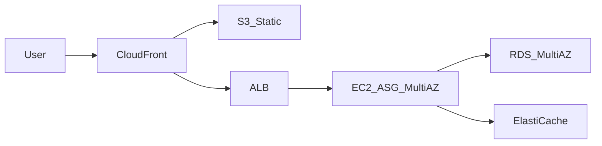
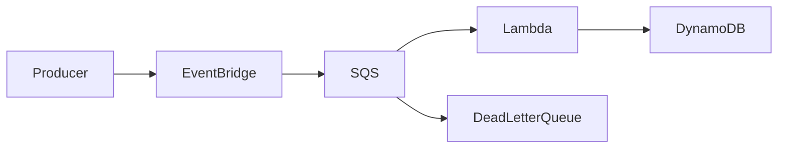
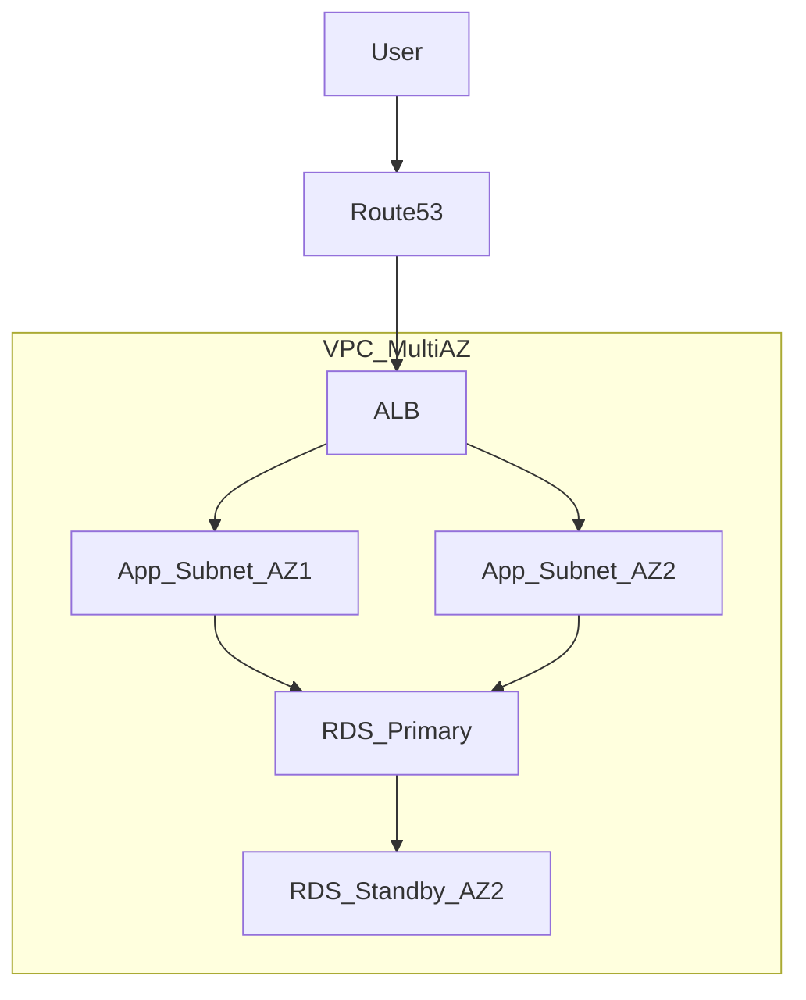

# AWS Solutions Architect Associate (SAA-C03) Cheat Sheet

A consolidated certification reference for the **AWS Certified Solutions Architect – Associate (SAA-C03)** exam. Covers the four official content domains, service selection under constraints, scenario-style Q&A with distractor analysis, engineering-level code and IaC examples, and an 8-week study plan aligned to the [official exam guide](https://docs.aws.amazon.com/aws-certification/latest/solutions-architect-associate-03/solutions-architect-associate-03.html).

> Exam note: SAA-C03 is the current Associate exam (live since August 2022, still active in 2026). It validates your ability to design solutions based on the **AWS Well-Architected Framework** — secure, resilient, high-performing, and cost-optimized.

> Currency note: content reviewed against AWS service changes through **mid-2026**, including the Amazon QuickSight → **Amazon Quick** rebrand, **QLDB** end of support, **Snowball Edge** restriction to existing customers, and newer services (Aurora DSQL, S3 Express One Zone, S3 Tables/Vectors, VPC Lattice). See [What Changed Recently](#what-changed-recently-20242026) for the delta and how much of it the exam actually asks about.

---

## Content

1. [How to Use This Guide](#how-to-use-this-guide)
   - [Reading the Abbreviations](#reading-the-abbreviations)
2. [Exam at a Glance](#exam-at-a-glance)
3. [What Changed Recently (2024–2026)](#what-changed-recently-20242026)
4. [Well-Architected Framework](#well-architected-framework)
5. [Core Mental Models](#core-mental-models)
6. [Domain 1: Design Secure Architectures (30%)](#domain-1-design-secure-architectures-30)
   - [Task 1.1: Secure Access to AWS Resources](#task-11-secure-access-to-aws-resources)
   - [Task 1.2: Secure Workloads and Applications](#task-12-secure-workloads-and-applications)
   - [Task 1.3: Data Security Controls](#task-13-data-security-controls)
7. [Domain 2: Design Resilient Architectures (26%)](#domain-2-design-resilient-architectures-26)
   - [Task 2.1: Scalable and Loosely Coupled Architectures](#task-21-scalable-and-loosely-coupled-architectures)
   - [Task 2.2: Highly Available and Fault-Tolerant Architectures](#task-22-highly-available-and-fault-tolerant-architectures)
8. [Domain 3: Design High-Performing Architectures (24%)](#domain-3-design-high-performing-architectures-24)
   - [Task 3.1: Storage Solutions](#task-31-storage-solutions)
   - [Task 3.2: Compute Solutions](#task-32-compute-solutions)
   - [Task 3.3: Database Solutions](#task-33-database-solutions)
   - [Task 3.4: Network Architectures](#task-34-network-architectures)
   - [Task 3.5: Data Ingestion and Transformation](#task-35-data-ingestion-and-transformation)
9. [Domain 4: Design Cost-Optimized Architectures (20%)](#domain-4-design-cost-optimized-architectures-20)
   - [Task 4.1: Cost-Optimized Storage](#task-41-cost-optimized-storage)
   - [Task 4.2: Cost-Optimized Compute](#task-42-cost-optimized-compute)
   - [Task 4.3: Cost-Optimized Database](#task-43-cost-optimized-database)
   - [Task 4.4: Cost-Optimized Network](#task-44-cost-optimized-network)
10. [Service Selection Decision Trees](#service-selection-decision-trees)
11. [Architecture Pattern Library](#architecture-pattern-library)
12. [Quotas and Limits That Matter](#quotas-and-limits-that-matter)
13. [For Software Engineers: SDK, IaC, and Code Patterns](#for-software-engineers-sdk-iac-and-code-patterns)
    - [Credentials and SDK Setup](#e1-credentials-and-sdk-setup)
    - [IAM Policies as Code](#e2-iam-policies-as-code)
    - [S3 from Application Code](#e3-s3-from-application-code)
    - [DynamoDB Access Patterns and Optimistic Concurrency](#e4-dynamodb-access-patterns-and-optimistic-concurrency)
    - [SQS Consumers, Idempotency, and Poison Messages](#e5-sqs-consumers-idempotency-and-poison-messages)
    - [Retries, Timeouts, and Backoff](#e6-retries-timeouts-and-backoff)
    - [Lambda Performance and Cold Starts](#e7-lambda-performance-and-cold-starts)
    - [Configuration and Secrets](#e8-configuration-and-secrets)
    - [Observability in Code](#e9-observability-in-code)
    - [Infrastructure as Code Options](#e10-infrastructure-as-code-options)
    - [CI/CD Without Long-Lived Keys](#e11-cicd-without-long-lived-keys)
    - [Local Development and Testing](#e12-local-development-and-testing)
    - [Cost-Aware Coding](#e13-cost-aware-coding)
14. [Foundational Q&A (15 Questions)](#foundational-qa-15-questions)
15. [Associate Scenario Q&A (25 Questions)](#associate-scenario-qa-25-questions)
16. [Architect Judgment Q&A (10 Questions)](#architect-judgment-qa-10-questions)
17. [Engineering Practice Q&A (10 Questions)](#engineering-practice-qa-10-questions)
18. [8-Week Study Plan](#8-week-study-plan)
19. [References and Practice Resources](#references-and-practice-resources)
20. [Pattern Recognition Cheat Sheet](#pattern-recognition-cheat-sheet)
21. [Rapid Answers](#rapid-answers)
22. [Self-Check Checklist](#self-check-checklist)
23. [Glossary and Abbreviations](#glossary-and-abbreviations)
    - [AWS Services and Features](#aws-services-and-features)
    - [AWS Concepts and Acronyms](#aws-concepts-and-acronyms)
    - [General Computing Terms](#general-computing-terms)
    - [Patterns Named in This Guide](#patterns-named-in-this-guide)

---

## How to Use This Guide

[↑ Content](#content)

- **Foundational:** Know shared responsibility, Regions/AZs, IAM primitives, and the six Well-Architected pillars. Exam distractors often exploit confusion between similar services (SQS vs SNS, security groups vs NACLs).
- **Associate scenarios:** Given business constraints (cost, RTO/RPO, latency, compliance), pick the *most appropriate* AWS service — not the most powerful one.
- **Architect judgment:** Trade-offs across multiple pillars; explain why the second-best answer is plausible but wrong.
- **Engineering:** The [SDK, IaC, and code-pattern section](#for-software-engineers-sdk-iac-and-code-patterns) and the [quotas table](#quotas-and-limits-that-matter) go beyond the exam. They exist because the fastest way to remember which service the exam wants is to have hit the limit that makes the alternative impossible.

Answer every scenario question in this order:

1. **Best design choice** — name the service(s) and topology.
2. **Mechanism** — why it satisfies the requirement.
3. **Why distractors fail** — what constraint each wrong answer violates.
4. **Deeper understanding** — limits, cost traps, or operational nuance a Principal engineer would mention.

The weakest SAA answer memorizes service lists. The strongest one reads the *constraint words* in the stem — "least operational overhead," "lowest cost," "minimal downtime," "strongly consistent" — and picks the design that satisfies all of them, not just one.

### Reading the Abbreviations

AWS documentation and exam questions are dense with acronyms, and this guide follows the same convention: each abbreviation is expanded the first time it appears in a section, then used in short form. Every abbreviation used anywhere in this file is also defined in the [Glossary and Abbreviations](#glossary-and-abbreviations) at the end, including general computing terms (not just AWS product names).

Four abbreviations are genuinely ambiguous and worth settling now, because AWS reuses them:

| Abbreviation | Meaning 1 | Meaning 2 | How to tell |
|--------------|-----------|-----------|-------------|
| **WAF** | **W**eb **A**pplication **F**irewall — the service that inspects HTTP requests | **W**ell-**A**rchitected **F**ramework — the design methodology | Firewall meaning appears with ALB/CloudFront; framework meaning appears with "pillars." This guide writes "AWS WAF" for the firewall and spells out "Well-Architected Framework" |
| **SG** | Security group (instance-level firewall) | — | Always the firewall |
| **AZ** | Availability Zone (one or more data centers) | — | Never "Amazon Zone" |
| **IA** | Infrequent Access (an S3 storage class tier) | — | Appears as a suffix: Standard-IA, One Zone-IA |

**Naming conventions in AWS itself:** services prefixed **"Amazon"** are generally standalone products (Amazon S3, Amazon EC2), while **"AWS"** prefixes tend to be features or tools that support other services (AWS Backup, AWS Config). The exam does not test this distinction, and AWS is not perfectly consistent about it, so do not read meaning into it — but it explains why the prefixes look arbitrary.

---

## Exam at a Glance

[↑ Content](#content)

| Fact | Value |
|------|-------|
| Exam code | SAA-C03 |
| Format | 65 questions (50 scored + 15 unscored), 130 minutes |
| Question types | Multiple choice (1 correct) and multiple response (2+ correct) |
| Passing score | 720 / 1000 (scaled) |
| Scoring model | Compensatory — pass overall; no per-domain pass required |
| Target candidate | ~1 year hands-on experience designing AWS solutions |
| Framework | AWS Well-Architected Framework |

**Domain weights:**

| Domain | Weight |
|--------|--------|
| Design Secure Architectures | 30% |
| Design Resilient Architectures | 26% |
| Design High-Performing Architectures | 24% |
| Design Cost-Optimized Architectures | 20% |

**Exam tactics:**

- Unanswered = incorrect; no penalty for guessing.
- "MOST cost-effective," "LEAST operational overhead," and "BEST" are precision words — the technically correct service may not be the best *under the stated constraint*.
- Multi-AZ ≠ multi-Region. Read whether the question asks for AZ-level or Region-level resilience.
- Managed > self-managed when the stem emphasizes operational overhead.

---

## What Changed Recently (2024–2026)

[↑ Content](#content)

SAA-C03 has stayed live unusually long because its blueprint is **pattern-heavy and service-list-light**: "decouple with a queue," "cache at the edge," "match the storage tier to the access pattern." New services slot into existing patterns rather than forcing a new exam version. That said, several changes matter either because older study material is now *wrong*, or because you will meet them at work even if the exam does not ask.

### Renames and deprecations (older guides get these wrong)

| Change | What it means |
|--------|---------------|
| **Amazon QuickSight → Amazon Quick** | Rebranded 9 October 2025; BI capability continues as **Quick Sight** inside Amazon Quick. Existing APIs, SDKs, dashboards unchanged. The official exam guide now writes "Amazon Quick"/"QuickSuite" — treat any of the names as the same BI answer |
| **Amazon QLDB deprecated** | End of support **31 July 2025**. Do not propose QLDB for new ledger workloads; use a verifiable design on Aurora/DynamoDB (hash-chained records) or a purpose-built ledger product |
| **Kinesis Data Firehose → Amazon Data Firehose** | Same service, renamed (2024). Exam guide uses the new name; "Kinesis Firehose" in older material is the same thing |
| **Snow Family shrunk** | Snowmobile retired (March 2024), Snowcone discontinued (Nov 2024), and **Snowball Edge is available to existing customers only** since 7 Nov 2025. New bulk-transfer answers: **DataSync** (online), **AWS Data Transfer Terminal** (physical drop-off), partner solutions, or **Outposts** for edge compute. Exam questions written before this still expect "Snowball" — know both the legacy answer and reality |
| **ElastiCache engines** | Now **Valkey**, Redis OSS, and Memcached, plus **ElastiCache Serverless**. Valkey is typically the cheapest option for new caches |
| **Shield DRT → SRT** | The Shield Advanced team is the Shield Response Team |

### Newer services worth knowing

| Service | What it is | Exam relevance |
|---------|------------|----------------|
| **Aurora DSQL** | Serverless distributed SQL (PostgreSQL wire-compatible), **active-active multi-Region with strong consistency**, GA May 2025 | Not on the blueprint, but it changes the honest answer to "multi-Region strongly consistent writes." Know it exists |
| **S3 Express One Zone** | Single-AZ storage class, single-digit ms, ~10× faster access than Standard, higher storage price / lower request price | Edge case; appears in latency-sensitive ML/analytics scenarios |
| **S3 Tables** | Managed Apache Iceberg tables in S3 | Data-lake scenarios; replaces hand-rolled Iceberg on S3 |
| **S3 Vectors** | Native vector storage and query in S3 | GenAI/RAG scenarios (mostly future SAA-C04 territory) |
| **S3 Metadata** | Queryable object metadata tables | Data discovery at scale |
| **VPC Lattice** | Application-layer service-to-service networking across VPCs/accounts with auth policies | Edge case now; expect growth |
| **Cost Optimization Hub** | Consolidated, deduplicated right-sizing and savings recommendations | Increasingly the answer where older material said "Trusted Advisor" |
| **Database Savings Plans** | Commitment-based discounts for database services including DynamoDB (Dec 2025) | Cost questions beyond EC2 Savings Plans |
| **Graviton4** | M8g / R8g / C8g instance families | "Better price/performance, ARM-compatible workload" answers |
| **Bedrock, Nova, Amazon Q** | Managed foundation models and AI assistants | Not on the SAA-C03 blueprint; expected to be first-class in SAA-C04 |

### Defaults that changed (and quietly fix old exam traps)

- **S3 Block Public Access is on by default** for new buckets, and **ACLs are disabled by default** (bucket owner enforced). "Someone made the bucket public by accident" now requires deliberately turning protections off.
- **S3 applies SSE-S3 encryption by default** to all new objects. The remaining design decision is *which key* (SSE-S3 vs SSE-KMS with a CMK), not *whether* to encrypt.
- **DynamoDB on-demand is now the default recommendation** for most workloads after the November 2024 price cut (on-demand throughput −50%, global-table replicated writes −67%). Provisioned + auto scaling is now the exception for very steady, high-volume traffic.
- **Aurora Serverless v2 can scale to zero**, which makes it a genuine dev/test and intermittent-workload answer.
- **DynamoDB warm throughput** exposes the instantaneous capacity a table can absorb, and lets you pre-warm before a launch or migration spike.

### Is SAA-C04 coming?

As of mid-2026 no SAA-C04 has opened for registration. When it lands, expect explicit generative-AI services, more private-connectivity (VPC Lattice, PrivateLink) scenarios, and sustainability treated as a first-class pillar. AWS normally overlaps versions for a few months, so studying SAA-C03 now is not wasted.

**How to use this section:** answer exam questions with the **blueprint-era** service (Snowball for offline bulk transfer, QuickSight for BI) while knowing the current reality for real work. If a question is ambiguous, the pattern — not the brand name — is what is being tested.

---

## Well-Architected Framework

[↑ Content](#content)

Every SAA scenario implicitly tests one or more pillars. When two answers both work, pick the one that best satisfies the pillar the question emphasizes.

| Pillar | Core question | Exam hotspots |
|--------|---------------|---------------|
| **Operational Excellence** | Can we run and evolve the system safely? | Infrastructure as Code (IaC) via CloudFormation, observability (CloudWatch, X-Ray), runbooks, deployments |
| **Security** | Can we protect data and systems? | IAM (Identity and Access Management) least privilege, encryption via KMS (Key Management Service), network isolation, AWS WAF/Shield |
| **Reliability** | Can the system recover from failure? | Multi-AZ (multiple Availability Zones), auto scaling, backups, DR (Disaster Recovery) strategies, decoupling |
| **Performance Efficiency** | Can we use resources efficiently for the workload? | Right-sizing, caching (ElastiCache, CloudFront), appropriate storage/compute |
| **Cost Optimization** | Are we avoiding unnecessary spend? | RIs (Reserved Instances), SPs (Savings Plans), Spot Instances, S3 lifecycle rules, NAT/endpoint costs, right-sizing |
| **Sustainability** | Are we minimizing resource waste? | Graviton (ARM processors), serverless, auto scaling down, efficient storage tiers |

**Trade-off lens:** Security and cost often conflict in distractors. If the stem says "must meet compliance" or mentions **PII** (Personally Identifiable Information — names, addresses, government IDs, anything that identifies a person), security wins. If it says "dev/test" or "lowest cost," cost optimization wins.

**Why "pillars" rather than a checklist:** the pillars exist because these goals genuinely conflict. Encrypting everything with customer-managed keys improves security and increases cost; running in three Availability Zones improves reliability and triples data-transfer chatter. A design is "well-architected" when the trade-offs are *deliberate and documented*, not when every pillar is maximized. That is exactly what a scenario question is testing when two answers both technically work.

---

## Core Mental Models

[↑ Content](#content)

### Shared Responsibility Model

AWS calls this "security **of** the cloud" (theirs) versus "security **in** the cloud" (yours).

| AWS responsibility | Customer responsibility |
|--------------------|-------------------------|
| Hardware, global infrastructure, managed service patching (for fully managed services) | Data, IAM policies, encryption keys, OS (operating system) patching on EC2, security groups, application code |
| Physical security of data centers | Client-side encryption, network configuration inside your VPC (Virtual Private Cloud) |

**Exam trap:** S3 bucket encryption is customer-configured; S3 infrastructure durability is AWS-managed.

**The line moves with the service model.** This is the part that trips people up, because "shared" is not a fixed 50/50 split — the more managed the service, the less you own:

| You run | You patch the OS? | You patch the runtime? | You own the data and access policy? |
|---------|-------------------|------------------------|-------------------------------------|
| EC2 (virtual machine) | Yes | Yes | Yes |
| RDS (managed database) | No | No (AWS patches the engine in your maintenance window) | Yes |
| Lambda (serverless function) | No | No | Yes |
| S3 (object storage) | No | No | Yes |

Notice the last column never changes. **Access control and data classification are always yours**, at every level of abstraction. That is why the majority of real-world AWS breaches are misconfigured permissions rather than unpatched infrastructure.

### Global Infrastructure

| Concept | Definition | Exam use |
|---------|------------|----------|
| **Region** | A geographic area (for example `eu-central-1`, Frankfurt) containing isolated AWS facilities | Data residency, DR across failures larger than one AZ |
| **Availability Zone (AZ)** | One or more discrete data centers within a Region, with independent power, cooling, and networking | Multi-AZ for HA (High Availability) within a Region |
| **Edge Location** | A CDN (Content Delivery Network) cache point used by CloudFront — hundreds worldwide, far more numerous than Regions | Low-latency static content delivery |
| **Local Zone** | An extension of a Region placed near a large population center | Single-digit millisecond (ms) latency to end users |
| **Wavelength Zone** | AWS infrastructure inside a telecom provider's 5G (fifth-generation mobile) network | Mobile and IoT (Internet of Things — connected devices such as sensors and cameras) at the carrier edge |

**How the hierarchy actually nests:** a Region contains multiple Availability Zones (typically three or more); an Availability Zone contains one or more data centers. Zones within a Region are close enough for synchronous replication (single-digit millisecond round trips) but far enough apart that a flood, fire, or power failure should not take out two of them. That single fact is the engineering basis for nearly every high-availability answer on the exam: **spread across AZs for component failure, spread across Regions for regional disaster or data-residency law.**

**Region identifiers you will see in question stems:** `us-east-1` (N. Virginia), `us-west-2` (Oregon), `eu-west-1` (Ireland), `eu-central-1` (Frankfurt), `ap-southeast-1` (Singapore). `us-east-1` matters disproportionately because some global services (IAM, CloudFront certificates, Route 53) are managed there.

### Blast Radius and Least Privilege

- **Account boundary** — isolates billing, IAM, and resource quotas. One compromised account should not expose the entire org (see [SAP-C02 guide](AWS_Solutions_Architect_Professional_SAP-C02_Cheat_Sheet.md) for multi-account).
- **Least privilege** — grant minimum permissions required; prefer roles over long-lived access keys; use IAM Identity Center for human access.

### Landing Zones (Intro)

For multiple accounts: AWS Organizations + Control Tower + SCPs provide guardrails. SAA tests the *concept*; SAP-C02 goes deep.

---

## Domain 1: Design Secure Architectures (30%)

### Task 1.1: Secure Access to AWS Resources

[↑ Content](#content)

**Why it exists:** Every AWS resource is an API (Application Programming Interface) call protected by **IAM** (Identity and Access Management). Even clicking a button in the console issues a signed API call. Misconfigured access is the number-one cloud breach vector.

#### IAM Core Primitives

| Primitive | Purpose |
|-----------|---------|
| **User** | Long-lived identity for a human, with a password and optionally access keys (avoid for applications) |
| **Group** | A collection of users, used to attach shared permissions once instead of per user |
| **Role** | An identity with no permanent credentials, assumed to receive temporary credentials from **STS** (Security Token Service); used by EC2, Lambda, and cross-account access |
| **Policy** | A JSON (JavaScript Object Notation) document listing `Effect`, `Action`, `Resource`, and optional `Condition` |

**Vocabulary that appears in every policy question:** a **principal** is whoever is making the request (a user, a role, or an AWS service). An **action** is a specific API operation such as `s3:GetObject`. A **resource** is the thing acted upon, named by its **ARN** (Amazon Resource Name) — a globally unique identifier shaped like `arn:aws:s3:::my-bucket/reports/file.pdf`. Reading ARNs fluently is worth the five minutes it takes: the segments are `arn:partition:service:region:account-id:resource`, and Regions or account IDs are left empty for globally scoped services such as S3 and IAM.

**Policy types:**

| Type | Attached to | Evaluated when |
|------|-------------|----------------|
| Identity-based | User, group, role | A principal makes a request |
| Resource-based | S3 bucket, SNS topic, KMS key | The resource is accessed (this is how cross-account access works without roles) |
| Permission boundary | A user or role, capping its maximum permissions | Caps effective permissions — a ceiling, not a grant |
| **SCP** (Service Control Policy) | An **OU** (Organizational Unit — a folder of accounts) or account in AWS Organizations | Limits what any principal in that account may do |

**How AWS decides (the evaluation logic every question relies on):**

1. **Default deny** — with no policy at all, nothing is permitted.
2. **Explicit allow** — some policy must grant the action.
3. **Explicit deny wins** — any `Deny` anywhere overrides every `Allow`, permanently.

So "absence of an allow" and "presence of a deny" both result in `AccessDenied`, but only the second cannot be fixed by adding permissions elsewhere. That is why SCPs and permission boundaries are described as guardrails: they work purely by denying, and no IAM administrator inside the account can grant around them.

#### Federation and Cross-Account Access

**Federation** means trusting an external identity system to authenticate people, so you do not create an IAM user per employee.

- **IAM Identity Center** (formerly AWS SSO — Single Sign-On) — one central sign-in to many accounts and roles. Integrates with a corporate **IdP** (Identity Provider, such as Microsoft Entra ID or Okta) using **SAML** (Security Assertion Markup Language) or **OIDC** (OpenID Connect) — the two standard protocols for passing a verified identity between systems.
- **STS `AssumeRole`** — the API that exchanges your current identity for temporary credentials in another account or with different permissions. No credentials are shared between accounts. For third parties, add an **external ID** (a shared secret the partner must present), which prevents the "confused deputy" problem where another of that partner's customers tricks them into accessing your account.
- **Role switching** — console users move into a role in a trusted account without signing in again.

**Why temporary credentials matter:** STS credentials expire (one hour by default, up to twelve). A leaked access key works until someone notices; a leaked STS token is usually worthless by the time it is found. This is the single strongest reason the exam always prefers roles over users for applications.

#### Multi-Account Security (Intro)

| Service | Role |
|---------|------|
| **AWS Organizations** | Groups many AWS accounts under one management account for consolidated billing, OUs, and SCPs |
| **SCP** (Service Control Policy) | A guardrail that caps maximum permissions for accounts (it can only deny, never grant) |
| **Control Tower** | Sets up an automated **landing zone** — a pre-built multi-account environment with logging, guardrails, and an account factory for vending new accounts |

**When not to use:** SCPs cannot grant permissions — they only filter what IAM policies inside the account are allowed to grant. Each account still needs its own IAM policies to actually permit anything.

---

### Task 1.2: Secure Workloads and Applications

[↑ Content](#content)

#### VPC Security Layers

| Layer | Stateful? | Scope | Default |
|-------|-----------|-------|---------|
| **Security group** (SG) | Yes | Attached to an **ENI** (Elastic Network Interface — the virtual network card of an instance) | Deny all inbound, allow all outbound |
| **NACL** (Network Access Control List) | No (stateless) | Applied to a whole subnet | Allow all traffic in both directions |

**What "stateful" means here, because the whole comparison depends on it:** a stateful firewall remembers that you allowed an outbound request, so the matching reply is automatically permitted. A stateless one evaluates every packet independently, so allowing a request out does *not* allow the response back in — you must write both rules, including the high-numbered **ephemeral ports** (roughly 1024–65535) that clients use for replies. This is why forgotten ephemeral-port rules are the classic NACL bug, and why security groups are the everyday tool while NACLs are reserved for coarse subnet-wide denials such as blocking a hostile IP range.

**Design pattern:** Public subnets hold only the **ALB** (Application Load Balancer) and **NAT** (Network Address Translation) gateway; application and database tiers sit in private subnets. Security groups can reference *other security groups* instead of IP ranges, so "the app tier may reach the database tier" stays correct as instances come and go — no **CIDR** (Classless Inter-Domain Routing, the `10.0.0.0/16` notation for IP ranges) maintenance required.

#### Edge and Application Protection

| Service | Protects against | Layer |
|---------|------------------|-------|
| **AWS WAF** (Web Application Firewall) | **SQLi** (SQL injection — smuggling database commands through input fields), **XSS** (cross-site scripting — injecting malicious JavaScript), and rate-based flooding rules | Layer 7, attached to ALB, CloudFront, or API Gateway |
| **AWS Shield Standard** | Common **DDoS** (Distributed Denial of Service — flooding a target from many machines at once) | Automatic and free on all accounts |
| **AWS Shield Advanced** | Sophisticated DDoS, plus billing protection for attack-driven scaling costs | Paid; includes 24/7 access to the **SRT** (Shield Response Team) |
| **AWS Network Firewall** | **IDS/IPS** (Intrusion Detection System / Intrusion Prevention System — detecting, and optionally blocking, malicious traffic patterns) and domain filtering | VPC-level, inspecting traffic between subnets and out to the internet |

**What "Layer 7" and "Layer 4" mean:** these refer to the OSI (Open Systems Interconnection) network model. **Layer 4** is the transport layer — TCP and UDP, where a device sees ports and IP addresses but not content. **Layer 7** is the application layer — HTTP, where a device can read URLs, headers, cookies, and request bodies. That difference decides the answers: AWS WAF can block a SQL-injection string only because it reads Layer 7 content, and a security group cannot, because it only sees Layer 4 ports. Likewise an ALB can route by URL path while an **NLB** (Network Load Balancer) cannot.

#### Hybrid Connectivity (Intro)

"Hybrid" means part of the workload stays in your own data center (**on-premises**, often shortened to *on-prem*).

| Option | Throughput | Use case |
|--------|------------|----------|
| **Site-to-Site VPN** (Virtual Private Network) | Up to roughly 1.25 Gbps (gigabits per second) per tunnel | Encrypted tunnel across the public internet — fast to set up, variable latency |
| **Direct Connect** (DX) | 1–100 Gbps on a dedicated physical circuit | Predictable latency and high bandwidth — takes weeks to provision |
| **PrivateLink** | Not a bandwidth tier — a connectivity model | Reaching AWS services or a **SaaS** (Software as a Service) vendor's API privately, with no internet traversal at all |

**The usual production answer is both:** Direct Connect as the primary path for predictable performance, with a Site-to-Site VPN as the encrypted backup, because a single physical circuit is a single point of failure and the VPN can be provisioned in minutes.

#### Identity for Applications

| Service | Use case |
|---------|----------|
| **Amazon Cognito** | Sign-up and sign-in for your *application's end users* (customers), with user pools and social/enterprise federation |
| **IAM roles for EC2/Lambda** | Your *application's own* access to AWS APIs — never embed access keys in code |

**Do not confuse the two.** IAM governs who may call AWS APIs (your engineers and your workloads). Cognito governs who may log into your product (your customers). A question about "500,000 mobile app users signing in with Google" is Cognito; a question about "the application needs to write to S3" is an IAM role.

---

### Task 1.3: Data Security Controls

[↑ Content](#content)

#### Encryption

Encryption is discussed in two states, and exam questions almost always mean one specific state:

| State | Meaning | Mechanism | Key management |
|-------|---------|-----------|----------------|
| **At rest** | Data sitting on a disk | S3 **SSE** (Server-Side Encryption), EBS volume encryption, RDS encryption | AWS-managed key, or a **CMK** (Customer Managed Key) held in **KMS** (Key Management Service) |
| **In transit** | Data crossing a network | **TLS** (Transport Layer Security — the protocol behind HTTPS, formerly called SSL) | Certificates from **ACM** (AWS Certificate Manager), or imported certificates |

**The three S3 server-side encryption modes**, since the suffixes are easy to mix up:

| Mode | Who holds the key | When to choose it |
|------|-------------------|-------------------|
| **SSE-S3** | AWS, entirely managed, invisible to you | The default; adequate whenever you have no key-control requirement |
| **SSE-KMS** | You, as a key in KMS | You need an audit trail of key usage, key-level permissions, or cross-account key sharing |
| **SSE-C** | You, passed with every request ("C" = customer-provided) | Rare; you must supply the key on every call and AWS stores nothing |

**KMS key types:**

| Type | Characteristics |
|------|-----------------|
| **AWS managed** | Free, automatically rotated, usable only by the one service that created it |
| **Customer managed (CMK)** | Full control — your own key policy, configurable rotation, and it appears in your KMS console. Carries a monthly charge plus per-request cost |
| **AWS owned** | Shared across many AWS customers, completely invisible to you |

**Envelope encryption, the mechanism behind all of this:** KMS never encrypts your actual data. It generates a **data key**, your service encrypts the data with that data key, and KMS encrypts the data key itself. The encrypted data key is stored alongside the data. This exists because KMS can only directly encrypt 4 KB, and because it would be prohibitively slow and expensive to send terabytes through an API. It also explains a practical cost trap: every object read triggers a KMS `Decrypt` call, which is why **S3 Bucket Keys** (which cache a bucket-level key) can cut KMS charges dramatically on high-volume buckets.

#### Secrets and Compliance

| Service | Purpose |
|---------|---------|
| **Secrets Manager** | Stores credentials and rotates them automatically for RDS, Redshift, and others |
| **Systems Manager Parameter Store** | Configuration and secrets storage; Standard tier is free, Advanced tier adds higher limits and policies (rotation requires your own Lambda) |
| **Amazon Macie** | Uses **ML** (machine learning) to discover sensitive data such as PII or credit-card numbers sitting in S3 |
| **Amazon GuardDuty** | Continuous threat detection by analyzing CloudTrail logs, VPC Flow Logs (records of network traffic), and **DNS** (Domain Name System — the service that resolves names to IP addresses) query logs |

**Secrets Manager vs Parameter Store, the decision that actually comes up:** Parameter Store is free and fine for configuration and static secrets. Secrets Manager costs money per secret per month but gives you built-in rotation, cross-Region replication, and native RDS integration. If a question emphasizes "automatic rotation with no custom code," it is Secrets Manager; if it emphasizes "lowest cost for configuration values," it is Parameter Store.

#### Backup and Data Governance

- **AWS Backup** — one place to define backup policies across EBS, RDS, DynamoDB, EFS, and more. **Vault Lock** and logically air-gapped vaults make backups immutable, which is the defense against ransomware that encrypts your backups along with your data.
- **S3 Object Lock** — **WORM** (Write Once, Read Many) retention, meaning an object cannot be altered or deleted for a defined period. *Governance* mode lets specially privileged users override it; *compliance* mode lets nobody override it, including the account root user. Regulators generally require compliance mode.
- **S3 Versioning + MFA Delete** — versioning keeps every prior copy of an object; **MFA** (Multi-Factor Authentication — a second proof of identity such as a hardware token or authenticator app) Delete requires that second factor before versions can be permanently removed. Together they defend against both accidents and a compromised credential.

#### S3 Secure-by-Default (Modern Behavior)

New buckets already have the protections that older exam questions treat as optional work:

| Default | Consequence |
|---------|-------------|
| **Block Public Access enabled** | Public exposure now requires deliberately disabling protection at both account and bucket level |
| **ACLs disabled** (bucket owner enforced) | Access is governed by bucket policies and IAM, not per-object **ACLs** (Access Control Lists — the legacy, per-object permission mechanism that predates bucket policies) |
| **SSE-S3 applied to all new objects** | The design question is *which key* (SSE-S3 vs SSE-KMS CMK), not whether to encrypt |

**When to choose SSE-KMS over SSE-S3:** you need an audit trail of key usage, key-level access control, cross-account key policies, or a compliance requirement for customer-managed keys. The cost is KMS API charges on every object operation — mitigate with **S3 Bucket Keys**, which reduce KMS requests substantially.

---

## Domain 2: Design Resilient Architectures (26%)

### Task 2.1: Scalable and Loosely Coupled Architectures

[↑ Content](#content)

**Why it exists:** Tightly coupled systems fail together and scale together. Decoupling lets components fail and scale independently.

#### Messaging and Events

| Service | Pattern | Key trait |
|---------|---------|-----------|
| **Amazon SQS** (Simple Queue Service) | Queue — typically one consumer processes each message | Buffers load, retries failures, and isolates poison messages in a **DLQ** (Dead Letter Queue) |
| **Amazon SNS** (Simple Notification Service) | Publish/subscribe ("pub/sub") fan-out | Pushes each message to every subscriber |
| **Amazon EventBridge** | Event bus with routing rules | Schema registry, scheduled events, and built-in SaaS integrations |
| **AWS Step Functions** | Workflow orchestration | Visual state machines with retries, branching, and error handling |

**Queue versus pub/sub, stated plainly:** in a **queue** each message is consumed once — it is work to be done, and adding consumers processes the backlog faster. In **pub/sub** each message is delivered to all subscribers — it is news to be broadcast, and adding subscribers means more copies delivered. "Fan-out" is the term for one message reaching many destinations.

**Common pattern:** SNS → SQS fan-out. The topic broadcasts to several queues, and each consuming team gets *its own* queue. This matters because a slow or broken consumer then backs up only its own queue instead of blocking everyone — a private buffer per subscriber.

#### Compute Scaling

| Service | Scaling model |
|---------|---------------|
| **EC2 Auto Scaling Group** (ASG) | Horizontal (adds and removes instances); driven by a **launch template** plus a policy — *target tracking* holds a metric at a value such as 60% CPU, *step scaling* applies fixed increments per alarm threshold |
| **Application Load Balancer** (ALB) | Distributes HTTP/HTTPS at Layer 7; runs health checks; routes by URL path or hostname |
| **Network Load Balancer** (NLB) | Layer 4 (TCP/UDP); provides a static IP address; handles extreme connection volumes |
| **Lambda** | Scales concurrency automatically per request; bounded by account concurrency limits |
| **Fargate** | Scales at the task (container) level, driven by the desired count of an **ECS** (Elastic Container Service) or **EKS** (Elastic Kubernetes Service) service |

**Horizontal versus vertical scaling:** *horizontal* (scaling out) adds more instances; *vertical* (scaling up) makes one instance bigger. AWS answers overwhelmingly favor horizontal, because a bigger instance still has one failure domain and a hard ceiling, while more instances give both elasticity and redundancy. Vertical scaling is the right answer mainly for databases that cannot shard.

#### Architecture Styles

| Style | When |
|-------|------|
| **Multi-tier** | The traditional split: web tier → application tier → **DB** (database) tier, each in its own subnet with its own security group |
| **Microservices** | Independently deployable services communicating over API boundaries |
| **Event-driven** | Components react to events through SQS, EventBridge, or Lambda rather than calling each other directly |
| **Serverless** | No servers to manage or patch; you pay per invocation rather than per hour of uptime |

**Stateless versus stateful, and why the exam cares:** a **stateless** component keeps no data that must survive its own restart, so any instance can serve any request and a terminated instance costs nothing but capacity. A **stateful** one holds something (a user session, an in-progress upload) that dies with the instance. Since Auto Scaling exists precisely to terminate and replace instances, statefulness fights elasticity. The three fixes, in order of preference: externalize the state (ElastiCache or DynamoDB), shard so each instance owns a defined slice, or fall back to **sticky sessions** (the load balancer pins a user to one instance) — which is last because the pinned user still loses their session when that instance goes away.

---

### Task 2.2: Highly Available and Fault-Tolerant Architectures

[↑ Content](#content)

#### DR Strategies (RTO / RPO)

Two measurements define every **DR** (Disaster Recovery) discussion, and mixing them up is the most common mistake in this domain:

- **RTO** — **Recovery Time Objective**: how long the system may be *down*. A measure of **time**.
- **RPO** — **Recovery Point Objective**: how much recent data you may *lose*. A measure of **data**, expressed as a time window (an RPO of one hour means losing up to the last hour of transactions is acceptable).

A worked example: nightly backups at 02:00 with a four-hour restore procedure gives an RPO of up to 24 hours (a failure at 01:00 loses almost a full day of writes) and an RTO of about four hours. Requirements are set by the business, not by engineering — and the cost of the architecture rises steeply as either number approaches zero.

| Strategy | RTO | RPO | Cost | Description |
|----------|-----|-----|------|-------------|
| **Backup and restore** | Hours | Hours | Lowest | Backups held in S3; infrastructure rebuilt after a failure |
| **Pilot light** | Tens of minutes | Minutes | Low | Only the core (usually a replicated database) runs in the DR Region; compute is switched on during failover |
| **Warm standby** | Minutes | Minutes | Medium | A complete but scaled-down copy runs continuously and is scaled up on failover |
| **Active-active (multi-Region)** | Near zero | Near zero | Highest | Both Regions serve live traffic, so failover is a routing change |

#### Route 53 Routing Policies

Route 53 is AWS's DNS service (the name is a reference to port 53, which DNS uses). A **routing policy** decides which answer it returns when a name is looked up.

| Policy | Use case |
|--------|----------|
| **Simple** | One resource, one answer |
| **Weighted** | Send a defined percentage to each target — used for **A/B testing** (comparing two versions on live traffic) and gradual migrations |
| **Latency** | Send each user to whichever Region responds fastest *for them* |
| **Failover** | Active-passive DR — return the standby only when the primary's health check fails |
| **Geolocation** | Route by the user's country or continent, typically for data-residency or licensing rules |
| **Geoproximity** | Route by geographic distance, with an adjustable bias to shift load between Regions |
| **Multivalue** | Return several healthy records at once so the client picks one — cheap redundancy, but not a load balancer (no capacity awareness, no connection draining) |

**Latency versus geolocation, a favorite distractor pair:** geolocation answers "where is this user, legally?" and latency answers "what is actually fastest for this user?" A German user routed by geolocation always reaches the Frankfurt Region even if it is degraded; the same user routed by latency may reach Ireland when that is quicker. Compliance requirements demand geolocation; performance requirements demand latency.

#### Eliminating Single Points of Failure

A **single point of failure** is any component whose loss takes down the system. The exercise is to name each one and give it a peer:

- **Multi-AZ** for RDS, ElastiCache, and NAT gateways — deploy one NAT gateway *per* Availability Zone in production, because a single NAT gateway leaves the other zones with no outbound internet when its zone fails
- **Auto Scaling across multiple AZs**, so losing a zone removes capacity rather than the whole service
- **S3 Cross-Region Replication** for data that must survive the loss of a Region
- **Health checks plus Route 53 failover**, so traffic actually moves when something dies — replication without automated redirection is only half a solution

#### RDS Proxy

Connection pooling between serverless compute (Lambda) and RDS. Each Lambda execution environment would otherwise open its own database connections, so a spike to 500 concurrent functions can exhaust a database that permits a few hundred connections. RDS Proxy holds a shared pool, hands out connections, and additionally speeds up failover by keeping client connections alive while the underlying database is replaced.

---

## Domain 3: Design High-Performing Architectures (24%)

### Task 3.1: Storage Solutions

[↑ Content](#content)

Three storage *types* underlie every service here, and naming them correctly is half of this task area:

| Type | How data is addressed | Analogy |
|------|-----------------------|---------|
| **Object** | A flat key-value store; you `GET`/`PUT` a whole object by key over HTTP | A valet parking desk — hand over a ticket, get the whole car back |
| **Block** | Raw fixed-size blocks that an operating system formats with a file system | A bare hard drive plugged into one machine |
| **File** | A shared hierarchy of directories accessed over a network protocol | A shared network drive several machines mount at once |

| Storage | Type | Access | Best for |
|---------|------|--------|----------|
| **S3** (Simple Storage Service) | Object | HTTP/API; effectively unlimited capacity | Static assets, backups, data lakes |
| **EBS** (Elastic Block Store) | Block | Attached to one EC2 instance (io2 Multi-Attach is the exception) | Boot volumes, databases running on EC2 |
| **EFS** (Elastic File System) | File, using **NFS** (Network File System — the standard Linux/Unix file-sharing protocol) | Many EC2 instances concurrently | Shared file storage, content management systems |
| **FSx** | Managed file | Four flavors: Windows File Server (**SMB** — Server Message Block, the Windows file-sharing protocol), Lustre, NetApp ONTAP, OpenZFS | **HPC** (High Performance Computing), Windows workloads, lift-and-shift of existing file servers |
| **Storage Gateway** | Hybrid | Presents on-premises file, volume, or tape interfaces backed by AWS storage | Hybrid access during cloud migration |
| **Instance Store** | Block | Ephemeral local **NVMe** (Non-Volatile Memory Express — the fast, directly attached SSD interface) | Temporary scratch data needing very high **IOPS** (Input/Output Operations Per Second — the count of reads/writes a disk sustains per second) |

**The critical property of Instance Store:** it is physically attached to the host, so it is the fastest option *and* the data is gone permanently when the instance stops or the host fails. Never put anything you cannot regenerate there. EBS, by contrast, is network-attached and survives instance termination.

**"POSIX semantics" in question stems** means the application expects real file-system behavior — file locking, permissions, partial in-place updates, directory traversal. **POSIX** (Portable Operating System Interface) is the Unix standard defining that behavior. S3 cannot provide it (objects are replaced whole, not edited in place), which is why "multiple instances need POSIX access to shared files" always points to EFS rather than S3.

#### S3 Storage Classes

| Class | Access pattern | Min storage duration |
|-------|----------------|----------------------|
In these names, **IA** stands for **Infrequent Access**, and **Glacier** is the family of archive tiers. "Minimum storage duration" is the period you are billed for even if you delete sooner — a real cost trap for short-lived data.

| Class | Access pattern | Min storage duration |
|-------|----------------|----------------------|
| **Standard** | Frequent | None |
| **Intelligent-Tiering** | Unknown or changing — S3 moves objects between tiers for you | None |
| **Express One Zone** | Very frequent, latency-critical, stored in a single AZ | 1 hour |
| **Standard-IA** | Infrequent, but needs multi-AZ durability | 30 days |
| **One Zone-IA** | Infrequent, and recreatable if the AZ is lost | 30 days |
| **Glacier Instant Retrieval** | Archive, retrieved in milliseconds | 90 days |
| **Glacier Flexible Retrieval** | Archive, retrieved in minutes to hours | 90 days |
| **Glacier Deep Archive** | Archive, retrieved in 12+ hours | 180 days |

**Choosing between them:** the deciding inputs are *access frequency*, *retrieval latency tolerance*, and *whether the data can be recreated*. Express One Zone inverts the usual trade: you pay more per GB but far less per request, so it wins for millions of small reads and loses for cold bulk storage. One Zone classes are only safe when losing an AZ means "regenerate," not "data loss."

**Two numbers behind the classes.** *Durability* is the probability an object survives — S3 Standard is designed for **11 nines** (99.999999999%), meaning statistically you would expect to lose one object out of ten million roughly every ten thousand years. *Availability* is the probability it is retrievable right now, which is a much lower 99.9%–99.99% depending on class. Archive tiers keep the same durability but trade away availability and retrieval speed, which is why they are cheaper. The One Zone classes are the only ones that reduce *durability scope*, because they hold data in one Availability Zone instead of three.

**Lifecycle policies** are how objects move between these classes automatically ("transition to Standard-IA after 30 days, Glacier after 90, delete after 7 years"). Transitions cost a small per-object fee, so moving millions of tiny objects to a cheaper tier can cost more than it saves — Intelligent-Tiering exists precisely so you do not have to make that calculation by hand.

**S3 feature layers built on top of buckets:**

| Feature | Purpose |
|---------|---------|
| **S3 Tables** | Managed Apache Iceberg tables (an open table format for large analytic datasets) — analytics without hand-managing metadata files |
| **S3 Metadata** | Queryable tables of object metadata, for finding objects at scale |
| **S3 Vectors** | Native storage and search of *vector embeddings* — numeric representations of text or images used for **RAG** (Retrieval-Augmented Generation, where an AI model retrieves your documents before answering) and semantic search |
| **Storage Lens** | Organization-wide storage usage and optimization metrics |
| **Object Lock** | WORM (Write Once, Read Many) retention — governance vs compliance mode |
| **Replication** — **CRR** (Cross-Region Replication) and **SRR** (Same-Region Replication) | Automatic copies to another Region or another bucket in the same Region; add **Replication Time Control** for a contractual **SLA** (Service Level Agreement) on replication lag |

**Why SRR exists when CRR sounds more useful:** same-Region replication is for separating *accounts or purposes*, not geography — for example replicating production logs into a locked-down audit account, or keeping a copy with different encryption. Cross-Region replication is for surviving the loss of a Region and for serving users closer to the data.

#### EBS Volume Types

The type codes decode as **gp** = general purpose (SSD), **io** = provisioned IOPS (SSD), **st** = throughput-optimized (**HDD**, spinning hard disk), **sc** = cold (HDD). **MiB/s** is mebibytes per second, a measure of *throughput* (bulk data moved); IOPS measures *operations* (how many separate reads/writes).

| Type | Use case | Performance shape |
|------|----------|-------------------|
| **gp3** | General purpose — the default choice | Baseline 3,000 IOPS / 125 MiB/s, independently scalable to 16,000 IOPS / 1,000 MiB/s |
| **io2 / io2 Block Express** | Mission-critical databases needing sustained high IOPS | Highest durability and IOPS; supports **Multi-Attach** (one volume attached to several instances) |
| **st1** | Throughput-optimized HDD — big data, log processing | Strong sequential throughput, poor random access |
| **sc1** | Cold HDD — infrequently accessed data | Cheapest block storage per GB |

**IOPS versus throughput, since the exam tests the distinction:** a database doing many small random reads is IOPS-bound, so it wants gp3 or io2. A log processor streaming large sequential files is throughput-bound, so st1 is both adequate and much cheaper. Choosing an expensive SSD for a sequential workload wastes money; choosing HDD for a random workload produces a support ticket.

**Engineering note:** gp3 decouples IOPS and throughput from capacity, which is why "migrate gp2 → gp3" is almost always both faster and cheaper. gp2 tied performance to volume size (3 IOPS per GB), so teams provisioned a 1 TB volume to store 100 GB purely to buy IOPS they could now request directly.

---

### Task 3.2: Compute Solutions

[↑ Content](#content)

#### EC2 Instance Families (Exam Shortcuts)

**How to read an instance name** such as `m7g.2xlarge`: `m` is the family (general purpose), `7` is the generation (higher is newer and usually better value), `g` is an attribute suffix (here Graviton/ARM), and `2xlarge` is the size. Sizes double as they climb — `large`, `xlarge`, `2xlarge`, `4xlarge` — and so do both the resources and the price.

| Family | Optimized for | Examples |
|--------|---------------|----------|
| **M** | General purpose — balanced **CPU** (Central Processing Unit) and memory | M7g / M8g (Graviton3 / Graviton4) |
| **C** | Compute — more CPU per unit of memory | Batch, gaming, HPC — C7g / C8g |
| **R** | Memory — more RAM per unit of CPU | In-memory databases, caching — R7g / R8g |
| **I** | Storage IOPS — large fast local disks | NoSQL databases, data warehousing |
| **G/P** | **GPU** (Graphics Processing Unit) | ML (machine learning) inference and training, graphics rendering |
| **T** | Burstable — a low CPU baseline plus credits for occasional spikes | Dev/test, low-traffic websites |

**The catch with T-family instances:** they earn CPU credits while idle and spend them while busy. Run above baseline for too long and you either throttle or (in unlimited mode) pay surcharges. They are excellent for spiky, mostly-idle workloads and a poor choice for steady load — a distinction the exam tests as "the application runs at consistent 80% CPU."

**Graviton in practice:** the `g` suffix means AWS Graviton, AWS's own **ARM64** processor architecture (as opposed to the x86-64 architecture used by Intel and AMD). Current generation is **Graviton4** (M8g, R8g, C8g). For managed runtimes (Lambda, Fargate, RDS, ElastiCache, OpenSearch) switching is a configuration change. For your own containers it means a multi-architecture build — for .NET, publish with `--arch arm64` and use an `arm64` base image; the usual blocker is a native dependency with no ARM build.

#### Placement Groups

A placement group tells AWS *how* to physically distribute your instances, trading proximity against isolation.

| Type | Behavior | Use case |
|------|----------|----------|
| **Cluster** | Packs instances onto nearby hardware in one AZ | Lowest network latency for tightly coupled HPC — but a single hardware failure can affect the whole group |
| **Spread** | Places each instance on distinct underlying hardware (max 7 per AZ per group) | Maximum isolation for a small number of critical instances |
| **Partition** | Groups instances into partitions that share no hardware | Large distributed systems that are already replica-aware, such as **HDFS** (Hadoop Distributed File System) or Apache Kafka |

#### Serverless and Containers

| Option | When |
|--------|------|
| **Lambda** | Event-driven work, under 15 minutes per execution, highly variable traffic |
| **Fargate** | Containers with no EC2 instances to manage, patch, or scale |
| **ECS** (Elastic Container Service) | AWS-native container orchestration — simpler, fewer moving parts |
| **EKS** (Elastic Kubernetes Service) | Managed Kubernetes, when you need Kubernetes APIs, tooling, or portability |
| **AWS Batch** | Queued batch computing at scale, which provisions and tears down compute per job |

**ECS versus EKS, framed as a decision rather than a feature list:** both run containers across a cluster. ECS is an AWS-proprietary orchestrator with far less to learn and operate. EKS runs upstream Kubernetes, which brings a large ecosystem and multi-cloud portability at the cost of real operational complexity (upgrades, add-ons, custom resources). If a question stresses "least operational overhead," ECS on Fargate is the answer; if it stresses "existing Kubernetes expertise" or "portability," it is EKS. Note that **Fargate is a compute engine, not an orchestrator** — it runs tasks *for* ECS or EKS, replacing the EC2 instances they would otherwise need.

---

### Task 3.3: Database Solutions

[↑ Content](#content)

**ACID** (Atomicity, Consistency, Isolation, Durability) is the guarantee set traditional relational databases provide: a transaction either fully completes or fully rolls back, never leaves the data in a contradictory state, is not corrupted by concurrent transactions, and survives a crash once committed. **NoSQL** means "not only SQL" — a family of databases that relax some of these guarantees (usually consistency across replicas) in exchange for horizontal scale.

| Need | Service |
|------|---------|
| Relational, complex joins, ACID | **RDS** (Relational Database Service) / **Aurora** |
| Serverless relational, intermittent (can scale to zero) | **Aurora Serverless v2** |
| Distributed SQL, multi-Region strongly consistent writes | **Aurora DSQL** |
| Key-value, document, unpredictable scale | **DynamoDB** |
| In-memory cache | **ElastiCache** (Valkey / Redis OSS / Memcached) |
| Data warehouse / analytics | **Redshift** |
| Document (MongoDB-compatible) | **DocumentDB** |
| Wide-column (Cassandra-compatible) | **Keyspaces** |
| Graph | **Neptune** |
| Time series | **Timestream** |
| Ledger / immutable | ~~QLDB~~ — **deprecated** (support ended July 2025); build verifiable history on Aurora/DynamoDB instead |

**Cache engine choice:** Valkey is the default for new caches (an open-source fork of Redis, cheaper on ElastiCache). Redis **OSS** (Open Source Software) for existing Redis workloads needing feature parity. Memcached only for simple, shardable, non-persistent caching with no replication.

#### DynamoDB Essentials

- **Partition key** (plus an optional **sort key**) determines which physical partition a row lands on. The two together form the **primary key**; the partition key decides distribution and the sort key orders items within a partition. A poorly chosen partition key creates a **hot partition** that no amount of capacity fixes.
- **Capacity units** are how DynamoDB meters work: an **RCU** (Read Capacity Unit) is one strongly consistent read of up to 4 KB per second, and a **WCU** (Write Capacity Unit) is one write of up to 1 KB per second. On-demand mode uses the equivalent **RRU/WRU** (Read/Write Request Units) billed per request instead of per second.
- **On-demand** is the default recommendation since the November 2024 price cut; **provisioned plus auto scaling** only for very steady high-volume traffic. On-demand tables can carry a **maximum throughput** cap to bound runaway cost.
- **Warm throughput** shows the instantaneous capacity a table can absorb; **pre-warm** before a launch or migration spike.
- **Secondary indexes** provide additional query patterns: a **GSI** (Global Secondary Index) uses a completely different partition key and has its own capacity, while an **LSI** (Local Secondary Index) keeps the same partition key with a different sort key and must be created with the table.
- **Global Tables** — multi-Region, multi-active replication (eventually consistent across Regions).
- **DAX** (DynamoDB Accelerator) — a managed in-memory cache in front of the table, giving microsecond reads through the same DynamoDB API, so application code barely changes.
- **Streams** — a time-ordered log of every change to the table (change data capture). The standard trigger for Lambda, for **CQRS** (Command Query Responsibility Segregation — maintaining separate write and read models) projections, and for outbox-style event publishing.
- **TTL** (Time To Live) — automatic, free expiry of rows past a timestamp you store; the cheapest way to keep a table small.

**Consistency choices on reads:** DynamoDB defaults to **eventually consistent** reads, which may briefly return a slightly stale value but cost half as much. A **strongly consistent** read always reflects the latest committed write, costs double, and is unavailable across Regions on Global Tables. When a question says "must read its own write immediately," it is asking for strong consistency.

#### RDS / Aurora

- **Multi-AZ** — a synchronous standby in another Availability Zone for **HA** (High Availability). The standby is *not readable*; it exists purely to take over. Multi-AZ *cluster* deployments are the variant that adds two readable standbys.
- **Read replicas** — asynchronous copies used to scale reads, and optionally placed in another Region for DR. Because replication is asynchronous, a replica can lag behind the primary.
- **Aurora** — AWS's own reimplementation of the MySQL and PostgreSQL engines, storing 6 copies of data across 3 AZs, with faster failover and up to 15 read replicas.

**The distinction the exam tests relentlessly:** Multi-AZ is for **availability** (automatic failover, no readable standby), read replicas are for **performance** (readable, but no automatic promotion). A question asking to "reduce load on the primary" wants replicas; a question asking to "survive an AZ failure with minimal downtime" wants Multi-AZ. Production systems normally use both.
- **Aurora Global Database** — cross-Region replication with typically sub-second lag; **one** Region accepts writes.
- **Aurora DSQL** — the exception to the above: active-active writes with multi-Region strong consistency, at the cost of a reduced PostgreSQL feature surface (no foreign keys, limited extensions), so it is not a drop-in for an existing schema.

---

### Task 3.4: Network Architectures

[↑ Content](#content)

#### VPC Design

```
Internet → IGW → Public Subnet (ALB, NAT GW) → Private Subnet (App) → Private Subnet (DB)
```

**What actually makes a subnet "public":** not a setting called public, but a **route table** entry sending `0.0.0.0/0` (all destinations) to an **IGW** (Internet Gateway — the VPC component that connects to the public internet). A private subnet has no such route, which is why nothing on the internet can initiate a connection to it. This is the single most useful VPC fact on the exam.

- **NAT Gateway** (Network Address Translation) — lets instances in private subnets make *outbound* connections (software updates, third-party APIs) while remaining unreachable from outside. Managed by AWS; deploy one per AZ for high availability.
- **VPC Endpoints** — private connectivity to AWS services without traversing the internet. **Gateway endpoints** (S3 and DynamoDB only) are free and work through a route table entry; **Interface endpoints** (everything else) place an ENI in your subnet and charge per hour plus per GB.
- **Transit Gateway** (TGW) — a hub connecting many VPCs and on-premises networks in a hub-and-spoke topology (introduced here; the [Professional guide](AWS_Solutions_Architect_Professional_SAP-C02_Cheat_Sheet.md) goes deep).
- **VPC Peering** — a direct one-to-one link between two VPCs. It is **non-transitive**, meaning if A peers with B and B peers with C, A still cannot reach C. Fine for two VPCs; unmanageable beyond a handful, since *n* VPCs need *n(n−1)/2* connections — which is precisely the problem Transit Gateway solves.
- **VPC Lattice** — application-layer (service-to-service) connectivity across VPCs and accounts with its own auth policies. Solves "my services need to call each other across accounts" without stitching together peering, NLBs, and route tables.

**Subnet sizing, briefly:** plan CIDRs before the first deployment. A `/16` VPC with `/20` subnets per AZ leaves room to grow; EKS and Lambda-in-VPC consume IPs faster than teams expect, and you cannot shrink a subnet later.

#### Edge and Global Performance

| Service | Purpose |
|---------|---------|
| **CloudFront** | The CDN — caches content at edge locations worldwide. The **origin** (the authoritative source it fetches from) is an S3 bucket, an ALB, or API Gateway |
| **Global Accelerator** | Provides two static **anycast** IP addresses (the same address announced from many locations, so traffic enters the AWS network at the nearest edge). Works for TCP and UDP, not just HTTP |
| **Route 53** | DNS, health checks, and routing policies |

**CloudFront vs Global Accelerator:** CloudFront *caches* content near users, so a cache hit never reaches your servers. Global Accelerator does not cache anything — it improves the *path*, pulling traffic onto AWS's private backbone at the nearest edge instead of traversing the public internet. So CloudFront suits cacheable HTTP content, while Global Accelerator suits non-HTTP protocols, real-time traffic such as gaming and **VoIP** (Voice over Internet Protocol), and any case where a static IP address is required for allowlisting.

**A note on private CloudFront origins:** an S3 bucket serving CloudFront should not be public. **OAC** (Origin Access Control) lets CloudFront — and only CloudFront — read the bucket, using a signed request that the bucket policy trusts. It replaces the older OAI (Origin Access Identity) and is the expected answer for "static content must not be reachable except through CloudFront."

---

### Task 3.5: Data Ingestion and Transformation

[↑ Content](#content)

| Service | Role |
|---------|------|
| **Amazon Kinesis Data Streams** | Real-time streaming ingest with your own consumer code; replayable for 24 hours up to 365 days |
| **Amazon Data Firehose** (formerly Kinesis Data Firehose) | Delivers streams into S3, Redshift, or OpenSearch — fully managed, no consumer code, no replay |
| **Amazon MSK** (Managed Streaming for Apache Kafka) | Managed Kafka — when you need Kafka semantics or have existing Kafka clients |
| **AWS Glue** | Serverless **ETL** (Extract, Transform, Load — pulling data from sources, reshaping it, and writing it somewhere queryable) plus a **Data Catalog** of table schemas |
| **Amazon Athena** | SQL directly over files in S3 (Parquet, **ORC** — Optimized Row Columnar, CSV); billed per **TB** (terabyte) scanned, not per hour |
| **AWS Lake Formation** | Permissions and governance over a **data lake** (raw and processed data held in S3 rather than in a database) |
| **Amazon EMR** (Elastic MapReduce) | Managed Hadoop and Apache Spark clusters for large-scale processing |
| **AWS DataSync** | Managed online data transfer between on-premises storage and AWS |
| **Amazon Quick** (formerly QuickSight) | **BI** (Business Intelligence — dashboards and visual reporting for non-engineers); the BI capability is called "Quick Sight" |

**Streaming versus batch, the split that drives these answers:** *streaming* processes records continuously as they arrive (seconds of latency, used for fraud detection, live dashboards, alerting). *Batch* processes accumulated data on a schedule (minutes to hours, used for nightly reports and warehouse loads). Kinesis and MSK are streaming; Glue and EMR are batch; Athena is interactive query over whatever has already landed.

**Exam pattern:** Real-time analytics with custom processing → Kinesis Data Streams. Just deliver the stream somewhere → Data Firehose. Batch ETL → Glue. Ad-hoc SQL on S3 → Athena. Kafka compatibility required → MSK.

**Data Streams versus Data Firehose, the pair most often confused:** Data Streams keeps records for a retention window, so multiple independent consumers can read the same data and you can replay after a bug. Firehose is a one-way pipe with buffering and no replay — simpler and cheaper, but once delivered the stream is gone. "Multiple teams must process the same events independently" means Data Streams; "just get this into S3 with no code" means Firehose.

**Engineering note on file format:** converting CSV or JSON to **Parquet** typically cuts Athena cost by an order of magnitude. Parquet is *columnar* (it stores each column together rather than each row), so a query touching 2 of 50 columns reads only those 2, and the format is compressed as well. Since Athena bills per byte scanned, this is a direct cost reduction. Partitioning by date (`s3://bucket/table/dt=2026-08-24/`) is the second-biggest lever, because a query filtered to one day then skips every other day's files entirely.

---

## Domain 4: Design Cost-Optimized Architectures (20%)

### Task 4.1: Cost-Optimized Storage

[↑ Content](#content)

- **S3 Lifecycle** — automatically transition objects to Infrequent Access or Glacier tiers, and expire old versions that versioning has been quietly accumulating.
- **Intelligent-Tiering** — lets S3 move objects between tiers based on observed access, for a small monitoring fee per object. Right when access patterns are unknown or varied; wrong for millions of tiny objects, where the monitoring fee can exceed the savings.
- **EBS** — choose gp3 over gp2; delete unattached volumes (a terminated instance often leaves its data volume behind, still billing); apply a snapshot lifecycle policy so snapshots do not accumulate forever.
- **Requester Pays** — shifts data-transfer and request costs to whoever downloads, used when publishing large datasets you do not want to subsidize.
- **Batch uploads** — S3 charges per request (`PUT`, `GET`), so writing one 100 MB file costs a fraction of writing 10,000 small ones. Aggregating small records before upload reduces both request cost and later query cost.

---

### Task 4.2: Cost-Optimized Compute

[↑ Content](#content)

| Purchasing option | When |
|-------------------|------|
| **On-Demand** | Unpredictable or short-term workloads; no commitment, highest per-hour price |
| **RI** — **Reserved Instance** (1 or 3 years) | A steady baseline, committed to a specific instance family and Region |
| **Compute Savings Plans** (SP) | A flexible commitment expressed in dollars per hour, usable across EC2, Fargate, and Lambda |
| **EC2 Instance Savings Plans** | Deeper discount than Compute SP, but locked to one instance family in one Region |
| **Spot Instances** | Interruption-tolerant work — up to 90% off, because AWS may reclaim the capacity with two minutes' notice |
| **Graviton (ARM)** | Better price/performance for any workload that runs on ARM |

**Choosing a commitment, in one rule:** commit to your *baseline* and pay On-Demand or Spot for the *peaks*. Reserved Instances give the deepest discount but the least flexibility (change instance family and the discount stops applying). Savings Plans trade a few percentage points of discount for the freedom to change instance types and even services — which is usually worth it, since a three-year technology guess is rarely correct. Note that both RIs and Savings Plans are *billing* constructs, not capacity reservations: buying one does not reserve a machine, it discounts whatever you run.

- **Right-sizing** — compare CloudWatch metrics against instance size, and let **Compute Optimizer** recommend changes; **Cost Optimization Hub** consolidates those recommendations across accounts.
- **Auto Scaling** — scale in during low demand, and use scheduled scaling for predictable quiet hours such as nights and weekends.
- **Lambda/Fargate** — pay only for actual usage, with no idle EC2 instances billing overnight.

**Spot in practice:** handle the two-minute interruption notice (delivered through instance metadata, or as an EventBridge event) by draining in-flight work and checkpointing progress. Spot suits stateless workers, batch jobs, and **CI** (Continuous Integration — automated build and test) runners; it is unsafe for a stateful singleton with no restart path.

---

### Task 4.3: Cost-Optimized Database

[↑ Content](#content)

- **Aurora Serverless v2** — can scale to zero, which makes it genuinely cheap for dev/test and intermittent workloads.
- **DynamoDB on-demand** — the default since the Nov 2024 price cut; add a maximum-throughput cap to bound runaway cost.
- **RDS Reserved Instances** / **Database Savings Plans** — production baseline commitments.
- **ElastiCache** — reduce RDS read load; a cache hit is far cheaper than a database read.
- **Stop/start RDS** — dev/test outside business hours (note: a stopped instance restarts automatically after 7 days).
- **DynamoDB TTL and table classes** — expire rows you no longer query; Standard-IA table class for rarely read data.

---

### Task 4.4: Cost-Optimized Network

[↑ Content](#content)

**The general rule of AWS data transfer:** inbound from the internet is free, traffic within one Availability Zone using private addresses is free, crossing Availability Zones costs a small amount per GB in *both* directions, crossing Regions costs more, and going out to the internet costs the most. Nearly every network cost surprise is one of these boundaries being crossed more often than anyone realized.

| Cost trap | Mitigation |
|-----------|------------|
| NAT Gateway data processing charges | Use VPC endpoints for S3/DynamoDB so that traffic never reaches the NAT gateway |
| Cross-AZ data transfer | Co-locate tiers that talk constantly; reduce chatty cross-AZ calls |
| Cross-Region transfer | Replicate only what DR actually requires, not entire buckets by default |
| CloudFront origin fetches | Cache aggressively with correct headers; add **Origin Shield** (an extra caching layer that shields the origin from repeated fetches by multiple edge locations) |
| One NAT gateway for production HA | One NAT per AZ for reliability; a single shared NAT is a legitimate dev/test saving |

**Cost management tools:** Cost Explorer (trends and forecasts), AWS Budgets (threshold alerts and actions), **CUR** (Cost and Usage Report — the raw line-item billing data, queryable with Athena or a BI tool), **Cost Optimization Hub** (consolidated recommendations), Compute Optimizer (right-sizing), S3 Storage Lens (storage analytics), and **cost allocation tags** (labels such as `Team=payments` that make spend attributable — they must be explicitly activated in the billing console before they appear in reports).

---

## Service Selection Decision Trees

[↑ Content](#content)

| Signal in question | Default direction |
|--------------------|-------------------|
| Static website / global read-heavy | S3 + CloudFront |
| Shared POSIX file system across EC2 | EFS |
| Block storage for single EC2 | EBS |
| Unpredictable key-value at scale | DynamoDB |
| Relational + complex joins | RDS/Aurora |
| Decouple producers/consumers | SQS (+ DLQ) |
| Fan-out notifications | SNS |
| Event routing with rules | EventBridge |
| Burst then idle compute | Lambda or Fargate |
| Steady 3-year baseline | Reserved Instances / Savings Plans |
| Spiky batch / fault-tolerant | Spot Instances |
| RTO minutes, RPO seconds (DB) | Multi-AZ + automated backup |
| Cross-region DR | Route 53 failover + replicated data |
| Hybrid on-prem file access | Storage Gateway or DataSync |
| Real-time stream processing | Kinesis Data Streams |
| Load stream to S3/Redshift | Amazon Data Firehose |
| Kafka semantics required | Amazon MSK |
| SQL on data lake | Athena (Parquet + partitions) |
| Secrets with auto-rotation | Secrets Manager |
| DDoS at edge | Shield + WAF on CloudFront/ALB |
| Bulk offline data transfer (new project) | DataSync, or Data Transfer Terminal for physical |
| Multi-Region strongly consistent writes | Aurora DSQL |
| Service-to-service across accounts | VPC Lattice or PrivateLink |

---

## Architecture Pattern Library

[↑ Content](#content)

### Static Site + Dynamic API



### Event-Driven Processing



### Multi-AZ Web Application



---

## Quotas and Limits That Matter

[↑ Content](#content)

Exam questions hide behind limits ("the payload is 5 MB," "processing takes 20 minutes"), and production incidents are usually a limit you did not know about. These are the ones worth memorizing. Treat all soft limits as increasable through Service Quotas; hard limits change the design.

A note on the units: **KB/MB/GB/TB** are kilo-, mega-, giga-, and terabytes; **RPS** is requests per second and **TPS** transactions per second; a **soft limit** can be raised by request through the Service Quotas console, while a **hard limit** cannot.

| Service | Limit | Why it matters |
|---------|-------|----------------|
| **Lambda** | 15 min max timeout | Longer work needs Step Functions, Fargate, or Batch |
| **Lambda** | 10,240 MB memory (CPU scales with it) | Memory is the CPU dial; more memory can be *cheaper* if it finishes faster |
| **Lambda** | 6 MB synchronous response payload | Bigger responses need response streaming or an S3 presigned URL |
| **Lambda** | 1,000 concurrent executions per Region (default, soft) | A traffic spike throttles other functions in the same account |
| **Lambda** | 512 MB–10,240 MB `/tmp` | Ephemeral scratch space only |
| **API Gateway** | 29 s integration timeout (REST default) | Anything slower must be asynchronous — return 202 and a status endpoint |
| **SQS** | 256 KB message size | Use the claim-check pattern: store the payload in S3, pass the key |
| **SQS** | 14 days max retention, 12 h max visibility timeout | Bounds how long a retry story can run |
| **SQS FIFO** | 300 messages/s (3,000 with batches of 10) per message group | Ordering costs throughput; choose group IDs carefully |
| **SNS** | 256 KB message size | Same claim-check rule |
| **DynamoDB** | 400 KB item size | Large blobs go to S3, with the pointer in the item |
| **DynamoDB** | ~3,000 RCU / 1,000 WCU per partition | The physics behind hot-partition throttling |
| **DynamoDB** | 1 MB per Query/Scan page | Always loop on `LastEvaluatedKey`; never assume one call returns everything |
| **S3** | 5 TB max object, 5 GB max single PUT | Above 5 GB requires multipart upload |
| **S3** | 10,000 parts per multipart upload | Drives part-size arithmetic for very large objects |
| **S3** | ~3,500 write / 5,500 read requests per second per prefix | Spread keys across prefixes for high-throughput workloads |
| **Kinesis** | 1 MB/s or 1,000 records/s write per shard; 2 MB/s shared read | Shard count is a capacity decision; enhanced fan-out gives each consumer its own 2 MB/s |
| **KMS** | 4 KB max direct encrypt | Use envelope encryption (data key encrypts data, KMS encrypts the data key) |
| **STS** | 1 h default role session, 12 h max | Long jobs must refresh credentials, which the SDKs do for you |
| **Step Functions** | Standard 1 year max execution; Express 5 min | Long-running orchestration vs high-volume short workflows |
| **EBS gp3** | 3,000 IOPS / 125 MiB/s baseline, up to 16,000 / 1,000 | Provision explicitly; do not size capacity to buy IOPS |

**How to use this in an exam:** when a stem mentions a number, check it against this table first. "Processing takes up to 30 minutes" eliminates every Lambda answer. "Messages are 2 MB" eliminates plain SQS. "Response must include a 50 MB report" points to presigned URLs.

---

## For Software Engineers: SDK, IaC, and Code Patterns

[↑ Content](#content)

The exam tests design choices; your job requires the code that implements them. This section covers what a solutions architect who still writes software needs at their fingertips.

Examples use the **AWS SDK for .NET** (**SDK** = Software Development Kit, the client libraries for calling AWS APIs from your language — chosen here to match the rest of this hub), the **AWS CLI** (Command Line Interface, the `aws` terminal command), and **IaC** (Infrastructure as Code — defining infrastructure in version-controlled files instead of clicking through the console) using CloudFormation, **CDK** (Cloud Development Kit), and Terraform. The concepts translate directly to any language's SDK.

### E1. Credentials and SDK Setup

[↑ Content](#content)

**The rule: never put access keys in code or config.** Every AWS SDK resolves credentials through a provider chain, and your job is to make sure the right link in that chain is populated.

| Environment | Credential source |
|-------------|-------------------|
| Local development | An SSO (Single Sign-On) profile via `aws sso login`, or a named profile in `~/.aws/credentials` |
| EC2 | An **instance profile** (a role attached to the instance), retrieved through **IMDSv2** (Instance Metadata Service version 2 — the session-authenticated metadata endpoint that replaced the older, forgeable version 1) |
| ECS / Fargate | A **task role** attached to the container task |
| Lambda | The function's **execution role** |
| EKS | **IRSA** (IAM Roles for Service Accounts — mapping a Kubernetes service account to an IAM role), or EKS Pod Identity |
| **CI/CD** (Continuous Integration / Continuous Delivery — automated build, test, and deploy pipelines) | **OIDC** (OpenID Connect) federation to an IAM role — no stored secrets |

**What a "provider chain" means:** the SDK tries credential sources in a fixed order — explicit code, environment variables, the shared credentials file, then the container or instance metadata endpoint — and uses the first that succeeds. This is why the same code runs unchanged on a laptop and in Lambda: only the populated link in the chain differs. It is also why a stale environment variable can silently override the profile you thought you were using, which the `sts get-caller-identity` check below catches immediately.

Register clients once through **DI** (dependency injection — the pattern where a container constructs and supplies your dependencies rather than each class creating its own) so credentials, retries, and Region all come from configuration:

```csharp
// Program.cs — AWSSDK.Extensions.NETCore.Setup
builder.Services.AddDefaultAWSOptions(builder.Configuration.GetAWSOptions());
builder.Services.AddAWSService<IAmazonS3>();
builder.Services.AddAWSService<IAmazonDynamoDB>();
builder.Services.AddAWSService<IAmazonSQS>();
```

```json
// appsettings.json — no credentials, only non-secret configuration
{
  "AWS": {
    "Region": "eu-central-1",
    "Profile": "dev-sso"
  }
}
```

Confirm which identity you are actually using before debugging a permission error — it is the wrong identity more often than the wrong policy:

```bash
aws sts get-caller-identity
```

**Deeper understanding:** SDK clients are thread-safe and expensive to construct because each one builds an HTTP handler and credential resolver. Create them once per process (singleton), never per request. Constructing an `AmazonS3Client` inside a request handler is the AWS equivalent of `new HttpClient()` per call, with the same socket-exhaustion outcome.

---

### E2. IAM Policies as Code

[↑ Content](#content)

Read policies as five questions: **who** (principal), **can do what** (action), **to which resource**, **under what conditions**, and **is anything explicitly denying it**. Explicit deny always wins; absence of allow is also deny.

Least-privilege policy for a service that reads only its own tenant's objects over TLS, from inside your organization:

```json
{
  "Version": "2012-10-17",
  "Statement": [
    {
      "Sid": "TenantScopedRead",
      "Effect": "Allow",
      "Action": ["s3:GetObject"],
      "Resource": "arn:aws:s3:::reports-prod/tenants/${aws:PrincipalTag/TenantId}/*",
      "Condition": {
        "Bool": { "aws:SecureTransport": "true" },
        "StringEquals": { "aws:PrincipalOrgID": "o-exampleorgid" }
      }
    },
    {
      "Sid": "DenyUnencryptedWrites",
      "Effect": "Deny",
      "Action": "s3:PutObject",
      "Resource": "arn:aws:s3:::reports-prod/*",
      "Condition": {
        "StringNotEquals": { "s3:x-amz-server-side-encryption": "aws:kms" }
      }
    }
  ]
}
```

Two mechanisms in that policy are worth internalizing:

- **Policy variables** (`${aws:PrincipalTag/TenantId}`) implement multi-tenant isolation with a single policy instead of one policy per tenant. This is the IAM equivalent of a query filter, and the same reasoning as the multitenancy discussion in [EF_Core_Interview_Cheat_Sheet.md](../dotnet/EF_Core_Interview_Cheat_Sheet.md).
- **Condition keys** (`aws:PrincipalOrgID`, `aws:SourceVpce`, `aws:SecureTransport`) are how you build a data perimeter without enumerating account IDs.

Verify before you ship, rather than discovering the gap in an audit:

```bash
# Would this call be allowed? Simulate instead of guessing.
aws iam simulate-principal-policy \
  --policy-source-arn arn:aws:iam::111122223333:role/report-service \
  --action-names s3:GetObject \
  --resource-arns "arn:aws:s3:::reports-prod/tenants/acme/summary.pdf"

# Find roles with unused permissions and public/cross-account exposure
aws accessanalyzer list-findings --analyzer-arn <arn>
```

---

### E3. S3 from Application Code

[↑ Content](#content)

**Presigned URLs** are the single most useful S3 pattern for application developers: the browser uploads or downloads directly, so your service never streams bytes and never needs a bigger instance.

```csharp
public async Task<string> CreateDownloadLinkAsync(string tenantId, string reportId)
{
    var request = new GetPreSignedUrlRequest
    {
        BucketName = "reports-prod",
        Key = $"tenants/{tenantId}/{reportId}.pdf",
        Verb = HttpVerb.GET,
        Expires = DateTime.UtcNow.AddMinutes(5)   // short-lived by default
    };

    return await _s3.GetPreSignedURLAsync(request);
}
```

Large uploads should use the transfer utility, which handles multipart, parallelism, and retries:

```csharp
var transfer = new TransferUtility(_s3);
await transfer.UploadAsync(new TransferUtilityUploadRequest
{
    BucketName = "ingest-prod",
    Key = objectKey,
    InputStream = stream,
    PartSize = 16 * 1024 * 1024,
    ServerSideEncryptionMethod = ServerSideEncryptionMethod.AWSKMS
});
```

Useful CLI equivalents for deployment and operations:

```bash
# Publish a static site with cache headers that let CloudFront actually cache
aws s3 sync ./dist s3://my-site --delete \
  --cache-control "public,max-age=31536000,immutable" \
  --exclude "index.html"
aws s3 cp ./dist/index.html s3://my-site/index.html \
  --cache-control "no-cache"

# Invalidate only what changed — invalidations beyond the free tier cost money
aws cloudfront create-invalidation --distribution-id E123EXAMPLE --paths "/index.html"
```

**Deeper understanding:** the `index.html` split above is the standard immutable-asset strategy. Fingerprinted bundles (`app.9f2a.js`) get a one-year cache; the HTML that references them must not be cached, or users keep loading the old bundle. Getting this wrong produces "the deploy didn't work" bug reports that are really cache-header bugs.

**Failure modes to expect:** an incomplete multipart upload keeps billing you for stored parts until aborted — add a lifecycle rule for `AbortIncompleteMultipartUpload`. Deleting an object in a versioned bucket only adds a delete marker, so storage cost does not drop until noncurrent versions expire.

---

### E4. DynamoDB Access Patterns and Optimistic Concurrency

[↑ Content](#content)

DynamoDB modeling inverts relational habits: you design from the **access patterns**, not from the entities. A single table with generic `PK`/`SK` attributes serves many patterns because the sort key encodes hierarchy.

| Access pattern | PK | SK |
|----------------|----|----|
| Get order by id | `ORDER#123` | `METADATA` |
| List items in an order | `ORDER#123` | `ITEM#<sku>` |
| List a customer's orders (newest first) | `CUSTOMER#42` | `ORDER#2026-08-24#123` |

Writes need concurrency control, and DynamoDB gives you it through **condition expressions** — the same optimistic-concurrency idea as a SQL version column ([SQL_PostgreSQL_Interview_Cheat_Sheet.md](../databases/SQL_PostgreSQL_Interview_Cheat_Sheet.md)), enforced by the database rather than by convention:

```csharp
var request = new PutItemRequest
{
    TableName = "Orders",
    Item = new Dictionary<string, AttributeValue>
    {
        ["PK"]      = new AttributeValue($"ORDER#{order.Id}"),
        ["SK"]      = new AttributeValue("METADATA"),
        ["Status"]  = new AttributeValue(order.Status),
        ["Version"] = new AttributeValue { N = (order.Version + 1).ToString() }
    },
    // Create only if absent, or update only if nobody else moved the version
    ConditionExpression = "attribute_not_exists(PK) OR #v = :expectedVersion",
    ExpressionAttributeNames = new() { ["#v"] = "Version" },
    ExpressionAttributeValues = new()
    {
        [":expectedVersion"] = new AttributeValue { N = order.Version.ToString() }
    }
};

try
{
    await _dynamo.PutItemAsync(request);
}
catch (ConditionalCheckFailedException)
{
    // Another writer won. Reload and retry, or surface a conflict to the caller.
    throw new ConcurrencyException(order.Id);
}
```

Never assume a query returned everything — 1 MB is a hard page limit:

```csharp
var results = new List<Dictionary<string, AttributeValue>>();
Dictionary<string, AttributeValue>? lastKey = null;

do
{
    var response = await _dynamo.QueryAsync(new QueryRequest
    {
        TableName = "Orders",
        KeyConditionExpression = "PK = :pk AND begins_with(SK, :prefix)",
        ExpressionAttributeValues = new()
        {
            [":pk"]     = new AttributeValue("CUSTOMER#42"),
            [":prefix"] = new AttributeValue("ORDER#")
        },
        ExclusiveStartKey = lastKey,
        Limit = 100
    });

    results.AddRange(response.Items);
    lastKey = response.LastEvaluatedKey?.Count > 0 ? response.LastEvaluatedKey : null;
}
while (lastKey is not null);
```

**Deeper understanding:** `Scan` reads the whole table and bills you for it — treat any `Scan` in a request path as a design defect, and use a GSI to turn it into a `Query`. Choose partition keys with high cardinality: `TenantId` looks natural until one tenant is 80% of traffic and you have a hot partition that no amount of provisioned capacity fixes.

---

### E5. SQS Consumers, Idempotency, and Poison Messages

[↑ Content](#content)

Standard SQS is **at-least-once** delivery, which means your consumer *will* see duplicates. Correctness comes from idempotent processing, not from hoping duplicates do not happen.

```csharp
// Lambda SQS handler with per-message failure reporting
public async Task<SQSBatchResponse> Handler(SQSEvent evt, ILambdaContext context)
{
    var failures = new List<SQSBatchResponse.BatchItemFailure>();

    foreach (var record in evt.Records)
    {
        try
        {
            await ProcessOnceAsync(record);
        }
        catch (Exception ex)
        {
            context.Logger.LogError($"messageId={record.MessageId} error={ex.Message}");
            // Only this message returns to the queue; the rest stay processed
            failures.Add(new SQSBatchResponse.BatchItemFailure
            {
                ItemIdentifier = record.MessageId
            });
        }
    }

    return new SQSBatchResponse(failures);
}
```

Idempotency enforced by a conditional write, so a duplicate is rejected by the database rather than double-charging a customer:

```csharp
private async Task ProcessOnceAsync(SQSEvent.SQSMessage record)
{
    var idempotencyKey = record.MessageAttributes["IdempotencyKey"].StringValue;

    try
    {
        await _dynamo.PutItemAsync(new PutItemRequest
        {
            TableName = "ProcessedMessages",
            Item = new Dictionary<string, AttributeValue>
            {
                ["Id"]        = new AttributeValue(idempotencyKey),
                ["ExpiresAt"] = new AttributeValue { N = DateTimeOffset.UtcNow
                                    .AddDays(7).ToUnixTimeSeconds().ToString() }
            },
            ConditionExpression = "attribute_not_exists(Id)"
        });
    }
    catch (ConditionalCheckFailedException)
    {
        return;   // Already handled — a duplicate delivery, not an error
    }

    await _payments.CaptureAsync(record.Body);
}
```

**Three settings that decide whether this works:**

| Setting | Rule |
|---------|------|
| **Visibility timeout** | Must exceed the consumer's worst-case processing time (a common rule of thumb is 6× the Lambda timeout) or the message is redelivered while still being processed |
| **`ReportBatchItemFailures`** | Must be enabled on the event source mapping, or one bad message retries the entire batch |
| **Redrive policy / `maxReceiveCount`** | Sends repeat offenders to a DLQ instead of retrying forever |

**Deeper understanding:** FIFO queues give ordering and deduplication but cost throughput (300 messages/s per message group). Most systems that "need ordering" actually need ordering *per entity* — use the entity id as the message group id, and you keep parallelism across entities. The TTL attribute on the idempotency table matters too: without it the table grows forever and you pay to store keys nobody will ever check again.

---

### E6. Retries, Timeouts, and Backoff

[↑ Content](#content)

Every AWS call can fail transiently. The SDKs retry for you, but only if you let them and only if your timeouts are sane.

```csharp
var config = new AmazonS3Config
{
    RegionEndpoint = RegionEndpoint.EUCentral1,
    RetryMode      = RequestRetryMode.Adaptive,  // Standard | Adaptive | Legacy
    MaxErrorRetry  = 5,
    Timeout        = TimeSpan.FromSeconds(10)    // per-request wall clock
};
```

For your own retry loops, exponential backoff **with jitter** is mandatory. Without jitter, every client that failed at the same instant retries at the same instant, and the retry storm keeps the dependency down:

```csharp
static async Task<T> WithBackoffAsync<T>(Func<Task<T>> action, int maxAttempts = 5)
{
    var random = Random.Shared;

    for (var attempt = 1; ; attempt++)
    {
        try
        {
            return await action();
        }
        catch (AmazonServiceException ex) when (IsTransient(ex) && attempt < maxAttempts)
        {
            // Full jitter: sleep a random duration in [0, 2^attempt * base)
            var ceiling = Math.Pow(2, attempt) * 100;
            await Task.Delay(TimeSpan.FromMilliseconds(random.NextDouble() * ceiling));
        }
    }

    static bool IsTransient(AmazonServiceException ex) =>
        ex.StatusCode is HttpStatusCode.ServiceUnavailable
                      or HttpStatusCode.InternalServerError
                      or (HttpStatusCode)429
        || ex.ErrorCode is "ThrottlingException" or "ProvisionedThroughputExceededException";
}
```

**Deeper understanding:** retries only help for *transient* faults. Retrying a `ConditionalCheckFailedException` or an `AccessDenied` just wastes time and multiplies load — classify errors before retrying. And retries must be bounded by the caller's deadline: an API Gateway integration dies at 29 seconds, so a retry budget of 5 attempts with 10-second timeouts is a guaranteed gateway timeout. Concurrency and cancellation mechanics for this kind of code are covered in [Multi_Threading_Interview_Cheat_Sheet.md](../dotnet/Multi_Threading_Interview_Cheat_Sheet.md).

---

### E7. Lambda Performance and Cold Starts

[↑ Content](#content)

| Lever | Effect | When to use |
|-------|--------|-------------|
| **Memory size** | Scales CPU and network proportionally | Tune with Lambda Power Tuning; more memory is often *cheaper* because duration drops |
| **Provisioned concurrency** | Pre-initialized environments, no cold start | Latency-sensitive user-facing APIs |
| **SnapStart** | Snapshots the initialized runtime | Java/.NET functions with heavy startup |
| **ARM64 (Graviton)** | Lower price per millisecond | Any ARM-compatible function |
| **Reserved concurrency** | Caps a function's concurrency | Protect a downstream database from a Lambda stampede |
| **Native AOT / trimming** | Smaller, faster-starting binary — **AOT** (Ahead-Of-Time compilation) produces native machine code at build time instead of compiling at startup | .NET functions where cold start dominates |

**What a "cold start" actually is:** when no warm execution environment is available, Lambda must download your code, start a runtime, and run your initialization before your handler executes. That extra latency is the cold start; subsequent invocations reuse the environment ("warm") and skip it. It matters for user-facing APIs and is irrelevant for a nightly batch job.

Structure the handler so expensive work happens once per execution environment, not once per invocation:

```csharp
public class Function
{
    // Static: reused across invocations in the same environment
    private static readonly IAmazonDynamoDB Dynamo = new AmazonDynamoDBClient();
    private static readonly HttpClient Http = new();

    public async Task<Response> Handler(Request request, ILambdaContext context)
    {
        // Per-invocation work only
        return await HandleAsync(request, context.RemainingTime);
    }
}
```

**Deeper understanding:** cold starts have two parts — AWS initializing the environment, and your code's static initialization. You only control the second, so move client construction, configuration parsing, and connection setup into static initializers. Two counter-intuitive points: putting a Lambda in a VPC no longer adds meaningful cold-start latency (that was fixed by the Hyperplane ENI change), and reserved concurrency is as much a *protection* mechanism as a cost control — it is how you stop a Lambda from exhausting an RDS connection pool. If you are connecting to RDS at all, put **RDS Proxy** in front of it.

---

### E8. Configuration and Secrets

[↑ Content](#content)

| Store | Best for | Notes |
|-------|----------|-------|
| **Secrets Manager** | Database credentials, API keys | Automatic rotation, cross-Region replication; per-secret monthly cost |
| **SSM Parameter Store** | Configuration, non-rotating secrets | Standard tier is free; `SecureString` uses KMS |
| **AppConfig** | Feature flags, runtime configuration | Validation and gradual rollout with automatic rollback |
| **Environment variables** | Non-secret settings, secret *references* | Visible in the console — never the secret value itself |

```csharp
// Cache secrets: a fetch per request adds latency and cost, and can throttle
private static readonly SecretsManagerCache Cache = new();

var connectionString = await Cache.GetSecretString("prod/orders/db");
```

```bash
# Parameter Store: cheap, hierarchical configuration
aws ssm put-parameter --name "/orders/prod/db-host" --value "orders.cluster-xyz.eu-central-1.rds.amazonaws.com" --type String
aws ssm get-parameters-by-path --path "/orders/prod" --with-decryption
```

**Deeper understanding:** rotation is only useful if the application picks up the new value. Cache with a TTL and handle an authentication failure by invalidating the cache and retrying once — otherwise rotation becomes a scheduled outage. Prefer **IAM authentication** for RDS and no password at all where the engine supports it; a credential that does not exist cannot leak.

---

### E9. Observability in Code

[↑ Content](#content)

You cannot operate a distributed system on `Console.WriteLine`. Three signals, three purposes:

| Signal | Purpose | AWS destination |
|--------|---------|-----------------|
| **Structured logs** | What happened, with searchable context | CloudWatch Logs (query with Logs Insights) |
| **Metrics** | Aggregate health, alarms, and **SLOs** (Service Level Objectives — the target you hold yourself to, such as "99.9% of requests under 300 ms") | CloudWatch Metrics, emitted via **EMF** (Embedded Metric Format — metrics written inside a log line, so CloudWatch extracts them without a separate API call) |
| **Traces** | Where the latency went across services | AWS X-Ray, or OpenTelemetry via **ADOT** (AWS Distro for OpenTelemetry — AWS's supported build of the vendor-neutral tracing standard) |

**Why traces exist separately from logs:** in a request that crosses an API Gateway, two Lambdas, and DynamoDB, logs tell you each component's story in isolation. A trace stitches them into one timeline with a shared **trace ID**, so "the endpoint is slow" becomes "84% of the time is one DynamoDB query." Propagating that correlation ID through every hop is what makes the whole thing work — which is why it appears in the logging example below.

Log JSON with correlation ids, not prose — a human-readable string is unqueryable at 3 a.m.:

```csharp
logger.LogInformation("{@LogData}", new
{
    Event      = "OrderProcessed",
    OrderId    = order.Id,
    TenantId   = tenantId,
    DurationMs = stopwatch.ElapsedMilliseconds,
    TraceId    = Environment.GetEnvironmentVariable("_X_AMZN_TRACE_ID")
});
```

```sql
-- CloudWatch Logs Insights: p95 latency for a specific event
fields @timestamp, DurationMs, OrderId
| filter Event = "OrderProcessed"
| stats pct(DurationMs, 95) as p95, count(*) as calls by bin(5m)
```

**Deeper understanding:** CloudWatch bills for ingestion and storage, so log volume is a cost decision — sample debug logs, keep errors complete, and set retention on every log group (the default is "never expire," which quietly becomes a large bill). Use **Embedded Metric Format** to emit metrics inside log lines rather than calling `PutMetricData` on a hot path, which costs both money and latency. **Powertools for AWS Lambda (.NET)** packages logging, tracing, metrics, and idempotency helpers so you are not rebuilding this per project.

---

### E10. Infrastructure as Code Options

[↑ Content](#content)

| Tool | Model | Choose when |
|------|-------|-------------|
| **CloudFormation** | Declarative **YAML** (YAML Ain't Markup Language — an indentation-based config format) or JSON, AWS-native | You want zero extra tooling and native **drift detection** (reporting where reality no longer matches the template) |
| **CDK** (Cloud Development Kit) | Real code (TypeScript, C#, Python) that generates CloudFormation | Reusable constructs and type safety matter; the team already writes code |
| **SAM** (Serverless Application Model) | A CloudFormation extension for serverless resources | Lambda- and API-centric projects, plus local invocation for testing |
| **Terraform** | Declarative **HCL** (HashiCorp Configuration Language), multi-cloud | You manage non-AWS resources too, or the organization already standardized on it |

**"Declarative" versus "imperative," since it explains the whole category:** a declarative tool describes the desired end state and lets the engine compute the changes needed to reach it, so re-running it is safe and converges to the same result (**idempotent**). An imperative script lists steps to perform, so running it twice may create two of everything. All four tools above are declarative — CDK looks imperative because you write code, but that code only *generates* a declarative template.

The same queue-with-DLQ in CDK, where a few properties encode several of this guide's lessons:

```typescript
const dlq = new sqs.Queue(this, 'OrdersDlq', { retentionPeriod: Duration.days(14) });

const queue = new sqs.Queue(this, 'Orders', {
  visibilityTimeout: Duration.seconds(180),          // > 6x consumer timeout
  enforceSSL: true,
  deadLetterQueue: { queue: dlq, maxReceiveCount: 5 },
});

processor.addEventSource(new SqsEventSource(queue, {
  batchSize: 10,
  reportBatchItemFailures: true,                      // partial batch failure
}));
```

And in Terraform:

```hcl
resource "aws_sqs_queue" "orders_dlq" {
  name                      = "orders-dlq"
  message_retention_seconds = 1209600
}

resource "aws_sqs_queue" "orders" {
  name                       = "orders"
  visibility_timeout_seconds = 180
  redrive_policy = jsonencode({
    deadLetterTargetArn = aws_sqs_queue.orders_dlq.arn
    maxReceiveCount     = 5
  })
}
```

**Deeper understanding:** the important discipline is not which tool you pick but that **nothing is created by hand**. Console-created resources have no review, no rollback, and no record of intent — and they are what makes drift detection useful in the first place. Keep state (Terraform state, CloudFormation stacks) separated per environment so a dev mistake cannot touch production.

---

### E11. CI/CD Without Long-Lived Keys

[↑ Content](#content)

Static `AWS_ACCESS_KEY_ID` secrets in a CI system are the most commonly leaked AWS credential. Use OIDC federation instead: the pipeline presents a short-lived identity token and assumes a role.

```yaml
# GitHub Actions — no stored AWS credentials
permissions:
  id-token: write     # required to request the OIDC token
  contents: read

jobs:
  deploy:
    runs-on: ubuntu-latest
    steps:
      - uses: actions/checkout@v4
      - uses: aws-actions/configure-aws-credentials@v4
        with:
          role-to-assume: arn:aws:iam::111122223333:role/github-deploy
          aws-region: eu-central-1
      - run: dotnet publish -c Release -r linux-arm64
      - run: aws cloudformation deploy --stack-name orders-prod --template-file packaged.yaml
```

The trust policy is where the security actually lives — scope it to your repository and branch, or any fork can assume your deployment role:

```json
{
  "Effect": "Allow",
  "Principal": { "Federated": "arn:aws:iam::111122223333:oidc-provider/token.actions.githubusercontent.com" },
  "Action": "sts:AssumeRoleWithWebIdentity",
  "Condition": {
    "StringEquals": { "token.actions.githubusercontent.com:aud": "sts.amazonaws.com" },
    "StringLike": { "token.actions.githubusercontent.com:sub": "repo:my-org/my-repo:ref:refs/heads/main" }
  }
}
```

**Deployment safety:** deploy with a strategy that can roll back automatically. CodeDeploy canary and linear deployments shift traffic gradually and revert when a CloudWatch alarm fires, which turns a bad release into a brief blip rather than an incident.

---

### E12. Local Development and Testing

[↑ Content](#content)

| Need | Approach |
|------|----------|
| Unit tests | Mock the `IAmazonS3` / `IAmazonDynamoDB` interfaces — this is why DI registration matters |
| Integration tests | **DynamoDB Local** (an AWS-provided local DynamoDB), **LocalStack** (a broader emulator covering many AWS services), or Testcontainers (spins up disposable Docker containers per test) |
| Serverless locally | `sam local invoke` / `sam local start-api` |
| Real-environment tests | An **ephemeral** (created per branch, destroyed after) stack in a sandbox account |

```csharp
// Point any client at a local emulator with ServiceURL
var dynamo = new AmazonDynamoDBClient(new AmazonDynamoDBConfig
{
    ServiceURL = "http://localhost:8000",
    AuthenticationRegion = "eu-central-1"
});
```

```bash
# Tail a deployed function's logs while you reproduce a bug
aws logs tail /aws/lambda/orders-processor --follow --since 10m

# Replay a DLQ back into the main queue after deploying a fix
aws sqs start-message-move-task \
  --source-arn arn:aws:sqs:eu-central-1:111122223333:orders-dlq \
  --destination-arn arn:aws:sqs:eu-central-1:111122223333:orders
```

**Deeper understanding:** emulators reproduce APIs, not behavior. They will not show you IAM denials, eventual consistency, throttling, or cross-AZ latency — which is exactly the class of bug that reaches production. Use emulators for fast feedback on logic, and a real sandbox account for anything involving permissions or scale.

---

### E13. Cost-Aware Coding

[↑ Content](#content)

Architecture decisions set your cost ceiling; code decides where in that range you land.

| Code-level decision | Cost effect |
|---------------------|-------------|
| `Scan` instead of `Query` | Reads (and bills for) the whole table |
| No pagination limit | Fetches and pays for data nobody displays |
| Chatty cross-AZ or cross-Region calls | Per-GB data transfer on every hop |
| NAT Gateway for S3/DynamoDB traffic | Per-GB processing that a free Gateway endpoint eliminates |
| `PutMetricData` per request | Per-metric API charges; use EMF instead |
| Uncompressed CSV in the data lake | Athena bills per byte scanned; Parquet cuts it dramatically |
| Missing log retention | Logs accumulate forever |
| Unbounded Lambda concurrency | A retry storm scales spend linearly |
| Fetching a secret per request | Secrets Manager API calls plus added latency |
| No S3 lifecycle rule | Old versions and incomplete uploads billed indefinitely |

**Deeper understanding:** cost is a non-functional requirement you can test. Put a **budget alarm** on every environment, tag resources so spend maps to a team, and review Cost Explorer after a feature ships the same way you review latency. The most expensive line item is usually not compute — it is data transfer and storage nobody has looked at since the launch.

---

## Foundational Q&A (15 Questions)

[↑ Content](#content)

### F1. What is the AWS shared responsibility model?

[↑ Content](#content)

**Best answer:** AWS secures the cloud (infrastructure, hardware, managed service foundations); the customer secures everything in the cloud (data, IAM, network config, encryption, guest OS on EC2).

**Why distractors fail:** "AWS handles all security" ignores customer IAM and data. "Customer handles everything" ignores physical data center security.

**Deeper understanding:** Responsibility shifts with abstraction — you patch EC2 OS; AWS patches Lambda runtime.

---

### F2. What is the difference between a Region and an Availability Zone?

[↑ Content](#content)

**Best answer:** A Region is a geographic area; an AZ is one or more isolated data centers within that Region. Multi-AZ deploys across AZs in one Region; multi-Region deploys across geographic Regions.

**Deeper understanding:** AZs have low-latency links within a Region but are designed to survive each other's failure. Regions are fully isolated for data residency and large-scale DR.

---

### F3. What is an IAM role vs an IAM user?

[↑ Content](#content)

**Best answer:** A user is a permanent identity with long-lived credentials. A role provides temporary credentials via STS and should be used by applications (EC2, Lambda) and federated humans.

**Deeper understanding:** Never embed access keys in code; use instance profiles and task roles.

---

### F4. What does "least privilege" mean in IAM?

[↑ Content](#content)

**Best answer:** Grant only the minimum permissions required to perform a task — specific actions on specific resources with conditions where possible.

**Deeper understanding:** Start with AWS managed job-function policies, then narrow. Use IAM Access Analyzer to find unused permissions.

---

### F5. Security group vs network ACL — when use which?

[↑ Content](#content)

**Best answer:** Security groups are stateful, instance-level firewalls (primary defense). NACLs are stateless, subnet-level filters for coarse deny rules or subnet boundaries.

**Why distractors fail:** NACLs alone cannot replace security groups for normal tier-to-tier rules because they are stateless and harder to maintain.

---

### F6. What is the difference between S3 durability and availability?

[↑ Content](#content)

**Best answer:** Durability (11 9s) means objects won't be lost. Availability (99.99% Standard) means objects are accessible when requested. One Zone-IA trades durability scope (single AZ) for lower cost.

---

### F7. What is a VPC and why use private subnets?

[↑ Content](#content)

**Best answer:** A VPC is your isolated network in AWS. Private subnets have no direct internet route; workloads access the internet via NAT Gateway and receive inbound traffic only through load balancers.

---

### F8. What is the difference between vertical and horizontal scaling?

[↑ Content](#content)

**Best answer:** Vertical scaling increases instance size (scale up). Horizontal scaling adds instances (scale out). AWS favors horizontal scaling with Auto Scaling and load balancers for elasticity.

---

### F9. What is Amazon SQS used for?

[↑ Content](#content)

**Best answer:** Decoupling components via a managed message queue — producers send messages; consumers poll and process asynchronously with retry and DLQ support.

---

### F10. What is the difference between Amazon SNS and Amazon SQS?

[↑ Content](#content)

**Best answer:** SNS is pub/sub fan-out (push to subscribers). SQS is a queue (pull-based, one consumer processes each message typically). Often combined: SNS → multiple SQS queues.

---

### F11. What is AWS KMS used for?

[↑ Content](#content)

**Best answer:** Creating and controlling encryption keys for encrypting data at rest across AWS services (S3, EBS, RDS, etc.) with audit trail via CloudTrail.

---

### F12. What is Multi-AZ for RDS?

[↑ Content](#content)

**Best answer:** Synchronous standby in another AZ; automatic failover for HA. Not for read scaling — use read replicas for that.

---

### F13. What is AWS CloudFront?

[↑ Content](#content)

**Best answer:** Global CDN that caches content at edge locations, reducing latency and origin load. Integrates with WAF and Shield for edge security.

---

### F14. What are Reserved Instances and Savings Plans?

[↑ Content](#content)

**Best answer:** Commitment-based discounts (1 or 3 years) for steady compute. RIs lock to instance family/Region; Savings Plans offer flexibility across instance types and services (Compute SP).

---

### F15. What is the Well-Architected Framework?

[↑ Content](#content)

**Best answer:** Six pillars (operational excellence, security, reliability, performance, cost optimization, sustainability) providing best practices for designing and evaluating cloud architectures.

---

## Associate Scenario Q&A (25 Questions)

[↑ Content](#content)

### A1. A web application must decrypt sensitive data using keys that never leave hardware security modules and require full audit control.

**Best answer:** Use AWS CloudHSM or KMS with custom key store (CloudHSM-backed CMKs) depending on compliance needs; encrypt data with KMS CMK; restrict key policy to specific roles.

**Why distractors fail:** AWS-managed keys offer less control. Storing keys in Secrets Manager does not provide HSM-level control.

**Deeper understanding:** CloudHSM = single-tenant HSM; KMS custom key store integrates with CloudHSM while keeping KMS API.

---

### A2. An API receives traffic spikes unpredictably. The team wants no server management and pay-per-use pricing.

**Best answer:** API Gateway + Lambda (+ DynamoDB or Aurora Serverless for persistence).

**Why distractors fail:** EC2 Auto Scaling requires server management. ECS on EC2 requires cluster management.

---

### A3. Order processing must survive payment service outages. Failed messages need retry and eventual isolation.

**Best answer:** API Gateway → SQS → Lambda consumer with DLQ after max receives.

**Why distractors fail:** SNS alone lacks consumer-side retry/DLQ. Direct Lambda invoke has no buffer when downstream fails.

**Deeper understanding:** Set visibility timeout > Lambda timeout; enable partial batch failure reporting.

---

### A4. A company needs to share AMI images with a partner AWS account without making them public.

**Best answer:** Modify launch permissions on the AMI to grant access to the partner account ID, or share via AWS Organizations/RAM for broader resource sharing.

---

### A5. Static website with global users; lowest latency for assets; HTTPS required.

**Best answer:** S3 static website (or REST endpoint) + CloudFront distribution + ACM certificate on CloudFront + Origin Access Control (OAC).

**Why distractors fail:** S3 alone has no global edge caching. ALB adds unnecessary cost for static content.

---

### A6. Database on EC2 needs shared file storage accessible from multiple instances simultaneously with POSIX semantics.

**Best answer:** Amazon EFS mounted on all EC2 instances.

**Why distractors fail:** EBS is block storage for one instance (except io2 multi-attach, limited). S3 is object storage, not POSIX.

---

### A7. Read-heavy reporting workload on RDS; primary must not be impacted.

**Best answer:** Create RDS read replicas; route reporting queries to replica endpoints.

**Why distractors fail:** Multi-AZ standby is not readable. ElastiCache helps but does not replace SQL reporting from replica.

---

### A8. Application requires sub-millisecond read latency for DynamoDB at scale.

**Best answer:** DynamoDB Accelerator (DAX) cluster in front of DynamoDB tables.

---

### A9. Regulatory requirement: audit all API calls across all accounts in an organization.

**Best answer:** CloudTrail organization trail in management account; logs to centralized S3 bucket with MFA delete and encryption.

---

### A10. Dev/test environment should minimize cost; brief daily usage; can tolerate interruption.

**Best answer:** Spot Instances with Auto Scaling or scheduled start/stop; or Fargate Spot for containers.

---

### A11. On-premises application needs low-latency access to S3 objects without changing application to use S3 API directly.

**Best answer:** AWS Storage Gateway (File Gateway or Volume Gateway) providing local cache with S3 backend.

---

### A12. VPC private subnets need outbound internet for patches; inbound internet not required.

**Best answer:** NAT Gateway in public subnet; route private subnet default route to NAT Gateway (not IGW).

**Why distractors fail:** IGW on private subnet exposes instances. NAT instance works but is not managed/HA by default.

---

### A13. Reduce S3 storage cost for logs accessed once after 30 days, then rarely; retrieval within milliseconds when needed.

**Best answer:** S3 Lifecycle transition to Glacier Instant Retrieval after 30 days.

**Why distractors fail:** Deep Archive has 12-hour retrieval. Standard-IA still costs more than Glacier tiers for archive patterns.

---

### A14. Highly available web tier across two AZs with SSL termination and path-based routing.

**Best answer:** Application Load Balancer (internet-facing) in public subnets spanning two AZs; target groups per path.

**Why distractors fail:** NLB is Layer 4 — no path routing. Classic Load Balancer is legacy.

---

### A15. Cross-account S3 access: Account B Lambda must read objects from Account A bucket.

**Best answer:** Bucket policy in Account A granting `s3:GetObject` to Account B Lambda execution role ARN (or role assumption via STS).

**Deeper understanding:** Resource-based policy on S3 OR IAM policy on role — both sides may need alignment; bucket policy is common for cross-account S3.

---

### A16. Real-time clickstream analytics with multiple consumers processing same stream independently.

**Best answer:** Kinesis Data Streams with enhanced fan-out or multiple consumer applications on shared stream.

**Why distractors fail:** SQS delivers each message to one consumer. Firehose is for delivery to destinations, not multiple custom consumers.

---

### A17. Protect public-facing API from SQL injection and rate-based attacks.

**Best answer:** AWS WAF on API Gateway or ALB with managed rule groups + rate-based rule.

**Why distractors fail:** Security groups filter network, not HTTP payloads. Shield protects DDoS, not application-layer SQLi.

---

### A18. Company migrating 50 TB data from on-premises to S3 over limited bandwidth link.

**Best answer (as the exam expects):** AWS Snowball Edge for the bulk seed; DataSync for ongoing incremental sync afterwards.

**Why distractors fail:** Direct upload over a constrained VPN for 50 TB takes weeks or months. Direct Connect solves bandwidth but has weeks of lead time and does not help a one-off transfer.

**Deeper understanding — current reality:** Snowball Edge has been restricted to **existing customers only** since 7 November 2025. For a new project today the answer is **DataSync** if the link can carry it within the deadline, **AWS Data Transfer Terminal** (bring drives to an AWS location) for offline bulk, or a partner solution. Do the arithmetic before choosing: 50 TB over a sustained 500 Mbps link is roughly 10 days of continuous transfer, which is often acceptable — offline transfer is only obviously better when the math exceeds the deadline.

---

### A19. DynamoDB table with unpredictable traffic; no capacity planning desired.

**Best answer:** On-demand capacity mode.

---

### A20. EC2 instances in private subnet need to call AWS S3 without traversing internet/NAT.

**Best answer:** VPC Gateway Endpoint for S3 (route table entry to S3 prefix list).

**Why distractors fail:** Interface endpoint works but Gateway endpoint for S3/DynamoDB is free and simpler.

---

### A21. Application session state must survive EC2 instance replacement in Auto Scaling group.

**Best answer:** Externalize sessions to ElastiCache (Redis) or DynamoDB; make instances stateless.

**Why distractors fail:** Sticky sessions on ALB tie user to instance — lost on termination.

---

### A22. RTO 4 hours, RPO 1 hour for RDS database; cost-sensitive DR.

**Best answer:** Automated backups + cross-Region snapshot copy; pilot light or backup-and-restore DR in secondary Region.

**Why distractors fail:** Active-active multi-Region exceeds cost requirement. Multi-AZ alone does not protect Region failure.

---

### A23. Lambda functions timing out connecting to RDS under high concurrency.

**Best answer:** Amazon RDS Proxy between Lambda and RDS for connection pooling.

---

### A24. Cost allocation by department for EC2, S3, and RDS resources.

**Best answer:** Activate cost allocation tags; apply consistent tag keys (e.g., `Department`, `Project`); analyze in Cost Explorer and CUR.

---

### A25. Fan-out email, SMS, and Lambda processing from a single order-placed event.

**Best answer:** Amazon SNS topic with subscriptions to email, SMS, and Lambda (or SNS → SQS → Lambda for buffering).

---

## Architect Judgment Q&A (10 Questions)

[↑ Content](#content)

### J1. Design a three-tier web app: secure, HA within one Region, cost-conscious for a startup.

[↑ Content](#content)

**Best answer:** VPC with public subnets (ALB + NAT) and private subnets (EC2 ASG + RDS Multi-AZ). CloudFront for static assets. Secrets Manager for credentials. Single NAT per AZ only if HA required — one shared NAT for dev cost savings.

**Trade-off matrix:**

| Choice | Benefit | Cost |
|--------|---------|------|
| RDS Multi-AZ | Automatic failover | ~2× DB instance cost |
| Single NAT | Lower cost | AZ failure loses outbound |
| Graviton EC2 | Lower compute cost | App must support ARM |

---

### J2. When would you choose Network Load Balancer over Application Load Balancer?

[↑ Content](#content)

**Best answer:** NLB for extreme TCP/UDP performance, static IP, or non-HTTP protocols. ALB for HTTP/HTTPS with path/host routing and WAF integration.

---

### J3. S3 vs EBS vs EFS — design storage for a video processing pipeline.

[↑ Content](#content)

**Best answer:** Source videos in S3 (durable, cheap). EC2 workers use instance store or EBS for scratch. Processed output back to S3 (Intelligent-Tiering). EFS only if multiple workers need shared POSIX access during processing.

---

### J4. How do you design for both security and cost when handling PII in S3?

[↑ Content](#content)

**Best answer:** Encrypt with CMK (KMS), block public access at account and bucket level, Macie for discovery, bucket policies restricting to VPC endpoints, lifecycle to Glacier for retention, CloudTrail data events for audit.

---

### J5. Explain when DynamoDB is wrong for a relational workload.

[↑ Content](#content)

**Best answer:** Complex joins, ad-hoc analytics, strong relational integrity across many tables, or unpredictable access patterns requiring flexible schema migrations — use RDS/Aurora instead.

---

### J6. Design decoupled order fulfillment with guaranteed at-least-once processing.

[↑ Content](#content)

**Best answer:** SQS standard queue (at-least-once) + idempotent consumers + DLQ for poison messages. Use FIFO + deduplication only if strict ordering required.

---

### J7. Minimize data transfer costs for a microservices architecture in one Region.

[↑ Content](#content)

**Best answer:** VPC endpoints for S3/DynamoDB; keep inter-service traffic in same AZ where possible; use private subnets; avoid NAT for AWS API calls; compress payloads.

---

### J8. Choose between Aurora and RDS PostgreSQL for a new SaaS product.

[↑ Content](#content)

**Best answer:** Aurora if you need faster failover, more read replicas, or serverless scaling. Standard RDS if simpler ops, smaller scale, or cost predictability at modest scale matters more.

---

### J9. How would you validate an SAA architecture design before production?

[↑ Content](#content)

**Best answer:** Well-Architected Review, load testing, failure injection (terminate AZ instance), DR drill, cost estimate via Pricing Calculator, security review (IAM Access Analyzer, public exposure scan).

---

### J10. A legacy monolith cannot be modified. How do you improve availability on AWS?

[↑ Content](#content)

**Best answer:** Lift-and-shift to EC2 with Multi-AZ ASG (min 1 per AZ), ALB health checks, RDS Multi-AZ, ElastiCache if sessions exist, CloudWatch alarms — improve infrastructure without code changes.

---

## Engineering Practice Q&A (10 Questions)

[↑ Content](#content)

These are the questions an interviewer asks after you pass the exam — the implementation half of each design decision.

### E-Q1. Your Lambda writes duplicate payment records occasionally. Why, and how do you fix it?

[↑ Content](#content)

**Cause:** SQS standard queues deliver at-least-once, and Lambda retries on failure. If the handler crashes after charging the card but before deleting the message, the charge repeats.

**Fix:** Make processing idempotent with a conditional write on an idempotency key (see [E5](#e5-sqs-consumers-idempotency-and-poison-messages)), enable `ReportBatchItemFailures` so one bad message does not replay a whole batch, and set the visibility timeout above the worst-case processing time.

**Deeper understanding:** exactly-once delivery does not exist across a network; exactly-once *effect* does, and it comes from idempotent writes. FIFO queues with deduplication narrow the window but do not remove the need — the dedup interval is 5 minutes, and retries can outlive it.

---

### E-Q2. A `Query` returns 60 items when the table has thousands. Is the code wrong?

[↑ Content](#content)

**Best answer:** Yes — it is ignoring pagination. DynamoDB returns at most 1 MB per page and sets `LastEvaluatedKey`; you must loop until it is empty.

**Deeper understanding:** the same bug exists in S3 `ListObjectsV2` (1,000 keys per page) and most `List*`/`Describe*` APIs. Prefer the SDK's paginators so the loop is not your problem, and never let a filter expression fool you: filters are applied *after* the read, so you pay for scanned items even when the result is empty.

---

### E-Q3. An API Gateway endpoint intermittently returns 504. The Lambda logs show success.

[↑ Content](#content)

**Best answer:** The work is exceeding API Gateway's 29-second integration timeout even though Lambda eventually finished. Convert to an asynchronous pattern: return `202 Accepted` with a job id, process via SQS/Step Functions, and expose a status endpoint or push completion via WebSocket/SSE.

**Deeper understanding:** retries inside the handler are a common hidden cause — five attempts with 10-second timeouts guarantees a gateway timeout. The retry budget must fit inside the caller's deadline, which means propagating a deadline, not just a cancellation token.

---

### E-Q4. Your service's p99 latency spikes whenever traffic grows, and RDS shows connection errors.

[↑ Content](#content)

**Best answer:** Connection exhaustion from many concurrent Lambda or container instances each opening its own pool. Add **RDS Proxy** for pooling, and set **reserved concurrency** on the function to cap how many callers can exist at once.

**Deeper understanding:** serverless compute and traditional connection pools are a structural mismatch — pools assume long-lived processes. Either pool outside the process (RDS Proxy) or use an HTTP-based data store (DynamoDB, Aurora Data API) where there is no connection to exhaust.

---

### E-Q5. How do you give a browser access to a 2 GB file in S3 without proxying it?

[↑ Content](#content)

**Best answer:** Generate a short-lived presigned GET URL and return it; the browser downloads directly from S3 (or CloudFront). For uploads, presign a PUT or use presigned POST with size and content-type conditions.

**Deeper understanding:** presigned URLs carry the *signer's* permissions, so sign with a narrowly scoped role, keep expiry short, and never generate them from a role that can read the whole bucket. Anyone holding the URL can use it until it expires — treat it as a bearer token.

---

### E-Q6. Your DynamoDB table throttles at 40% of provisioned capacity. Why?

[↑ Content](#content)

**Best answer:** A hot partition. Capacity is distributed across partitions (~3,000 RCU / 1,000 WCU each), so one popular key throttles while the table looks underused.

**Fix:** Increase key cardinality (add a suffix or shard id to the partition key), cache the hot item in DAX or ElastiCache, or switch to on-demand which adapts faster — but note it does not repeal the per-partition ceiling.

---

### E-Q7. A deployment succeeded, but users still see the old frontend.

[↑ Content](#content)

**Best answer:** Cache headers. Fingerprinted assets should be immutable with a long `max-age`, but `index.html` must be `no-cache` so it is revalidated, plus a CloudFront invalidation for the entry point (see [E3](#e3-s3-from-application-code)).

**Deeper understanding:** invalidations are eventually consistent and cost money beyond the free allowance, so design so you rarely need them — versioned filenames mean only one small file ever needs invalidating.

---

### E-Q8. How do you stop CI/CD from needing long-lived AWS keys?

[↑ Content](#content)

**Best answer:** OIDC federation. Register the CI provider as an IAM identity provider and let the pipeline assume a role with `sts:AssumeRoleWithWebIdentity`, scoping the trust policy to a specific repository and branch (see [E11](#e11-cicd-without-long-lived-keys)).

**Deeper understanding:** the trust policy condition is the entire control. A `sub` condition of `repo:my-org/*` lets any repo in the org deploy to production; pin the repository *and* the ref.

---

### E-Q9. Costs doubled after a feature launch with no traffic increase. Where do you look first?

[↑ Content](#content)

**Best answer:** Cost Explorer grouped by service, then by usage type. The usual culprits are data transfer (NAT Gateway processing, cross-AZ chatter), CloudWatch Logs ingestion from new debug logging, and DynamoDB read amplification from a `Scan` or a missing index.

**Deeper understanding:** none of those appear in a code review, which is why cost needs a dashboard and a budget alarm per environment, and tags that map spend to a team. A `Scan` added to a hot path is a performance bug and a billing bug simultaneously.

---

### E-Q10. Which parts of a design can you not test with LocalStack?

[↑ Content](#content)

**Best answer:** IAM authorization, eventual consistency, throttling and quota behavior, cross-AZ and cross-Region latency, and service-specific failure modes. Emulators verify that your API calls are well-formed, not that they will be permitted or fast.

**Deeper understanding:** the practical split is emulators for logic in unit and integration tests, and a real sandbox account with ephemeral per-branch stacks for anything involving permissions, scale, or failure injection. Fault Injection Simulator exists precisely because the interesting failures cannot be mocked.

---

## 8-Week Study Plan

[↑ Content](#content)

| Week | Focus | Activities |
|------|-------|------------|
| 1 | WAF + IAM + shared responsibility | Read Domain 1 tasks; F1–F15 foundational Q; IAM lab in free tier |
| 2 | Domain 1 deep dive | VPC security, KMS, Secrets Manager; A1, A9, A17 scenario Q |
| 3 | Domain 2 — decoupling | SQS/SNS/EventBridge/Lambda labs; A3, A16, A25 |
| 4 | Domain 2 — HA/DR | Multi-AZ, Route 53, backup; A22, J6; DR strategy table drill |
| 5 | Domain 3 — storage + compute | S3/EBS/EFS + EC2/Lambda/Fargate; A5, A6, A18; decision tree review |
| 6 | Domain 3 — databases + networking | RDS vs DynamoDB; A7, A8, A19, A20; VPC endpoint lab |
| 7 | Domain 4 — cost optimization | RI/SP/Spot, S3 lifecycle, NAT costs; A10, A13, A24; J7; [E13](#e13-cost-aware-coding) |
| 8 | Mixed timed practice | 2× 65-question timed sets; review every wrong answer with distractor notes; [quotas table](#quotas-and-limits-that-matter) drill |

**Daily routine (~60 min):**

1. Review 1 concept section (10 min)
2. Solve 2–3 scenario questions or hands-on lab (30 min)
3. Write "why distractors fail" notes (10 min)
4. Rapid Answers drill (10 min)

**Hands-on labs (free tier):**

- Create VPC with public/private subnets, NAT, security groups
- S3 static site + CloudFront + OAC, with correct cache headers ([E3](#e3-s3-from-application-code))
- Lambda + API Gateway + DynamoDB, deployed with CDK or SAM ([E10](#e10-infrastructure-as-code-options))
- SQS + DLQ + Lambda trigger with `ReportBatchItemFailures` and an idempotency table ([E5](#e5-sqs-consumers-idempotency-and-poison-messages))
- RDS Multi-AZ with read replica, plus RDS Proxy from a Lambda
- Deploy from GitHub Actions via OIDC — no stored keys ([E11](#e11-cicd-without-long-lived-keys))

**If you already write software:** work the [engineering section](#for-software-engineers-sdk-iac-and-code-patterns) in parallel rather than after. Implementing a pattern is the fastest way to remember which service the exam wants, because the limits that drive the exam answer are the same limits that break your code.

---

## References and Practice Resources

[↑ Content](#content)

### Official AWS

| Resource | URL |
|----------|-----|
| SAA-C03 Exam Guide | https://docs.aws.amazon.com/aws-certification/latest/solutions-architect-associate-03/solutions-architect-associate-03.html |
| Well-Architected Framework | https://docs.aws.amazon.com/wellarchitected/latest/framework/welcome.html |
| AWS Skill Builder | https://skillbuilder.aws/ |
| AWS Free Tier | https://aws.amazon.com/free/ |
| AWS Documentation | https://docs.aws.amazon.com/ |
| AWS Whitepapers (Overview of AWS, Storage Options, HA) | https://aws.amazon.com/whitepapers/ |
| What's New with AWS (track changes) | https://aws.amazon.com/new/ |
| Service Quotas reference | https://docs.aws.amazon.com/general/latest/gr/aws_service_limits.html |
| AWS Architecture Center (reference architectures) | https://aws.amazon.com/architecture/ |
| AWS Solutions Library | https://aws.amazon.com/solutions/ |
| AWS Pricing Calculator | https://calculator.aws/ |

### Engineering References

| Resource | URL |
|----------|-----|
| AWS SDK for .NET Developer Guide | https://docs.aws.amazon.com/sdk-for-net/latest/developer-guide/welcome.html |
| Powertools for AWS Lambda (.NET) | https://docs.aws.amazon.com/powertools/dotnet/ |
| AWS CDK Developer Guide | https://docs.aws.amazon.com/cdk/v2/guide/home.html |
| AWS SAM Developer Guide | https://docs.aws.amazon.com/serverless-application-model/latest/developerguide/what-is-sam.html |
| Terraform AWS Provider | https://registry.terraform.io/providers/hashicorp/aws/latest/docs |
| Timeouts, retries, and backoff with jitter (Builders' Library) | https://aws.amazon.com/builders-library/timeouts-retries-and-backoff-with-jitter/ |
| DynamoDB best practices | https://docs.aws.amazon.com/amazondynamodb/latest/developerguide/best-practices.html |
| Serverless Land (patterns) | https://serverlessland.com/patterns |
| AWS Prescriptive Guidance | https://docs.aws.amazon.com/prescriptive-guidance/ |

### Practice (Third-Party)

| Resource | Best for |
|----------|----------|
| [Tutorials Dojo](https://tutorialsdojo.com/) | Practice exams aligned to SAA-C03 |
| [Jon Bonso on Udemy](https://www.udemy.com/user/jon-bonso/) | Timed practice tests with detailed explanations |
| [AWS Official Practice Question Sets](https://skillbuilder.aws/) | Free official-style questions |

### Books (Optional)

- *AWS Certified Solutions Architect Study Guide: Associate SAA-C03 Exam*, 4th Edition — Ben Piper & David Clinton (Sybex/Wiley)
- *AWS Certified Solutions Architect Associate SAA-C03 Exam Guide** — official exam guide PDF (free)

### Next Step

After scoring **≥80%** on two consecutive timed practice exams, proceed to the [SAP-C02 Professional addendum](AWS_Solutions_Architect_Professional_SAP-C02_Cheat_Sheet.md).

---

## Pattern Recognition Cheat Sheet

[↑ Content](#content)

When you see this → think this:

| Problem signal | Likely service/pattern |
|----------------|------------------------|
| "Decouple" / "buffer" / "async processing" | SQS |
| "Fan-out" / "notify many subscribers" | SNS |
| "Route events" / "event bus" / "schedule" | EventBridge |
| "Static content globally" | S3 + CloudFront |
| "Shared file system" / "NFS" | EFS |
| "Boot volume" / "single instance disk" | EBS |
| "Unpredictable NoSQL scale" | DynamoDB on-demand |
| "Complex SQL joins" | RDS/Aurora |
| "Read-heavy, don't hit primary" | Read replica or ElastiCache |
| "Sub-ms DynamoDB reads" | DAX |
| "No servers" / "pay per request" | Lambda |
| "Containers, no EC2 management" | Fargate |
| "Steady 3-year workload" | RI or Savings Plan |
| "Fault-tolerant batch" | Spot Instances |
| "HA database, same Region" | RDS Multi-AZ |
| "DR across Regions" | Route 53 failover + replication |
| "Audit API calls" | CloudTrail |
| "Encrypt at rest, key control" | KMS CMK |
| "Auto-rotate database password" | Secrets Manager |
| "Block public S3 exposure" | Block Public Access + bucket policy |
| "SQL injection" | WAF |
| "DDoS" | Shield (+ WAF for L7) |
| "Private S3 from VPC" | Gateway endpoint |
| "Hybrid cache for S3" | Storage Gateway |
| "50+ TB migration, slow link" | Snowball (exam) / DataSync or Data Transfer Terminal (reality) |
| "Real-time streaming" | Kinesis Data Streams |
| "ETL serverless" | Glue |
| "Query S3 with SQL" | Athena |
| "Connection exhaustion Lambda→RDS" | RDS Proxy |
| "Least operational overhead" | Managed service over self-managed |
| "Lowest cost dev/test" | Spot, single NAT, stop RDS, Aurora Serverless v2 |
| "Active-active writes in two Regions" | Aurora DSQL (or partition users by Region) |
| "Sub-second cross-Region replica lag" | Aurora Global Database |
| "Immutable backups / ransomware" | AWS Backup Vault Lock |
| "Reduce Athena cost" | Parquet + partitioning |
| "Cheapest new cache engine" | ElastiCache for Valkey |

---

## Rapid Answers

[↑ Content](#content)

| Question | One-line answer |
|----------|-----------------|
| SAA-C03 pass score? | 720 / 1000 |
| Exam duration? | 130 minutes, 65 questions |
| Domain 1 weight? | 30% — Secure Architectures |
| Multi-AZ vs read replica? | Multi-AZ = HA failover; replica = read scaling |
| SQS vs SNS? | Queue (pull) vs pub/sub (push) |
| SG vs NACL? | Stateful instance-level vs stateless subnet-level |
| S3 durability? | 11 9s (Standard) |
| NAT Gateway purpose? | Outbound internet from private subnets |
| Gateway endpoint services? | S3 and DynamoDB (free) |
| CloudFront vs Global Accelerator? | CDN cache vs anycast routing optimization |
| DynamoDB modes? | Provisioned (with auto scaling) or on-demand |
| RI vs Savings Plan? | RI = specific instance; SP = flexible $/hr commitment |
| Spot max discount? | Up to 90% off On-Demand |
| DR lowest cost? | Backup and restore |
| DR lowest RTO? | Active-active multi-Region |
| Encrypt S3 at rest? | SSE-S3, SSE-KMS, or SSE-C |
| Cross-account S3 access? | Bucket policy or role + IAM policy |
| Org-wide audit trail? | CloudTrail organization trail |
| Session state on ASG? | Externalize to ElastiCache/DynamoDB |
| WAF layer? | Layer 7 (HTTP/HTTPS) |
| Shield Standard cost? | Free, automatic |
| Secrets with rotation? | Secrets Manager |
| SQL on S3? | Athena |
| Real-time ingest? | Kinesis Data Streams |
| Hybrid file to S3? | Storage Gateway File Gateway |
| Lambda max timeout? | 15 minutes |
| EFS vs EBS? | Shared NFS vs block for one EC2 |
| Aurora storage? | 6 copies across 3 AZs, auto-growing |
| Block public S3? | On by default now; account + bucket Block Public Access |
| Cost allocation? | Tags + Cost Explorer + CUR |
| QuickSight today? | Renamed **Amazon Quick** (BI = Quick Sight) |
| QLDB? | Deprecated — support ended July 2025 |
| Kinesis Data Firehose today? | Renamed **Amazon Data Firehose** |
| Snowball for new projects? | Existing customers only — use DataSync or Data Transfer Terminal |
| Cheapest new cache engine? | ElastiCache for Valkey |
| DynamoDB default capacity mode? | On-demand (since the Nov 2024 price cut) |
| Multi-Region strongly consistent SQL? | Aurora DSQL |
| S3 max object / max single PUT? | 5 TB / 5 GB |
| DynamoDB max item size? | 400 KB |
| SQS max message size? | 256 KB (claim-check via S3 for larger) |
| API Gateway REST integration timeout? | 29 seconds (default) |
| Lambda max memory? | 10,240 MB (CPU scales with it) |
| Kinesis shard write limit? | 1 MB/s or 1,000 records/s |
| KMS direct encrypt limit? | 4 KB — use envelope encryption |
| Fix duplicate processing? | Idempotency key + conditional write |
| Avoid retry storms? | Exponential backoff **with jitter** |
| CI/CD without stored keys? | OIDC federation + `AssumeRoleWithWebIdentity` |
| Cut Athena cost? | Parquet + partitioning |

---

## Self-Check Checklist

[↑ Content](#content)

**Security**

- [ ] Shared responsibility — who patches what for EC2 vs RDS vs Lambda
- [ ] IAM: users, roles, policies, permission boundaries, SCPs (deny guardrails)
- [ ] Federation: IAM Identity Center, AssumeRole, cross-account access
- [ ] VPC: public/private subnets, SG vs NACL, NAT, endpoints
- [ ] Encryption: KMS CMK vs AWS-managed; at rest vs in transit (ACM/TLS)
- [ ] WAF vs Shield vs Network Firewall use cases

**Resilience**

- [ ] SQS (+ DLQ), SNS, EventBridge, Step Functions patterns
- [ ] Auto Scaling triggers and ALB health checks
- [ ] Multi-AZ vs multi-Region vs read replica
- [ ] DR strategies: backup/restore, pilot light, warm standby, active-active
- [ ] Route 53 routing policies (especially failover and weighted)

**Performance**

- [ ] S3 storage classes and lifecycle transitions
- [ ] EBS types (gp3, io2, st1, sc1) and instance store
- [ ] EC2 families and placement groups
- [ ] Lambda vs Fargate vs EC2 decision
- [ ] RDS vs Aurora vs DynamoDB vs ElastiCache
- [ ] CloudFront vs Global Accelerator
- [ ] Kinesis, Glue, Athena pipeline

**Cost**

- [ ] On-Demand vs RI vs SP vs Spot
- [ ] NAT Gateway and data transfer cost traps
- [ ] S3 tiering and Intelligent-Tiering
- [ ] VPC endpoints to avoid NAT for S3/DynamoDB
- [ ] Cost Explorer, Budgets, tagging

**Currency**

- [ ] Know the renames: Amazon Quick, Amazon Data Firehose
- [ ] Know the deprecations: QLDB, Snow Family restrictions
- [ ] Know the newer options: Aurora DSQL, S3 Express One Zone, VPC Lattice, Cost Optimization Hub
- [ ] Know the changed defaults: S3 BPA/ACLs/SSE-S3, DynamoDB on-demand

**Engineering**

- [ ] Explain the credential provider chain per runtime (EC2, Lambda, ECS, EKS, CI)
- [ ] Write a least-privilege policy with condition keys and policy variables
- [ ] Generate a presigned URL and explain its security properties
- [ ] Model a DynamoDB single-table access pattern and paginate correctly
- [ ] Implement an idempotent SQS consumer with partial batch failures
- [ ] Implement retry with exponential backoff and jitter inside a caller deadline
- [ ] Name the quotas that eliminate Lambda, plain SQS, or synchronous API answers
- [ ] Deploy via IaC with OIDC-based CI credentials

**Exam skills**

- [ ] Read constraint keywords: MOST, LEAST, MINIMUM downtime
- [ ] Explain why 2nd-best answer fails
- [ ] Complete 65-question timed practice with ≥80%

---

## Glossary and Abbreviations

[↑ Content](#content)

Every abbreviation used in this guide, split into three tables: AWS service names, AWS-specific concepts, and general computing terms that AWS documentation assumes you already know.

### AWS Services and Features

| Abbreviation | Expansion | What it is |
|--------------|-----------|------------|
| **ACM** | AWS Certificate Manager | Provisions and renews TLS certificates for AWS endpoints |
| **ALB** | Application Load Balancer | Layer 7 load balancer; routes by URL path, hostname, and headers |
| **ARC** | Application Recovery Controller | Route 53 readiness checks and routing controls for reliable failover |
| **ASG** | Auto Scaling Group | Maintains a desired number of EC2 instances across AZs |
| **Aurora DSQL** | (not an abbreviation) | Serverless distributed SQL with active-active multi-Region strong consistency |
| **CDK** | Cloud Development Kit | Define infrastructure in TypeScript/C#/Python, compiled to CloudFormation |
| **CUR** | Cost and Usage Report | Raw line-item billing data, queryable with Athena |
| **DAX** | DynamoDB Accelerator | Managed in-memory cache in front of DynamoDB, API-compatible |
| **DMS** | Database Migration Service | Migrates and continuously replicates databases |
| **DX** | Direct Connect | Dedicated physical network circuit into AWS |
| **EBS** | Elastic Block Store | Network-attached block storage for EC2 |
| **EC2** | Elastic Compute Cloud | Virtual machines |
| **ECR** | Elastic Container Registry | Managed container image registry |
| **ECS** | Elastic Container Service | AWS-native container orchestrator |
| **EFS** | Elastic File System | Managed NFS file storage, shared across instances |
| **EKS** | Elastic Kubernetes Service | Managed Kubernetes |
| **EMR** | Elastic MapReduce | Managed Hadoop and Spark clusters |
| **FSx** | (not an abbreviation) | Managed file systems: Windows, Lustre, NetApp ONTAP, OpenZFS |
| **IAM** | Identity and Access Management | Who may call which AWS API on which resource |
| **IGW** | Internet Gateway | VPC component providing internet connectivity |
| **KMS** | Key Management Service | Creates and controls encryption keys |
| **MSK** | Managed Streaming for Apache Kafka | Managed Kafka clusters |
| **NLB** | Network Load Balancer | Layer 4 load balancer with static IP and very high throughput |
| **Quick** | (formerly QuickSight) | BI and analytics platform; the BI capability is "Quick Sight" |
| **RDS** | Relational Database Service | Managed MySQL, PostgreSQL, SQL Server, Oracle, MariaDB |
| **RDS Proxy** | — | Connection pooler in front of RDS; essential for Lambda |
| **S3** | Simple Storage Service | Object storage |
| **SAM** | Serverless Application Model | CloudFormation extension for serverless, with local invoke |
| **SNS** | Simple Notification Service | Publish/subscribe messaging and fan-out |
| **SQS** | Simple Queue Service | Managed message queue |
| **SSM** | Systems Manager | Operations tooling: Parameter Store, Session Manager, Automation |
| **STS** | Security Token Service | Issues temporary credentials (`AssumeRole`) |
| **TGW** | Transit Gateway | Hub connecting many VPCs and on-premises networks |
| **VPC** | Virtual Private Cloud | Your isolated virtual network in AWS |
| **AWS WAF** | Web Application Firewall | Inspects and filters HTTP/HTTPS requests at Layer 7 |

### AWS Concepts and Acronyms

| Abbreviation | Expansion | Meaning |
|--------------|-----------|---------|
| **ARN** | Amazon Resource Name | Globally unique resource identifier: `arn:partition:service:region:account:resource` |
| **AZ** | Availability Zone | One or more isolated data centers within a Region |
| **CMK** | Customer Managed Key | A KMS key you own, with your own key policy and rotation |
| **CRR / SRR** | Cross-Region / Same-Region Replication | Automatic S3 object copying to another Region or bucket |
| **DLQ** | Dead Letter Queue | Destination for messages that repeatedly fail processing |
| **DR** | Disaster Recovery | Restoring service after a large-scale failure |
| **EMF** | Embedded Metric Format | CloudWatch metrics emitted inside log lines, avoiding API calls |
| **GSI / LSI** | Global / Local Secondary Index | Extra DynamoDB query patterns; GSI changes the partition key, LSI only the sort key |
| **HA** | High Availability | Surviving component failure without meaningful downtime |
| **IA** | Infrequent Access | Cheaper S3 tiers for rarely read data (Standard-IA, One Zone-IA) |
| **Identity Center** | (formerly AWS SSO) | Central sign-in across many accounts and roles |
| **IMDSv2** | Instance Metadata Service v2 | Session-authenticated endpoint that supplies EC2 role credentials |
| **IRSA** | IAM Roles for Service Accounts | Maps a Kubernetes service account to an IAM role on EKS |
| **Multi-AZ** | — | Deployed across multiple Availability Zones for HA |
| **NACL** | Network Access Control List | Stateless, subnet-level firewall |
| **NAT** | Network Address Translation | Lets private subnets reach the internet outbound only |
| **OAC** | Origin Access Control | Lets CloudFront read a private S3 bucket |
| **RCU / WCU** | Read / Write Capacity Unit | DynamoDB throughput units (one 4 KB read / 1 KB write per second) |
| **RI** | Reserved Instance | Term commitment discount tied to instance family and Region |
| **RPO** | Recovery Point Objective | Maximum acceptable *data loss*, expressed as a time window |
| **RTO** | Recovery Time Objective | Maximum acceptable *downtime* |
| **SCP** | Service Control Policy | Organization-level guardrail that can only deny |
| **SG** | Security group | Stateful firewall attached to an ENI |
| **SP** | Savings Plan | Flexible dollar-per-hour compute commitment discount |
| **SRT** | Shield Response Team | AWS DDoS specialists available with Shield Advanced |
| **SSE** | Server-Side Encryption | S3 encryption at rest: SSE-S3, SSE-KMS, or SSE-C |
| **TTL** | Time To Live | Automatic expiry timestamp (DynamoDB rows, DNS records, cache entries) |
| **WAF** | Well-Architected Framework | The six-pillar design methodology (distinct from AWS WAF the firewall) |
| **Warm throughput** | — | DynamoDB's instantaneous capacity, pre-warmable before a spike |

### General Computing Terms

| Abbreviation | Expansion | Meaning |
|--------------|-----------|---------|
| **ACID** | Atomicity, Consistency, Isolation, Durability | The transactional guarantees of a relational database |
| **ACL** | Access Control List | Per-object permission list; legacy in S3 and disabled by default |
| **AOT** | Ahead-Of-Time compilation | Compiling to native code at build time to cut startup latency |
| **API** | Application Programming Interface | The programmatic contract for calling a service |
| **ARM64** | — | Processor architecture used by AWS Graviton, as opposed to x86-64 |
| **BI** | Business Intelligence | Dashboards and reporting for non-engineering users |
| **CDN** | Content Delivery Network | Globally distributed caches near users (CloudFront) |
| **CDC** | Change Data Capture | Streaming a database's changes as events |
| **CI/CD** | Continuous Integration / Continuous Delivery | Automated build, test, and deployment pipelines |
| **CIDR** | Classless Inter-Domain Routing | IP range notation such as `10.0.0.0/16` |
| **CPU / GPU** | Central / Graphics Processing Unit | General-purpose compute versus parallel compute for ML and graphics |
| **CQRS** | Command Query Responsibility Segregation | Separate write and read models for the same data |
| **DDoS** | Distributed Denial of Service | Flooding a target from many machines at once |
| **DI** | Dependency Injection | Supplying dependencies from a container rather than constructing them inline |
| **DNS** | Domain Name System | Resolves names to IP addresses (Route 53) |
| **ENI** | Elastic Network Interface | The virtual network card attached to an instance |
| **ETL** | Extract, Transform, Load | Moving and reshaping data into a queryable form |
| **HCL** | HashiCorp Configuration Language | Terraform's configuration syntax |
| **HDD / SSD** | Hard Disk Drive / Solid State Drive | Spinning magnetic disk versus flash storage |
| **HDFS** | Hadoop Distributed File System | Distributed storage layer used by Hadoop |
| **HPC** | High Performance Computing | Tightly coupled parallel compute (simulation, modelling) |
| **HTTP / HTTPS** | HyperText Transfer Protocol (Secure) | The web's request protocol, encrypted with TLS in the secure form |
| **IaC** | Infrastructure as Code | Defining infrastructure in version-controlled files |
| **IdP** | Identity Provider | The system that authenticates users (Entra ID, Okta, Google) |
| **IDS / IPS** | Intrusion Detection / Prevention System | Detects, and optionally blocks, malicious traffic |
| **IOPS** | Input/Output Operations Per Second | How many separate reads/writes a disk sustains |
| **IoT** | Internet of Things | Networked physical devices such as sensors and cameras |
| **JSON / YAML** | JavaScript Object Notation / YAML Ain't Markup Language | The two common configuration and policy formats |
| **ML** | Machine Learning | Statistical models trained on data |
| **NFS / SMB** | Network File System / Server Message Block | Unix and Windows network file-sharing protocols |
| **NoSQL** | "Not only SQL" | Non-relational databases that trade guarantees for scale |
| **NVMe** | Non-Volatile Memory Express | High-speed interface for directly attached SSDs |
| **OIDC** | OpenID Connect | Modern federated identity protocol built on OAuth 2.0 |
| **ORC / Parquet** | Optimized Row Columnar / Parquet | Columnar, compressed file formats that cut query scan cost |
| **OS** | Operating System | Linux or Windows on an instance — yours to patch on EC2 |
| **OSI Layer 4 / Layer 7** | Open Systems Interconnection model | Transport (TCP/UDP, ports) versus application (HTTP, content) |
| **OSS** | Open Source Software | Publicly licensed source, as in "Redis OSS" |
| **PII** | Personally Identifiable Information | Data identifying a person; usually triggers compliance rules |
| **POSIX** | Portable Operating System Interface | The Unix standard defining real file-system behavior |
| **RAG** | Retrieval-Augmented Generation | Retrieving your documents to ground an AI model's answer |
| **RPS / TPS** | Requests / Transactions Per Second | Throughput measures used in quotas |
| **SaaS** | Software as a Service | Vendor-hosted software consumed over the network |
| **SAML** | Security Assertion Markup Language | Enterprise federated-identity standard |
| **SDK** | Software Development Kit | Language-specific client libraries for an API |
| **SLA / SLO** | Service Level Agreement / Objective | Contractual commitment versus internal target |
| **SQLi / XSS** | SQL injection / Cross-Site Scripting | Injecting database commands, or malicious JavaScript, via user input |
| **SSO** | Single Sign-On | One sign-in granting access to many systems |
| **TLS** | Transport Layer Security | Encryption for data in transit (formerly SSL) |
| **VPN** | Virtual Private Network | Encrypted tunnel across an untrusted network |
| **WORM** | Write Once, Read Many | Immutable retention required by many regulators |

### Patterns Named in This Guide

| Term | Meaning |
|------|---------|
| **Backoff with jitter** | Randomized exponential retry delay that prevents synchronized retry storms |
| **Claim check** | Store a large payload in S3 and pass only its key in the message |
| **Cold start** | Added latency when Lambda must initialize a new execution environment |
| **Envelope encryption** | Encrypt data with a data key, then encrypt that data key with KMS |
| **Fan-out** | One message delivered to many independent consumers |
| **Hot partition** | A DynamoDB key concentrating traffic, causing throttling below table capacity |
| **Idempotency key** | Token ensuring a repeated request takes effect only once |
| **Least privilege** | Grant the minimum permissions needed, scoped by action, resource, and condition |
| **Presigned URL** | Time-limited URL carrying the signer's S3 permissions |
| **Provisioned / reserved concurrency** | Pre-warmed Lambda environments / a cap protecting downstream systems |
| **Single point of failure** | Any component whose loss takes down the system |
| **Sticky session** | Load balancer pinning a user to one instance — a last-resort state fix |
| **Visibility timeout** | How long an SQS message stays hidden after being received |

---

*Lector-style study sheet for AWS SAA-C03. Study path: Well-Architected lens → domain task areas → service decision trees → quotas → engineering patterns → foundational Q → scenario Q → architect judgment → engineering Q → timed practice. Practice by building one VPC-based three-tier app with IaC, breaking it (terminate an AZ, flood the queue, revoke a permission), and explaining which pillar each fix addresses and what it costs.*

---
