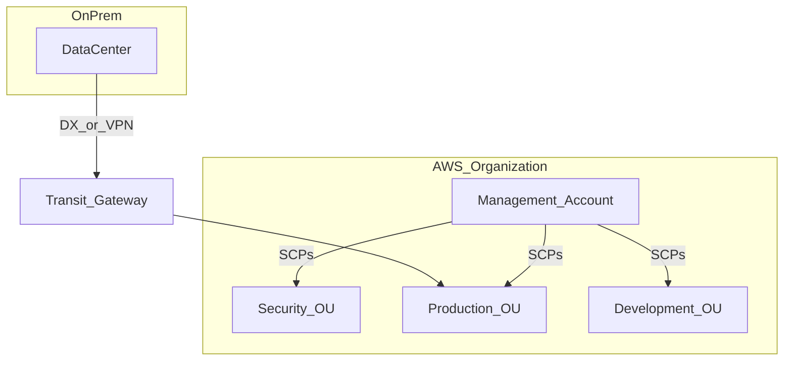

# AWS Solutions Architect Professional (SAP-C02) Cheat Sheet

A certification addendum for the **AWS Certified Solutions Architect – Professional (SAP-C02)** exam. Assumes fluency from the [SAA-C03 Associate guide](AWS_Solutions_Architect_Associate_SAA-C03_Cheat_Sheet.md) and goes deeper on **organizational complexity**, **greenfield design**, **continuous improvement**, and **migration/modernization**.

> **Prerequisite:** Complete the [SAA-C03 cheat sheet](AWS_Solutions_Architect_Associate_SAA-C03_Cheat_Sheet.md) first. This guide does not re-teach basic service selection (S3 vs EBS, SQS vs SNS, etc.) — it focuses on multi-account, hybrid, migration sequencing, and multi-constraint trade-offs.

> Exam note: SAP-C02 requires **2+ years** AWS design experience. Questions are long vignettes with plausible distractors; the exam tests **sequencing, justification, and trade-offs**, not service identification alone.

> Currency note: reviewed against AWS changes through **mid-2026**. Notable additions since many study guides were written: **resource control policies (RCPs)** and **declarative policies** in Organizations, **Aurora DSQL** for multi-Region strongly consistent writes, **AWS Transform** for VMware/mainframe/.NET modernization, and the **Snow Family** restriction that changes bulk-migration answers. See [What Changed Recently](#what-changed-recently-professional-scope).

---

## Content

1. [How to Use This Guide](#how-to-use-this-guide)
   - [Reading the Abbreviations](#reading-the-abbreviations)
2. [Exam at a Glance](#exam-at-a-glance)
3. [What Changed Recently (Professional Scope)](#what-changed-recently-professional-scope)
4. [Domain 1: Design Solutions for Organizational Complexity (26%)](#domain-1-design-solutions-for-organizational-complexity-26)
   - [Task 1.1: Network Connectivity Strategies](#task-11-network-connectivity-strategies)
   - [Task 1.2: Security Controls](#task-12-security-controls)
   - [Task 1.3: Reliable and Resilient Architectures](#task-13-reliable-and-resilient-architectures)
   - [Task 1.4: Multi-Account AWS Environment](#task-14-multi-account-aws-environment)
   - [Task 1.5: Cost Optimization and Visibility](#task-15-cost-optimization-and-visibility)
5. [Domain 2: Design for New Solutions (29%)](#domain-2-design-for-new-solutions-29)
   - [Task 2.1: Deployment Strategy](#task-21-deployment-strategy)
   - [Task 2.2: Business Continuity](#task-22-business-continuity)
   - [Task 2.3: Security Controls for New Solutions](#task-23-security-controls-for-new-solutions)
   - [Task 2.4: Reliability Strategy](#task-24-reliability-strategy)
   - [Task 2.5: Performance Objectives](#task-25-performance-objectives)
   - [Task 2.6: Cost Optimization Strategy](#task-26-cost-optimization-strategy)
6. [Domain 3: Continuous Improvement for Existing Solutions (25%)](#domain-3-continuous-improvement-for-existing-solutions-25)
   - [Task 3.1: Operational Excellence](#task-31-operational-excellence)
   - [Task 3.2: Security Improvements](#task-32-security-improvements)
   - [Task 3.3: Performance Improvements](#task-33-performance-improvements)
   - [Task 3.4: Reliability Improvements](#task-34-reliability-improvements)
   - [Task 3.5: Cost Optimization Opportunities](#task-35-cost-optimization-opportunities)
7. [Domain 4: Accelerate Workload Migration and Modernization (20%)](#domain-4-accelerate-workload-migration-and-modernization-20)
   - [Task 4.1: Migration Assessment and Wave Planning](#task-41-migration-assessment-and-wave-planning)
   - [Task 4.2: Optimal Migration Approach](#task-42-optimal-migration-approach)
   - [Task 4.3: New Architecture for Existing Workloads](#task-43-new-architecture-for-existing-workloads)
   - [Task 4.4: Modernization and Enhancements](#task-44-modernization-and-enhancements)
8. [For Engineers: Platform Automation at Org Scale](#for-engineers-platform-automation-at-org-scale)
   - [Multi-Account Deployment Pipelines](#pa1-multi-account-deployment-pipelines)
   - [Guardrails as Code](#pa2-guardrails-as-code)
   - [Cross-Account Application Wiring](#pa3-cross-account-application-wiring)
   - [Automated Remediation](#pa4-automated-remediation)
   - [Cost Attribution Automation](#pa5-cost-attribution-automation)
9. [Cross-Domain Scenario Q&A (30 Questions)](#cross-domain-scenario-qa-30-questions)
10. [6-Week Professional Study Plan](#6-week-professional-study-plan)
11. [References](#references)
12. [Rapid Answers](#rapid-answers)
13. [Self-Check Checklist](#self-check-checklist)
14. [Glossary (Professional Terms)](#glossary-professional-terms)

---

## How to Use This Guide

[↑ Content](#content)

**Professional exam mindset:** Every question has at least two technically valid answers. The correct one satisfies **all** constraints in the vignette — regulatory, timeline, team skill, existing investment, and blast radius.

Answer long scenarios in this order:

1. **Recommended approach** — what to do first and what architecture results.
2. **Sequencing** — phased rollout, migration waves, or parallel tracks.
3. **Trade-off matrix** — cost / complexity / risk / time-to-value for key decisions.
4. **Why distractors fail** — which unstated assumption each wrong answer makes.
5. **Deeper understanding** — operational and organizational consequences.

Cross-reference [SAA-C03](AWS_Solutions_Architect_Associate_SAA-C03_Cheat_Sheet.md) for service fundamentals. Use this guide when the question involves **40 accounts**, **Direct Connect + 20 VPCs**, **Oracle migration with 15-minute RPO**, or **retrofit GuardDuty org-wide**.

### Reading the Abbreviations

Professional vignettes are written in dense shorthand, so each abbreviation here is expanded the first time it appears in a section. Two glossaries back this up: the [Professional glossary](#glossary-professional-terms) at the end of this file for organization- and migration-scale terms, and the [Associate guide's complete glossary](AWS_Solutions_Architect_Associate_SAA-C03_Cheat_Sheet.md#glossary-and-abbreviations) for shared AWS and general-computing vocabulary.

Three abbreviation clusters cause the most confusion at this level, and they are worth fixing in mind before Domain 1:

| Cluster | The distinction |
|---------|-----------------|
| **SCP / RCP / declarative policy** | SCPs cap what your **principals** may do; RCPs cap what may be done **to your resources**, including by principals outside your organization; declarative policies enforce a **service configuration** regardless of which API is used to change it |
| **RTO / RPO** | RTO is maximum acceptable **downtime**; RPO is maximum acceptable **data loss**, expressed as a time window. Every DR question turns on which of the two the vignette constrains |
| **MGN / DMS / DRS / SCT** | MGN rehosts **servers**; DMS migrates and replicates **databases**; DRS provides continuous replication for **disaster recovery**; SCT converts **schemas** when the database engine changes |

---

## Exam at a Glance

[↑ Content](#content)

| Fact | Value |
|------|-------|
| Exam code | SAP-C02 |
| Format | 75 questions (65 scored + 10 unscored), 180 minutes |
| Passing score | 750 / 1000 |
| Prerequisite experience | 2+ years designing AWS solutions |
| Companion cert | SAA-C03 (recommended, not required) |

**Domain weights:**

| Domain | Weight |
|--------|--------|
| Design Solutions for Organizational Complexity | 26% |
| Design for New Solutions | 29% |
| Continuous Improvement for Existing Solutions | 25% |
| Accelerate Workload Migration and Modernization | 20% |

**Professional vs Associate:** Associate asks "which service?" Professional asks "which sequence, which scope, and what do we defer?"

---

## What Changed Recently (Professional Scope)

[↑ Content](#content)

The Professional exam is more exposed to service change than the Associate exam, because governance and migration tooling has moved quickly. These are the changes that alter a *correct answer*, not just add an option.

### Governance: two new policy types

Older material presents SCPs as the only org-level guardrail. There are now three, and picking the right one is a Professional-level distinction:

| Policy type | Applies to | Use when |
|-------------|-----------|----------|
| **SCP** (Service Control Policy) | **Principals** in member accounts | Limit what identities in an account may do — "no EC2 outside approved instance types" |
| **RCP** (Resource Control Policy) | **Resources** in member accounts | Build a data perimeter — "no principal outside this organization may read our S3 buckets," enforced regardless of who wrote the bucket policy |
| **Declarative policy** | **Service configuration** | Enforce a baseline setting that stays enforced as AWS adds APIs — "VPCs may not have internet gateways," "AMIs may not be shared publicly" |

Key RCP properties for exam reasoning: RCPs never grant permissions, do not apply to the management account or service-linked roles, require all-features Organizations, and currently cover a subset of services (S3, SQS, KMS, Secrets Manager, STS among them). The classic question they answer is "how do I guarantee no bucket in 200 accounts can be shared externally, without auditing 200 bucket policies."

Declarative policies matter because they survive service evolution: an SCP denying specific API actions can be bypassed by a new API, while a declarative policy expresses the desired *configuration* and AWS keeps enforcing it.

### Data layer: multi-Region writes became possible

**Aurora DSQL** (GA May 2025) provides active-active multi-Region writes with strong consistency. This genuinely changes the honest answer to "global application with strongly consistent writes," which previously forced you into a single write Region or application-level conflict resolution. The cost is a reduced PostgreSQL surface (no foreign keys, limited extensions), so it is a greenfield choice, not a migration target for an existing schema.

### Migration tooling: the offline path changed, and modernization got agents

| Change | Effect on answers |
|--------|-------------------|
| **Snowmobile retired** (2024), **Snowcone discontinued** (2024), **Snowball Edge existing-customers-only** (Nov 2025) | For new projects, bulk transfer means **DataSync**, **AWS Data Transfer Terminal** (physical drop-off at an AWS location), or partner solutions; **Outposts** for edge compute |
| **AWS Transform** | Agentic migration/modernization for **VMware**, **mainframe**, and **Windows/.NET** workloads. The .NET agent modernizes Windows-based .NET applications to Linux and targets substantial Windows licensing savings; assessment and the VMware/mainframe/Windows agents are currently free |
| **Migration Hub / Application Discovery** | Still the tracking and inventory layer; AWS Transform sits above them for assessment and code transformation |

**Why AWS Transform matters for a .NET shop specifically:** the classic "rehost the Windows fleet and keep paying Windows licensing" answer now has a credible middle path — port .NET Framework applications to modern .NET on Linux, then run on Graviton containers. That converts a licensing cost line into a one-off engineering project, which is exactly the trade-off a Professional-level question wants you to articulate.

### Cost and operations

- **Cost Optimization Hub** consolidates and deduplicates recommendations across accounts — increasingly the right answer where older material says "Trusted Advisor."
- **Database Savings Plans** (Dec 2025) extend commitment-based discounts to database services including DynamoDB.
- **AWS Backup logically air-gapped vaults** and **Vault Lock** are the current answers for ransomware-resilient, shareable backup copies.

---

## Domain 1: Design Solutions for Organizational Complexity (26%)

### Task 1.1: Network Connectivity Strategies

[↑ Content](#content)

#### Hybrid and Multi-VPC Connectivity

**Vocabulary for this task area:** **VPC** = Virtual Private Cloud (your isolated network), **CIDR** = Classless Inter-Domain Routing (IP range notation such as `10.0.0.0/16`), **DX** = Direct Connect (a dedicated physical circuit), **TGW** = Transit Gateway, **on-prem** = on-premises, meaning your own data center.

| Pattern | When | Limitation |
|---------|------|------------|
| **VPC Peering** | A few VPCs, where a full mesh is still manageable | Non-transitive (A↔B and B↔C does not give A↔C); overlapping CIDR ranges make peering impossible |
| **Transit Gateway** | Hub-and-spoke connecting many VPCs plus on-premises | Route table design gets complex; per-attachment and per-GB cost adds up at scale |
| **Direct Connect + DX Gateway** | Dedicated high-bandwidth link to on-premises | Lead time of weeks to months; a single circuit is a single point of failure |
| **Site-to-Site VPN** | Backup path, or lower-bandwidth hybrid | Depends on the public internet; roughly 1.25 Gbps per tunnel |
| **PrivateLink** | Exposing or consuming one service privately, SaaS-style | Per-service endpoints; it is not a full network extension |

**The CIDR overlap problem deserves emphasis** because it is the most common reason a merger or acquisition integration fails: two networks that both use `10.0.0.0/16` cannot be peered or routed together at all, since routers cannot tell which side an address belongs to. The fixes are all expensive — re-address one network, or place NAT/PrivateLink in between so only translated addresses are exposed. This is why IP address planning (**IPAM** — IP Address Management, which AWS offers as a service) is a Professional-level concern rather than a detail.

#### DNS in Hybrid Environments

**DNS** (Domain Name System) resolves names to IP addresses. In a hybrid environment, names must resolve correctly in both directions — AWS workloads need to find on-premises servers and vice versa.

| Component | Role |
|-----------|------|
| **Route 53 Resolver** | The DNS resolver inside every VPC; **inbound endpoints** let on-premises systems query AWS names, **outbound endpoints** let AWS query on-premises names |
| **Resolver rules** | Conditional forwarding — send queries for `corp.example.com` to the on-premises DNS servers |
| **Split-horizon DNS** | The same hostname deliberately resolving to a private address internally and a public one externally |

#### Network Monitoring

- **VPC Flow Logs** — metadata for accepted and rejected traffic (source, destination, port, bytes). Metadata only, not packet contents — enough to answer "did this connection happen?" but not "what was sent?"
- **Traffic Mirroring** — copies actual packets to an inspection appliance, for **IDS** (Intrusion Detection System) or forensic analysis
- **Network Firewall** — centralized, stateful inspection between network segments, typically deployed in an inspection VPC that all traffic transits



---

### Task 1.2: Security Controls

[↑ Content](#content)

#### Organization-Wide Security

| Service | Scope |
|---------|-------|
| **CloudTrail organization trail** | Records every **API** (Application Programming Interface) call in every account into one central S3 bucket, encrypted with **KMS** (Key Management Service) |
| **AWS Config aggregator** | Collects resource configuration and compliance-rule results across all accounts and Regions |
| **Security Hub** | Single pane of findings from GuardDuty, Inspector (vulnerability scanning), and Macie (sensitive-data discovery) |
| **GuardDuty** | Continuous threat detection; enable organization-wide through a delegated administrator |
| **IAM Access Analyzer** | Reports which resources are reachable from outside the organization, and which granted permissions are unused |
| **AWS Firewall Manager** | Pushes AWS WAF rules and security-group policies consistently across accounts |

**The two-word idea behind all six:** *centralize evidence, delegate administration*. Logs and findings land in an account that workload teams cannot write to (so evidence cannot be tampered with), while day-to-day operation happens in a security account rather than the management account (which should hold no workloads and be used as rarely as possible).

#### Cross-Account Access Patterns

- **Delegated administrator** — security services are operated from an account in the Security **OU** (Organizational Unit) rather than from the management account
- **Cross-account roles** — `sts:AssumeRole` with an **external ID** for third parties. The external ID is a shared secret the partner must supply, defeating the *confused deputy* attack in which another of that partner's customers persuades them to act against your account
- **RAM** (Resource Access Manager) — shares actual resources (subnets, Transit Gateway attachments, License Manager configurations) with other accounts, instead of duplicating them per account

#### Data Perimeter Controls

A data perimeter answers "only my identities, from my networks, to my resources." It is built from four condition-key families, applied through SCPs, RCPs, and resource policies together:

| Goal | Mechanism |
|------|-----------|
| Only identities in my org may access my resources | **RCP** with `aws:PrincipalOrgID` |
| My identities may only access my resources | SCP with `aws:ResourceOrgID` |
| Access only from expected networks | `aws:SourceVpce` / `aws:SourceIp` conditions |
| Only trusted service principals | `aws:PrincipalIsAWSService`, `aws:SourceArn` |

**Why RCPs changed this:** before RCPs, a data perimeter on resources depended on every bucket, queue, and key carrying the right resource policy — one missed resource was a hole. An RCP applies centrally to all supported resources in scope, so new resources inherit the perimeter by default.

---

### Task 1.3: Reliable and Resilient Architectures

[↑ Content](#content)

#### Advanced DR (Org Scale)

**RTO** (Recovery Time Objective) is the maximum acceptable *downtime*; **RPO** (Recovery Point Objective) is the maximum acceptable *data loss*, expressed as a time window. At organization scale the important addition is that these are set **per workload tier**, not once for the company — paying active-active prices for an internal reporting tool is as much an architecture failure as giving the payments system nightly backups.

| Strategy | RTO | RPO | When at org scale |
|----------|-----|-----|-------------------|
| **Backup and restore** | Hours | Hours | The default for the long tail of non-critical workloads |
| **Pilot light** | Tens of minutes | Minutes | Core database and network kept minimal but live in the DR Region |
| **Warm standby** | Minutes | Minutes | A scaled-down but complete stack, ready to scale up |
| **Active-active multi-Region** | Near zero | Near zero | Revenue-critical global products; highest cost and complexity |

**AWS Elastic Disaster Recovery (DRS)** — continuous block-level replication of whole servers, giving RTO in minutes and RPO in seconds without paying for a full active-active footprint. It is the pragmatic middle option, and often the right answer when a question demands "minutes, not hours" but rules out running two live Regions.

#### Backup Strategy at Scale

- **AWS Backup** — organization-wide backup plans, applied by tag and managed through a delegated administrator account
- **Cross-Region copy** — required by many regulators, and the only protection against losing an entire Region
- **Immutable backups (Vault Lock)** — the defense against ransomware, which increasingly targets the backups first. A backup an attacker with admin credentials can delete is not a backup

---

### Task 1.4: Multi-Account AWS Environment

[↑ Content](#content)

#### Account Structure (Typical)

An **OU** (Organizational Unit) is a folder of accounts inside AWS Organizations; policies attach to an OU and are inherited by every account within it, which is what makes this structure worth designing carefully.

| OU / Account | Purpose |
|--------------|---------|
| **Management** | Owns AWS Organizations, SCPs, and consolidated billing. Runs **no workloads** — it cannot be restricted by SCPs, so anything in it is effectively unguarded |
| **Security** | Log archive, GuardDuty administration, Security Hub. Write-once for logs; workload teams have no delete rights |
| **Infrastructure** | Shared networking (Transit Gateway, DNS, IPAM) and the CI/CD tooling accounts |
| **Workloads** | Dev / Test / Prod accounts, one set per product line or business unit |
| **Sandbox** | Experimentation, with strict SCPs and a hard budget limit |

**Why so many accounts rather than one big one:** the account is AWS's strongest isolation boundary. It separates IAM, service quotas, and billing simultaneously — so a runaway dev workload cannot exhaust production's quotas, a compromised dev credential cannot reach production data, and cost attribution needs no tagging discipline. The cost is that everything cross-account (networking, deployment, logging) needs deliberate plumbing, which is precisely what this domain tests.

#### Control Tower vs Manual Organizations

| Approach | When |
|----------|------|
| **Control Tower** | A greenfield organization that wants a pre-built **landing zone** (baseline multi-account setup with logging and guardrails) plus **Account Factory** for vending new accounts |
| **Organizations + custom IaC** | An existing organization, a mature platform team, or requirements Control Tower's opinions do not fit |

**The honest trade-off:** Control Tower is faster to a compliant baseline and harder to customize later; hand-built Organizations is the reverse. A frequent Professional-exam scenario is an existing 40-account organization that wants Control Tower — the answer is that Control Tower can *enroll* existing accounts, but only after their configuration is reconciled with the landing zone's expectations, which is the real project.

**SCP rules:** Deny list only — cannot grant permissions. Example: deny `ec2:RunInstances` except approved instance types; deny root user actions; deny Regions outside an allowlist.

#### Choosing Among the Three Policy Types

| Requirement | Right tool |
|-------------|-----------|
| "Nobody in dev may create resources outside eu-central-1" | **SCP** (limits principals) |
| "No external principal may read any bucket we own" | **RCP** (limits resources) |
| "No VPC may have an internet gateway, permanently" | **Declarative policy** (enforces configuration) |
| "This team may deploy only these services" | **SCP** on their OU |
| "Snapshots and AMIs must never be public" | **Declarative policy** |

**Deeper understanding:** a common design error is reaching for SCPs for everything. SCPs are blind to access that does not originate from your organization's principals — an externally shared bucket is a resource-side problem, so it needs an RCP. And any control expressible as a *configuration* is better as a declarative policy, because it keeps holding when AWS ships a new API that your action-based deny list has never heard of.

---

### Task 1.5: Cost Optimization and Visibility

[↑ Content](#content)

| Tool | Purpose |
|------|---------|
| **Cost Explorer** | Trend analysis, forecasting, and **RI/SP** (Reserved Instance / Savings Plan) purchase recommendations |
| **AWS Budgets** | Alerts, and optionally automated actions, when spend crosses a threshold |
| **CUR** (Cost and Usage Report) | Raw line-item billing data delivered to S3, queried with Athena or Amazon Quick |
| **Compute Optimizer** | Right-sizing recommendations for EC2, EBS, Lambda, and **ASG** (Auto Scaling Group) |
| **S3 Storage Lens** | Organization-wide S3 usage and optimization metrics |
| **Trusted Advisor** | Best-practice checks across cost, security, and limits (full checks need Business or Enterprise Support) |
| **Pricing Calculator** | Cost estimates *before* deployment, for architecture comparisons |

**Tagging strategy:** mandatory tags such as `CostCenter`, `Environment`, and `Owner`, enforced at creation time by an SCP using the `aws:RequestTag` condition and audited afterwards by AWS Config rules. Note the step everyone forgets: a tag does nothing for cost reporting until it is **activated as a cost allocation tag** in the billing console, and activation is not retroactive — untagged historical spend stays unattributable, which is why this is set up on day one rather than during the first budget crisis.

---

## Domain 2: Design for New Solutions (29%)

### Task 2.1: Deployment Strategy

[↑ Content](#content)

| Pattern | Risk | Rollback |
|---------|------|----------|
| **All-at-once** | Highest — every instance replaced simultaneously | Redeploy the previous version (there is an outage in between) |
| **Rolling** | Medium — replaced in batches, so both versions run at once | Stop the deployment and drain the bad instances |
| **Blue/green** | Low — a complete second environment ("green") is built, then traffic is switched | Switch traffic back to the old ("blue") environment; near-instant |
| **Canary** | Lowest — a small percentage of traffic goes to the new version first | Automated rollback triggered by error-rate or latency metrics |

**The constraint that decides between them:** blue/green needs double the infrastructure for the duration of the deployment, and it requires that both versions can coexist against the *same database*. That schema-compatibility requirement (an "expand and contract" migration: add the new column, deploy code tolerant of both, then remove the old) is the real work, and the reason teams settle for rolling deployments.

**IaC** (Infrastructure as Code): CloudFormation **StackSets** deploy one template across many accounts and Regions from a central point; **drift detection** reports where reality has diverged from the template; **change sets** preview what a deployment will actually alter before it runs.

**CI/CD** (Continuous Integration / Continuous Delivery): CodePipeline for orchestration, CodeBuild for build and test, CodeDeploy for release (or any third-party equivalent), with manual approval gates before production.

---

### Task 2.2: Business Continuity

[↑ Content](#content)

Design for **Region-level** failure when RTO/RPO requires it:

- Route 53 health checks + failover routing; **Route 53 Application Recovery Controller** for readiness checks and routing control when you need a reliable, dependency-light failover switch
- Data layer options, and what each actually promises:

| Option | Write model | Consistency across Regions |
|--------|-------------|----------------------------|
| **Aurora Global Database** | Single writer Region | Asynchronous, typically sub-second lag |
| **DynamoDB Global Tables** | Multi-active writes | Eventually consistent (last-writer-wins conflict resolution) |
| **Aurora DSQL** | Multi-active writes | Strongly consistent across Regions |
| **S3 CRR / SRR** | Asynchronous replication | Eventual; add Replication Time Control for an SLA |
| **AWS Elastic Disaster Recovery (DRS)** | Block-level replication | Continuous, seconds of RPO, minutes of RTO |

- Regular **game days** — simulate Region failure and measure actual RTO/RPO rather than the documented one

See [SAA-C03 DR table](AWS_Solutions_Architect_Associate_SAA-C03_Cheat_Sheet.md#task-22-highly-available-and-fault-tolerant-architectures) for strategy definitions.

**Deeper understanding:** the failover mechanism is usually the weakest link, not the data replication. A DR plan that depends on the control plane of the failed Region, or on a human running a runbook nobody has rehearsed, has a much worse real RTO than its design document claims. This is why ARC exists and why game days are non-negotiable.

---

### Task 2.3: Security Controls for New Solutions

[↑ Content](#content)

Greenfield checklist:

- [ ] IAM Identity Center for human access; no long-lived IAM users
- [ ] Encryption by default (EBS, S3, RDS) with CMK strategy
- [ ] VPC with private subnets; VPC endpoints for AWS APIs
- [ ] WAF + Shield on public endpoints
- [ ] Secrets Manager for credentials; no secrets in code/env plain text
- [ ] GuardDuty + Security Hub from day one

**Large-scale web attack mitigation:** CloudFront → WAF (rate limits, geo block, managed rules) → ALB in private subnets.

---

### Task 2.4: Reliability Strategy

[↑ Content](#content)

- **Cell-based architecture** — partition the whole stack into independent "cells," each serving a subset of customers, so a failure affects one cell rather than everyone. **Shuffle sharding** goes further: each customer is assigned to a random *combination* of cells, so no two customers share exactly the same set and one abusive tenant cannot take down another's entire capacity.
- **Bulkhead pattern** — named after ship compartments: give each tenant or feature its own thread pool, connection pool, or queue, so one flooded component cannot consume the resources every other component needs.
- **Circuit breaker** — after repeated failures, stop calling a failing dependency entirely for a cooling-off period and fail fast instead. This protects both sides: the caller stops piling up blocked threads, and the struggling dependency gets a chance to recover instead of being retried into the ground. Buffer the work in SQS so nothing is lost.
- **Chaos engineering** — deliberately inject failure in production-like environments to verify the theory. **FIS** (Fault Injection Simulator) does this in a controlled, stoppable way (terminate instances, add latency, fail an AZ).

**Service quotas:** request increases proactively for production, before the launch that needs them, since some increases take days. Document current limits in runbooks so that an on-call engineer recognizes throttling for what it is.

**Why these four appear together:** each one bounds a different blast radius. Cells bound *who* is affected, bulkheads bound *what* resources one caller can consume, circuit breakers bound *how long* a failure propagates, and chaos engineering verifies that the other three actually work. A design that claims all three without ever testing them is the failure mode the Professional exam probes.

---

### Task 2.5: Performance Objectives

[↑ Content](#content)

| Access pattern | Architecture |
|----------------|--------------|
| Read-heavy global | CloudFront, plus read replicas, **DAX** (DynamoDB Accelerator), or ElastiCache |
| Write-heavy sharded | Careful DynamoDB partition key design; Kinesis shard sizing |
| Mixed transactional and analytical | Aurora for transactions, Redshift Serverless for analytics, S3 as the data lake |
| **HPC** (High Performance Computing) batch | AWS ParallelCluster, Spot Fleet, FSx for Lustre |

**Caching hierarchy:** CloudFront at the edge → ElastiCache or DAX at the application tier → read replicas at the database. Each layer should absorb what the layer below cannot afford to serve, and the correct order to optimize is outside-in: a request served at the edge costs a fraction of one that reaches the database, so improving edge cache-hit ratio usually beats scaling the database.

**Stating objectives properly.** Performance requirements at this level are expressed as percentiles, not averages: **p50** is the median request, **p99** is the slowest 1%. Averages hide the problem — a service averaging 100 ms may have a p99 of 4 seconds, and that tail is what users complain about and what causes retry storms upstream. An **SLO** (Service Level Objective) is your internal target ("p99 under 300 ms"), while an **SLA** (Service Level Agreement) is the contractual promise with financial consequences; always set the SLO tighter than the SLA.

---

### Task 2.6: Cost Optimization Strategy

[↑ Content](#content)

Greenfield cost design:

- Graviton where supported
- Savings Plans for baseline; Spot for fault-tolerant tiers
- S3 Intelligent-Tiering for unknown access patterns
- Data transfer modeling in Pricing Calculator before committing to multi-Region
- Lifecycle policies from day one — not retrofitted

---

## Domain 3: Continuous Improvement for Existing Solutions (25%)

### Task 3.1: Operational Excellence

[↑ Content](#content)

| Improvement | Tool/Pattern |
|-------------|--------------|
| Centralized logging | CloudWatch Logs subscription filters streaming to OpenSearch; an organization-wide log archive account |
| Distributed tracing | AWS X-Ray, or **ADOT** (AWS Distro for OpenTelemetry — AWS's supported build of the vendor-neutral OpenTelemetry standard) |
| Automated remediation | EventBridge triggering Lambda or **SSM** (Systems Manager) Automation when AWS Config reports non-compliance |
| Patch compliance | Systems Manager Patch Manager, with maintenance windows per environment |
| Deployment safety | CodeDeploy blue/green, using CloudWatch alarms as automatic rollback triggers |

**Prioritization:** run a Well-Architected Review, identify the high-risk gaps, then automate **toil** first — the repetitive manual operational work that scales with usage rather than with value delivered (backups, patching, scaling, access requests). Toil is the right first target because it both consumes the team's time and is where human error causes incidents.

---

### Task 3.2: Security Improvements

[↑ Content](#content)

Retrofit sequence (typical):

1. Enable CloudTrail org trail + log integrity
2. Block S3 public access account-wide
3. Enable GuardDuty org-wide
4. IAM Access Analyzer — fix external access
5. Secrets Manager migration from embedded credentials
6. WAF on existing ALB/CloudFront
7. Config rules for encryption and open SG detection

---

### Task 3.3: Performance Improvements

[↑ Content](#content)

- Compute Optimizer recommendations → right-size over-provisioned EC2
- Add ElastiCache/DAX where read latency dominates
- Convert gp2 → gp3 EBS volumes
- Enable Aurora I/O-Optimized if I/O cost exceeds threshold
- CloudFront for static/dynamic content offload

---

### Task 3.4: Reliability Improvements

[↑ Content](#content)

- Single-AZ → Multi-AZ for RDS, ElastiCache, NAT
- Manual failover → Route 53 health checks + ASG across AZs
- Introduce SQS between tiers to absorb spikes
- AWS Backup policies replacing ad-hoc snapshots
- DR drill findings → reduce actual RTO

---

### Task 3.5: Cost Optimization Opportunities

[↑ Content](#content)

| Finding | Action |
|---------|--------|
| Idle EC2 / unattached EBS | Stop/terminate; snapshot then delete |
| Over-provisioned RDS | Right-size; Aurora Serverless for variable load |
| S3 Standard for archives | Lifecycle to Glacier tiers |
| NAT Gateway heavy S3 traffic | VPC endpoints |
| Old RI/SP coverage | Renew or convert to Compute SP |
| Cross-AZ chatty microservices | Same-AZ placement where HA allows |

---

## Domain 4: Accelerate Workload Migration and Modernization (20%)

### Task 4.1: Migration Assessment and Wave Planning

[↑ Content](#content)

| Tool | Purpose |
|------|---------|
| **Migration Hub** | A single dashboard tracking migration progress across all the other tools |
| **Application Discovery Service** | Inventories on-premises servers and their network dependencies, agent-based or agentless |
| **Migration Evaluator** | **TCO** (Total Cost of Ownership — the full cost including hardware, licensing, power, staff, and refresh cycles, not just the invoice) modeling; formerly TSO Logic |
| **AWS Transform** | Agentic assessment, dependency mapping, and wave planning for VMware, mainframe, and Windows/.NET estates |
| **AWS Prescriptive Guidance** | Migration methodology frameworks |

**Wave planning:** Group by dependency, complexity, and business criticality — not random batches. Low-risk, low-dependency first builds momentum.

**Deeper understanding:** discovery output is only as good as its dependency mapping, and the dependency nobody documented is what breaks a cutover. Insist on network-flow evidence (flow logs, agent data, AWS Transform's mapping) rather than an application owner's memory, and sequence waves so that a rollback never leaves a dependency split across the two environments.

---

### Task 4.2: Optimal Migration Approach

[↑ Content](#content)

#### The 6 R's

The "6 R's" is AWS's standard vocabulary for what you *do* with each application you find. Every migration plan classifies its portfolio into these six buckets.

| Strategy | Description | When |
|----------|-------------|------|
| **Rehost** (lift-and-shift) | Move the server as-is onto EC2, unchanged | Speed matters most; minimal change and minimal risk |
| **Replatform** (lift-and-reshape) | Small optimization without rewriting — for example moving a self-managed Oracle database onto RDS | Some cloud benefit for limited code change |
| **Repurchase** (drop-and-shop) | Replace with a **SaaS** (Software as a Service) product, such as moving a custom **CRM** (Customer Relationship Management) system to Salesforce | The capability is a commodity you should not be building |
| **Refactor / Re-architect** | Redesign as cloud-native (serverless, managed data stores, event-driven) | Maximum long-term value; highest effort and risk |
| **Retire** | Decommission entirely | Genuinely unused workloads — typically 10–20% of a discovered portfolio |
| **Retain** (revisit) | Deliberately leave on-premises for now | Regulatory constraint, latency requirement, or an imminent replacement |

**The sequencing insight that separates a Professional answer from an Associate one:** rehost first, refactor later, is usually correct even though refactoring delivers more value. Rehosting exits the data center (which is what stops the contract renewal and the hardware refresh), and it does so with a rollback path. Refactoring while simultaneously migrating doubles the number of things that can be blamed when something breaks. The exception is an application already at end of life, where rehosting means paying to move something you are about to delete — which is what "Retire" and "Repurchase" are for.

#### Migration Tools

| Tool | Use case |
|------|----------|
| **Application Migration Service (MGN)** | Rehost — block-level replication to EC2 |
| **Database Migration Service (DMS)** | Homogeneous/heterogeneous DB migration + CDC |
| **Schema Conversion Tool (SCT)** | Convert Oracle/SQL Server schema to Aurora PostgreSQL/MySQL |
| **AWS Transform** | Assessment plus automated code/config transformation for VMware, mainframe, Windows/.NET |
| **DataSync** | Online file/object transfer (the default for bulk data now) |
| **AWS Data Transfer Terminal** | Physical drop-off transfer at an AWS location |
| **Snow Family** | Offline transfer — **existing customers only** since Nov 2025 |
| **Storage Gateway** | Hybrid access during a phased migration |

**Choosing the transfer path:** compute the transfer time before choosing hardware. Volume ÷ sustained throughput gives days; compare that against the cutover window. Offline transfer wins only when the arithmetic misses the deadline, or when the link is needed for production traffic.

---

### Task 4.3: New Architecture for Existing Workloads

[↑ Content](#content)

After lift-and-shift, evolve toward:

- **ASG + ALB** (Auto Scaling Group behind an Application Load Balancer) instead of a fixed set of EC2 instances
- **RDS Multi-AZ** instead of a self-managed database on EC2
- **S3** for static assets and backups, taking that data off expensive block storage
- Decompose the monolith using the **strangler fig pattern** — named after the vine that grows around a tree until the tree is gone: put a facade (API Gateway or a load balancer) in front of the monolith, route one capability at a time to a new service behind it, and retire the old code path only once traffic has moved. It is the low-risk alternative to a rewrite, because every step is individually reversible

**Constraint:** "Application cannot be modified" → infrastructure-only improvements (see [SAA J10](AWS_Solutions_Architect_Associate_SAA-C03_Cheat_Sheet.md#j10-a-legacy-monolith-cannot-be-modified-how-do-you-improve-availability-on-aws)).

---

### Task 4.4: Modernization and Enhancements

[↑ Content](#content)

| Path | Target |
|------|--------|
| **Containerize** | **ECS** (Elastic Container Service) with Fargate, or **EKS** (Elastic Kubernetes Service) — better portability and host density |
| **Serverless refactor** | Lambda plus API Gateway for genuinely event-driven components |
| **Managed databases** | Aurora and DynamoDB — less operational work than self-managed engines |
| **Event-driven** | EventBridge and SQS replacing scheduled polling |
| **Windows → Linux (.NET)** | AWS Transform's .NET agent ports .NET Framework apps to modern .NET on Linux, removing Windows licensing cost |
| **ARM migration** | Graviton for managed runtimes and rebuilt containers |

**The .NET modernization ladder**, cheapest step first:

| Step | Effort | Payoff |
|------|--------|--------|
| Rehost on EC2 Windows | Days | Exits the data center; licensing unchanged |
| License Manager and **BYOL** (Bring Your Own License) optimization | Days | Reduces licensing waste by tracking and right-sizing existing entitlements |
| Port .NET Framework → modern .NET on Linux | Weeks–months | Removes Windows licensing; enables containers |
| Containerize on ECS/Fargate | Weeks | Density, faster deploys |
| Move to Graviton | Days after containerizing | Better price/performance |
| Decompose with the strangler fig pattern | Quarters | Independent scaling and deployment |

**Modernization ROI** (Return on Investment): measure operations hours saved, deployment frequency, incident rate, and licensing removed — not just the infrastructure bill. A migration that halves the EC2 bill but doubles deployment friction is not a win, and the reverse is often the better trade.

---

## For Engineers: Platform Automation at Org Scale

[↑ Content](#content)

Professional-level design becomes real through automation. Where the [Associate engineering section](AWS_Solutions_Architect_Associate_SAA-C03_Cheat_Sheet.md#for-software-engineers-sdk-iac-and-code-patterns) covers application code, this covers the platform layer: deploying to many accounts, enforcing guardrails as code, and wiring services across account boundaries.

### PA1. Multi-Account Deployment Pipelines

[↑ Content](#content)

| Mechanism | Best for |
|-----------|----------|
| **CloudFormation StackSets** | Pushing baseline stacks (roles, Config rules, log destinations) to every account in an OU, automatically including accounts created later |
| **CDK Pipelines** | Application deployments promoted dev → staging → prod across accounts; **self-mutating**, meaning the pipeline updates its own definition when you change it |
| **Terraform with per-account state** | Existing Terraform estates; one **state file** (Terraform's record of what it created) per account and environment |
| **Control Tower Account Factory / AFT** (Account Factory for Terraform) | Vending new accounts with baselines already applied at creation time |

The safest pattern is one pipeline account holding the deployment role, assuming a narrowly scoped role in each target account:

```bash
# Deploy an org-wide baseline to every account in two OUs, new accounts included
aws cloudformation create-stack-instances \
  --stack-set-name security-baseline \
  --deployment-targets OrganizationalUnitIds=ou-abc-11111111,ou-abc-22222222 \
  --regions eu-central-1 us-east-1 \
  --operation-preferences FailureTolerancePercentage=10,MaxConcurrentPercentage=25
```

**Deeper understanding:** `FailureTolerancePercentage` and `MaxConcurrentPercentage` are the difference between a bad baseline breaking one account and breaking two hundred. Roll out to a canary OU first. Service-managed StackSets with automatic deployment are what make "every new account is compliant on day one" true rather than aspirational — an account created outside that path is the account that fails your next audit.

---

### PA2. Guardrails as Code

[↑ Content](#content)

An RCP that blocks any principal outside your organization from reading your buckets, regardless of what individual bucket policies say:

```json
{
  "Version": "2012-10-17",
  "Statement": [
    {
      "Sid": "EnforceOrgPerimeterOnS3",
      "Effect": "Deny",
      "Principal": "*",
      "Action": ["s3:GetObject", "s3:PutObject", "s3:ListBucket"],
      "Resource": "*",
      "Condition": {
        "StringNotEqualsIfExists": { "aws:PrincipalOrgID": "o-exampleorgid" },
        "BoolIfExists": { "aws:PrincipalIsAWSService": "false" }
      }
    }
  ]
}
```

An SCP that constrains principals to approved Regions while exempting global services:

```json
{
  "Version": "2012-10-17",
  "Statement": [
    {
      "Sid": "DenyUnapprovedRegions",
      "Effect": "Deny",
      "NotAction": ["iam:*", "organizations:*", "sts:*", "cloudfront:*", "route53:*", "support:*"],
      "Resource": "*",
      "Condition": {
        "StringNotEquals": { "aws:RequestedRegion": ["eu-central-1", "eu-west-1"] }
      }
    }
  ]
}
```

**Deeper understanding:** three details cause most guardrail incidents. `StringNotEqualsIfExists` and `BoolIfExists` prevent the policy from denying requests where the condition key is simply absent, which would otherwise break AWS service integrations. The `NotAction` exemption list is required because global services are only reachable through specific Regions. And SCPs never apply to the management account — so a control tested only there proves nothing. Always test guardrails in a sandbox OU, and keep CloudTrail on to see what the deny actually blocked.

---

### PA3. Cross-Account Application Wiring

[↑ Content](#content)

| Need | Mechanism |
|------|-----------|
| Consume a service in another account privately | **PrivateLink** endpoint service, or **VPC Lattice** for service-to-service with auth policies |
| Share a subnet or Transit Gateway | **RAM** (shared VPC keeps one network team owning IPAM) |
| Publish events across accounts | **EventBridge** cross-account bus target with a resource policy on the target bus |
| Read another account's data | Cross-account role via `sts:AssumeRole`, or a resource policy plus KMS grant |
| Central logging | Cross-account CloudWatch Logs destination or S3 bucket with a bucket policy per source account |

```json
// Target event bus policy — accept events only from within the organization
{
  "Sid": "AllowOrgAccountsToPutEvents",
  "Effect": "Allow",
  "Principal": "*",
  "Action": "events:PutEvents",
  "Resource": "arn:aws:events:eu-central-1:111122223333:event-bus/central",
  "Condition": { "StringEquals": { "aws:PrincipalOrgID": "o-exampleorgid" } }
}
```

**The KMS trap:** cross-account access to encrypted data needs *three* alignments — the resource policy, the caller's IAM policy, and the **KMS key policy or grant**. Teams routinely fix the first two, get `AccessDenied` from KMS, and conclude the resource policy is wrong. If a cross-account read fails after the bucket policy looks correct, check the key.

---

### PA4. Automated Remediation

[↑ Content](#content)

Detection without remediation is a backlog. The standard loop is Config or Security Hub detects, EventBridge routes, and Systems Manager Automation or Lambda fixes.

| Layer | Service |
|-------|---------|
| Detect | AWS Config rules, Security Hub controls, GuardDuty findings |
| Route | EventBridge rules (organization-wide via a central bus) |
| Remediate | SSM Automation documents, Lambda, Config remediation actions |
| Verify | Config compliance timeline, Security Hub score trend |

```bash
# Attach automatic remediation to a Config rule
aws configservice put-remediation-configurations --remediation-configurations '[{
  "ConfigRuleName": "s3-bucket-server-side-encryption-enabled",
  "TargetType": "SSM_DOCUMENT",
  "TargetId": "AWS-EnableS3BucketEncryption",
  "Automatic": true,
  "MaximumAutomaticAttempts": 3,
  "RetryAttemptSeconds": 60
}]'
```

**Deeper understanding:** automatic remediation must be reversible and loud. Remediating a resource someone deliberately configured causes an outage that looks like a mystery, so start in alert-only mode, measure how often the rule would have fired, then enable enforcement. Prefer **preventive** controls (SCPs, RCPs, declarative policies) over detective-plus-remediate wherever the control can be expressed preventively — nothing to remediate is cheaper than remediating well.

---

### PA5. Cost Attribution Automation

[↑ Content](#content)

**Chargeback** means billing each team for the AWS spend it caused; **showback** means reporting that spend without moving money. Either way the mechanism is the same, and either way it fails on missing tags — so make tags structural rather than aspirational:

| Control | Effect |
|---------|--------|
| **Tag policies** (Organizations) | Define allowed tag keys and value formats per OU |
| **SCP with `aws:RequestTag` condition** | Refuse resource creation without a `CostCenter` tag |
| **Cost allocation tags activated in billing** | Makes tags appear in Cost Explorer and CUR |
| **Cost Categories** | Group accounts and tags into business-meaningful buckets |
| **CUR in S3 + Athena** | Arbitrary chargeback queries |
| **Budgets per account/OU with actions** | Alert, or automatically apply a restrictive policy on breach |

```sql
-- Untagged spend by account, from the Cost and Usage Report in Athena
SELECT line_item_usage_account_id,
       SUM(line_item_unblended_cost) AS untagged_cost
FROM cur_table
WHERE (resource_tags_user_cost_center IS NULL OR resource_tags_user_cost_center = '')
  AND billing_period = '2026-08'
GROUP BY line_item_usage_account_id
ORDER BY untagged_cost DESC;
```

**Deeper understanding:** the account is the cleanest cost boundary, which is one reason mature organizations give each team its own account rather than relying on tags inside a shared one. Tags remain necessary for cross-cutting attribution (per-environment, per-customer), but a tag can be forgotten and an account cannot. Enforce at creation time with an SCP, because retrofitting tags onto existing resources is manual work nobody schedules.

---

## Cross-Domain Scenario Q&A (30 Questions)

[↑ Content](#content)

### P1. A company has 40 AWS accounts with inconsistent guardrails. Design a 90-day landing zone rollout.

[↑ Content](#content)

**Recommended approach:** Enable Organizations (if not already) → deploy Control Tower in home Region → define OUs (Security, Infrastructure, Workloads, Sandbox) → apply SCPs (Region allowlist, deny root, require encryption) → Account Factory for new accounts → migrate existing accounts in waves with Config conformance packs.

**Sequencing:** Security/logging account first → central CloudTrail and log archive → SCPs in audit mode → enforce → workload migration.

**Trade-off matrix:**

| Choice | Benefit | Risk/Cost |
|--------|---------|-----------|
| Control Tower | Fast guardrails | Less flexible than custom |
| Custom IaC | Full control | Slower; needs mature team |
| Big-bang all accounts | Uniform | High disruption |

**Why distractors fail:** Single-account VPC design ignores org scope. Manual account creation without SCPs doesn't fix guardrails.

---

### P2. On-premises data center connects to AWS. 15 VPCs across 3 Regions need full mesh connectivity with transitive routing.

[↑ Content](#content)

**Best answer:** AWS Transit Gateway in each Region; inter-Region peering between TGWs; on-prem via Direct Connect + DX Gateway (VPN as backup).

**Why distractors fail:** VPC peering is non-transitive — 15 VPCs = n(n-1)/2 peering connections, unmanageable. Single VPN to one VPC doesn't reach all VPCs without TGW.

---

### P3. Oracle 12c on-prem, 40 TB, migration to AWS with <15 minutes RPO and minimal downtime.

[↑ Content](#content)

**Best answer:** AWS DMS with ongoing replication (CDC) to Aurora PostgreSQL (after SCT schema conversion) or RDS Oracle; cutover during maintenance window when replication lag < threshold; MGN for app tier if rehosting.

**Trade-off matrix:**

| Choice | RPO | Complexity |
|--------|-----|------------|
| DMS CDC | Minutes | Schema conversion effort |
| Native RDS Oracle | Minutes | License cost |
| Backup/restore | Hours | Too slow for 15-min RPO |

---

### P4. Global SaaS needs active-active in us-east-1 and eu-west-1. Writes must be strongly consistent.

[↑ Content](#content)

**Best answer (as the exam expects):** Route 53 latency routing to regional stacks with a **single primary Region for writes** (or an explicit conflict-resolution layer) — true strongly consistent active-active writes are not native to the databases SAP-C02 was written around.

**Deeper understanding:** DynamoDB Global Tables are eventually consistent across Regions with last-writer-wins. Aurora Global Database has one write Region. The exam expects you to recognize the consistency limit and choose **partition users by Region** or **primary write Region + global reads**.

**Current reality worth stating in an interview:** **Aurora DSQL** (GA May 2025) does provide active-active multi-Region writes with strong consistency, which removes the constraint this question is built on. The trade-off moved rather than disappeared: DSQL has a reduced PostgreSQL feature surface (no foreign keys, limited extensions, no custom extensions), so it is a greenfield choice. If the workload already runs on Aurora PostgreSQL with a rich schema, the write-partitioning answer is still the pragmatic one.

---

### P5. Central security team must detect threats in all accounts without each account configuring separately.

[↑ Content](#content)

**Best answer:** Designate GuardDuty and Security Hub delegated administrator account; enable organization-wide auto-enrollment; aggregate findings to security OU.

---

### P6. Developers need self-service sandbox accounts with guardrails; prod must not be affected.

[↑ Content](#content)

**Best answer:** Sandbox OU with SCPs: deny expensive services (large EC2, DX), Region allowlist, require `Environment=Sandbox` tag; Account Factory with expiration; separate from Prod OU with stricter SCPs.

---

### P7. Existing monolith on EC2; deployment causes outages. Improve with minimal architecture change.

[↑ Content](#content)

**Best answer:** CodeDeploy blue/green with ALB; second ASG; shift traffic after health checks; CloudWatch alarms trigger rollback.

---

### P8. Multi-account environment needs shared services VPC (Directory, monitoring) accessible from workload VPCs.

[↑ Content](#content)

**Best answer:** Shared services VPC attached to Transit Gateway; RAM share subnets if needed; route tables propagate to spoke VPCs; PrivateLink for specific services.

---

### P9. Compliance requires all API activity retained 7 years, tamper-evident, searchable.

[↑ Content](#content)

**Best answer:** Organization CloudTrail → S3 log archive with Object Lock (Compliance mode) + KMS encryption + lifecycle to Glacier; Athena for query.

---

### P10. Cost anomaly: NAT Gateway charges dominate. Existing VPC microservices call S3 and DynamoDB heavily.

[↑ Content](#content)

**Best answer:** Add Gateway endpoints for S3 and DynamoDB; Interface endpoints for other AWS APIs if needed; review cross-AZ traffic patterns.

---

### P11. Migrate 200 VMs from VMware on-prem to AWS in 6 months with minimal application change.

[↑ Content](#content)

**Best answer:** Application Discovery Service → Migration Hub → MGN for replication → waves by dependency → cutover with test period each wave.

---

### P12. PostgreSQL database on large EC2; team wants managed service with minimal downtime migration.

[↑ Content](#content)

**Best answer:** DMS homogeneous migration to RDS PostgreSQL or Aurora PostgreSQL with CDC; cutover when lag minimal.

---

### P13. E-commerce platform: improve Black Friday readiness on existing AWS deployment.

[↑ Content](#content)

**Best answer:** Pre-warm ASG (desired capacity + scheduled scaling); CloudFront cache tuning; ElastiCache fronting RDS; SQS buffer for order spikes; load test and request quota increases beforehand.

---

### P14. Hybrid DNS: AWS resources must resolve on-prem hostnames and vice versa.

[↑ Content](#content)

**Best answer:** Route 53 Resolver inbound/outbound endpoints; conditional forwarding rules for corporate domain to on-prem DNS; on-prem forwarders for `aws.internal` zones.

---

### P15. Retiring data center in 12 months. Some apps cannot move yet. Design hybrid interim architecture.

[↑ Content](#content)

**Best answer:** Direct Connect primary + VPN backup; Storage Gateway for hybrid storage; phased 6 R's assessment; retain critical on-prem until refactored; TGW for connectivity hub.

---

### P16. Organization wants to enforce encryption on all new EBS volumes and S3 buckets.

[↑ Content](#content)

**Best answer:** SCP requiring encryption + AWS Config rules (`encrypted-volumes`, `s3-bucket-server-side-encryption-enabled`) with auto-remediation via Lambda/SSM.

---

### P17. Legacy .NET app on Windows Server; team wants containers without rewriting entire app.

[↑ Content](#content)

**Best answer:** Replatform to ECS on Fargate Windows containers or App2Container assessment; or lift-and-shift to EC2 first, containerize in phase 2.

---

### P18. Active Directory on-prem; AWS workloads need domain join and SSO for developers.

[↑ Content](#content)

**Best answer:** AWS Managed Microsoft AD or AD Connector in shared services VPC; IAM Identity Center integrated with corporate IdP for console/CLI access.

---

### P19. Ransomware resilience for critical backups across organization.

[↑ Content](#content)

**Best answer:** AWS Backup with vault lock (immutable); cross-Region copy; separate backup account with restricted SCPs; regular restore drills.

---

### P20. Microservices on EKS; central observability without per-team custom tooling.

[↑ Content](#content)

**Best answer:** Amazon Managed Grafana + Managed Prometheus; Fluent Bit/ADOT for logs/traces to CloudWatch; centralized dashboards; alert routing via SNS/PagerDuty.

---

### P21. Reduce cross-Region data transfer costs for analytics pipeline.

[↑ Content](#content)

**Best answer:** Process data in Region where it originates; S3 replication only for required datasets; compress (Parquet); schedule batch transfers; avoid chatty cross-Region API calls.

---

### P22. SAP workload migration to AWS — high availability required.

[↑ Content](#content)

**Best answer:** SAP on AWS certified instances (high-memory); Multi-AZ deployment; Amazon FSx for NetApp ONTAP or EBS for shared storage per SAP guide; DR with warm standby in second Region.

---

### P23. Existing CloudFormation per account; platform team needs consistent guardrails on 50 accounts.

[↑ Content](#content)

**Best answer:** CloudFormation StackSets from management account; Service-Managed or Self-Managed permissions; deploy Config conformance packs and baseline VPC via StackSets.

---

### P24. API rate limits hit during peak; downstream legacy system cannot scale.

[↑ Content](#content)

**Best answer:** SQS queue + Lambda/ECS consumer with controlled concurrency; API Gateway throttling and caching; circuit breaker to protect legacy system.

---

### P25. Financial services: segregate PCI workloads from general corporate workloads.

[↑ Content](#content)

**Best answer:** Separate account per compliance boundary (PCI account in dedicated OU); SCPs restrict sharing; network isolation via dedicated VPC + TGW segmentation; centralized logging to audit account.

---

### P26. Optimize spend on 500 EC2 instances without performance regression.

[↑ Content](#content)

**Best answer:** Compute Optimizer + CloudWatch metrics → right-size in waves; convert to Graviton where supported; Savings Plans for new baseline; load test after each wave.

---

### P27. Real-time fraud detection pipeline at scale — new greenfield design.

[↑ Content](#content)

**Best answer:** Kinesis Data Streams → Lambda/Flink (Managed Service for Apache Flink) → DynamoDB/ElastiCache for feature store → SageMaker for model inference (if ML required); multi-AZ throughout.

---

### P28. M&A: acquired company AWS account must integrate into existing org with billing consolidation.

[↑ Content](#content)

**Best answer:** Invite account to Organizations → move to appropriate OU → apply SCPs → integrate CloudTrail/Config → RAM/TGW connectivity → IAM Identity Center for access; assess IP/CIDR conflicts early.

---

### P29. IoT fleet sends telemetry globally; process near users, aggregate centrally.

[↑ Content](#content)

**Best answer:** IoT Core → local Rules to Kinesis/Firehose in regional buckets → Glue ETL → S3 data lake central Region; IoT Greengrass for edge processing where needed.

---

### P30. Board mandates carbon reduction; optimize existing AWS footprint.

[↑ Content](#content)

**Best answer:** Graviton migration; auto scaling to eliminate idle; S3 lifecycle reducing stored data; right-sizing; schedule dev/test shutdown; Customer Carbon Footprint Tool for reporting — align with Sustainability pillar.

---

## 6-Week Professional Study Plan

[↑ Content](#content)

**Prerequisite:** Score ≥80% on two consecutive SAA-C03 practice exams.

| Week | Focus | Activities |
|------|-------|------------|
| 1 | Domain 1 — org complexity | Control Tower lab; TGW + DX architecture diagrams; P1, P2, P5, P6; [PA1](#pa1-multi-account-deployment-pipelines) |
| 2 | Domain 1 — security & cost at scale | Org CloudTrail, GuardDuty admin; SCP/RCP/declarative policy drill; tagging/CUR; P9, P10, P16; [PA2](#pa2-guardrails-as-code), [PA5](#pa5-cost-attribution-automation) |
| 3 | Domain 2 — greenfield design | Blue/green, multi-Region DR; P4, P7, P27; Well-Architected lab; [PA3](#pa3-cross-account-application-wiring) |
| 4 | Domain 3 — continuous improvement | Retrofit sequences; Compute Optimizer; P13, P26, P30; [PA4](#pa4-automated-remediation) |
| 5 | Domain 4 — migration | DMS/MGN labs; 6 R's case studies; .NET modernization ladder; P3, P11, P12, P15 |
| 6 | Timed practice | 2× 75-question sets (180 min); review all vignettes; weak-domain drill |

**Daily routine (~90 min):**

1. One long scenario (20 min read + answer)
2. Official docs deep dive on missed services (30 min)
3. Draw architecture from memory (20 min)
4. Trade-off matrix for one design decision (20 min)

---

## References

[↑ Content](#content)

### Official AWS

| Resource | URL |
|----------|-----|
| SAP-C02 Exam Guide | https://docs.aws.amazon.com/aws-certification/latest/solutions-architect-professional-02/solutions-architect-professional-02.html |
| AWS Control Tower | https://docs.aws.amazon.com/controltower/latest/userguide/what-is-control-tower.html |
| AWS Prescriptive Guidance — Migration | https://docs.aws.amazon.com/prescriptive-guidance/latest/migration-approach/welcome.html |
| AWS Well-Architected Framework | https://docs.aws.amazon.com/wellarchitected/latest/framework/welcome.html |
| AWS Organizations | https://docs.aws.amazon.com/organizations/latest/userguide/orgs_introduction.html |
| Transit Gateway | https://docs.aws.amazon.com/vpc/latest/tgw/what-is-transit-gateway.html |
| AWS Skill Builder — SAP-C02 | https://skillbuilder.aws/ |
| Resource control policies (RCPs) | https://docs.aws.amazon.com/organizations/latest/userguide/orgs_manage_policies_rcps.html |
| Declarative policies | https://docs.aws.amazon.com/organizations/latest/userguide/orgs_manage_policies_declarative.html |
| Data perimeters on AWS | https://aws.amazon.com/identity/data-perimeters-on-aws/ |
| AWS Transform | https://aws.amazon.com/transform/ |
| Aurora DSQL | https://docs.aws.amazon.com/aurora-dsql/latest/userguide/what-is-aurora-dsql.html |
| Route 53 Application Recovery Controller | https://docs.aws.amazon.com/r53recovery/latest/dg/what-is-route53-recovery.html |
| Multi-Region fundamentals (whitepaper) | https://docs.aws.amazon.com/whitepapers/latest/aws-multi-region-fundamentals/aws-multi-region-fundamentals.html |
| AWS Builders' Library (operational patterns) | https://aws.amazon.com/builders-library/ |

### Companion Material

| Resource | URL |
|----------|-----|
| [SAA-C03 Associate Cheat Sheet](AWS_Solutions_Architect_Associate_SAA-C03_Cheat_Sheet.md) | Service fundamentals and Associate scenarios |
| [SAA-C03 engineering section](AWS_Solutions_Architect_Associate_SAA-C03_Cheat_Sheet.md#for-software-engineers-sdk-iac-and-code-patterns) | SDK, IaC, and application-level code patterns |
| AWS Whitepapers — Overview of AWS, Hybrid Connectivity, Migration | https://aws.amazon.com/whitepapers/ |

### Books (Optional)

- *AWS Certified Solutions Architect Professional Study Guide: SAP-C02 Exam* — Ben Piper & David Clinton (Sybex/Wiley)

### Practice

- Tutorials Dojo SAP-C02 practice exams
- Jon Bonso SAP-C02 practice tests (Udemy)
- AWS Official Practice Question Sets on Skill Builder

---

## Rapid Answers

[↑ Content](#content)

| Question | One-line answer |
|----------|-----------------|
| SAP-C02 pass score? | 750 / 1000 |
| Exam duration? | 180 minutes, 75 questions |
| Domain 2 weight? | 29% — Design for New Solutions |
| VPC peering transitive? | No — use Transit Gateway |
| SCP grants permissions? | No — deny/guardrail only |
| Control Tower purpose? | Automated multi-account landing zone |
| DMS use case? | DB migration + ongoing replication (CDC) |
| MGN use case? | Rehost — block-level server migration |
| 6 R's — fastest migration? | Rehost (lift-and-shift) |
| Org CloudTrail location? | Central log archive account (S3) |
| GuardDuty org-wide? | Delegated admin account |
| DX vs VPN? | Dedicated high bandwidth vs encrypted internet |
| Blue/green vs rolling? | Blue/green = instant rollback via DNS/traffic shift |
| Aurora Global Database writes? | Single primary Region |
| DynamoDB Global Tables consistency? | Eventually consistent across Regions |
| Backup vault lock? | Immutable backups (ransomware protection) |
| StackSets? | Deploy CloudFormation across many accounts/Regions |
| RAM? | Share resources (subnets, TGW) across accounts |
| Resolver endpoints? | Hybrid DNS between VPC and on-prem |
| Compute Optimizer? | ML-based right-sizing recommendations |
| Migration Hub? | Central tracking for migration tools |
| SCT? | Schema conversion (Oracle/SQL Server → Aurora PG/MySQL) |
| FIS? | Fault Injection Simulator — chaos testing |
| PCI on AWS? | Account isolation + network segmentation + compliance services |
| Carbon reporting? | AWS Customer Carbon Footprint Tool |
| SCP vs RCP? | SCP limits principals; RCP limits resources |
| Declarative policy purpose? | Enforce a service configuration that survives new APIs |
| Block external access to all buckets org-wide? | RCP with `aws:PrincipalOrgID` |
| Multi-Region strongly consistent writes? | Aurora DSQL |
| Snow Family for a new migration? | Not available — DataSync or Data Transfer Terminal |
| Modernize Windows/.NET workloads? | AWS Transform .NET agent (Windows → Linux) |
| Reliable multi-Region failover switch? | Route 53 Application Recovery Controller |
| Consolidated savings recommendations? | Cost Optimization Hub |
| Cross-account read fails after fixing bucket policy? | Check the KMS key policy or grant |
| Deploy a baseline to every new account? | Service-managed StackSets on an OU |
| Enforce a required cost tag? | SCP with an `aws:RequestTag` condition |

---

## Self-Check Checklist

[↑ Content](#content)

**Organizational complexity**

- [ ] Design TGW hub-and-spoke with on-prem DX/VPN
- [ ] Hybrid DNS with Route 53 Resolver
- [ ] Multi-account OU structure + SCP strategy
- [ ] Choose correctly among SCP, RCP, and declarative policy
- [ ] Build a data perimeter with `aws:PrincipalOrgID` / `aws:ResourceOrgID` / `aws:SourceVpce`
- [ ] Control Tower vs custom landing zone trade-offs
- [ ] Org-wide CloudTrail, Config, GuardDuty, Security Hub

**Greenfield design**

- [ ] Blue/green and canary deployment patterns
- [ ] Multi-Region DR aligned to RTO/RPO
- [ ] Caching hierarchy for global performance
- [ ] StackSets for multi-account IaC

**Continuous improvement**

- [ ] Well-Architected Review process
- [ ] Retrofit security sequence
- [ ] Compute Optimizer / Storage Lens / CUR analysis
- [ ] Automated remediation with Config + EventBridge

**Migration**

- [ ] 6 R's selection criteria
- [ ] MGN vs DMS vs DataSync vs Data Transfer Terminal decision tree
- [ ] Wave planning by dependency and risk
- [ ] Cutover strategies with CDC lag monitoring
- [ ] Articulate the .NET modernization ladder and what each step saves

**Platform engineering**

- [ ] Roll out a baseline with StackSets, including failure tolerance settings
- [ ] Write an SCP and an RCP with correct `IfExists` conditions
- [ ] Wire cross-account events and explain the KMS alignment requirement
- [ ] Set up detect → route → remediate with Config, EventBridge, and SSM
- [ ] Enforce cost tags at creation and query untagged spend from the CUR

**Exam readiness**

- [ ] Complete 75-question timed practice (≥80%)
- [ ] Explain trade-offs, not just service names
- [ ] Draw org + network diagram from memory in <5 min

---

## Glossary (Professional Terms)

[↑ Content](#content)

Professional-scope terms only. For the shared AWS and general-computing vocabulary (VPC, CIDR, RTO/RPO, TLS, OSI layers, ACID, and the rest), see the [Associate guide's glossary](AWS_Solutions_Architect_Associate_SAA-C03_Cheat_Sheet.md#glossary-and-abbreviations), which is the complete reference.

### Services and Tools

| Abbreviation | Expansion | What it is |
|--------------|-----------|------------|
| **Account Factory** | — | Control Tower's mechanism for provisioning governed accounts |
| **AD Connector** | Active Directory Connector | Proxies authentication to on-premises Active Directory without replicating it into AWS |
| **AFT** | Account Factory for Terraform | Terraform-driven account vending on top of Control Tower |
| **ARC** | Application Recovery Controller | Route 53 readiness checks and routing controls for dependable failover |
| **Aurora DSQL** | — | Serverless distributed SQL with active-active multi-Region strong consistency |
| **AWS Transform** | — | Agentic assessment and modernization for VMware, mainframe, and Windows/.NET estates |
| **DMS** | Database Migration Service | Migrates and continuously replicates databases between engines |
| **DRS** | Elastic Disaster Recovery | Continuous block-level server replication for minutes-scale RTO |
| **DX Gateway** | Direct Connect Gateway | Connects one Direct Connect circuit to VPCs in many accounts and Regions |
| **FIS** | Fault Injection Simulator | Runs controlled chaos-engineering experiments |
| **IPAM** | IP Address Manager | Plans, tracks, and allocates CIDR ranges across an organization |
| **MGN** | Application Migration Service | Agent-based rehost replication of servers into EC2 |
| **RAM** | Resource Access Manager | Shares resources (subnets, TGW, licenses) across accounts |
| **SCT** | Schema Conversion Tool | Converts database schemas and code between engines |
| **StackSets** | — | CloudFormation deployments spanning accounts and Regions |
| **VPC Lattice** | — | Application-layer service-to-service networking across VPCs and accounts |

### Governance and Policy

| Term | Meaning |
|------|---------|
| **Conformance pack** | A collection of AWS Config rules packaged and deployed as one unit |
| **Cost Categories** | Rules grouping accounts and tags into business-meaningful cost buckets |
| **Data perimeter** | The combined controls ensuring only your identities, from your networks, reach your resources |
| **Declarative policy** | An Organizations policy enforcing a *service configuration*, so it still holds when AWS ships new APIs |
| **Delegated administrator** | The account that operates an organization-wide service on the others' behalf |
| **External ID** | A shared secret in a cross-account trust policy that defeats the confused-deputy attack |
| **Landing zone** | The baseline multi-account environment: accounts, OUs, logging, and guardrails |
| **OU** | Organizational Unit — a container of accounts; policies attached here are inherited |
| **RCP** | Resource Control Policy — an organization-level cap on what may be done *to your resources*, including by external principals |
| **SCP** | Service Control Policy — an organization-level cap on what *your principals* may do |
| **Tag policy** | Defines allowed tag keys and value formats across the organization |
| **Vault Lock** | AWS Backup immutability, for compliance and ransomware protection |

### Architecture and Migration Patterns

| Term | Meaning |
|------|---------|
| **6 R's** | Rehost, Replatform, Repurchase, Refactor, Retire, Retain — the classification for each application in a migration portfolio |
| **Blue/green deployment** | Two complete environments, with traffic switched atomically between them |
| **Bulkhead** | Isolated resource pools per tenant or feature, so one cannot starve the others |
| **BYOL** | Bring Your Own License — using existing software entitlements on AWS |
| **CDC** | Change Data Capture — streaming a database's ongoing changes as events |
| **Cell-based architecture** | Failure isolation by partitioning the whole stack into independent cells |
| **Circuit breaker** | Failing fast after repeated errors instead of retrying a failing dependency |
| **Game day** | A rehearsed failure exercise measuring actual RTO/RPO rather than documented values |
| **Pilot light** | A minimal core (usually the database) kept live in the DR Region until failover |
| **p50 / p99** | Latency percentiles — the median request and the slowest one percent |
| **Shuffle sharding** | Assigning each customer to a random combination of cells, so no two share the same blast radius |
| **SLA / SLO** | Service Level Agreement (contractual promise) versus Objective (internal target) |
| **Strangler fig** | Incrementally replacing a monolith by routing capabilities, one at a time, to new services behind a facade |
| **TCO** | Total Cost of Ownership — including licensing, power, staff, and hardware refresh, not just the invoice |
| **Toil** | Repetitive manual operational work that scales with usage rather than with value |
| **Warm standby** | A complete but scaled-down DR environment, scaled up on failover |

---

*Professional addendum for SAP-C02. Study path: confirm SAA fluency → org/network complexity → greenfield multi-constraint design → retrofit/improvement playbooks → migration sequencing → platform automation → timed vignette practice. Practice by whiteboarding a 20-account landing zone with hybrid connectivity and explaining every SCP, RCP, and route table decision — then implement the baseline with StackSets so the design becomes something you can deploy rather than something you can draw.*

---
