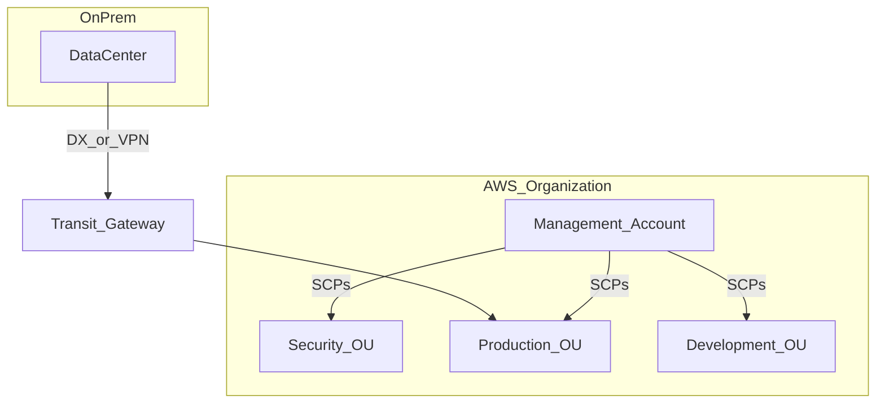

# AWS at Organizational Scale: Architecture and the SAP-C02 Exam

A course-style companion to the [Associate guide](AWS_Solutions_Architect_Associate_SAA-C03_Cheat_Sheet.md), covering what changes when one workload in one account becomes hundreds of workloads across hundreds of accounts. Parts I to VIII teach the organization-scale services and disciplines — Organizations and policy, networking at scale, security and governance, resilience across a portfolio, migration and modernization, and platform automation. Part IX is everything specific to the **AWS Certified Solutions Architect – Professional (SAP-C02)** exam, including 30 scenario questions with distractor analysis.

> **Prerequisite:** read the [Associate guide](AWS_Solutions_Architect_Associate_SAA-C03_Cheat_Sheet.md) first. This guide does not re-teach individual service selection (S3 versus EBS, SQS versus SNS); it assumes it and builds on top.

> Exam note: SAP-C02 expects **two or more years** of AWS design experience. Questions are long vignettes with plausible distractors, testing **sequencing, justification, and trade-offs** rather than service identification.

> Currency note: reviewed against AWS changes through **mid-2026**. Notable additions since many study guides were written: **resource control policies (RCPs)** and **declarative policies** in Organizations, **Aurora DSQL** for multi-Region strongly consistent writes, **AWS Transform** for VMware, mainframe, and .NET modernization, and the **Snow Family** restriction that changes bulk-migration answers. See [What Changed Recently](#what-changed-recently-professional-scope).

---

## Content

**[Part I — The Professional Mindset](#part-i--the-professional-mindset)**

1. [How to Use This Guide](#how-to-use-this-guide)
   - [Reading the Abbreviations](#reading-the-abbreviations)
2. [What Changes at Organizational Scale](#what-changes-at-organizational-scale)

**[Part II — The Multi-Account Organization](#part-ii--the-multi-account-organization)**

3. [AWS Organizations and Account Structure](#aws-organizations-and-account-structure)
4. [The Three Policy Types](#the-three-policy-types)
5. [Control Tower and Landing Zones](#control-tower-and-landing-zones)
6. [Identity at Organizational Scale](#identity-at-organizational-scale)
7. [Cost Management and Attribution at Scale](#cost-management-and-attribution-at-scale)

**[Part III — Networking at Scale](#part-iii--networking-at-scale)**

8. [Hybrid and Multi-VPC Connectivity](#hybrid-and-multi-vpc-connectivity)
9. [DNS in Hybrid Environments](#dns-in-hybrid-environments)
10. [Centralized Inspection and Network Monitoring](#centralized-inspection-and-network-monitoring)

**[Part IV — Security and Governance at Scale](#part-iv--security-and-governance-at-scale)**

11. [Organization-Wide Security Services](#organization-wide-security-services)
12. [Cross-Account Access Patterns](#cross-account-access-patterns)
13. [Data Perimeter Controls](#data-perimeter-controls)

**[Part V — Resilience at Organizational Scale](#part-v--resilience-at-organizational-scale)**

14. [Disaster Recovery Across a Portfolio](#disaster-recovery-across-a-portfolio)
15. [Backup Strategy at Scale](#backup-strategy-at-scale)

**[Part VI — Designing and Improving Solutions at Scale](#part-vi--designing-and-improving-solutions-at-scale)**

16. [Deployment and Release Strategy](#deployment-and-release-strategy)
17. [Business Continuity for New Solutions](#business-continuity-for-new-solutions)
18. [Security Controls for New Solutions](#security-controls-for-new-solutions)
19. [Reliability Engineering at Scale](#reliability-engineering-at-scale)
20. [Performance at Scale](#performance-at-scale)
21. [Cost Strategy for New Solutions](#cost-strategy-for-new-solutions)
22. [Operational Excellence at Scale](#operational-excellence-at-scale)
23. [Improving Security in Existing Environments](#improving-security-in-existing-environments)
24. [Improving Performance in Existing Environments](#improving-performance-in-existing-environments)
25. [Improving Reliability in Existing Environments](#improving-reliability-in-existing-environments)
26. [Finding Cost Optimization Opportunities](#finding-cost-optimization-opportunities)

**[Part VII — Migration and Modernization](#part-vii--migration-and-modernization)**

27. [Migration Assessment and Wave Planning](#migration-assessment-and-wave-planning)
28. [Choosing a Migration Approach](#choosing-a-migration-approach)
    - [The 6 R's](#the-6-rs)
    - [Migration Tools](#migration-tools)
29. [Re-architecting Existing Workloads](#re-architecting-existing-workloads)
30. [Modernization and Enhancements](#modernization-and-enhancements)

**[Part VIII — Platform Automation](#part-viii--platform-automation)**

31. [For Engineers: Platform Automation at Org Scale](#for-engineers-platform-automation-at-org-scale)
    - [Multi-Account Deployment Pipelines](#pa1-multi-account-deployment-pipelines)
    - [Guardrails as Code](#pa2-guardrails-as-code)
    - [Cross-Account Application Wiring](#pa3-cross-account-application-wiring)
    - [Automated Remediation](#pa4-automated-remediation)
    - [Cost Attribution Automation](#pa5-cost-attribution-automation)

**[Part IX — Exam Preparation (SAP-C02)](#part-ix--exam-preparation-sap-c02)**

32. [Exam at a Glance](#exam-at-a-glance)
33. [Exam Domain Map](#exam-domain-map)
34. [What Changed Recently (Professional Scope)](#what-changed-recently-professional-scope)
35. [Cross-Domain Scenario Q&A (30 Questions)](#cross-domain-scenario-qa-30-questions)
36. [6-Week Professional Study Plan](#6-week-professional-study-plan)
37. [Rapid Answers](#rapid-answers)
38. [Self-Check Checklist](#self-check-checklist)

**[Part X — Reference](#part-x--reference)**

39. [References](#references)
40. [Glossary (Professional Terms)](#glossary-professional-terms)

---

# Part I — The Professional Mindset

## How to Use This Guide

[↑ Content](#content)

This guide is written as a course in operating AWS at organizational scale, with the exam treated as an outcome rather than the subject. The order is deliberate: Part II first, because the multi-account organization is the foundation everything else assumes, then networking, security, resilience, design and improvement, migration, and platform automation.

| Part | Contents | Read it when |
|------|----------|--------------|
| **I — The Professional Mindset** | What actually changes between one account and two hundred | First. It explains why the rest of the guide is organized as it is |
| **II — The Multi-Account Organization** | Organizations, the three policy types, Control Tower and landing zones, identity at scale, cost attribution | Immediately after. Nothing later makes sense without it |
| **III — Networking at Scale** | Transit Gateway, Direct Connect, hybrid DNS, centralized inspection | When the question involves more than two VPCs or a data center |
| **IV — Security and Governance at Scale** | Organization-wide detection, cross-account access, data perimeters | Alongside Part II — governance and security are the same project |
| **V — Resilience at Organizational Scale** | DR across a portfolio, backup strategy, ransomware resilience | When RTO and RPO differ per workload, which at scale is always |
| **VI — Designing and Improving Solutions** | Deployment, continuity, reliability, performance, cost — for both new and existing workloads | The bulk of day-to-day architecture work |
| **VII — Migration and Modernization** | Assessment, wave planning, the 6 R's, tooling, modernization ladders | When workloads are arriving from somewhere else |
| **VIII — Platform Automation** | Working code: multi-account pipelines, guardrails as code, remediation, cost attribution | If you build the platform rather than consume it |
| **IX — Exam Preparation** | Format, domain map, recent changes, 30 scenarios, study plan | When you have a test date |
| **X — Reference** | Documentation links and the Professional glossary | Continuously |

**How to answer a long scenario**, whether in an exam or a design review. The five-step shape used throughout the Q&A section:

1. **Recommended approach** — what to do first, and what architecture results.
2. **Sequencing** — phased rollout, migration waves, or parallel tracks.
3. **Trade-off matrix** — cost, complexity, risk, and time-to-value for the key decisions.
4. **Why the alternatives fail** — which unstated assumption each one makes.
5. **Deeper understanding** — the operational and organizational consequences that follow.

Use this guide when the situation involves **40 accounts**, **Direct Connect plus 20 VPCs**, **an Oracle migration with a 15-minute RPO**, or **retrofitting GuardDuty organization-wide**. For anything that is fundamentally a single-service question, the [Associate guide](AWS_Solutions_Architect_Associate_SAA-C03_Cheat_Sheet.md) teaches it in more depth.

### Reading the Abbreviations

Professional vignettes are written in dense shorthand, so each abbreviation here is expanded the first time it appears in a section. Two glossaries back this up: the [Professional glossary](#glossary-professional-terms) at the end of this file for organization- and migration-scale terms, and the [Associate guide's complete glossary](AWS_Solutions_Architect_Associate_SAA-C03_Cheat_Sheet.md#glossary-and-abbreviations) for shared AWS and general-computing vocabulary.

Three abbreviation clusters cause the most confusion at this level, and they are worth settling before Part II:

| Cluster | The distinction |
|---------|-----------------|
| **SCP / RCP / declarative policy** | SCPs cap what your **principals** may do; RCPs cap what may be done **to your resources**, including by principals outside your organization; declarative policies enforce a **service configuration** regardless of which API is used to change it |
| **RTO / RPO** | RTO is maximum acceptable **downtime**; RPO is maximum acceptable **data loss**, expressed as a time window. Every DR question turns on which of the two the vignette constrains |
| **MGN / DMS / DRS / SCT** | MGN rehosts **servers**; DMS migrates and replicates **databases**; DRS provides continuous replication for **disaster recovery**; SCT converts **schemas** when the database engine changes |

---

## What Changes at Organizational Scale

[↑ Content](#content)

The Associate level asks *which service*. Professional-level architecture asks *which sequence, which scope, and what do we defer* — and it does so because at organizational scale a set of new constraints appears that simply do not exist for a single workload in a single account. Understanding those constraints is the real content of this level; the services are mostly the same ones.

**Six shifts define the difference.**

**1. The unit of design becomes the account, not the resource.** With one account you design VPCs and instances. With two hundred accounts you design the *organization*: which accounts exist, what each is for, which policies attach to which OU, how a new account is created and baselined. Individual resources become an implementation detail of a platform.

**2. Every control must work by default, for resources that do not exist yet.** A bucket policy secures one bucket. A team of 40 engineers creating buckets weekly needs something that secures buckets nobody has created — which is why RCPs, declarative policies, and Config rules with automatic remediation matter more than any individual configuration. The question shifts from "is this resource secure" to "can an insecure resource be created at all."

**3. Networking becomes an address-space and routing problem.** One VPC needs a CIDR. Sixty VPCs plus three data centers plus two acquisitions need an *IP address plan*, because overlapping ranges cannot be routed together at any price. The most expensive networking mistakes at this level were made years earlier by someone who picked `10.0.0.0/16` twice.

**4. Requirements stop being uniform.** A single workload has one RTO. A portfolio has a hundred workloads whose RTOs range from five minutes to a week, and applying one standard to all of them guarantees you are both over-spending on the tail and under-protecting the crown jewels. Tiering — and defending the tiers — becomes the architect's job.

**5. Sequencing becomes as important as the target design.** Nobody migrates 200 applications at once or retrofits guardrails onto 40 accounts in a weekend. The valuable skill is ordering the work so that each step is independently safe, reversible, and delivers something: land the guardrails before the workloads, the network before the migration waves, the logging before the incident. A perfect end-state design with no credible path to it is worth nothing.

**6. Organizational constraints are real constraints.** Team skill, existing licensing, vendor contracts, audit cycles, and the political cost of a migration are inputs to the design, not excuses. This is why Professional vignettes mention them: an answer that is technically superior but requires a Kubernetes platform team that does not exist is the wrong answer.

**What this means for how you read a scenario.** Long vignettes are long because they contain constraints, and usually every sentence contributes one. Before evaluating options, extract: how many accounts and Regions, what the regulatory requirement is, what already exists that cannot be discarded, what the timeline is, what the team can actually operate, and what the blast radius of the change is. The correct answer satisfies all of them; each distractor violates exactly one, and usually the one mentioned only in passing.

---

# Part II — The Multi-Account Organization

Everything at this level rests on the multi-account environment: how accounts are structured, what policies constrain them, how they are created, who signs into them, and how their cost is attributed. This part covers that foundation in depth.

---

## AWS Organizations and Account Structure

[↑ Content](#content)

**What it is.** AWS Organizations binds many accounts into one entity with central policy and consolidated billing. It is not optional at scale — it is the substrate that makes everything else in this guide possible.

**The components, precisely.**

| Component | What it is |
|-----------|-----------|
| **Management account** (formerly master, sometimes payer) | Owns the organization. Creates and invites accounts, attaches policies, receives the consolidated bill. **Cannot be restricted by SCPs or RCPs**, which is why it must run no workloads |
| **Member account** | Every other account. Isolated by default, constrained by inherited policies |
| **Root** | The top of the OU hierarchy — not the root *user*, which is a different thing entirely. Confusing the two is common |
| **OU** (Organizational Unit) | A container of accounts and nested OUs. Policies attach here and are **inherited downward**, which is what makes hierarchy design consequential |
| **All features versus consolidated billing only** | All features is required for SCPs, RCPs, declarative policies, and integrated services. Consolidated-billing-only organizations are legacy and should be migrated |
| **Service-linked / trusted access** | The mechanism by which GuardDuty, Config, CloudTrail, Backup, and others operate organization-wide, usually through a **delegated administrator** account |

**The reference account structure**, which most mature organizations converge on:

| OU / Account | Purpose |
|--------------|---------|
| **Management** | Organizations, policies, billing. **No workloads** — it cannot be constrained by SCPs, so anything in it is effectively unguarded |
| **Security** | Log archive, GuardDuty and Security Hub administration, forensics. Logs are write-once and workload teams have no delete rights |
| **Infrastructure** | Shared networking (Transit Gateway, Route 53 Resolver, IPAM), shared services, and CI/CD tooling |
| **Workloads** | Dev / Test / Prod accounts, one set per product line or business unit. The account, not a tag, is the environment boundary |
| **Sandbox** | Experimentation, with restrictive SCPs and a hard budget action |
| **Suspended** | An OU with a deny-all SCP, where accounts go before closure |

**Why so many accounts rather than one large one.** The account is AWS's strongest isolation boundary, and it separates three things simultaneously: IAM (a compromised dev credential cannot reach production), service quotas (a runaway test job cannot exhaust production's Lambda concurrency or API rate limits), and billing (cost attribution needs no tagging discipline at all). It also creates a natural blast-radius boundary for both incidents and mistakes.

The cost is that everything cross-account requires deliberate plumbing — networking, deployment pipelines, log aggregation, DNS, and access. That plumbing is precisely what a platform team exists to build, and it is what the Professional exam tests.

**Designing the OU hierarchy** has one governing principle: **group accounts by the policies they should share, not by the org chart.** A hierarchy mirroring the company's departments looks tidy and produces policy chaos when departments reorganize. A hierarchy organized by environment and sensitivity (`Workloads/Prod`, `Workloads/NonProd`, `Sandbox`) stays stable because those categories genuinely differ in what they should be allowed to do.

**Specifics worth knowing.** The default account quota is 10 (raisable, and raised freely on request). Policies are inherited and *cumulative* — an SCP at the root and another at the OU both apply, and the effect is the intersection. Moving an account between OUs changes its effective permissions immediately, which is a useful lever and a dangerous one. Closing an account is possible from the management account, and the account remains in a suspended state for 90 days.

---

## The Three Policy Types

[↑ Content](#content)

Older material presents SCPs as the only organization-level guardrail. There are now three, and choosing correctly among them is a defining Professional-level skill.

| Policy type | Constrains | Answers the question |
|-------------|-----------|----------------------|
| **SCP** (Service Control Policy) | **Principals** in member accounts | "What may identities in this account do?" |
| **RCP** (Resource Control Policy) | **Resources** in member accounts | "What may be done *to* our resources, by anyone, including principals outside the organization?" |
| **Declarative policy** | **Service configuration** | "What configuration must remain true, regardless of which API someone uses?" |

**Service Control Policies in depth.** An SCP is a *filter*, not a grant. It defines the maximum permissions available to principals in an account; the account's own IAM policies must still grant anything to actually happen. Effective permissions are the intersection of the SCP and IAM.

The practical properties that questions turn on:

- **SCPs cannot grant.** An SCP allowing `s3:*` grants nothing.
- **SCPs do not apply to the management account.** This is the single most important SCP fact, and the reason the management account must be empty.
- **SCPs do not apply to service-linked roles**, so AWS services can continue functioning.
- **Deny lists are the practical pattern.** Start from `FullAWSAccess` and add explicit denies. Allow lists are technically possible and operationally miserable, because every new service requires a policy change.
- **Common denies:** Regions outside an allowlist (using `aws:RequestedRegion`), root user actions, disabling CloudTrail or GuardDuty, deleting log buckets, creating IAM users, and resources without required tags (using `aws:RequestTag`).

**Resource Control Policies in depth.** An RCP applies to resources in scope, regardless of who wrote the resource policy. The properties that matter:

- RCPs **never grant** permissions, like SCPs.
- They do **not** apply to the management account or to service-linked roles.
- They require an all-features organization.
- They cover a **subset of services** — S3, SQS, KMS, Secrets Manager, and STS among them — so they are not yet a universal perimeter.

**Why RCPs changed the game:** before them, a data perimeter on resources depended on every bucket, queue, and key carrying the correct resource policy, and one missed resource was a hole that no audit reliably found. An RCP applies centrally, so resources created tomorrow inherit the perimeter. The classic question it answers is "guarantee that no bucket in 200 accounts can be read from outside the organization, without auditing 200 bucket policies."

**Declarative policies in depth.** These express a desired *configuration* rather than a list of forbidden API actions — "VPCs may not have internet gateways," "AMIs may not be shared publicly," "EBS volumes must be encrypted." The distinction is subtle and important: an SCP denying specific API actions can be bypassed by a new API that AWS ships next quarter and your deny list has never heard of. A declarative policy states the outcome, and AWS keeps enforcing it across API changes.

**Choosing among the three.**

| Requirement | Right tool |
|-------------|-----------|
| "Nobody in dev may create resources outside eu-central-1" | **SCP** — it limits principals |
| "No external principal may read any bucket we own" | **RCP** — it limits resources |
| "No VPC may have an internet gateway, permanently" | **Declarative policy** — it enforces configuration |
| "This team may deploy only these services" | **SCP** on their OU |
| "Snapshots and AMIs must never be public" | **Declarative policy** |
| "Everything must be tagged with a cost center at creation" | **SCP** with an `aws:RequestTag` condition, audited by Config |

**The common design error** is reaching for SCPs for everything. SCPs are blind to access that does not originate from your organization's principals, so an externally shared bucket is a resource-side problem needing an RCP. And any control expressible as a configuration is better as a declarative policy, because it keeps holding when the API surface changes. A fourth consideration: **permission boundaries** live inside the account and are the right tool for delegating IAM administration safely — SCPs cannot express "developers may create roles, but only ones weaker than this."

**A note on rollout, because this is where real projects fail.** Deploying a restrictive SCP to a live production OU breaks things you did not predict — a forgotten automation, a vendor integration, a service-linked behavior. The safe sequence is: write the policy, apply it to a sandbox OU, use CloudTrail to find calls that *would* have been denied, then expand OU by OU. Policy rollout is a migration, not a configuration change.

---

## Control Tower and Landing Zones

[↑ Content](#content)

**What a landing zone is.** A pre-built, opinionated multi-account environment: the account structure, centralized logging, baseline guardrails, an identity setup, and a repeatable way to create new accounts. You either build one or buy AWS's implementation of one.

**AWS Control Tower** is that implementation. It creates the Log Archive and Audit accounts, sets up CloudTrail organization trails and Config aggregation, applies a set of **controls** (formerly guardrails) classified as *preventive* (implemented as SCPs), *detective* (implemented as Config rules), and *proactive* (implemented as CloudFormation Hooks that block non-compliant resources before creation), and provides **Account Factory** for vending new accounts with a baseline already applied.

| Approach | When it fits |
|----------|--------------|
| **Control Tower** | A greenfield or early-stage organization that wants a compliant baseline quickly, and whose requirements fit AWS's opinions |
| **Organizations plus custom IaC** | An existing large organization, a mature platform team, or requirements Control Tower's opinions do not accommodate |

**The honest trade-off:** Control Tower reaches a compliant baseline far faster and is harder to customize afterwards; a hand-built landing zone is the reverse. Both are legitimate, and the deciding factor is usually whether you have a platform team that will own the alternative for years.

**The scenario that appears repeatedly:** an existing 40-account organization wants Control Tower. The answer is that Control Tower can *enroll* existing accounts — but only after each account's configuration is reconciled with the landing zone's expectations (Config recorder state, required roles, no conflicting SCPs, CloudTrail arrangement). The enrollment is the easy part; the reconciliation is the project, and it is done in waves starting with the least critical accounts.

**Account Factory for Terraform (AFT)** is worth knowing by name: it drives account vending through a Terraform pipeline, so account creation and its baseline customizations are code and reviewable. **Customizations for Control Tower (CfCT)** is the CloudFormation-based equivalent.

---

## Identity at Organizational Scale

[↑ Content](#content)

**The model.** With many accounts, per-account IAM users are unmanageable and unauditable. **IAM Identity Center** replaces them: identities live in one place (an external IdP or Identity Center's own directory), and access is granted as a three-way assignment — *which group*, gets *which permission set*, in *which accounts*.

**How permission sets actually work**, since this is the mechanism: a permission set is a template containing managed policies, an inline policy, an optional permissions boundary, and a session duration. When you assign it to an account, Identity Center provisions a corresponding IAM role in that account and keeps it in sync. Changing the permission set updates every account it is assigned to — which is what makes "revoke this access everywhere" a single operation rather than a project.

**Design guidance that matters at scale:**

- **Assign to groups, never to individuals.** Joiner-mover-leaver processes should touch the IdP only.
- **Keep permission sets few and coarse** (`ReadOnly`, `Developer`, `DataEngineer`, `Break-Glass`). A permission set per person is per-account IAM with extra steps.
- **Use attribute-based access control** where possible: pass IdP attributes as session tags and write policies referencing `aws:PrincipalTag`, so one permission set serves many teams.
- **Session duration is a real security control.** Long sessions are convenient and extend the window a stolen session is useful.
- **Plan break-glass access.** Identity Center is a Region-pinned service, and your recovery plan must survive its unavailability or a misconfigured IdP. Keep a small number of heavily protected, hardware-MFA, monitored root or IAM credentials, and alarm on their use.

**Workload identity across accounts** is the other half. Prefer role assumption with narrowly scoped trust policies over any form of shared credential, use **RAM** (Resource Access Manager) to share resources rather than duplicating them, and remember that cross-account access to an encrypted resource requires the KMS key policy to agree as well as the resource and identity policies.

**Active Directory integration** is a recurring vignette. The options are: federate Identity Center to AD (through AD Connector or a two-way trust) for human console access, and use **AWS Managed Microsoft AD** for workloads that need genuine domain join — Windows instances, FSx for Windows, RDS SQL Server Windows authentication. "Users must keep their existing corporate credentials" points to federation, not to a new directory.

---

## Cost Management and Attribution at Scale

[↑ Content](#content)

**What changes with many accounts.** Cost stops being a number and becomes an *attribution problem*: engineering teams cannot optimize what they cannot see, and finance cannot forecast what it cannot attribute. The tooling therefore splits into visibility, attribution, and control.

| Tool | Purpose |
|------|---------|
| **Cost Explorer** | Trends, forecasts, and **RI/SP** (Reserved Instance / Savings Plan) purchase recommendations across the organization |
| **CUR** (Cost and Usage Report) | Raw hourly line-item data in S3, queried with Athena or Amazon Quick. The only complete source for detailed chargeback |
| **AWS Budgets** | Alerts and **budget actions** — apply a restrictive policy or stop resources when a threshold is crossed |
| **Cost Anomaly Detection** | Machine-learning detection of unusual spend per account or service |
| **Cost Optimization Hub** | Consolidated, deduplicated recommendations across accounts — increasingly the right answer where older material says Trusted Advisor |
| **Compute Optimizer** | Right-sizing for EC2, EBS, Lambda, and **ASGs** (Auto Scaling Groups) from observed utilization |
| **S3 Storage Lens** | Organization-wide storage usage and optimization metrics |
| **Pricing Calculator** | Cost estimates *before* deployment, for comparing candidate architectures |

**Commitment management is a central-team responsibility.** Because Savings Plans and RIs are shared across the organization by default, buying them per team produces both over-commitment and unused coverage. The workable model is that a central team owns commitment purchasing against aggregate baseline usage, and the discount is redistributed to accounts through the chargeback model. Note that **Database Savings Plans** (December 2025) extended this to database services including DynamoDB.

**Tagging, and the step everyone forgets.** Mandatory tags such as `CostCenter`, `Environment`, and `Owner`, enforced at creation by an SCP using the `aws:RequestTag` condition and audited afterwards by AWS Config rules. But a tag does nothing for cost reporting until it is **activated as a cost allocation tag** in the billing console — and activation is not retroactive. Untagged historical spend stays unattributable forever, which is why this is a day-one task rather than a first-budget-crisis task.

**Chargeback versus showback**, since the terms appear in vignettes: *showback* reports each team's spend without moving money, and is the right starting point because it creates awareness without triggering political defensiveness. *Chargeback* actually allocates the cost to the team's budget, which drives behavior harder and requires attribution accurate enough to survive a dispute. Attempting chargeback before attribution is trustworthy is a reliable way to destroy confidence in the whole programme.

---

# Part III — Networking at Scale

---

## Hybrid and Multi-VPC Connectivity

[↑ Content](#content)

**Vocabulary for this part:** **VPC** = Virtual Private Cloud (an isolated network), **CIDR** = Classless Inter-Domain Routing (IP range notation such as `10.0.0.0/16`), **DX** = Direct Connect (a dedicated physical circuit), **TGW** = Transit Gateway, **on-prem** = on-premises, meaning your own data center.

| Pattern | When | Limitation |
|---------|------|------------|
| **VPC Peering** | A few VPCs, where a full mesh is still manageable | Non-transitive (A↔B and B↔C does not give A↔C); overlapping CIDR ranges make peering impossible |
| **Transit Gateway** | Hub-and-spoke connecting many VPCs plus on-premises | Route table design gets complex; per-attachment and per-GB cost adds up at scale |
| **Direct Connect + DX Gateway** | Dedicated high-bandwidth link to on-premises | Lead time of weeks to months; a single circuit is a single point of failure |
| **Site-to-Site VPN** | Backup path, or lower-bandwidth hybrid | Depends on the public internet; roughly 1.25 Gbps per tunnel |
| **PrivateLink** | Exposing or consuming one service privately, SaaS-style | Per-service endpoints; it is not a full network extension |

**The CIDR overlap problem deserves emphasis** because it is the most common reason a merger or acquisition integration fails: two networks that both use `10.0.0.0/16` cannot be peered or routed together at all, since routers cannot tell which side an address belongs to. The fixes are all expensive — re-address one network, or place NAT or PrivateLink in between so only translated addresses are exposed. This is why IP address planning (**IPAM** — IP Address Management, which AWS offers as a service) is a Professional-level concern rather than a detail.

**Transit Gateway in depth**, since it is the backbone of most large AWS networks. A TGW is a Regional router. VPCs, VPN connections, Direct Connect gateways, and other TGWs attach to it, and **TGW route tables** decide which attachments can reach which. That last point is the design lever people miss: a TGW is not automatically a flat network. By giving Production and Development their own route tables, and a shared-services route table reachable from both, you get segmentation without separate infrastructure — the standard way to satisfy "dev must never reach prod" while still sharing DNS and monitoring.

The specifics that shape designs:

| Item | Detail |
|------|--------|
| Scope | Regional; **peer TGWs** across Regions for a global network |
| Bandwidth | Up to 50 Gbps per VPC attachment, with equal-cost multipath across attachments |
| Cost | Per attachment-hour **plus per GB processed** — which is why very chatty inter-VPC traffic sometimes justifies direct peering alongside a TGW |
| Sharing | Shared to other accounts with **RAM**, so spoke accounts attach their own VPCs to a central TGW they do not own |
| Multicast and appliance mode | Supported; **appliance mode** keeps a flow pinned to the same appliance AZ, which stateful inspection requires |

**Direct Connect in depth**, because the exam tests its resilience model. A **connection** is the physical port (1, 10, or 100 Gbps dedicated, or a hosted connection from a partner). On top of it you create **virtual interfaces**: a *private* VIF reaches one VPC, a *transit* VIF reaches a Direct Connect gateway and thence a TGW, and a *public* VIF reaches AWS public services. A **Direct Connect gateway** is global, which lets one circuit reach VPCs in multiple Regions.

Resilience is the part that matters: a single connection at a single location is a single point of failure, and AWS's resilience models are explicit — *development and test* (one connection), *high resilience* (two connections at two locations), and *maximum resilience* (two connections at each of two locations, on separate devices). Add a Site-to-Site VPN as a lower-bandwidth backup regardless, since it provisions in minutes. And remember that **Direct Connect is private but not encrypted**; a requirement for encryption in transit means running a VPN over the DX or using MACsec on supported ports.

**MTU and BGP details** appear occasionally: DX supports 9,001-byte jumbo frames on private and transit VIFs while VPN does not, and routing preference is controlled with BGP attributes — **AS path** and **local preference** on your side, longest-prefix match first. When a vignette says "traffic must prefer Direct Connect and fail over to VPN," the mechanism is BGP path selection, not a manual switch.

---

## DNS in Hybrid Environments

**DNS** (Domain Name System) resolves names to IP addresses. In a hybrid environment, names must resolve correctly in both directions — AWS workloads need to find on-premises servers and vice versa.

| Component | Role |
|-----------|------|
| **Route 53 Resolver** | The DNS resolver inside every VPC; **inbound endpoints** let on-premises systems query AWS names, **outbound endpoints** let AWS query on-premises names |
| **Resolver rules** | Conditional forwarding — send queries for `corp.example.com` to the on-premises DNS servers |
| **Split-horizon DNS** | The same hostname deliberately resolving to a private address internally and a public one externally |
| **Private hosted zones** | Route 53 zones resolvable only from associated VPCs — the standard way to name internal services |
| **Resolver DNS Firewall** | Blocks or monitors queries for specified domains, which is how you stop **DNS exfiltration** and malware command-and-control |

**The pattern to internalize** for bidirectional hybrid resolution: create a **shared services VPC** in the Infrastructure account holding the Resolver endpoints, share it or associate private hosted zones across the organization, and point on-premises DNS servers at the inbound endpoint while forwarding rules send corporate domains to the outbound endpoint. Doing this per-VPC instead of centrally is the mistake that produces sixty sets of forwarding rules and one very bad afternoon.

**Route 53 Profiles** are worth knowing as the newer answer to that sprawl: they bundle private hosted zone associations, resolver rules, and DNS Firewall rules into a profile applied to many VPCs at once.

---

## Centralized Inspection and Network Monitoring

[↑ Content](#content)

| Tool | What it gives you |
|------|-------------------|
| **VPC Flow Logs** | Metadata for accepted and rejected traffic — source, destination, port, bytes. Metadata only, not contents: enough to answer "did this connection happen?" but not "what was sent?" |
| **Traffic Mirroring** | Copies actual packets to an inspection appliance, for **IDS** (Intrusion Detection System) or forensic capture |
| **AWS Network Firewall** | Managed stateful inspection, domain filtering, and Suricata-compatible rules |
| **Gateway Load Balancer** | Inserts third-party appliances transparently into the traffic path, preserving source and destination |
| **Firewall Manager** | Applies AWS WAF, Shield Advanced, Network Firewall, and security-group policies consistently across every account |
| **Reachability Analyzer / Network Access Analyzer** | Answers "can A reach B, and why not" from configuration, without sending a packet — and finds unintended paths to the internet |

**The centralized inspection pattern**, which is the standard regulated-industry design: all spoke VPCs attach to a Transit Gateway, TGW route tables send inter-VPC and egress traffic to an **inspection VPC**, and that VPC contains Network Firewall or a third-party appliance behind a Gateway Load Balancer. Every packet crossing a boundary is inspected in one place, so the control is uniform and the evidence is centralized.

Two details make or break it. **Appliance mode** must be enabled on the inspection VPC's TGW attachment, otherwise return traffic can arrive at a different AZ's appliance and stateful inspection breaks. And centralized egress through a shared NAT gateway saves money on gateway-hours but concentrates data-processing charges and creates a bandwidth chokepoint — worth measuring rather than assuming.

**A cost note that comes up in real reviews:** centralizing everything through a TGW means every cross-VPC byte is billed twice (in and out) plus TGW processing. For two VPCs exchanging very high volume continuously, a direct peering connection alongside the TGW is both faster and cheaper. Architectural purity is not free.



---

# Part IV — Security and Governance at Scale

---

## Organization-Wide Security Services

[↑ Content](#content)

| Service | Scope |
|---------|-------|
| **CloudTrail organization trail** | Records every **API** (Application Programming Interface) call in every account into one central S3 bucket, encrypted with **KMS** (Key Management Service) |
| **AWS Config aggregator** | Collects resource configuration and compliance-rule results across all accounts and Regions |
| **Security Hub** | Single pane of findings from GuardDuty, Inspector (vulnerability scanning), and Macie (sensitive-data discovery) |
| **GuardDuty** | Continuous threat detection; enable organization-wide through a delegated administrator |
| **IAM Access Analyzer** | Reports which resources are reachable from outside the organization, and which granted permissions are unused |
| **AWS Firewall Manager** | Pushes AWS WAF rules and security-group policies consistently across accounts |

**The two-word idea behind all six:** *centralize evidence, delegate administration*. Logs and findings land in an account that workload teams cannot write to (so evidence cannot be tampered with), while day-to-day operation happens in a security account rather than the management account (which should hold no workloads and be used as rarely as possible).

**How to actually roll this out**, because "enable GuardDuty organization-wide" is a sentence that hides a project. The order that works: designate the Security account as **delegated administrator** for each service; enable *auto-enrollment* so new accounts are covered without anyone remembering; aggregate findings into Security Hub in that same account; then tune. Tuning is not optional — an untuned Security Hub in a large organization produces thousands of findings, the team stops reading them, and you have bought a compliance artifact rather than a security control.

---

## Cross-Account Access Patterns

[↑ Content](#content)

- **Delegated administrator** — security services are operated from an account in the Security **OU** (Organizational Unit) rather than from the management account, which should stay empty and rarely used.
- **Cross-account roles** — `sts:AssumeRole` with narrowly scoped trust policies. For third parties, add an **external ID**: a shared secret the partner must supply, defeating the *confused deputy* attack in which another of that partner's customers persuades them to act against your account.
- **RAM** (Resource Access Manager) — shares actual resources (subnets, Transit Gateway attachments, Route 53 Resolver rules, License Manager configurations) with other accounts instead of duplicating them. This is what makes a shared-VPC or shared-TGW topology possible.
- **Resource policies plus KMS key policies** — cross-account access to an encrypted resource requires *three* alignments: the caller's identity policy, the resource policy, and the KMS key policy. Teams routinely fix the first two and spend an afternoon on the third.

**Shared VPC versus per-account VPC** is a recurring design question. Sharing subnets through RAM centralizes network administration and conserves address space, at the cost of coupling accounts to a network they do not control and complicating security-group ownership. Per-account VPCs attached to a TGW give teams autonomy and cost more addresses and attachments. Neither is wrong; the deciding factor is whether the network team wants to be in the path of every application change.

---

## Data Perimeter Controls

[↑ Content](#content)

A data perimeter answers "only my identities, from my networks, to my resources." It is built from four condition-key families, applied through SCPs, RCPs, and resource policies together:

| Goal | Mechanism |
|------|-----------|
| Only identities in my org may access my resources | **RCP** with `aws:PrincipalOrgID` |
| My identities may only access my resources | SCP with `aws:ResourceOrgID` |
| Access only from expected networks | `aws:SourceVpce` / `aws:SourceIp` conditions |
| Only trusted service principals | `aws:PrincipalIsAWSService`, `aws:SourceArn` |

**Why RCPs changed this:** before RCPs, a data perimeter on resources depended on every bucket, queue, and key carrying the right resource policy — one missed resource was a hole. An RCP applies centrally to all supported resources in scope, so new resources inherit the perimeter by default.

---

# Part V — Resilience at Organizational Scale

---

## Disaster Recovery Across a Portfolio

[↑ Content](#content)

**RTO** (Recovery Time Objective) is the maximum acceptable *downtime*; **RPO** (Recovery Point Objective) is the maximum acceptable *data loss*, expressed as a time window. At organization scale the important addition is that these are set **per workload tier**, not once for the company — paying active-active prices for an internal reporting tool is as much an architecture failure as giving the payments system nightly backups.

| Strategy | RTO | RPO | When at org scale |
|----------|-----|-----|-------------------|
| **Backup and restore** | Hours | Hours | The default for the long tail of non-critical workloads |
| **Pilot light** | Tens of minutes | Minutes | Core database and network kept minimal but live in the DR Region |
| **Warm standby** | Minutes | Minutes | A scaled-down but complete stack, ready to scale up |
| **Active-active multi-Region** | Near zero | Near zero | Revenue-critical global products; highest cost and complexity |

**AWS Elastic Disaster Recovery (DRS)** — continuous block-level replication of whole servers, giving RTO in minutes and RPO in seconds without paying for a full active-active footprint. It is the pragmatic middle option, and often the right answer when a question demands "minutes, not hours" but rules out running two live Regions.

---

## Backup Strategy at Scale

[↑ Content](#content)

| Control | Why it exists at this scale |
|---------|----------------------------|
| **AWS Backup organization-wide plans** | Backup policy defined centrally in Organizations and applied by tag, so protection is inherited rather than remembered. Managed through a delegated administrator account |
| **Cross-Region copy** | Required by many regulators, and the only protection against losing an entire Region |
| **Cross-account copy** | The control that matters most against a compromised credential — a copy in an account the attacker cannot reach |
| **Vault Lock (compliance mode)** | Immutable retention that nobody can shorten, including the root user and AWS Support |
| **Logically air-gapped vaults** | AWS-owned, encrypted vaults that can be shared for restore to another account, giving recovery even if the source account is destroyed |
| **Restore testing** | Scheduled automated restores that validate the backups actually work. Untested backups are a hypothesis |

**The reasoning to be able to articulate:** modern ransomware targets backups first, because an attacker who encrypts data while leaving recoverable backups has no leverage. So the design requirement is not "we take backups" but "no single compromised identity can destroy both the data and every copy of it." That decomposes into three properties — a copy in a different account, immutability with a retention period nobody can shorten, and a tested restore path — and a design missing any one of them fails the requirement regardless of how many backups it takes.

---

# Part VI — Designing and Improving Solutions at Scale

---

## Deployment and Release Strategy

[↑ Content](#content)

| Pattern | Risk | Rollback |
|---------|------|----------|
| **All-at-once** | Highest — every instance replaced simultaneously | Redeploy the previous version (there is an outage in between) |
| **Rolling** | Medium — replaced in batches, so both versions run at once | Stop the deployment and drain the bad instances |
| **Blue/green** | Low — a complete second environment ("green") is built, then traffic is switched | Switch traffic back to the old ("blue") environment; near-instant |
| **Canary** | Lowest — a small percentage of traffic goes to the new version first | Automated rollback triggered by error-rate or latency metrics |

**The constraint that decides between them:** blue/green needs double the infrastructure for the duration of the deployment, and it requires that both versions can coexist against the *same database*. That schema-compatibility requirement (an "expand and contract" migration: add the new column, deploy code tolerant of both, then remove the old) is the real work, and the reason teams settle for rolling deployments.

**IaC** (Infrastructure as Code): CloudFormation **StackSets** deploy one template across many accounts and Regions from a central point; **drift detection** reports where reality has diverged from the template; **change sets** preview what a deployment will actually alter before it runs.

**CI/CD** (Continuous Integration / Continuous Delivery): CodePipeline for orchestration, CodeBuild for build and test, CodeDeploy for release (or any third-party equivalent), with manual approval gates before production.

---

## Business Continuity for New Solutions

[↑ Content](#content)

Design for **Region-level** failure when RTO/RPO requires it:

- Route 53 health checks + failover routing; **Route 53 Application Recovery Controller** for readiness checks and routing control when you need a reliable, dependency-light failover switch
- Data layer options, and what each actually promises:

| Option | Write model | Consistency across Regions |
|--------|-------------|----------------------------|
| **Aurora Global Database** | Single writer Region | Asynchronous, typically sub-second lag |
| **DynamoDB Global Tables** | Multi-active writes | Eventually consistent (last-writer-wins conflict resolution) |
| **Aurora DSQL** | Multi-active writes | Strongly consistent across Regions |
| **S3 CRR / SRR** | Asynchronous replication | Eventual; add Replication Time Control for an SLA |
| **AWS Elastic Disaster Recovery (DRS)** | Block-level replication | Continuous, seconds of RPO, minutes of RTO |

- Regular **game days** — simulate Region failure and measure actual RTO/RPO rather than the documented one

See [Resilience and Disaster Recovery](AWS_Solutions_Architect_Associate_SAA-C03_Cheat_Sheet.md#resilience-and-disaster-recovery) in the Associate guide for the four strategy definitions and the RTO/RPO arithmetic.

**Deeper understanding:** the failover mechanism is usually the weakest link, not the data replication. A DR plan that depends on the control plane of the failed Region, or on a human running a runbook nobody has rehearsed, has a much worse real RTO than its design document claims. This is why ARC exists and why game days are non-negotiable.

---

## Security Controls for New Solutions

[↑ Content](#content)

Greenfield checklist:

- [ ] IAM Identity Center for human access; no long-lived IAM users
- [ ] Encryption by default (EBS, S3, RDS) with CMK strategy
- [ ] VPC with private subnets; VPC endpoints for AWS APIs
- [ ] WAF + Shield on public endpoints
- [ ] Secrets Manager for credentials; no secrets in code/env plain text
- [ ] GuardDuty + Security Hub from day one

**Large-scale web attack mitigation:** CloudFront → WAF (rate limits, geo block, managed rules) → ALB in private subnets.

---

## Reliability Engineering at Scale

[↑ Content](#content)

- **Cell-based architecture** — partition the whole stack into independent "cells," each serving a subset of customers, so a failure affects one cell rather than everyone. **Shuffle sharding** goes further: each customer is assigned to a random *combination* of cells, so no two customers share exactly the same set and one abusive tenant cannot take down another's entire capacity.
- **Bulkhead pattern** — named after ship compartments: give each tenant or feature its own thread pool, connection pool, or queue, so one flooded component cannot consume the resources every other component needs.
- **Circuit breaker** — after repeated failures, stop calling a failing dependency entirely for a cooling-off period and fail fast instead. This protects both sides: the caller stops piling up blocked threads, and the struggling dependency gets a chance to recover instead of being retried into the ground. Buffer the work in SQS so nothing is lost.
- **Chaos engineering** — deliberately inject failure in production-like environments to verify the theory. **FIS** (Fault Injection Simulator) does this in a controlled, stoppable way (terminate instances, add latency, fail an AZ).

**Service quotas:** request increases proactively for production, before the launch that needs them, since some increases take days. Document current limits in runbooks so that an on-call engineer recognizes throttling for what it is.

**Why these four appear together:** each one bounds a different blast radius. Cells bound *who* is affected, bulkheads bound *what* resources one caller can consume, circuit breakers bound *how long* a failure propagates, and chaos engineering verifies that the other three actually work. A design that claims all three without ever testing them is the failure mode the Professional exam probes.

---

## Performance at Scale

[↑ Content](#content)

| Access pattern | Architecture |
|----------------|--------------|
| Read-heavy global | CloudFront, plus read replicas, **DAX** (DynamoDB Accelerator), or ElastiCache |
| Write-heavy sharded | Careful DynamoDB partition key design; Kinesis shard sizing |
| Mixed transactional and analytical | Aurora for transactions, Redshift Serverless for analytics, S3 as the data lake |
| **HPC** (High Performance Computing) batch | AWS ParallelCluster, Spot Fleet, FSx for Lustre |

**Caching hierarchy:** CloudFront at the edge → ElastiCache or DAX at the application tier → read replicas at the database. Each layer should absorb what the layer below cannot afford to serve, and the correct order to optimize is outside-in: a request served at the edge costs a fraction of one that reaches the database, so improving edge cache-hit ratio usually beats scaling the database.

**Stating objectives properly.** Performance requirements at this level are expressed as percentiles, not averages: **p50** is the median request, **p99** is the slowest 1%. Averages hide the problem — a service averaging 100 ms may have a p99 of 4 seconds, and that tail is what users complain about and what causes retry storms upstream. An **SLO** (Service Level Objective) is your internal target ("p99 under 300 ms"), while an **SLA** (Service Level Agreement) is the contractual promise with financial consequences; always set the SLO tighter than the SLA.

---

## Cost Strategy for New Solutions

[↑ Content](#content)

Greenfield cost design:

- Graviton where supported
- Savings Plans for baseline; Spot for fault-tolerant tiers
- S3 Intelligent-Tiering for unknown access patterns
- Data transfer modeling in Pricing Calculator before committing to multi-Region
- Lifecycle policies from day one — not retrofitted

---

## Operational Excellence at Scale

[↑ Content](#content)

| Improvement | Tool/Pattern |
|-------------|--------------|
| Centralized logging | CloudWatch Logs subscription filters streaming to OpenSearch; an organization-wide log archive account |
| Distributed tracing | AWS X-Ray, or **ADOT** (AWS Distro for OpenTelemetry — AWS's supported build of the vendor-neutral OpenTelemetry standard) |
| Automated remediation | EventBridge triggering Lambda or **SSM** (Systems Manager) Automation when AWS Config reports non-compliance |
| Patch compliance | Systems Manager Patch Manager, with maintenance windows per environment |
| Deployment safety | CodeDeploy blue/green, using CloudWatch alarms as automatic rollback triggers |

**Prioritization:** run a Well-Architected Review, identify the high-risk gaps, then automate **toil** first — the repetitive manual operational work that scales with usage rather than with value delivered (backups, patching, scaling, access requests). Toil is the right first target because it both consumes the team's time and is where human error causes incidents.

---

## Improving Security in Existing Environments

[↑ Content](#content)

Retrofit sequence (typical):

1. Enable CloudTrail org trail + log integrity
2. Block S3 public access account-wide
3. Enable GuardDuty org-wide
4. IAM Access Analyzer — fix external access
5. Secrets Manager migration from embedded credentials
6. WAF on existing ALB/CloudFront
7. Config rules for encryption and open SG detection

---

## Improving Performance in Existing Environments

[↑ Content](#content)

- Compute Optimizer recommendations → right-size over-provisioned EC2
- Add ElastiCache/DAX where read latency dominates
- Convert gp2 → gp3 EBS volumes
- Enable Aurora I/O-Optimized if I/O cost exceeds threshold
- CloudFront for static/dynamic content offload

---

## Improving Reliability in Existing Environments

[↑ Content](#content)

- Single-AZ → Multi-AZ for RDS, ElastiCache, NAT
- Manual failover → Route 53 health checks + ASG across AZs
- Introduce SQS between tiers to absorb spikes
- AWS Backup policies replacing ad-hoc snapshots
- DR drill findings → reduce actual RTO

---

## Finding Cost Optimization Opportunities

[↑ Content](#content)

| Finding | Action |
|---------|--------|
| Idle EC2 / unattached EBS | Stop/terminate; snapshot then delete |
| Over-provisioned RDS | Right-size; Aurora Serverless for variable load |
| S3 Standard for archives | Lifecycle to Glacier tiers |
| NAT Gateway heavy S3 traffic | VPC endpoints |
| Old RI/SP coverage | Renew or convert to Compute SP |
| Cross-AZ chatty microservices | Same-AZ placement where HA allows |

---

# Part VII — Migration and Modernization

---

## Migration Assessment and Wave Planning

[↑ Content](#content)

| Tool | Purpose |
|------|---------|
| **Migration Hub** | A single dashboard tracking migration progress across all the other tools |
| **Application Discovery Service** | Inventories on-premises servers and their network dependencies, agent-based or agentless |
| **Migration Evaluator** | **TCO** (Total Cost of Ownership — the full cost including hardware, licensing, power, staff, and refresh cycles, not just the invoice) modeling; formerly TSO Logic |
| **AWS Transform** | Agentic assessment, dependency mapping, and wave planning for VMware, mainframe, and Windows/.NET estates |
| **AWS Prescriptive Guidance** | Migration methodology frameworks |

**Wave planning:** Group by dependency, complexity, and business criticality — not random batches. Low-risk, low-dependency first builds momentum.

**Deeper understanding:** discovery output is only as good as its dependency mapping, and the dependency nobody documented is what breaks a cutover. Insist on network-flow evidence (flow logs, agent data, AWS Transform's mapping) rather than an application owner's memory, and sequence waves so that a rollback never leaves a dependency split across the two environments.

---

## Choosing a Migration Approach

[↑ Content](#content)

### The 6 R's

The "6 R's" is AWS's standard vocabulary for what you *do* with each application you find. Every migration plan classifies its portfolio into these six buckets.

| Strategy | Description | When |
|----------|-------------|------|
| **Rehost** (lift-and-shift) | Move the server as-is onto EC2, unchanged | Speed matters most; minimal change and minimal risk |
| **Replatform** (lift-and-reshape) | Small optimization without rewriting — for example moving a self-managed Oracle database onto RDS | Some cloud benefit for limited code change |
| **Repurchase** (drop-and-shop) | Replace with a **SaaS** (Software as a Service) product, such as moving a custom **CRM** (Customer Relationship Management) system to Salesforce | The capability is a commodity you should not be building |
| **Refactor / Re-architect** | Redesign as cloud-native (serverless, managed data stores, event-driven) | Maximum long-term value; highest effort and risk |
| **Retire** | Decommission entirely | Genuinely unused workloads — typically 10–20% of a discovered portfolio |
| **Retain** (revisit) | Deliberately leave on-premises for now | Regulatory constraint, latency requirement, or an imminent replacement |

**The sequencing insight that separates a Professional answer from an Associate one:** rehost first, refactor later, is usually correct even though refactoring delivers more value. Rehosting exits the data center (which is what stops the contract renewal and the hardware refresh), and it does so with a rollback path. Refactoring while simultaneously migrating doubles the number of things that can be blamed when something breaks. The exception is an application already at end of life, where rehosting means paying to move something you are about to delete — which is what "Retire" and "Repurchase" are for.

### Migration Tools

| Tool | Use case |
|------|----------|
| **Application Migration Service (MGN)** | Rehost — block-level replication to EC2 |
| **Database Migration Service (DMS)** | Homogeneous/heterogeneous DB migration + CDC |
| **Schema Conversion Tool (SCT)** | Convert Oracle/SQL Server schema to Aurora PostgreSQL/MySQL |
| **AWS Transform** | Assessment plus automated code/config transformation for VMware, mainframe, Windows/.NET |
| **DataSync** | Online file/object transfer (the default for bulk data now) |
| **AWS Data Transfer Terminal** | Physical drop-off transfer at an AWS location |
| **Snow Family** | Offline transfer — **existing customers only** since Nov 2025 |
| **Storage Gateway** | Hybrid access during a phased migration |

**Choosing the transfer path:** compute the transfer time before choosing hardware. Volume ÷ sustained throughput gives days; compare that against the cutover window. Offline transfer wins only when the arithmetic misses the deadline, or when the link is needed for production traffic.

---

## Re-architecting Existing Workloads

[↑ Content](#content)

After lift-and-shift, evolve toward:

- **ASG + ALB** (Auto Scaling Group behind an Application Load Balancer) instead of a fixed set of EC2 instances
- **RDS Multi-AZ** instead of a self-managed database on EC2
- **S3** for static assets and backups, taking that data off expensive block storage
- Decompose the monolith using the **strangler fig pattern** — named after the vine that grows around a tree until the tree is gone: put a facade (API Gateway or a load balancer) in front of the monolith, route one capability at a time to a new service behind it, and retire the old code path only once traffic has moved. It is the low-risk alternative to a rewrite, because every step is individually reversible

**Constraint:** "Application cannot be modified" → infrastructure-only improvements (see [SAA J10](AWS_Solutions_Architect_Associate_SAA-C03_Cheat_Sheet.md#j10-a-legacy-monolith-cannot-be-modified-how-do-you-improve-availability-on-aws)).

---

## Modernization and Enhancements

[↑ Content](#content)

| Path | Target |
|------|--------|
| **Containerize** | **ECS** (Elastic Container Service) with Fargate, or **EKS** (Elastic Kubernetes Service) — better portability and host density |
| **Serverless refactor** | Lambda plus API Gateway for genuinely event-driven components |
| **Managed databases** | Aurora and DynamoDB — less operational work than self-managed engines |
| **Event-driven** | EventBridge and SQS replacing scheduled polling |
| **Windows → Linux (.NET)** | AWS Transform's .NET agent ports .NET Framework apps to modern .NET on Linux, removing Windows licensing cost |
| **ARM migration** | Graviton for managed runtimes and rebuilt containers |

**The .NET modernization ladder**, cheapest step first:

| Step | Effort | Payoff |
|------|--------|--------|
| Rehost on EC2 Windows | Days | Exits the data center; licensing unchanged |
| License Manager and **BYOL** (Bring Your Own License) optimization | Days | Reduces licensing waste by tracking and right-sizing existing entitlements |
| Port .NET Framework → modern .NET on Linux | Weeks–months | Removes Windows licensing; enables containers |
| Containerize on ECS/Fargate | Weeks | Density, faster deploys |
| Move to Graviton | Days after containerizing | Better price/performance |
| Decompose with the strangler fig pattern | Quarters | Independent scaling and deployment |

**Modernization ROI** (Return on Investment): measure operations hours saved, deployment frequency, incident rate, and licensing removed — not just the infrastructure bill. A migration that halves the EC2 bill but doubles deployment friction is not a win, and the reverse is often the better trade.

---

# Part VIII — Platform Automation

## For Engineers: Platform Automation at Org Scale

[↑ Content](#content)

Professional-level design becomes real through automation. Where the [Associate engineering section](AWS_Solutions_Architect_Associate_SAA-C03_Cheat_Sheet.md#for-software-engineers-sdk-iac-and-code-patterns) covers application code, this covers the platform layer: deploying to many accounts, enforcing guardrails as code, and wiring services across account boundaries.

### PA1. Multi-Account Deployment Pipelines

[↑ Content](#content)

| Mechanism | Best for |
|-----------|----------|
| **CloudFormation StackSets** | Pushing baseline stacks (roles, Config rules, log destinations) to every account in an OU, automatically including accounts created later |
| **CDK Pipelines** | Application deployments promoted dev → staging → prod across accounts; **self-mutating**, meaning the pipeline updates its own definition when you change it |
| **Terraform with per-account state** | Existing Terraform estates; one **state file** (Terraform's record of what it created) per account and environment |
| **Control Tower Account Factory / AFT** (Account Factory for Terraform) | Vending new accounts with baselines already applied at creation time |

The safest pattern is one pipeline account holding the deployment role, assuming a narrowly scoped role in each target account:

```bash
# Deploy an org-wide baseline to every account in two OUs, new accounts included
aws cloudformation create-stack-instances \
  --stack-set-name security-baseline \
  --deployment-targets OrganizationalUnitIds=ou-abc-11111111,ou-abc-22222222 \
  --regions eu-central-1 us-east-1 \
  --operation-preferences FailureTolerancePercentage=10,MaxConcurrentPercentage=25
```

**Deeper understanding:** `FailureTolerancePercentage` and `MaxConcurrentPercentage` are the difference between a bad baseline breaking one account and breaking two hundred. Roll out to a canary OU first. Service-managed StackSets with automatic deployment are what make "every new account is compliant on day one" true rather than aspirational — an account created outside that path is the account that fails your next audit.

---

### PA2. Guardrails as Code

[↑ Content](#content)

An RCP that blocks any principal outside your organization from reading your buckets, regardless of what individual bucket policies say:

```json
{
  "Version": "2012-10-17",
  "Statement": [
    {
      "Sid": "EnforceOrgPerimeterOnS3",
      "Effect": "Deny",
      "Principal": "*",
      "Action": ["s3:GetObject", "s3:PutObject", "s3:ListBucket"],
      "Resource": "*",
      "Condition": {
        "StringNotEqualsIfExists": { "aws:PrincipalOrgID": "o-exampleorgid" },
        "BoolIfExists": { "aws:PrincipalIsAWSService": "false" }
      }
    }
  ]
}
```

An SCP that constrains principals to approved Regions while exempting global services:

```json
{
  "Version": "2012-10-17",
  "Statement": [
    {
      "Sid": "DenyUnapprovedRegions",
      "Effect": "Deny",
      "NotAction": ["iam:*", "organizations:*", "sts:*", "cloudfront:*", "route53:*", "support:*"],
      "Resource": "*",
      "Condition": {
        "StringNotEquals": { "aws:RequestedRegion": ["eu-central-1", "eu-west-1"] }
      }
    }
  ]
}
```

**Deeper understanding:** three details cause most guardrail incidents. `StringNotEqualsIfExists` and `BoolIfExists` prevent the policy from denying requests where the condition key is simply absent, which would otherwise break AWS service integrations. The `NotAction` exemption list is required because global services are only reachable through specific Regions. And SCPs never apply to the management account — so a control tested only there proves nothing. Always test guardrails in a sandbox OU, and keep CloudTrail on to see what the deny actually blocked.

---

### PA3. Cross-Account Application Wiring

[↑ Content](#content)

| Need | Mechanism |
|------|-----------|
| Consume a service in another account privately | **PrivateLink** endpoint service, or **VPC Lattice** for service-to-service with auth policies |
| Share a subnet or Transit Gateway | **RAM** (shared VPC keeps one network team owning IPAM) |
| Publish events across accounts | **EventBridge** cross-account bus target with a resource policy on the target bus |
| Read another account's data | Cross-account role via `sts:AssumeRole`, or a resource policy plus KMS grant |
| Central logging | Cross-account CloudWatch Logs destination or S3 bucket with a bucket policy per source account |

```json
// Target event bus policy — accept events only from within the organization
{
  "Sid": "AllowOrgAccountsToPutEvents",
  "Effect": "Allow",
  "Principal": "*",
  "Action": "events:PutEvents",
  "Resource": "arn:aws:events:eu-central-1:111122223333:event-bus/central",
  "Condition": { "StringEquals": { "aws:PrincipalOrgID": "o-exampleorgid" } }
}
```

**The KMS trap:** cross-account access to encrypted data needs *three* alignments — the resource policy, the caller's IAM policy, and the **KMS key policy or grant**. Teams routinely fix the first two, get `AccessDenied` from KMS, and conclude the resource policy is wrong. If a cross-account read fails after the bucket policy looks correct, check the key.

---

### PA4. Automated Remediation

[↑ Content](#content)

Detection without remediation is a backlog. The standard loop is Config or Security Hub detects, EventBridge routes, and Systems Manager Automation or Lambda fixes.

| Layer | Service |
|-------|---------|
| Detect | AWS Config rules, Security Hub controls, GuardDuty findings |
| Route | EventBridge rules (organization-wide via a central bus) |
| Remediate | SSM Automation documents, Lambda, Config remediation actions |
| Verify | Config compliance timeline, Security Hub score trend |

```bash
# Attach automatic remediation to a Config rule
aws configservice put-remediation-configurations --remediation-configurations '[{
  "ConfigRuleName": "s3-bucket-server-side-encryption-enabled",
  "TargetType": "SSM_DOCUMENT",
  "TargetId": "AWS-EnableS3BucketEncryption",
  "Automatic": true,
  "MaximumAutomaticAttempts": 3,
  "RetryAttemptSeconds": 60
}]'
```

**Deeper understanding:** automatic remediation must be reversible and loud. Remediating a resource someone deliberately configured causes an outage that looks like a mystery, so start in alert-only mode, measure how often the rule would have fired, then enable enforcement. Prefer **preventive** controls (SCPs, RCPs, declarative policies) over detective-plus-remediate wherever the control can be expressed preventively — nothing to remediate is cheaper than remediating well.

---

### PA5. Cost Attribution Automation

[↑ Content](#content)

**Chargeback** means billing each team for the AWS spend it caused; **showback** means reporting that spend without moving money. Either way the mechanism is the same, and either way it fails on missing tags — so make tags structural rather than aspirational:

| Control | Effect |
|---------|--------|
| **Tag policies** (Organizations) | Define allowed tag keys and value formats per OU |
| **SCP with `aws:RequestTag` condition** | Refuse resource creation without a `CostCenter` tag |
| **Cost allocation tags activated in billing** | Makes tags appear in Cost Explorer and CUR |
| **Cost Categories** | Group accounts and tags into business-meaningful buckets |
| **CUR in S3 + Athena** | Arbitrary chargeback queries |
| **Budgets per account/OU with actions** | Alert, or automatically apply a restrictive policy on breach |

```sql
-- Untagged spend by account, from the Cost and Usage Report in Athena
SELECT line_item_usage_account_id,
       SUM(line_item_unblended_cost) AS untagged_cost
FROM cur_table
WHERE (resource_tags_user_cost_center IS NULL OR resource_tags_user_cost_center = '')
  AND billing_period = '2026-08'
GROUP BY line_item_usage_account_id
ORDER BY untagged_cost DESC;
```

**Deeper understanding:** the account is the cleanest cost boundary, which is one reason mature organizations give each team its own account rather than relying on tags inside a shared one. Tags remain necessary for cross-cutting attribution (per-environment, per-customer), but a tag can be forgotten and an account cannot. Enforce at creation time with an SCP, because retrofitting tags onto existing resources is manual work nobody schedules.

---

# Part IX — Exam Preparation (SAP-C02)

Everything before this point is architecture knowledge that outlives any certification. This part is specifically about passing SAP-C02.

---

## Exam at a Glance

[↑ Content](#content)

| Fact | Value |
|------|-------|
| Exam code | SAP-C02 |
| Format | 75 questions (65 scored + 10 unscored), 180 minutes |
| Passing score | 750 / 1000 |
| Prerequisite experience | Two or more years designing AWS solutions |
| Companion cert | SAA-C03 (recommended, not required) |

**Domain weights:**

| Domain | Weight |
|--------|--------|
| Design Solutions for Organizational Complexity | 26% |
| Design for New Solutions | 29% |
| Continuous Improvement for Existing Solutions | 25% |
| Accelerate Workload Migration and Modernization | 20% |

**Professional versus Associate:** Associate asks "which service?" Professional asks "which sequence, which scope, and what do we defer?"

**How to survive the format.** Questions are long — often a full screen — and the reading is the work. Two habits help materially: read the *last sentence first* to learn what is actually being asked before absorbing the vignette, and mark for review rather than agonizing, because 180 minutes across 75 long questions is about 2.4 minutes each with no slack for perfectionism.

---

## Exam Domain Map

[↑ Content](#content)

The exam organizes by design activity; this guide organizes by subject. Use this to revise by domain.

| Exam domain | Weight | Where the knowledge lives here |
|-------------|--------|--------------------------------|
| **1. Organizational Complexity** | 26% | [Part II — The Multi-Account Organization](#part-ii--the-multi-account-organization) in full; [Part III — Networking at Scale](#part-iii--networking-at-scale); [Part IV — Security and Governance at Scale](#part-iv--security-and-governance-at-scale) |
| **2. Design for New Solutions** | 29% | [Deployment and Release Strategy](#deployment-and-release-strategy), [Business Continuity for New Solutions](#business-continuity-for-new-solutions), [Security Controls for New Solutions](#security-controls-for-new-solutions), [Reliability Engineering at Scale](#reliability-engineering-at-scale), [Performance at Scale](#performance-at-scale), [Cost Strategy for New Solutions](#cost-strategy-for-new-solutions) |
| **3. Continuous Improvement** | 25% | [Operational Excellence at Scale](#operational-excellence-at-scale) and the four "Improving..." chapters that follow it |
| **4. Migration and Modernization** | 20% | [Part VII — Migration and Modernization](#part-vii--migration-and-modernization) in full |

**Cross-cutting:** [What Changes at Organizational Scale](#what-changes-at-organizational-scale) for the reasoning style the exam rewards, [What Changed Recently](#what-changed-recently-professional-scope) for answers that older material gets wrong, and [Part VIII](#part-viii--platform-automation) for how the guardrails are actually implemented.

---

## What Changed Recently (Professional Scope)

[↑ Content](#content)

The Professional exam is more exposed to service change than the Associate exam, because governance and migration tooling has moved quickly. These are the changes that alter a *correct answer* rather than merely adding an option.

### Governance: two new policy types

The three policy types are taught in [The Three Policy Types](#the-three-policy-types). What matters for exam purposes is that older material presents SCPs as the only organization-level guardrail, so any question about preventing external sharing of resources across many accounts now has a better answer (an RCP) than the one older guides give, and any question about a configuration that must stay enforced as APIs evolve has a better answer than an action-based deny list (a declarative policy).

### Data layer: multi-Region writes became possible

**Aurora DSQL** (GA May 2025) provides active-active multi-Region writes with strong consistency. This genuinely changes the honest answer to "global application with strongly consistent writes," which previously forced you into a single write Region or application-level conflict resolution. The cost is a reduced PostgreSQL surface (no foreign keys, limited extensions), so it is a greenfield choice rather than a migration target for an existing schema.

### Migration tooling: the offline path changed, and modernization got agents

| Change | Effect on answers |
|--------|-------------------|
| **Snowmobile retired** (2024), **Snowcone discontinued** (2024), **Snowball Edge existing-customers-only** (Nov 2025) | For new projects, bulk transfer means **DataSync**, **AWS Data Transfer Terminal** (physical drop-off at an AWS location), or partner solutions; **Outposts** for edge compute |
| **AWS Transform** | Agentic migration and modernization for **VMware**, **mainframe**, and **Windows/.NET** workloads. The .NET agent modernizes Windows-based .NET applications to Linux and targets substantial Windows licensing savings; assessment and the VMware, mainframe, and Windows agents are currently free |
| **Migration Hub / Application Discovery** | Still the tracking and inventory layer; AWS Transform sits above them for assessment and code transformation |

**Why AWS Transform matters for a .NET shop specifically:** the classic "rehost the Windows fleet and keep paying Windows licensing" answer now has a credible middle path — port .NET Framework applications to modern .NET on Linux, then run them on Graviton containers. That converts a recurring licensing cost into a one-off engineering project, which is exactly the trade-off a Professional-level question wants you to articulate.

### Cost and operations

- **Cost Optimization Hub** consolidates and deduplicates recommendations across accounts — increasingly the right answer where older material says "Trusted Advisor."
- **Database Savings Plans** (Dec 2025) extend commitment-based discounts to database services including DynamoDB.
- **AWS Backup logically air-gapped vaults** and **Vault Lock** are the current answers for ransomware-resilient, shareable backup copies.

---

## Cross-Domain Scenario Q&A (30 Questions)

[↑ Content](#content)

### P1. A company has 40 AWS accounts with inconsistent guardrails. Design a 90-day landing zone rollout.

[↑ Content](#content)

**Recommended approach:** Enable Organizations (if not already) → deploy Control Tower in home Region → define OUs (Security, Infrastructure, Workloads, Sandbox) → apply SCPs (Region allowlist, deny root, require encryption) → Account Factory for new accounts → migrate existing accounts in waves with Config conformance packs.

**Sequencing:** Security/logging account first → central CloudTrail and log archive → SCPs in audit mode → enforce → workload migration.

**Trade-off matrix:**

| Choice | Benefit | Risk/Cost |
|--------|---------|-----------|
| Control Tower | Fast guardrails | Less flexible than custom |
| Custom IaC | Full control | Slower; needs mature team |
| Big-bang all accounts | Uniform | High disruption |

**Why distractors fail:** Single-account VPC design ignores org scope. Manual account creation without SCPs doesn't fix guardrails.

---

### P2. On-premises data center connects to AWS. 15 VPCs across 3 Regions need full mesh connectivity with transitive routing.

[↑ Content](#content)

**Best answer:** AWS Transit Gateway in each Region; inter-Region peering between TGWs; on-prem via Direct Connect + DX Gateway (VPN as backup).

**Why distractors fail:** VPC peering is non-transitive — 15 VPCs = n(n-1)/2 peering connections, unmanageable. Single VPN to one VPC doesn't reach all VPCs without TGW.

---

### P3. Oracle 12c on-prem, 40 TB, migration to AWS with <15 minutes RPO and minimal downtime.

[↑ Content](#content)

**Best answer:** AWS DMS with ongoing replication (CDC) to Aurora PostgreSQL (after SCT schema conversion) or RDS Oracle; cutover during maintenance window when replication lag < threshold; MGN for app tier if rehosting.

**Trade-off matrix:**

| Choice | RPO | Complexity |
|--------|-----|------------|
| DMS CDC | Minutes | Schema conversion effort |
| Native RDS Oracle | Minutes | License cost |
| Backup/restore | Hours | Too slow for 15-min RPO |

---

### P4. Global SaaS needs active-active in us-east-1 and eu-west-1. Writes must be strongly consistent.

[↑ Content](#content)

**Best answer (as the exam expects):** Route 53 latency routing to regional stacks with a **single primary Region for writes** (or an explicit conflict-resolution layer) — true strongly consistent active-active writes are not native to the databases SAP-C02 was written around.

**Deeper understanding:** DynamoDB Global Tables are eventually consistent across Regions with last-writer-wins. Aurora Global Database has one write Region. The exam expects you to recognize the consistency limit and choose **partition users by Region** or **primary write Region + global reads**.

**Current reality worth stating in an interview:** **Aurora DSQL** (GA May 2025) does provide active-active multi-Region writes with strong consistency, which removes the constraint this question is built on. The trade-off moved rather than disappeared: DSQL has a reduced PostgreSQL feature surface (no foreign keys, limited extensions, no custom extensions), so it is a greenfield choice. If the workload already runs on Aurora PostgreSQL with a rich schema, the write-partitioning answer is still the pragmatic one.

---

### P5. Central security team must detect threats in all accounts without each account configuring separately.

[↑ Content](#content)

**Best answer:** Designate GuardDuty and Security Hub delegated administrator account; enable organization-wide auto-enrollment; aggregate findings to security OU.

---

### P6. Developers need self-service sandbox accounts with guardrails; prod must not be affected.

[↑ Content](#content)

**Best answer:** Sandbox OU with SCPs: deny expensive services (large EC2, DX), Region allowlist, require `Environment=Sandbox` tag; Account Factory with expiration; separate from Prod OU with stricter SCPs.

---

### P7. Existing monolith on EC2; deployment causes outages. Improve with minimal architecture change.

[↑ Content](#content)

**Best answer:** CodeDeploy blue/green with ALB; second ASG; shift traffic after health checks; CloudWatch alarms trigger rollback.

---

### P8. Multi-account environment needs shared services VPC (Directory, monitoring) accessible from workload VPCs.

[↑ Content](#content)

**Best answer:** Shared services VPC attached to Transit Gateway; RAM share subnets if needed; route tables propagate to spoke VPCs; PrivateLink for specific services.

---

### P9. Compliance requires all API activity retained 7 years, tamper-evident, searchable.

[↑ Content](#content)

**Best answer:** Organization CloudTrail → S3 log archive with Object Lock (Compliance mode) + KMS encryption + lifecycle to Glacier; Athena for query.

---

### P10. Cost anomaly: NAT Gateway charges dominate. Existing VPC microservices call S3 and DynamoDB heavily.

[↑ Content](#content)

**Best answer:** Add Gateway endpoints for S3 and DynamoDB; Interface endpoints for other AWS APIs if needed; review cross-AZ traffic patterns.

---

### P11. Migrate 200 VMs from VMware on-prem to AWS in 6 months with minimal application change.

[↑ Content](#content)

**Best answer:** Application Discovery Service → Migration Hub → MGN for replication → waves by dependency → cutover with test period each wave.

---

### P12. PostgreSQL database on large EC2; team wants managed service with minimal downtime migration.

[↑ Content](#content)

**Best answer:** DMS homogeneous migration to RDS PostgreSQL or Aurora PostgreSQL with CDC; cutover when lag minimal.

---

### P13. E-commerce platform: improve Black Friday readiness on existing AWS deployment.

[↑ Content](#content)

**Best answer:** Pre-warm ASG (desired capacity + scheduled scaling); CloudFront cache tuning; ElastiCache fronting RDS; SQS buffer for order spikes; load test and request quota increases beforehand.

---

### P14. Hybrid DNS: AWS resources must resolve on-prem hostnames and vice versa.

[↑ Content](#content)

**Best answer:** Route 53 Resolver inbound/outbound endpoints; conditional forwarding rules for corporate domain to on-prem DNS; on-prem forwarders for `aws.internal` zones.

---

### P15. Retiring data center in 12 months. Some apps cannot move yet. Design hybrid interim architecture.

[↑ Content](#content)

**Best answer:** Direct Connect primary + VPN backup; Storage Gateway for hybrid storage; phased 6 R's assessment; retain critical on-prem until refactored; TGW for connectivity hub.

---

### P16. Organization wants to enforce encryption on all new EBS volumes and S3 buckets.

[↑ Content](#content)

**Best answer:** SCP requiring encryption + AWS Config rules (`encrypted-volumes`, `s3-bucket-server-side-encryption-enabled`) with auto-remediation via Lambda/SSM.

---

### P17. Legacy .NET app on Windows Server; team wants containers without rewriting entire app.

[↑ Content](#content)

**Best answer:** Replatform to ECS on Fargate Windows containers or App2Container assessment; or lift-and-shift to EC2 first, containerize in phase 2.

---

### P18. Active Directory on-prem; AWS workloads need domain join and SSO for developers.

[↑ Content](#content)

**Best answer:** AWS Managed Microsoft AD or AD Connector in shared services VPC; IAM Identity Center integrated with corporate IdP for console/CLI access.

---

### P19. Ransomware resilience for critical backups across organization.

[↑ Content](#content)

**Best answer:** AWS Backup with vault lock (immutable); cross-Region copy; separate backup account with restricted SCPs; regular restore drills.

---

### P20. Microservices on EKS; central observability without per-team custom tooling.

[↑ Content](#content)

**Best answer:** Amazon Managed Grafana + Managed Prometheus; Fluent Bit/ADOT for logs/traces to CloudWatch; centralized dashboards; alert routing via SNS/PagerDuty.

---

### P21. Reduce cross-Region data transfer costs for analytics pipeline.

[↑ Content](#content)

**Best answer:** Process data in Region where it originates; S3 replication only for required datasets; compress (Parquet); schedule batch transfers; avoid chatty cross-Region API calls.

---

### P22. SAP workload migration to AWS — high availability required.

[↑ Content](#content)

**Best answer:** SAP on AWS certified instances (high-memory); Multi-AZ deployment; Amazon FSx for NetApp ONTAP or EBS for shared storage per SAP guide; DR with warm standby in second Region.

---

### P23. Existing CloudFormation per account; platform team needs consistent guardrails on 50 accounts.

[↑ Content](#content)

**Best answer:** CloudFormation StackSets from management account; Service-Managed or Self-Managed permissions; deploy Config conformance packs and baseline VPC via StackSets.

---

### P24. API rate limits hit during peak; downstream legacy system cannot scale.

[↑ Content](#content)

**Best answer:** SQS queue + Lambda/ECS consumer with controlled concurrency; API Gateway throttling and caching; circuit breaker to protect legacy system.

---

### P25. Financial services: segregate PCI workloads from general corporate workloads.

[↑ Content](#content)

**Best answer:** Separate account per compliance boundary (PCI account in dedicated OU); SCPs restrict sharing; network isolation via dedicated VPC + TGW segmentation; centralized logging to audit account.

---

### P26. Optimize spend on 500 EC2 instances without performance regression.

[↑ Content](#content)

**Best answer:** Compute Optimizer + CloudWatch metrics → right-size in waves; convert to Graviton where supported; Savings Plans for new baseline; load test after each wave.

---

### P27. Real-time fraud detection pipeline at scale — new greenfield design.

[↑ Content](#content)

**Best answer:** Kinesis Data Streams → Lambda/Flink (Managed Service for Apache Flink) → DynamoDB/ElastiCache for feature store → SageMaker for model inference (if ML required); multi-AZ throughout.

---

### P28. M&A: acquired company AWS account must integrate into existing org with billing consolidation.

[↑ Content](#content)

**Best answer:** Invite account to Organizations → move to appropriate OU → apply SCPs → integrate CloudTrail/Config → RAM/TGW connectivity → IAM Identity Center for access; assess IP/CIDR conflicts early.

---

### P29. IoT fleet sends telemetry globally; process near users, aggregate centrally.

[↑ Content](#content)

**Best answer:** IoT Core → local Rules to Kinesis/Firehose in regional buckets → Glue ETL → S3 data lake central Region; IoT Greengrass for edge processing where needed.

---

### P30. Board mandates carbon reduction; optimize existing AWS footprint.

[↑ Content](#content)

**Best answer:** Graviton migration; auto scaling to eliminate idle; S3 lifecycle reducing stored data; right-sizing; schedule dev/test shutdown; Customer Carbon Footprint Tool for reporting — align with Sustainability pillar.

---

## 6-Week Professional Study Plan

[↑ Content](#content)

**Prerequisite:** Score ≥80% on two consecutive SAA-C03 practice exams.

| Week | Focus | Read | Practice |
|------|-------|------|----------|
| 1 | The multi-account organization | [Part I](#part-i--the-professional-mindset), [Part II](#part-ii--the-multi-account-organization) | Control Tower lab; write an SCP and an RCP and test both; P1, P5, P6; [PA1](#pa1-multi-account-deployment-pipelines) |
| 2 | Networking and security at scale | [Part III](#part-iii--networking-at-scale), [Part IV](#part-iv--security-and-governance-at-scale) | TGW plus DX diagrams from memory; organization CloudTrail and GuardDuty delegated admin; P2, P9, P14; [PA2](#pa2-guardrails-as-code) |
| 3 | Resilience and greenfield design | [Part V](#part-v--resilience-at-organizational-scale), [Part VI](#part-vi--designing-and-improving-solutions-at-scale) first half | Blue/green and multi-Region DR labs; Vault Lock; P4, P7, P19, P27; [PA3](#pa3-cross-account-application-wiring) |
| 4 | Continuous improvement | [Part VI](#part-vi--designing-and-improving-solutions-at-scale) second half | Retrofit sequences; Compute Optimizer; cost attribution with CUR in Athena; P13, P26, P30; [PA4](#pa4-automated-remediation), [PA5](#pa5-cost-attribution-automation) |
| 5 | Migration and modernization | [Part VII](#part-vii--migration-and-modernization) | DMS and MGN labs; 6 R's case studies; the .NET modernization ladder; P3, P11, P12, P15 |
| 6 | Timed practice | [Exam Domain Map](#exam-domain-map), [Rapid Answers](#rapid-answers) | Two 75-question sets at 180 minutes; review every vignette; drill the weakest domain |

**Daily routine (~90 min):**

1. One long scenario (20 min read + answer)
2. Official docs deep dive on missed services (30 min)
3. Draw architecture from memory (20 min)
4. Trade-off matrix for one design decision (20 min)

---

## Rapid Answers

[↑ Content](#content)

| Question | One-line answer |
|----------|-----------------|
| SAP-C02 pass score? | 750 / 1000 |
| Exam duration? | 180 minutes, 75 questions |
| Domain 2 weight? | 29% — Design for New Solutions |
| VPC peering transitive? | No — use Transit Gateway |
| SCP grants permissions? | No — deny/guardrail only |
| Control Tower purpose? | Automated multi-account landing zone |
| DMS use case? | DB migration + ongoing replication (CDC) |
| MGN use case? | Rehost — block-level server migration |
| 6 R's — fastest migration? | Rehost (lift-and-shift) |
| Org CloudTrail location? | Central log archive account (S3) |
| GuardDuty org-wide? | Delegated admin account |
| DX vs VPN? | Dedicated high bandwidth vs encrypted internet |
| Blue/green vs rolling? | Blue/green = instant rollback via DNS/traffic shift |
| Aurora Global Database writes? | Single primary Region |
| DynamoDB Global Tables consistency? | Eventually consistent across Regions |
| Backup vault lock? | Immutable backups (ransomware protection) |
| StackSets? | Deploy CloudFormation across many accounts/Regions |
| RAM? | Share resources (subnets, TGW) across accounts |
| Resolver endpoints? | Hybrid DNS between VPC and on-prem |
| Compute Optimizer? | ML-based right-sizing recommendations |
| Migration Hub? | Central tracking for migration tools |
| SCT? | Schema conversion (Oracle/SQL Server → Aurora PG/MySQL) |
| FIS? | Fault Injection Simulator — chaos testing |
| PCI on AWS? | Account isolation + network segmentation + compliance services |
| Carbon reporting? | AWS Customer Carbon Footprint Tool |
| SCP vs RCP? | SCP limits principals; RCP limits resources |
| Declarative policy purpose? | Enforce a service configuration that survives new APIs |
| Block external access to all buckets org-wide? | RCP with `aws:PrincipalOrgID` |
| Multi-Region strongly consistent writes? | Aurora DSQL |
| Snow Family for a new migration? | Not available — DataSync or Data Transfer Terminal |
| Modernize Windows/.NET workloads? | AWS Transform .NET agent (Windows → Linux) |
| Reliable multi-Region failover switch? | Route 53 Application Recovery Controller |
| Consolidated savings recommendations? | Cost Optimization Hub |
| Cross-account read fails after fixing bucket policy? | Check the KMS key policy or grant |
| Deploy a baseline to every new account? | Service-managed StackSets on an OU |
| Enforce a required cost tag? | SCP with an `aws:RequestTag` condition |

---

## Self-Check Checklist

[↑ Content](#content)

**Organizational complexity**

- [ ] Design TGW hub-and-spoke with on-prem DX/VPN
- [ ] Hybrid DNS with Route 53 Resolver
- [ ] Multi-account OU structure + SCP strategy
- [ ] Choose correctly among SCP, RCP, and declarative policy
- [ ] Build a data perimeter with `aws:PrincipalOrgID` / `aws:ResourceOrgID` / `aws:SourceVpce`
- [ ] Control Tower vs custom landing zone trade-offs
- [ ] Org-wide CloudTrail, Config, GuardDuty, Security Hub

**Greenfield design**

- [ ] Blue/green and canary deployment patterns
- [ ] Multi-Region DR aligned to RTO/RPO
- [ ] Caching hierarchy for global performance
- [ ] StackSets for multi-account IaC

**Continuous improvement**

- [ ] Well-Architected Review process
- [ ] Retrofit security sequence
- [ ] Compute Optimizer / Storage Lens / CUR analysis
- [ ] Automated remediation with Config + EventBridge

**Migration**

- [ ] 6 R's selection criteria
- [ ] MGN vs DMS vs DataSync vs Data Transfer Terminal decision tree
- [ ] Wave planning by dependency and risk
- [ ] Cutover strategies with CDC lag monitoring
- [ ] Articulate the .NET modernization ladder and what each step saves

**Platform engineering**

- [ ] Roll out a baseline with StackSets, including failure tolerance settings
- [ ] Write an SCP and an RCP with correct `IfExists` conditions
- [ ] Wire cross-account events and explain the KMS alignment requirement
- [ ] Set up detect → route → remediate with Config, EventBridge, and SSM
- [ ] Enforce cost tags at creation and query untagged spend from the CUR

**Exam readiness**

- [ ] Complete 75-question timed practice (≥80%)
- [ ] Explain trade-offs, not just service names
- [ ] Draw org + network diagram from memory in <5 min

---

# Part X — Reference

## References

[↑ Content](#content)

### Official AWS

| Resource | URL |
|----------|-----|
| SAP-C02 Exam Guide | https://docs.aws.amazon.com/aws-certification/latest/solutions-architect-professional-02/solutions-architect-professional-02.html |
| AWS Control Tower | https://docs.aws.amazon.com/controltower/latest/userguide/what-is-control-tower.html |
| AWS Prescriptive Guidance — Migration | https://docs.aws.amazon.com/prescriptive-guidance/latest/migration-approach/welcome.html |
| AWS Well-Architected Framework | https://docs.aws.amazon.com/wellarchitected/latest/framework/welcome.html |
| AWS Organizations | https://docs.aws.amazon.com/organizations/latest/userguide/orgs_introduction.html |
| Transit Gateway | https://docs.aws.amazon.com/vpc/latest/tgw/what-is-transit-gateway.html |
| Direct Connect resiliency recommendations | https://docs.aws.amazon.com/directconnect/latest/UserGuide/high_resiliency_selection.html |
| IAM Identity Center | https://docs.aws.amazon.com/singlesignon/latest/userguide/what-is.html |
| AWS Skill Builder — SAP-C02 | https://skillbuilder.aws/ |
| Resource control policies (RCPs) | https://docs.aws.amazon.com/organizations/latest/userguide/orgs_manage_policies_rcps.html |
| Declarative policies | https://docs.aws.amazon.com/organizations/latest/userguide/orgs_manage_policies_declarative.html |
| Data perimeters on AWS | https://aws.amazon.com/identity/data-perimeters-on-aws/ |
| AWS Transform | https://aws.amazon.com/transform/ |
| Aurora DSQL | https://docs.aws.amazon.com/aurora-dsql/latest/userguide/what-is-aurora-dsql.html |
| Route 53 Application Recovery Controller | https://docs.aws.amazon.com/r53recovery/latest/dg/what-is-route53-recovery.html |
| Multi-Region fundamentals (whitepaper) | https://docs.aws.amazon.com/whitepapers/latest/aws-multi-region-fundamentals/aws-multi-region-fundamentals.html |
| AWS Builders' Library (operational patterns) | https://aws.amazon.com/builders-library/ |

### Companion Material

| Resource | URL |
|----------|-----|
| [SAA-C03 Associate guide](AWS_Solutions_Architect_Associate_SAA-C03_Cheat_Sheet.md) | The services taught in depth, plus Associate-level scenarios |
| [Associate engineering section](AWS_Solutions_Architect_Associate_SAA-C03_Cheat_Sheet.md#for-software-engineers-sdk-iac-and-code-patterns) | SDK, IaC, and application-level code patterns |
| [Associate glossary](AWS_Solutions_Architect_Associate_SAA-C03_Cheat_Sheet.md#glossary-and-abbreviations) | Shared AWS and general-computing vocabulary |
| AWS Whitepapers — Overview of AWS, Hybrid Connectivity, Migration | https://aws.amazon.com/whitepapers/ |

### Books (Optional)

- *AWS Certified Solutions Architect Professional Study Guide: SAP-C02 Exam* — Ben Piper & David Clinton (Sybex/Wiley)

### Practice

- Tutorials Dojo SAP-C02 practice exams
- Jon Bonso SAP-C02 practice tests (Udemy)
- AWS Official Practice Question Sets on Skill Builder

---

## Glossary (Professional Terms)

[↑ Content](#content)

Professional-scope terms only. For the shared AWS and general-computing vocabulary (VPC, CIDR, RTO/RPO, TLS, OSI layers, ACID, and the rest), see the [Associate guide's glossary](AWS_Solutions_Architect_Associate_SAA-C03_Cheat_Sheet.md#glossary-and-abbreviations), which is the complete reference.

### Services and Tools

| Abbreviation | Expansion | What it is |
|--------------|-----------|------------|
| **Account Factory** | — | Control Tower's mechanism for provisioning governed accounts |
| **AD Connector** | Active Directory Connector | Proxies authentication to on-premises Active Directory without replicating it into AWS |
| **AFT** | Account Factory for Terraform | Terraform-driven account vending on top of Control Tower |
| **ARC** | Application Recovery Controller | Route 53 readiness checks and routing controls for dependable failover |
| **Aurora DSQL** | — | Serverless distributed SQL with active-active multi-Region strong consistency |
| **AWS Transform** | — | Agentic assessment and modernization for VMware, mainframe, and Windows/.NET estates |
| **DMS** | Database Migration Service | Migrates and continuously replicates databases between engines |
| **DRS** | Elastic Disaster Recovery | Continuous block-level server replication for minutes-scale RTO |
| **DX Gateway** | Direct Connect Gateway | Connects one Direct Connect circuit to VPCs in many accounts and Regions |
| **FIS** | Fault Injection Simulator | Runs controlled chaos-engineering experiments |
| **IPAM** | IP Address Manager | Plans, tracks, and allocates CIDR ranges across an organization |
| **MGN** | Application Migration Service | Agent-based rehost replication of servers into EC2 |
| **RAM** | Resource Access Manager | Shares resources (subnets, TGW, licenses) across accounts |
| **SCT** | Schema Conversion Tool | Converts database schemas and code between engines |
| **StackSets** | — | CloudFormation deployments spanning accounts and Regions |
| **VPC Lattice** | — | Application-layer service-to-service networking across VPCs and accounts |

### Governance and Policy

| Term | Meaning |
|------|---------|
| **Conformance pack** | A collection of AWS Config rules packaged and deployed as one unit |
| **Cost Categories** | Rules grouping accounts and tags into business-meaningful cost buckets |
| **Data perimeter** | The combined controls ensuring only your identities, from your networks, reach your resources |
| **Declarative policy** | An Organizations policy enforcing a *service configuration*, so it still holds when AWS ships new APIs |
| **Delegated administrator** | The account that operates an organization-wide service on the others' behalf |
| **External ID** | A shared secret in a cross-account trust policy that defeats the confused-deputy attack |
| **Landing zone** | The baseline multi-account environment: accounts, OUs, logging, and guardrails |
| **OU** | Organizational Unit — a container of accounts; policies attached here are inherited |
| **RCP** | Resource Control Policy — an organization-level cap on what may be done *to your resources*, including by external principals |
| **SCP** | Service Control Policy — an organization-level cap on what *your principals* may do |
| **Tag policy** | Defines allowed tag keys and value formats across the organization |
| **Vault Lock** | AWS Backup immutability, for compliance and ransomware protection |

### Architecture and Migration Patterns

| Term | Meaning |
|------|---------|
| **6 R's** | Rehost, Replatform, Repurchase, Refactor, Retire, Retain — the classification for each application in a migration portfolio |
| **Blue/green deployment** | Two complete environments, with traffic switched atomically between them |
| **Bulkhead** | Isolated resource pools per tenant or feature, so one cannot starve the others |
| **BYOL** | Bring Your Own License — using existing software entitlements on AWS |
| **CDC** | Change Data Capture — streaming a database's ongoing changes as events |
| **Cell-based architecture** | Failure isolation by partitioning the whole stack into independent cells |
| **Circuit breaker** | Failing fast after repeated errors instead of retrying a failing dependency |
| **Game day** | A rehearsed failure exercise measuring actual RTO/RPO rather than documented values |
| **Pilot light** | A minimal core (usually the database) kept live in the DR Region until failover |
| **p50 / p99** | Latency percentiles — the median request and the slowest one percent |
| **Shuffle sharding** | Assigning each customer to a random combination of cells, so no two share the same blast radius |
| **SLA / SLO** | Service Level Agreement (contractual promise) versus Objective (internal target) |
| **Strangler fig** | Incrementally replacing a monolith by routing capabilities, one at a time, to new services behind a facade |
| **TCO** | Total Cost of Ownership — including licensing, power, staff, and hardware refresh, not just the invoice |
| **Toil** | Repetitive manual operational work that scales with usage rather than with value |
| **Warm standby** | A complete but scaled-down DR environment, scaled up on failover |

---

*Professional addendum for SAP-C02. Study path: confirm SAA fluency → org/network complexity → greenfield multi-constraint design → retrofit/improvement playbooks → migration sequencing → platform automation → timed vignette practice. Practice by whiteboarding a 20-account landing zone with hybrid connectivity and explaining every SCP, RCP, and route table decision — then implement the baseline with StackSets so the design becomes something you can deploy rather than something you can draw.*

---
