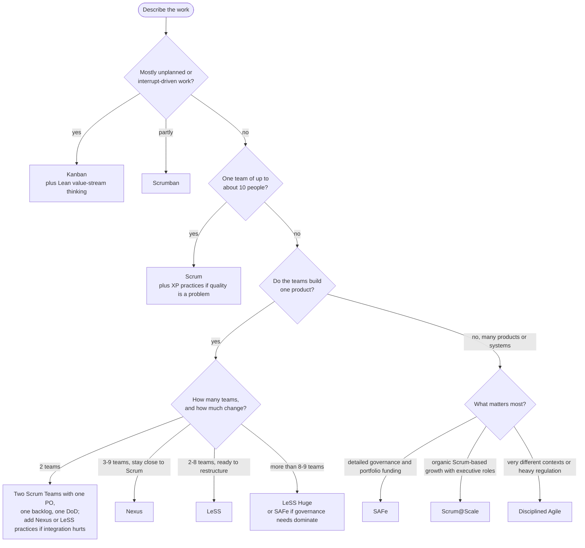

# Agile Frameworks Comparison Guide

[Knowledge-Hub](../../README.md) / [Study](../Study.md) / [agile](Agile.md) / Agile Frameworks Comparison Guide

A decision reference for the **ten most widely used Agile frameworks and methods**, ordered by adoption. Each profile gives the description, goal, governing specification, structure, implementation steps, scale, strengths, constraints, and the kinds of projects and problems it fits or does not fit, so you can choose an approach for a specific team, product, or organization. It is for team leads, architects, delivery managers, and interview preparation. Scrum is covered in depth in the [Scrum Study Guide](Scrum.md).

> Currency note: popularity figures come from surveys published from 2021 to 2025 and were checked in November 2026. Survey samples and questions differ, so treat the order as an evidence-informed ranking, not an exact measurement. See [How the Ranking Was Built](#how-the-ranking-was-built).

> Scope note: "framework" is used broadly. The list mixes team-level frameworks (Scrum), methods (Kanban, XP), principle sets (Lean), and scaling frameworks (SAFe, LeSS, Nexus), because these are the options teams actually compare.

---

## Content

1. [How to Use This Guide](#how-to-use-this-guide)
2. [How the Ranking Was Built](#how-the-ranking-was-built)
3. [Top 10 at a Glance](#top-10-at-a-glance)
4. [Framework Profiles](#framework-profiles)
   - [Scrum](#f1-scrum)
   - [Kanban](#f2-kanban)
   - [SAFe (Scaled Agile Framework)](#f3-safe-scaled-agile-framework)
   - [Lean Software Development](#f4-lean-software-development)
   - [Scrum@Scale and Scrum of Scrums](#f5-scrumscale-and-scrum-of-scrums)
   - [Scrumban](#f6-scrumban)
   - [Extreme Programming (XP)](#f7-extreme-programming-xp)
   - [LeSS (Large-Scale Scrum)](#f8-less-large-scale-scrum)
   - [Disciplined Agile (DA)](#f9-disciplined-agile-da)
   - [Nexus](#f10-nexus)
5. [Comparison Matrix](#comparison-matrix)
6. [Selection Guide](#selection-guide)
   - [Decision Questions](#s1-decision-questions)
   - [Decision Flow](#s2-decision-flow)
   - [Typical Project Scenarios](#s3-typical-project-scenarios)
7. [Combining and Migrating](#combining-and-migrating)
8. [Selection Anti-Patterns](#selection-anti-patterns)
9. [Other Frameworks Worth Knowing](#other-frameworks-worth-knowing)
10. [Rapid Answers](#rapid-answers)
11. [Quick Interview Checklist](#quick-interview-checklist)
12. [Glossary](#glossary)
13. [Sources](#sources)

---

## How to Use This Guide

[↑ Content](#content)

- **Choosing for a project:** answer the [Decision Questions](#s1-decision-questions), follow the [Decision Flow](#s2-decision-flow), then read the two or three matching profiles in full.
- **Comparing quickly:** use [Top 10 at a Glance](#top-10-at-a-glance) and the [Comparison Matrix](#comparison-matrix).
- **Interview:** be able to explain, for each framework, its **goal, unit of scale, core mechanism, and main constraint**.

Every profile uses the same blocks: **Description**, **Goal**, **Specification**, **Structure**, **Implementation**, **Scale**, **Strengths**, **Constraints and costs**, **Pick it when**, **Avoid it when**, and **Success signals**.

Two rules to remember while choosing:

1. **Pick the smallest approach that solves the actual problem.** Most teams need a team-level method first; scaling frameworks solve coordination problems between teams.
2. **Team-level and scaling frameworks combine.** A SAFe or Nexus adoption still runs Scrum, Kanban, or XP inside its teams.

---

## How the Ranking Was Built

[↑ Content](#content)

No single current survey measures all ten approaches with the same question. The ranking combines these sources:

| Source | Year, sample | What it measures | Key figures |
|--------|--------------|------------------|-------------|
| **18th State of Agile** (Digital.ai) | Survey Jul-Aug 2025, 349 respondents, mostly coaches and consultants in large enterprises | Frameworks and delivery models used at organization level | SAFe 44%, Lean principles 29%, Scrum@Scale or Scrum of Scrums 23%, blended or hybrid 48%, homegrown 26% |
| **17th State of Agile** (Digital.ai) | Survey 2023, published Jan 2024, 788 respondents | Team-level method; enterprise framework | Scrum 63% of team-level Agile users; enterprise: SAFe 26%, Scrum@Scale or Scrum of Scrums 19%, Disciplined Agile 3%, others in low single digits |
| **15th State of Agile** (Digital.ai) | Published 2021 | Team-level method followed most closely | Scrum 66%, Scrumban 9%, Scrum/XP hybrid 6%, Kanban 6%; standalone XP and Lean about 1% each |
| **PwC Luxembourg Agile Survey** | Q1 2024, mostly financial and public sector | Frameworks used | Scrum 78%, Kanban second, DevOps third (57%) |
| **PMI France Barometer** | 2025, 495 respondents for this question | Methods used by project professionals | Kanban 21%, Scrum 20% |
| **PMI Japan Agile Survey** | Mar 2025, 192 respondents | Methods used on Agile projects | Scrum 55%, LeSS 5%, Scrum of Scrums 3%, Disciplined Agile 3%, SAFe 2% |
| **Theseus thesis survey** (Vaasa UAS) | 2025, 54 software professionals | Framework used by the team or company | Scrum 57%, Kanban 17%, SAFe 17%; XP and LeSS mentioned |

**Ranking rules**

1. Rank by the breadth and consistency of adoption across sources, giving more weight to recent, larger samples.
2. Compare team-level methods with team-level data and scaling frameworks with enterprise data. Percentages from different questions are **not** added or compared directly.
3. Use the 2021 team-level data only as a disclosed tie-breaker for Scrumban and XP, which newer surveys do not report separately.

**Limits**

- The 18th report's sample is small and enterprise-heavy, which favors scaling frameworks such as SAFe.
- "Used" is not "used well": many organizations report hybrid or homegrown approaches (74% combined in the 18th report).
- Kanban is often used alongside Scrum, so "most closely followed" questions understate it.
- The order of ranks 8 to 10 (LeSS, Disciplined Agile, Nexus) rests on low single-digit figures and is the least certain.

**Evidence behind each rank**

| Rank | Framework | Main evidence |
|------|-----------|---------------|
| 1 | Scrum | 63% of team-level users (17th); 55% to 78% in the 2024-2025 PMI Japan, Theseus, and PwC surveys |
| 2 | Kanban | Second after Scrum (PwC 2024); 21% vs Scrum 20% (PMI France 2025) |
| 3 | SAFe | Top enterprise framework: 44% (18th), 26% (17th) |
| 4 | Lean | Lean principles 29% (18th), ahead of Scrum@Scale in the same question |
| 5 | Scrum@Scale / Scrum of Scrums | 23% (18th), 19% (17th) |
| 6 | Scrumban | 9%, second team approach after Scrum (15th) |
| 7 | XP | Scrum/XP hybrid 6%, standalone about 1% (15th); practices widely embedded in other methods |
| 8 | LeSS | 5% (PMI Japan 2025); low single digits (17th) |
| 9 | Disciplined Agile | 3% (17th and PMI Japan 2025) |
| 10 | Nexus | Low single digits (17th) |

---

## Top 10 at a Glance

[↑ Content](#content)

| Rank | Framework | Level | Core idea | Strongest fit | Main constraint |
|------|-----------|-------|-----------|---------------|-----------------|
| 1 | [Scrum](#f1-scrum) | Team | Fixed Sprints, Sprint Goal, Done Increments | Complex product development | Needs a real Product Owner and stable team |
| 2 | [Kanban](#f2-kanban) | Team to organization | Visualize, limit WIP, manage flow | Continuous, interrupt-driven work | Little structure for discovery and goals |
| 3 | [SAFe](#f3-safe-scaled-agile-framework) | Enterprise | Agile Release Trains and PI Planning | Large enterprises with many dependent teams | Heavy, costly, risk of rebranded hierarchy |
| 4 | [Lean Software Development](#f4-lean-software-development) | Principles, any level | Eliminate waste, optimize the whole | Improving end-to-end flow and value | Principles only; needs a method to apply them |
| 5 | [Scrum@Scale](#f5-scrumscale-and-scrum-of-scrums) | Multi-team to enterprise | Scale-free networks of Scrum Teams | Scaling Scrum organically | Requires executive participation |
| 6 | [Scrumban](#f6-scrumban) | Team | Scrum cadence plus Kanban flow | Mixed planned and unplanned work | Loose definition; can drift to no discipline |
| 7 | [Extreme Programming (XP)](#f7-extreme-programming-xp) | Team | Engineering excellence, very short feedback | Software with changing requirements and high quality needs | Demanding discipline; software only |
| 8 | [LeSS](#f8-less-large-scale-scrum) | Multi-team, one product | Scrum scaled by descaling the organization | 2 to 8 teams on one product, willing to restructure | Deep organizational change required |
| 9 | [Disciplined Agile](#f9-disciplined-agile-da) | Team to enterprise | Context-based toolkit of choices | Regulated or heterogeneous organizations | Large toolkit; needs experienced coaches |
| 10 | [Nexus](#f10-nexus) | Multi-team, one product | Minimal extension of Scrum for 3 to 9 teams | Scrum teams with integration problems | Single product only; integration discipline required |

---

## Framework Profiles

### F1. Scrum

[↑ Content](#content)

**Description:** a lightweight framework for generating value through adaptive solutions for complex problems. A small, self-managing team works in fixed-length Sprints and delivers usable Increments. Created by Ken Schwaber and Jeff Sutherland in the early 1990s; the most widely adopted team-level Agile framework in every State of Agile report since 2006.

**Goal:** maximize product value under uncertainty through empiricism (transparency, inspection, adaptation) and short feedback loops.

**Specification:** [The 2020 Scrum Guide](https://scrumguides.org/scrum-guide), the single official definition. Optional companion: Scrum Guide Expansion Pack (2025).

**Structure**

| Element | Content |
|---------|---------|
| Roles | Product Owner, Scrum Master, Developers; team typically 10 or fewer |
| Events | Sprint (one month or less), Sprint Planning (8 h max), Daily Scrum (15 min), Sprint Review (4 h max), Sprint Retrospective (3 h max) |
| Artifacts | Product Backlog (Product Goal), Sprint Backlog (Sprint Goal), Increment (Definition of Done) |
| Cadence | Fixed Sprints, back to back |

**Implementation:** appoint an empowered Product Owner and a Scrum Master; form a stable cross-functional team; write the Product Goal and an initial ordered backlog; agree a Definition of Done; fix the Sprint length; run Sprints and improve through Retrospectives. Full steps in [Scrum: Implementing Scrum](Scrum.md#implementing-scrum).

**Scale:** one team. Multiple teams use Nexus, LeSS, Scrum@Scale, or SAFe.

**Strengths:** simple to learn; clear accountabilities; regular stakeholder feedback; large community, training, and tool support; widely understood by hires.

**Constraints and costs:** needs an empowered Product Owner and stable team; event overhead; fixed Sprint Goal conflicts with frequent interrupts; defines no engineering practices; easy to adopt mechanically without empiricism.

**Pick it when:** building or evolving a product with uncertain requirements; a team of up to about 10 can focus on one product; stakeholders can review every Sprint; the organization wants a clear first structure.

**Avoid it when:** work is mostly unplanned (support, operations); work is simple and repeatable; nobody can own priorities; scope and date are both contractually fixed with no renegotiation.

**Success signals:** Done Increments every Sprint; Sprint Goals mostly met; backlog changes after Sprint Reviews; Retrospective actions actually completed.

Deep dive: [Scrum Study Guide](Scrum.md).

---

### F2. Kanban

[↑ Content](#content)

**Description:** a strategy for optimizing the flow of value through a process, using visualization and explicit control of work in progress (WIP) to create a pull system. It traces back to the Toyota Production System; the practices for knowledge work largely originated on a team at Corbis in 2006 (David J. Anderson and others).

**Goal:** find the right balance of **effectiveness** (deliver what stakeholders want when they want it), **efficiency** (use resources well), and **predictability** (forecast delivery within acceptable uncertainty), by optimizing flow.

**Specification:** [The Kanban Guide](https://kanbanguides.org/the-kanban-guide/) (May 2025, Vacanti, Coleman, and others). A different, broader school is the **Kanban Method** (David J. Anderson, Kanban University), which adds principles, general practices, and service-delivery cadences.

**Structure (Kanban Guide)**

| Element | Content |
|---------|---------|
| Practices | Defining and visualizing a workflow; actively managing items in a workflow; improving a workflow |
| Definition of Workflow (DoW) | Work item definition; start and finish points; workflow states; how WIP is controlled; explicit policies; a Service Level Expectation (SLE) |
| Mandatory flow metrics | WIP, Throughput, Work Item Age, Cycle Time |
| Roles | None prescribed |
| Cadence | None required; reviews may be continuous, regular, or both |

**Implementation**

1. Map the current workflow as it really is ("start with what you do now", a Kanban Method principle).
2. Define work items and when each is started and finished.
3. Visualize the states on a board.
4. Set WIP controls, start conservatively, and pull new work only when capacity frees up.
5. Write explicit policies, for example entry and exit criteria per column, or classes of service (a Kanban Method practice).
6. Measure the four flow metrics and set an SLE, for example "85% of items finish in 8 days or less".
7. Review flow regularly (blocked items, aging items, bottlenecks) and change the workflow.

**Scale:** any. Works for one team or across teams through connected boards and portfolio Kanban.

**Strengths:** minimal disruption to start; handles changing priorities and unplanned work; forecasting from real flow data (Monte Carlo); applies outside software; overlays existing processes, including Scrum.

**Constraints and costs:** no built-in product goal, roles, or feedback events, so discovery and stakeholder alignment must be added; WIP limits need real discipline; improvement stalls without someone paying attention to flow; teams often run "a board" without limits and call it Kanban.

**Pick it when:** support, maintenance, operations, DevOps, and platform teams; requests arrive continuously with varying urgency; you want to improve an existing process without reorganizing; release on demand is possible.

**Avoid it when:** a new product needs strong goal focus and regular stakeholder inspection and the team lacks that discipline; the organization needs explicit role clarity to start.

**Success signals:** stable or falling cycle time; work item age within the SLE; WIP within limits; fewer blocked items; reliable probabilistic forecasts.

---

### F3. SAFe (Scaled Agile Framework)

[↑ Content](#content)

**Description:** a comprehensive operating model for applying Lean, Agile, and DevOps practices across an enterprise, from teams through programs to portfolio. Created by Dean Leffingwell; first released in 2011 and maintained by Scaled Agile, Inc. The most reported enterprise scaling framework in the 17th (26%) and 18th (44%) State of Agile reports.

**Goal:** business agility: align many teams to strategy and deliver value in synchronized increments across a large organization.

**Specification:** [SAFe 6.0](https://framework.scaledagile.com/) (released March 2023), with monthly and quarterly online updates. Scaled Agile also publishes an AI-Native SAFe extension.

**Structure**

| Element | Content |
|---------|---------|
| Configurations | Essential SAFe, Large Solution SAFe, Portfolio SAFe, Full SAFe |
| Core unit | Agile Release Train (ART): a long-lived team of Agile teams, typically 50 to 125 people, aligned to a value stream |
| Cadence | Planning Interval (PI), typically 8 to 12 weeks, made of several team iterations |
| Key events | PI Planning (typically two days, whole ART), System Demo, Inspect and Adapt, ART Sync |
| Key roles | Release Train Engineer, Product Management, System Architect, Business Owners, Product Owner and Scrum Master/Team Coach per team |
| Core values | Alignment, Respect for people, Transparency, Relentless improvement |
| Team methods | SAFe Scrum and SAFe Team Kanban |

**Implementation:** SAFe 6.0 publishes a 13-step **Implementation Roadmap** (older material often quotes 12 steps):

1. Reach the tipping point.
2. Train lean-agile change agents (SAFe Practice Consultants).
3. Create a Lean-Agile Center of Excellence (LACE).
4. Train executives, managers, and leaders.
5. Lead in the digital age.
6. Organize around value (identify value streams and ARTs).
7. Create the implementation plan.
8. Prepare for ART launch.
9. Train teams and launch the ART.
10. Coach ART execution.
11. Launch more ARTs and value streams.
12. Enhance the portfolio.
13. Accelerate.

**Scale:** from one ART (about 50 to 125 people) to multiple ARTs in Solution Trains and the full portfolio.

**Strengths:** detailed, prescriptive guidance for large organizations; ties strategy, funding (Lean Portfolio Management), and delivery together; PI Planning gives visible cross-team alignment; large ecosystem of training, certification, and consultants; familiar to executives.

**Constraints and costs:** high training, certification, and consulting cost; many roles and events; long planning horizon can recreate fixed-scope quarterly plans; risk of renaming existing hierarchy without real change; criticized for reducing team autonomy.

**Pick it when:** hundreds of people on interdependent systems; strong need for portfolio governance and predictability; regulated industries needing traceability; leadership commits to sustained, funded transformation.

**Avoid it when:** a few teams on one product (use Nexus or LeSS); teams are largely independent; the organization cannot fund training and coaching; the aim is to maximize team autonomy and minimize process.

**Success signals:** ARTs aligned to value streams, not departments; PI objectives mostly met; shorter lead time from idea to production; business owners actively engaged in PI Planning.

---

### F4. Lean Software Development

[↑ Content](#content)

**Description:** an adaptation of Lean manufacturing principles to software and knowledge work, popularized by Mary and Tom Poppendieck in *Lean Software Development* (2003) and *Implementing Lean Software Development* (2006). It is a set of principles and thinking tools rather than a prescriptive framework.

**Goal:** deliver value to the customer quickly by eliminating waste and optimizing the whole value stream rather than individual steps.

**Specification:** no official guide. The reference is the Poppendieck books; related sources include the Toyota Production System and Value Stream Mapping.

**Structure: the seven principles (2006)**

| Principle | Meaning |
|-----------|---------|
| Eliminate waste | Remove anything that does not add customer value: partially done work, extra features, relearning, handoffs, delays, task switching, defects |
| Build quality in | Prevent defects (test-first, automation) instead of inspecting them out later |
| Create knowledge | Learn through short cycles and feedback; codify what is learned |
| Defer commitment | Make irreversible decisions at the last responsible moment |
| Deliver fast | Short cycle times reduce risk and increase learning |
| Respect people | Empower the people who do the work |
| Optimize the whole | Improve the end-to-end flow, not local efficiency |

**Implementation:** map the value stream from request to delivery; measure lead time and wait time; identify the biggest waste and bottleneck; run improvement experiments; standardize what works; repeat. Usually applied through Kanban (flow), XP (built-in quality), or a scaling framework (portfolio flow).

**Scale:** any level, from team practices to portfolio and value-stream management.

**Strengths:** focuses on the customer and the whole system; fits any methodology; strong for reducing lead time and cost; principles last when practices change.

**Constraints and costs:** principles only, so teams need a concrete method; easily misread as cost-cutting; needs management that values flow over utilization; results depend on measuring the real value stream.

**Pick it when:** delivery is slow because of handoffs and waiting; the organization wants to improve end-to-end, across teams and departments; combined with Kanban or as a mindset for any Agile approach.

**Avoid it when:** used alone as the team's only process; leadership intends "lean" as headcount reduction.

**Success signals:** shorter lead time; higher flow efficiency (more active time relative to waiting); fewer handoffs; decisions made close to the work.

---

### F5. Scrum@Scale and Scrum of Scrums

[↑ Content](#content)

**Description:** **Scrum of Scrums** is the long-standing practice where representatives of several Scrum Teams coordinate integration and impediments. **Scrum@Scale** (Jeff Sutherland and Scrum Inc.) formalizes and extends it into a framework for scaling Scrum to an entire organization through a scale-free architecture. Surveys usually group the two: 19% (17th report) and 23% (18th report) of respondents.

**Goal:** linear scalability (delivery grows in proportion to the number of teams) and business agility through a "minimum viable bureaucracy".

**Specification:** [The Scrum@Scale Guide](https://www.scrumatscale.com/scrum-at-scale-guide-online/), version 2.1, February 2022, released under Creative Commons.

**Structure**

| Element | Content |
|---------|---------|
| Scrum of Scrums (SoS) | A team of teams that releases one integrated product; the guide gives 4 or 5 teams as optimal. Led by a Scrum of Scrums Master, with a Scaled Daily Scrum and scaled Retrospective |
| Scrum of Scrum of Scrums | Further levels of SoS for larger networks |
| Product Owner Team | Product Owners of the SoS, led by a Chief Product Owner (CPO), with one shared backlog |
| Executive Action Team (EAT) | Fulfills the Scrum Master accountabilities for the whole organization: owns the Agile operating system and removes organizational impediments (the "how") |
| Executive MetaScrum (EMS) | Event where CPOs, executives, and key stakeholders set vision and priorities, adjust budgets, and realign teams, at least once per Sprint (the "what") |
| Two cycles | Scrum Master cycle (how: delivery, improvement, impediments) and Product Owner cycle (what: vision, backlog, release planning, feedback) |

**Implementation:** start with high-performing Scrum Teams; form a first Scrum of Scrums around a product; create the Executive Action Team and Executive MetaScrum; set up a Chief Product Owner and shared backlog; add further SoS as needed and grow the network gradually, using the framework's components as a modular checklist.

**Scale:** from a few teams to the whole enterprise, growing organically.

**Strengths:** stays close to Scrum, so teams keep familiar practices; modular and low prescription; explicit leadership involvement through EAT and EMS; can grow gradually.

**Constraints and costs:** requires executives to take on concrete roles in the framework; less detailed guidance than SAFe for portfolio, funding, and compliance; quality of the base Scrum Teams determines everything; a plain "Scrum of Scrums meeting" without the rest is often only a status meeting.

**Pick it when:** the organization already runs Scrum and wants to scale it gradually; leadership is willing to work in Scrum itself; you want lighter structure than SAFe.

**Avoid it when:** leadership will not participate; teams are not yet effective at Scrum; heavy regulatory or portfolio funding structures need detailed guidance.

**Success signals:** impediments resolved quickly at the right level; teams integrate frequently; executive backlog decisions visible and timely.

---

### F6. Scrumban

[↑ Content](#content)

**Description:** a hybrid combining Scrum's structure (backlog, cadence, regular reviews and retrospectives) with Kanban's flow management (visual board, WIP limits, pull). Described by Corey Ladas in *Scrumban: Essays on Kanban Systems for Lean Software Development* (2009), originally as a path for Scrum teams to evolve toward Kanban. The 15th State of Agile report listed it as the second most followed team approach (9%).

**Goal:** keep a predictable planning and feedback rhythm while handling continuous flow and unplanned work better than strict Sprints.

**Specification:** no official guide. Reference is Ladas's book; practical implementations vary by team.

**Structure (typical, not mandated)**

| Element | Typical content |
|---------|-----------------|
| Board | Kanban board with explicit WIP limits per column |
| Planning | On-demand planning triggered when the "ready" queue drops below a threshold, or a regular planning cadence |
| Iterations | Optional; many teams keep 1 to 2 week cycles for review and retrospective |
| Roles | Often keeps a Product Owner; other Scrum roles optional |
| Metrics | Cycle time, throughput, cumulative flow diagram |
| Estimation | Often replaced by item-count forecasting |

**Implementation:** start from a Scrum team; add a board with WIP limits; replace fixed Sprint commitment with pull from a prioritized ready queue; keep Reviews and Retrospectives at a fixed cadence; switch forecasting to flow data; decide explicitly which Scrum elements you keep.

**Scale:** single team or a few teams.

**Strengths:** handles mixed planned and unplanned work; easier to adopt for Scrum teams frustrated by interruptions; flow metrics improve forecasting; less estimation overhead.

**Constraints and costs:** no standard definition, so "Scrumban" can mean anything; risks losing goal focus and stakeholder feedback; teams may drop Retrospectives and improvement; harder to explain to stakeholders used to Sprints.

**Pick it when:** product teams that also handle support or maintenance; teams whose Sprint Goals are regularly broken by urgent work; transition from Scrum toward Kanban or the reverse.

**Avoid it when:** the team is new to Agile and needs clear structure (start with Scrum or Kanban by the book); it is used to escape discipline rather than to improve flow.

**Success signals:** WIP respected; urgent work handled without chaos; regular reviews still drive backlog changes; predictable cycle time.

---

### F7. Extreme Programming (XP)

[↑ Content](#content)

**Description:** a software development method focused on technical excellence and very short feedback loops, created by Kent Beck in the late 1990s (C3 project at Chrysler) and described in *Extreme Programming Explained* (1999; second edition 2004 with Cynthia Andres). Standalone XP is rare in surveys (around 1% in the 15th report), but its practices (TDD, CI, pairing, refactoring) are widely used inside Scrum teams; the Scrum/XP hybrid was reported by 6%.

**Goal:** produce high-quality software that can change cheaply, so the team can respond to changing requirements at a sustainable pace.

**Specification:** *Extreme Programming Explained*, 2nd edition, by Kent Beck and Cynthia Andres.

**Structure (2nd edition)**

| Element | Content |
|---------|---------|
| Values | Communication, Simplicity, Feedback, Courage, Respect |
| Primary practices | Sit Together, Whole Team, Informative Workspace, Energized Work, Pair Programming, Stories, Weekly Cycle, Quarterly Cycle, Slack, Ten-Minute Build, Continuous Integration, Test-First Programming, Incremental Design |
| Corollary practices | Including Real Customer Involvement, Incremental Deployment, Team Continuity, Shared Code, Single Code Base, Daily Deployment, Root-Cause Analysis |
| Cadence | Weekly cycle for planning and delivery; quarterly cycle for themes and reflection |
| Roles | Whole team including customer representatives; roles are not rigid |

**Implementation:** introduce practices incrementally, each as an experiment: start with CI and a fast automated build, then test-first development, then pairing and collective code ownership, continuous refactoring, and weekly planning with real customer involvement. Measure quality and feedback time, and keep the practices that help.

**Scale:** a single small, co-located or closely collaborating team (the first edition targeted teams of two to ten programmers). Scaled through a framework above it.

**Strengths:** strongest engineering discipline of any Agile approach; low defect rates and cheap change; enables continuous delivery; complements Scrum or Kanban well.

**Constraints and costs:** demanding practices such as pairing and TDD need skill, time to learn, and management acceptance; mostly software-specific; requires close customer involvement; little guidance on product strategy or scaling.

**Pick it when:** requirements change often and quality matters; technical debt is slowing delivery; continuous delivery is a goal; the team owns its code base end to end.

**Avoid it when:** the work is not software; management refuses practices such as pairing; customers or domain experts cannot be involved regularly.

**Success signals:** build and test feedback in minutes; few escaped defects; small, frequent releases; refactoring is routine, not a project.

---

### F8. LeSS (Large-Scale Scrum)

[↑ Content](#content)

**Description:** a framework for scaling Scrum to many teams working on **one product**, created by Craig Larman and Bas Vodde from about 2005. Its core idea is "more with LeSS": instead of adding coordination layers, simplify the organization so that Scrum works at scale. Reported in low single digits (5% in the PMI Japan 2025 survey).

**Goal:** apply Scrum's purpose, empiricism, and principles to a large product by **descaling** the organization: fewer roles, fewer artifacts, and fewer handoffs.

**Specification:** [LeSS Rules](https://less.works/less/rules) (November 2024) on less.works, plus principles, guides, and experiments in the books by Larman and Vodde.

**Structure**

| Element | Basic LeSS (2 to 8 teams) | LeSS Huge (more than 8 teams) |
|---------|---------------------------|-------------------------------|
| Product Owner | One Product Owner, one Product Backlog for the whole product | One Product Owner plus Area Product Owners per Requirement Area |
| Teams | Self-managing, cross-functional, long-lived customer-focused feature teams | Same, grouped into Requirement Areas of about 4 to 8 teams |
| Sprint | One product-level Sprint for all teams; one integrated product each Sprint | Same |
| Events | Sprint Planning One (shared) and Two (per team); Daily Scrum per team; multi-team refinement; one Sprint Review; team Retrospectives plus an Overall Retrospective | Per-area events added |
| Definition of Done | One for the product; teams may strengthen it | Same |
| Scrum Masters | Dedicated, full time, serving 1 to 3 teams | Same |

**Implementation:** define the product broadly and from the customer's view; set up the full LeSS structure for that product group at the start (feature teams, one PO, one backlog); move from component teams to feature teams; invest heavily in continuous integration and a shared DoD; expand to the wider organization evolutionarily using "Go and See".

**Scale:** 2 to 8 teams (Basic LeSS); LeSS Huge for products with more than 8 teams.

**Strengths:** keeps Scrum simple at scale; removes coordination roles and overhead; strong whole-product focus; forces fixing structural problems (component teams, handoffs).

**Constraints and costs:** requires deep organizational redesign (feature teams, changed management roles, HR and budgeting); demands strong technical practices for one integrated product every Sprint; less guidance for portfolios of many products; adoption depends on strong leadership commitment.

**Pick it when:** one large product built by 2 or more teams; leadership is willing to restructure; teams can integrate continuously; you want less, not more, process.

**Avoid it when:** many separate products need portfolio governance; the organization cannot change team structure or management roles; the code base cannot be integrated frequently.

**Success signals:** an integrated, shippable product every Sprint; feature teams deliver end to end; fewer coordination meetings and roles over time.

---

### F9. Disciplined Agile (DA)

[↑ Content](#content)

**Description:** a hybrid, context-sensitive **toolkit** that helps teams and organizations choose their own way of working (WoW) from agile, lean, and traditional strategies. Created by Scott Ambler and Mark Lines (starting with Disciplined Agile Delivery, 2012) and owned by PMI since 2019. Reported at about 3% in the 17th State of Agile report and the PMI Japan 2025 survey.

**Goal:** optimize the way of working for the specific context instead of applying one prescribed method ("context counts", "choice is good").

**Specification:** PMI's [Disciplined Agile](https://www.pmi.org/learning/agile/disciplined-agile) toolkit and DA Browser, updated regularly; overview in *Choose Your WoW!*, 2nd edition (aligned with toolkit version 5.3).

**Structure**

| Element | Content |
|---------|---------|
| Principles | Delight customers, Be awesome, Context counts, Pragmatism, Choice is good, Optimize flow, Organize around products/services, Enterprise awareness |
| Layers | Disciplined Agile Delivery (DAD), Disciplined DevOps, Value Streams, Disciplined Agile Enterprise |
| DAD phases | Inception, Construction, Transition |
| DAD lifecycles | Agile (Scrum-based), Lean (Kanban-based), Continuous Delivery: Agile, Continuous Delivery: Lean, Exploratory (Lean Startup), Program (team of teams) |
| Process goals | Decision tables of options with trade-offs for each goal (for example, "Explore Scope", "Produce a Potentially Consumable Solution") |
| Roles | Primary: Team Lead, Product Owner, Architecture Owner, Team Member, Stakeholder; plus supporting roles |

**Implementation:** train coaches and team leads in the toolkit; for each team, pick a lifecycle that fits its context; use the process goals to choose practices deliberately; apply guided continuous improvement (try, measure, keep or discard); extend to DevOps, value streams, and enterprise functions as needed.

**Scale:** from one team to enterprise, including governance, finance, and other functions.

**Strengths:** explicitly hybrid, so it fits regulated, traditional, or mixed environments; covers the full lifecycle including inception and transition; gives choices with trade-offs instead of one answer; enterprise awareness and governance built in.

**Constraints and costs:** large and complex toolkit; requires experienced practitioners to choose well; smaller community and less tool support than Scrum or SAFe; flexibility can become an excuse to avoid change.

**Pick it when:** organizations with many different team contexts; regulated industries needing governance; PMI-oriented project management cultures; teams that need an explicit hybrid of agile and traditional practices.

**Avoid it when:** a team needs a simple, clear starting point; there are no experienced coaches; the organization wants a single standard process across teams.

**Success signals:** teams can explain why their way of working fits their context; continuous improvement experiments are visible; governance relies on evidence rather than documents.

---

### F10. Nexus

[↑ Content](#content)

**Description:** a framework for **3 to 9 Scrum Teams** working on one product from a single Product Backlog, developed by Ken Schwaber and Scrum.org (2015). It extends Scrum only where necessary to manage cross-team dependencies and integration. Reported in low single digits in the 17th State of Agile report.

**Goal:** scale the value a group of Scrum Teams on one product can deliver, by reducing the complexity of their collaboration and producing one Integrated Increment at least every Sprint.

**Specification:** [The Nexus Guide](https://www.scrum.org/resources/online-nexus-guide) (January 2021), aligned with the 2020 Scrum Guide.

**Structure**

| Element | Content |
|---------|---------|
| Accountabilities | Nexus Integration Team (NIT): Product Owner, a Scrum Master, and members accountable for integration; plus the Scrum Teams |
| Events | Sprint (shared); Cross-Team Refinement; Nexus Sprint Planning; Nexus Daily Scrum; Nexus Sprint Review (replaces team Reviews); Nexus Sprint Retrospective |
| Artifacts | Product Backlog, Nexus Sprint Backlog, Sprint Backlogs per team, Integrated Increment |
| Commitments | Product Goal, Nexus Sprint Goal, Definition of Done (shared) |

**Implementation:** start with working Scrum Teams on one product; form the Nexus Integration Team; unify the Product Backlog and Definition of Done; run Cross-Team Refinement to expose and reduce dependencies; synchronize Sprints; integrate continuously and produce one Integrated Increment every Sprint.

**Scale:** about 3 to 9 Scrum Teams (Nexus+ for multiple Nexuses).

**Strengths:** smallest step from Scrum; familiar vocabulary; explicit focus on integration and dependencies; no new hierarchy.

**Constraints and costs:** single product only; offers no portfolio or funding guidance; requires strong technical integration (CI, shared DoD); depends on a capable single Product Owner for all teams.

**Pick it when:** several Scrum Teams share one product and suffer integration and dependency problems; the organization wants to stay within Scrum.

**Avoid it when:** more than about 9 teams or many products; teams are not yet doing Scrum effectively; the main problem is portfolio governance rather than integration.

**Success signals:** an Integrated Increment every Sprint; fewer cross-team dependencies over time; integration issues found early, not at release.

---

## Comparison Matrix

[↑ Content](#content)

Ratings are relative judgments, not measured values: **High**, **Med**, **Low**. S@S is Scrum@Scale.

| Criterion | Scrum | Kanban | SAFe | Lean | S@S | Scrumban | XP | LeSS | DA | Nexus |
|-----------|-------|--------|------|------|-----|----------|----|------|----|-------|
| Handles high uncertainty | High | Med | Med | Med | High | Med | High | High | High | High |
| Handles unplanned work | Low | High | Low | Med | Low | High | Med | Low | Med | Low |
| Prescriptiveness | Med | Low | High | Low | Med | Low | Med | Med | Med | Med |
| Adoption effort | Med | Low | High | Low | Med | Low | High | High | High | Med |
| Organizational change needed | Med | Low | High | Med | High | Low | Med | High | Med | Med |
| Cross-team coordination support | Low | Med | High | Med | High | Low | Low | High | High | High |
| Governance and compliance support | Low | Low | High | Low | Med | Low | Low | Low | High | Low |
| Engineering practice guidance | Low | Low | Med | Med | Low | Low | High | Med | Med | Med |
| Typical team size or scale | 1 team | Any | 50-125 per ART, up to portfolio | Any | 4-5 teams per SoS, scale-free | 1 to a few teams | 1 team | 2-8 teams, more with Huge | Any | 3-9 teams |
| Cadence | Fixed Sprints | Continuous | PIs and iterations | Any | Sprints | Optional | Weekly and quarterly | One shared Sprint | Per lifecycle | One shared Sprint |
| Formal specification | Scrum Guide | Kanban Guide | SAFe 6.0 | Books | S@S Guide | Book | Book | LeSS Rules | DA toolkit | Nexus Guide |

---

## Selection Guide

### S1. Decision Questions

[↑ Content](#content)

| Question | If the answer is... | Lean toward |
|----------|---------------------|-------------|
| **How does work arrive?** | Planned product features | Scrum, XP |
| | Continuous, unpredictable requests | Kanban |
| | Both | Scrumban |
| **How uncertain is the problem?** | High (new product, new technology) | Scrum, XP, LeSS, Nexus |
| | Low (known, repeatable) | Kanban or a standard process |
| **How many teams work on it?** | One | Scrum, Kanban, Scrumban, XP |
| | 2 to 9 on one product | Nexus, LeSS |
| | Many products, hundreds of people | SAFe, Scrum@Scale, DA |
| **How strong are cross-team dependencies?** | Weak | Keep teams independent; no scaling framework |
| | Strong, one product | Nexus, LeSS |
| | Strong, many systems | SAFe |
| **What governance is required?** | Light | Scrum, Kanban, LeSS |
| | Strict regulatory or audit | SAFe, DA (plus a strong DoD) |
| **What is the main pain?** | Slow feedback, unclear priorities | Scrum |
| | Overload, long waits, bottlenecks | Kanban, Lean |
| | Quality and technical debt | XP |
| | Misalignment across many teams | SAFe, Scrum@Scale, LeSS |
| **How much change can the organization absorb?** | Little | Kanban, Lean |
| | Moderate | Scrum, Nexus, Scrumban |
| | Large, with executive backing | LeSS, SAFe, Scrum@Scale |
| **How mature is Agile in the organization?** | New | Scrum or Kanban by the book |
| | Experienced, diverse contexts | DA, Scrumban, tailored hybrids |

---

### S2. Decision Flow

[↑ Content](#content)

UML activity diagram: answer each decision from the top and stop at the first framework reached.

Always check the result against the constraints in the profile. If the organization cannot meet the main constraint (for example, no empowered Product Owner for Scrum, no executive participation for Scrum@Scale), fix that or pick another option.

---

### S3. Typical Project Scenarios

[↑ Content](#content)

| Scenario | Recommended start | Why |
|----------|-------------------|-----|
| Startup building a new SaaS product, one team | Scrum plus XP practices | High uncertainty, need fast feedback and quality |
| Internal IT support and maintenance team | Kanban | Continuous, varying-priority requests |
| Product team that also runs production support | Scrumban | Mixed planned and unplanned work |
| Platform or DevOps team | Kanban with flow metrics | Service-oriented, request-driven |
| 4 Scrum Teams on one e-commerce product with integration pain | Nexus | Minimal extension focused on integration |
| 6 teams on one telecom product, leadership ready to reorganize | LeSS | Feature teams, one backlog, less overhead |
| Bank with 300+ people on interdependent systems and audit needs | SAFe | Portfolio governance, synchronized planning, compliance |
| Company already running Scrum, scaling step by step with engaged executives | Scrum@Scale | Organic growth, executive roles |
| Organization with very different team contexts in a regulated industry | Disciplined Agile | Context-based choices and governance |
| Agency doing fixed-price client projects | Scrum or Kanban, inside a hybrid contract (time and materials, or fixed price with variable scope) | Agile needs flexible scope; adapt the contract |
| Delivery is slow because of handoffs between departments | Lean value-stream mapping, then Kanban | Waste and waiting are the problem, not team process |
| Team with frequent regressions and fragile code | Add XP to the current method | Engineering practices fix quality |

---

## Combining and Migrating

[↑ Content](#content)

**Common, effective combinations**

| Combination | Why it works |
|-------------|--------------|
| Scrum plus XP | Scrum provides the management frame; XP provides engineering practices |
| Scrum plus Kanban board and flow metrics | Better visibility and forecasting inside Sprints |
| Kanban plus Lean | Kanban applies Lean flow principles day to day |
| Scaling framework plus team-level method | SAFe, Nexus, LeSS, and Scrum@Scale all run Scrum (or Kanban) inside teams |
| DA lifecycles | Explicitly choose Scrum-based, Kanban-based, or continuous-delivery lifecycles per team |

**Migration paths**

- **Scrum to Scrumban to Kanban:** when unplanned work grows. Keep regular reviews and retrospectives during the change.
- **Ad hoc to Kanban:** the least disruptive first step; visualize, then limit WIP.
- **Scrum to Nexus or LeSS:** when a product needs more than one team. Fix team-level Scrum first.
- **Project-based to product-based:** before any scaling framework, organize teams around long-lived products or value streams.

**Pilot before rollout**

1. Pick one or two teams with a real problem and willing members.
2. Define success measures before starting (lead time, quality, predictability, satisfaction).
3. Run for at least three months, or about six Sprints or two PIs.
4. Review the evidence, adjust, then expand gradually.

---

## Selection Anti-Patterns

[↑ Content](#content)

| Anti-pattern | Why it fails | Better approach |
|--------------|--------------|-----------------|
| Choosing by popularity alone | The most used option may not fit the problem | Start from the problem and constraints |
| Scaling before teams work | Multiplies team-level dysfunction | Make one team effective first |
| Adopting a scaling framework for independent teams | Coordination overhead with no dependencies to manage | Keep teams independent; share standards |
| Renaming existing roles and meetings | No change in behavior, cynicism grows | Change decisions, structures, and incentives |
| Mandating one framework for all contexts | Support, platform, and product teams differ | Allow a team-level choice inside a common frame |
| Mixing frameworks without understanding them | Incoherent rules; "cherry-picked" practices lose their purpose | Learn each by the book first, then tailor deliberately |
| Ignoring engineering practices | Process cannot fix fragile code | Add XP practices and CI/CD |
| Treating certification as transformation | Training without changed structures | Coach real teams on real work |

---

## Other Frameworks Worth Knowing

[↑ Content](#content)

These appear rarely in recent adoption surveys but are useful to recognize:

| Framework | Short description | Typical use |
|-----------|-------------------|-------------|
| **Spotify model** | Squads, tribes, chapters, and guilds; a 2012 description of Spotify's structure, not a framework its authors recommend copying | Inspiration for team organization |
| **DSDM / AgilePM** | Agile project framework with fixed time and cost and MoSCoW-prioritized scope (Agile Business Consortium) | Project governance in agile delivery |
| **Crystal** | Family of methods by Alistair Cockburn, scaled by team size and criticality | Small, people-centric teams |
| **Feature-Driven Development (FDD)** | Model-driven, feature-by-feature delivery (Jeff De Luca, Peter Coad) | Larger teams with modeling culture |
| **Adaptive Software Development (ASD)** | Speculate, collaborate, learn cycle (Jim Highsmith) | Highly uncertain projects |
| **Lean Startup** | Build-measure-learn with minimum viable products (Eric Ries) | Product discovery and validation |
| **Enterprise Scrum, RAGE, Agile Portfolio Management** | Enterprise frameworks reported in single digits by the 17th State of Agile report | Niche enterprise contexts |

---

## Rapid Answers

[↑ Content](#content)

| Question | One-line answer |
|----------|-----------------|
| Which Agile framework is most widely used? | Scrum, at team level, in every State of Agile report since 2006. |
| Which scaling framework is most widely used? | SAFe (26% in the 17th report, 44% in the 2025 18th report). |
| Scrum or Kanban? | Scrum for complex product work with planned goals; Kanban for continuous, interrupt-driven flow. |
| What is Scrumban? | Scrum's cadence and roles combined with Kanban's board, WIP limits, and pull. |
| What does XP add to Scrum? | Engineering practices: TDD, CI, pairing, refactoring, small releases. |
| Is Lean a framework? | No, it is a set of principles applied through methods such as Kanban. |
| What are Kanban's four mandatory flow metrics? | WIP, throughput, work item age, cycle time. |
| What is an Agile Release Train? | SAFe's team of Agile teams, typically 50 to 125 people, planning together every PI. |
| Nexus or LeSS? | Nexus for a minimal Scrum extension for 3-9 teams; LeSS when you will restructure to simplify. |
| What is Scrum@Scale's leadership structure? | Executive Action Team (how) and Executive MetaScrum (what). |
| When is Disciplined Agile a good choice? | Diverse contexts or regulated environments that need an explicit hybrid with choices. |
| What should you fix before scaling? | Team-level delivery: Done, integrated Increments from stable cross-functional teams. |
| Why do hybrid models dominate the 2025 data? | Organizations tailor frameworks to context; 74% reported hybrid or homegrown approaches. |

---

## Quick Interview Checklist

[↑ Content](#content)

**Knowledge**

- [ ] I can name the top 10 approaches, their level, and their creators or owners.
- [ ] I can state each one's goal, core mechanism, and main constraint.
- [ ] I know the official specification for each (Scrum Guide, Kanban Guide, SAFe 6.0, LeSS Rules, Nexus Guide, Scrum@Scale Guide, DA toolkit).

**Judgment**

- [ ] I can recommend an approach for a given scenario and justify it with fit criteria.
- [ ] I can explain why team-level and scaling frameworks combine.
- [ ] I can explain the trade-offs between SAFe, LeSS, Nexus, and Scrum@Scale.
- [ ] I can describe how to pilot and measure a framework adoption.

**Critical thinking**

- [ ] I can explain the limits of popularity surveys.
- [ ] I can name the selection anti-patterns and how to avoid them.

---

## Glossary

[↑ Content](#content)

| Term | Short definition |
|------|------------------|
| **ART (Agile Release Train)** | SAFe's long-lived team of Agile teams aligned to a value stream |
| **Cycle time** | Elapsed time from when a work item starts to when it finishes |
| **Definition of Workflow (DoW)** | Kanban's explicit shared understanding of flow in a context |
| **Descaling** | LeSS's approach of simplifying the organization instead of adding coordination |
| **Feature team** | Cross-functional team that delivers end-to-end customer features |
| **Flow efficiency** | Share of total lead time during which work is actively worked on |
| **Integrated Increment** | Nexus's combined, Done result of all teams in a Sprint |
| **Lead time** | Elapsed time from request to delivery |
| **MetaScrum** | Scrum@Scale event where leaders and stakeholders align priorities with the Product Owner Team |
| **Nexus Integration Team (NIT)** | Group accountable for integration in a Nexus |
| **PI (Planning Interval)** | SAFe's timebox, typically 8 to 12 weeks, for planning and delivery across an ART |
| **Pull system** | Work is started only when capacity is available, not pushed in |
| **Requirement Area** | LeSS Huge grouping of 4 to 8 teams around a major customer area |
| **Scrum of Scrums** | Coordination of several Scrum Teams through representatives |
| **SLE (Service Level Expectation)** | Kanban forecast of how long an item should take, with a probability |
| **Value stream** | The sequence of steps that delivers value from request to customer |
| **WIP (work in progress)** | Items started but not finished |
| **WoW (Way of Working)** | Disciplined Agile term for a team's chosen process |

---

## Sources

[↑ Content](#content)

**Adoption evidence**

- [18th State of Agile Report](https://digital.ai/resource-center/analyst-reports/18th-state-of-agile-report/) — Digital.ai, 2025.
- [17th State of Agile Report (PDF)](https://2288549.fs1.hubspotusercontent-na1.net/hubfs/2288549/RE-SA-17th-Annual-State-Of-Agile-Report.pdf) — Digital.ai, 2024.
- [PwC Luxembourg Agile Survey 2024](https://www.pwc.lu/en/advisory/digital-tech-impact/digital/agile-transformation/agile-survey-2024.html).
- [PMI France Project Management Barometer 2025 (PDF)](https://pmi-france.org/files/ressources/barometre-2025-pmi-france-synthese.pdf).
- [PMI Japan Agile Project Survey 2025 (PDF)](https://www.jstage.jst.go.jp/article/pmijapan/6/1/6_26-18/_pdf/-char/en).
- [The Impact of Agile Methodology on Software Project Management](https://www.theseus.fi/handle/10024/894281) — Theseus, 2025 thesis survey (small sample).
- [Parabol Agile statistics](https://www.parabol.co/resources/agile-statistics/) — secondary summary of the 15th State of Agile report.

**Specifications**

- [The 2020 Scrum Guide](https://scrumguides.org/scrum-guide)
- [The Kanban Guide (May 2025)](https://kanbanguides.org/the-kanban-guide/)
- [Scaled Agile Framework](https://framework.scaledagile.com/), [SAFe 6.0 announcement](https://framework.scaledagile.com/blog/say-hello-to-safe-6-0), and [Implementation Roadmap poster (PDF)](https://framework.scaledagile.com/wp-content/uploads/2025/05/Implementation-Roadmap_6.0_48x60_EN.pdf)
- [The Scrum@Scale Guide](https://www.scrumatscale.com/scrum-at-scale-guide-online/)
- [LeSS Rules](https://less.works/less/rules)
- [Disciplined Agile (PMI)](https://www.pmi.org/learning/agile/disciplined-agile)
- [The Nexus Guide](https://www.scrum.org/resources/online-nexus-guide)
- Kent Beck and Cynthia Andres, *Extreme Programming Explained*, 2nd edition, 2004.
- Mary and Tom Poppendieck, *Implementing Lean Software Development*, 2006.
- Corey Ladas, *Scrumban: Essays on Kanban Systems for Lean Software Development*, 2009.

---

*Agile frameworks in one line: pick a team-level method for how work flows (Scrum, Kanban, Scrumban, XP), and add a scaling framework only when teams must coordinate (Nexus, LeSS, Scrum@Scale, SAFe, DA). Study path: [Scrum](Scrum.md) first, then Kanban and XP, then scaling.*
