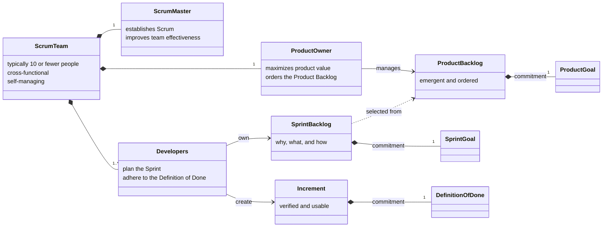
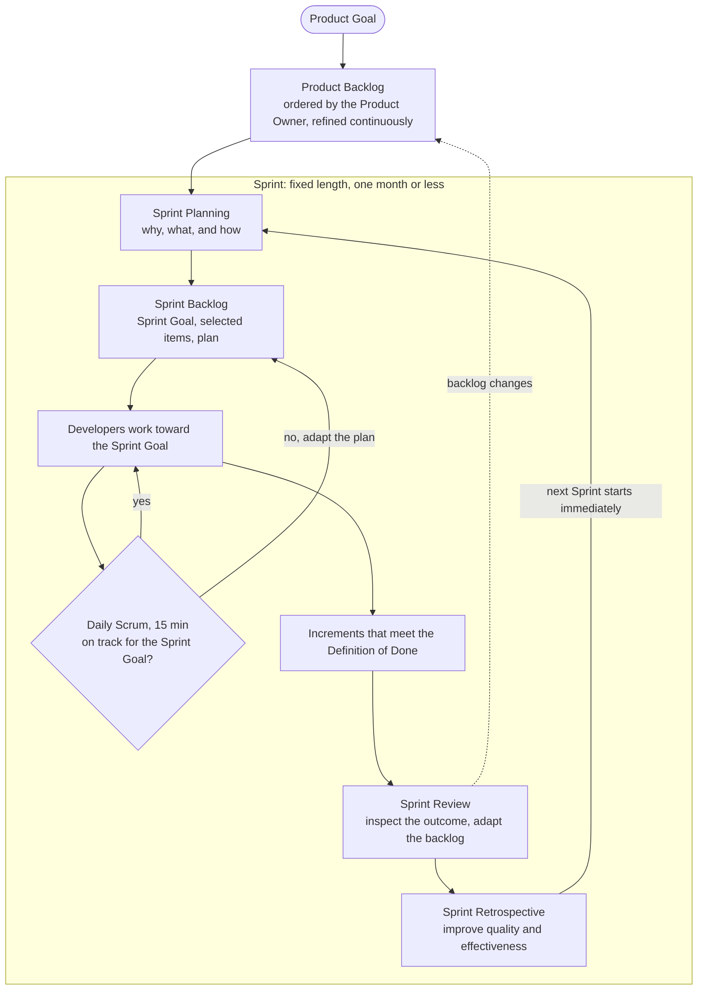
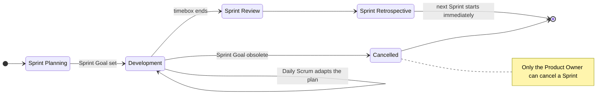

# Scrum Study Guide

[Knowledge-Hub](../../README.md) / [Study](../Study.md) / [agile](Agile.md) / Scrum Study Guide

A consolidated reference for **Scrum**: what the framework requires, why each element exists, how to start and run it in a real team, how to measure it, where it breaks down, and when to choose something else. It is for developers, team leads, Product Owners, and Scrum Masters, and for interview preparation. For a comparison with Kanban, SAFe, LeSS, and other approaches, see [Agile Frameworks](Agile_Frameworks.md).

> Version note: the rules here follow the official **November 2020 Scrum Guide** by Ken Schwaber and Jeff Sutherland, which is still the current official version as of November 2026. The **Scrum Guide Expansion Pack** (June 2025, Sutherland, Jocham, Coleman) is an optional companion and does not replace the Guide.

> **Rule vs practice:** Foundations, Accountabilities, Events, and Artifacts and Commitments restate the Scrum Guide, so they are the rules of Scrum. The other sections, and practices such as user stories, story points, velocity, and burndown charts, are common practice and judgment, not part of Scrum.

---

## Content

1. [How to Use This Guide](#how-to-use-this-guide)
2. [Scrum at a Glance](#scrum-at-a-glance)
3. [Foundations](#foundations)
   - [Definition and Purpose](#f1-definition-and-purpose)
   - [Empiricism and Lean Thinking](#f2-empiricism-and-lean-thinking)
   - [Scrum Values](#f3-scrum-values)
   - [What Scrum Deliberately Leaves Out](#f4-what-scrum-deliberately-leaves-out)
4. [Accountabilities](#accountabilities)
   - [The Scrum Team](#a1-the-scrum-team)
   - [Product Owner](#a2-product-owner)
   - [Scrum Master](#a3-scrum-master)
   - [Developers](#a4-developers)
5. [Events](#events)
   - [The Sprint](#e1-the-sprint)
   - [Sprint Planning](#e2-sprint-planning)
   - [Daily Scrum](#e3-daily-scrum)
   - [Sprint Review](#e4-sprint-review)
   - [Sprint Retrospective](#e5-sprint-retrospective)
   - [Product Backlog Refinement](#e6-product-backlog-refinement)
6. [Artifacts and Commitments](#artifacts-and-commitments)
   - [Product Backlog and Product Goal](#ar1-product-backlog-and-product-goal)
   - [Sprint Backlog and Sprint Goal](#ar2-sprint-backlog-and-sprint-goal)
   - [Increment and Definition of Done](#ar3-increment-and-definition-of-done)
7. [Implementing Scrum](#implementing-scrum)
   - [Readiness Check](#i1-readiness-check)
   - [Launch Sequence](#i2-launch-sequence)
   - [The First Three Sprints](#i3-the-first-three-sprints)
   - [Complementary Practices](#i4-complementary-practices)
   - [Forecasting and Release Planning](#i5-forecasting-and-release-planning)
   - [Metrics](#i6-metrics)
8. [Constraints and Failure Modes](#constraints-and-failure-modes)
   - [Constraints and Costs](#c1-constraints-and-costs)
   - [Anti-Patterns](#c2-anti-patterns)
9. [When to Pick Scrum](#when-to-pick-scrum)
   - [Good Fit](#d1-good-fit)
   - [Poor Fit](#d2-poor-fit)
   - [Scrum vs Kanban vs Scrumban](#d3-scrum-vs-kanban-vs-scrumban)
   - [Scaling Scrum](#d4-scaling-scrum)
10. [Rapid Answers](#rapid-answers)
11. [Quick Interview Checklist](#quick-interview-checklist)
12. [Glossary](#glossary)
13. [Sources](#sources)

---

## How to Use This Guide

[↑ Content](#content)

- **New to Scrum:** read [Scrum at a Glance](#scrum-at-a-glance), then Foundations, Accountabilities, Events, and Artifacts in order. Those four sections are the whole framework.
- **Starting a team:** go to [Implementing Scrum](#implementing-scrum) and [Constraints and Failure Modes](#constraints-and-failure-modes).
- **Choosing a framework:** read [When to Pick Scrum](#when-to-pick-scrum), then the [Agile Frameworks](Agile_Frameworks.md) comparison.
- **Interview:** finish with [Rapid Answers](#rapid-answers) and the [Quick Interview Checklist](#quick-interview-checklist).

For each element, learn three things: **what the Guide requires**, **which problem it solves**, and **what goes wrong without it**.

When answering live: **one-sentence rule, then the purpose, then a failure example**.

---

## Scrum at a Glance

[↑ Content](#content)

Scrum is **3 accountabilities, 5 events, 3 artifacts, each artifact with 1 commitment**, held together by empiricism and five values.

| Element | Items |
|---------|-------|
| **Accountabilities** | Product Owner, Scrum Master, Developers (together: one Scrum Team, typically 10 or fewer people) |
| **Events** | The Sprint (container), Sprint Planning, Daily Scrum, Sprint Review, Sprint Retrospective |
| **Artifacts and commitments** | Product Backlog with Product Goal, Sprint Backlog with Sprint Goal, Increment with Definition of Done |
| **Pillars** | Transparency, Inspection, Adaptation |
| **Values** | Commitment, Focus, Openness, Respect, Courage |

**Structure (UML class diagram):** who is accountable for which artifact, and which commitment each artifact carries.

**Flow (UML activity diagram):** one Sprint, from the Product Goal to the start of the next Sprint.

**Timeboxes** (maximums for a one-month Sprint; shorter Sprints usually have shorter events):

| Event | Timebox |
|-------|---------|
| Sprint | One month or less, fixed length |
| Sprint Planning | 8 hours |
| Daily Scrum | 15 minutes, every working day |
| Sprint Review | 4 hours |
| Sprint Retrospective | 3 hours |

---

## Foundations

### F1. Definition and Purpose

[↑ Content](#content)

The Guide defines Scrum as *a lightweight framework that helps people, teams and organizations generate value through adaptive solutions for complex problems*.

In a nutshell, a Scrum Master fosters an environment where:

1. A Product Owner orders the work for a complex problem into a Product Backlog.
2. The Scrum Team turns a selection of the work into an Increment of value during a Sprint.
3. The Scrum Team and its stakeholders inspect the results and adjust for the next Sprint.
4. Repeat.

**Deeper understanding**

The key word is **complex**: more is unknown than known, so a detailed up-front plan would be wrong anyway. Scrum replaces prediction with short feedback loops. For simple, repeatable work where the path is known, Scrum adds overhead without much benefit.

---

### F2. Empiricism and Lean Thinking

[↑ Content](#content)

Scrum is founded on **empiricism** (knowledge comes from experience and decisions are based on what is observed) and **lean thinking** (reduce waste and focus on essentials).

| Pillar | Meaning | Where Scrum enforces it |
|--------|---------|-------------------------|
| **Transparency** | The process and work are visible to those doing and receiving it | Artifacts, Definition of Done, Sprint Goal |
| **Inspection** | Artifacts and progress are inspected frequently to detect problems | All five events |
| **Adaptation** | When something deviates outside acceptable limits, adjust as soon as possible | Planning, Daily Scrum, Review, Retrospective |

**Deeper understanding**

The pillars depend on each other. Inspection without transparency is misleading, and inspection without the ability to adapt is pointless. A team that cannot change its plan, scope, or process (for example, because scope and dates are fixed by contract and nobody can renegotiate) is not doing empirical process control, whatever it calls its meetings.

---

### F3. Scrum Values

[↑ Content](#content)

| Value | In practice |
|-------|-------------|
| **Commitment** | The team commits to achieving its goals and to supporting each other |
| **Focus** | Primary focus is the work of the Sprint, to make the best possible progress toward goals |
| **Openness** | The team and stakeholders are open about the work and the challenges |
| **Respect** | Members respect each other as capable, independent people |
| **Courage** | Members have the courage to do the right thing and work on tough problems |

The values give direction to the team's work, actions, and behavior. When they are missing, the events become rituals: a Retrospective without openness produces no real improvement, and a Sprint Review without courage hides bad news.

---

### F4. What Scrum Deliberately Leaves Out

[↑ Content](#content)

The Guide calls Scrum **purposefully incomplete**: it defines only the parts required to implement Scrum theory. These are **not** in the 2020 Guide:

- User stories, story points, planning poker, and velocity.
- Burndown or burnup charts.
- A "Definition of Ready".
- Engineering practices (testing, CI/CD, pairing). Teams add them, often from XP.
- Sprint 0, hardening Sprints, or release Sprints.
- A project manager role, or a team lead above the Developers.
- How to scale to many teams.

**Deeper understanding**

Changes from earlier Guides worth knowing: the 2020 Guide replaced *roles* with *accountabilities*, removed the separate "Development Team" (one Scrum Team, no sub-teams), replaced *self-organizing* with *self-managing* (the team decides who does what, when, and how), added the **Product Goal**, and made each artifact carry a **commitment**. Sprint Planning gained a third topic: **Why** is this Sprint valuable.

---

## Accountabilities

### A1. The Scrum Team

[↑ Content](#content)

- One Product Owner, one Scrum Master, and Developers. No sub-teams and no hierarchies.
- **Cross-functional:** members have all the skills needed to create value each Sprint.
- **Self-managing:** the team internally decides who does what, when, and how.
- **Size:** typically 10 or fewer people. Smaller teams communicate better and are more productive. A team that grows too large should reorganize into several cohesive Scrum Teams on the same product, sharing the same Product Goal, Product Backlog, and Product Owner.
- The whole team is accountable for creating a valuable, useful Increment every Sprint.

---

### A2. Product Owner

[↑ Content](#content)

Accountable for **maximizing the value** of the product resulting from the work of the Scrum Team, and for effective Product Backlog management:

- Developing and explicitly communicating the Product Goal.
- Creating and clearly communicating Product Backlog items.
- Ordering Product Backlog items.
- Ensuring the Product Backlog is transparent, visible, and understood.

The Product Owner may delegate the work but stays accountable. The Product Owner is **one person, not a committee**. For the role to work, the organization must respect their decisions, which are visible in the content and ordering of the Product Backlog and in the inspectable Increment at the Sprint Review.

**Deeper understanding**

The most common failure is a Product Owner with no authority: a proxy who relays decisions from a committee or a manager. Every decision then waits, ordering changes without explanation, and the team optimizes for output instead of value.

---

### A3. Scrum Master

[↑ Content](#content)

Accountable for **establishing Scrum** as defined in the Guide and for the **Scrum Team's effectiveness**. Scrum Masters are true leaders who serve the Scrum Team and the larger organization.

| Serves | How |
|--------|-----|
| **Scrum Team** | Coaching self-management and cross-functionality; focusing on high-value Increments that meet the Definition of Done; causing the removal of impediments; ensuring events take place, are productive, and stay within the timebox |
| **Product Owner** | Techniques for Product Goal definition and backlog management; helping the team understand clear, concise backlog items; empirical product planning; facilitating stakeholder collaboration |
| **Organization** | Leading, training, and coaching the adoption; planning and advising implementations; helping employees and stakeholders understand an empirical approach; removing barriers between stakeholders and teams |

**Deeper understanding**

A Scrum Master is not a project manager, a meeting secretary, or the person who updates the board. Measure the role by whether the team and organization improve, not by how many meetings it runs.

---

### A4. Developers

[↑ Content](#content)

The people in the Scrum Team committed to creating any aspect of a usable Increment each Sprint. "Developer" covers every skill involved (design, testing, analysis, operations), not only programmers. Developers are accountable for:

- Creating a plan for the Sprint, the Sprint Backlog.
- Instilling quality by adhering to a Definition of Done.
- Adapting their plan each day toward the Sprint Goal.
- Holding each other accountable as professionals.

---

## Events

### E1. The Sprint

[↑ Content](#content)

The heartbeat of Scrum, where ideas are turned into value. A fixed-length event of **one month or less**; the next Sprint starts immediately after the previous one ends. All work, including Sprint Planning, Daily Scrums, Sprint Review, and Sprint Retrospective, happens within Sprints.

During the Sprint:

- No changes are made that would endanger the Sprint Goal.
- Quality does not decrease.
- The Product Backlog is refined as needed.
- Scope may be clarified and renegotiated with the Product Owner as more is learned.

A Sprint can be **cancelled only by the Product Owner**, and only if the Sprint Goal becomes obsolete.

**Lifecycle (UML state diagram)**

**Deeper understanding**

Sprint length is a risk decision. Longer Sprints let the goal grow too large, increase complexity, and raise risk. Shorter Sprints generate more learning cycles and limit cost and effort risk to a smaller time frame. Two weeks is a common choice in practice, but the Guide does not prescribe it.

---

### E2. Sprint Planning

[↑ Content](#content)

Initiates the Sprint by laying out the work. The whole Scrum Team attends and may invite others for advice. Timebox: **8 hours** for a one-month Sprint. Three topics:

| Topic | Question | Output |
|-------|----------|--------|
| **Why** | Why is this Sprint valuable? | Sprint Goal, finalized before the end of Planning |
| **What** | What can be Done this Sprint? | Selected Product Backlog items |
| **How** | How will the chosen work get done? | A plan, often by decomposing items into work of one day or less |

The Sprint Goal, the selected items, and the plan together form the **Sprint Backlog**. Developers base the selection on past performance, upcoming capacity, and their Definition of Done.

---

### E3. Daily Scrum

[↑ Content](#content)

A **15-minute** event for the Developers, at the same time and place every working day. Purpose: inspect progress toward the Sprint Goal and adapt the Sprint Backlog as necessary.

- The Developers choose the structure and techniques. The "three questions" are one option, not a rule.
- If the Product Owner or Scrum Master are actively working on Sprint Backlog items, they take part as Developers.
- It is not the only time to adjust the plan. Detailed discussion often continues right after it.

**Deeper understanding**

The most common anti-pattern is a status report to a manager. The test: does the meeting end with a changed or confirmed plan for reaching the Sprint Goal? If not, it is reporting, not inspection and adaptation.

---

### E4. Sprint Review

[↑ Content](#content)

Purpose: inspect the **outcome** of the Sprint and determine future adaptations. The Scrum Team presents results to key stakeholders, and progress toward the Product Goal is discussed. Timebox: **4 hours** for a one-month Sprint.

- It is a **working session**, not a presentation or demo for approval.
- Attendees review what was accomplished and what has changed in the environment, then collaborate on what to do next.
- The Product Backlog may be adjusted to meet new opportunities.
- It must not be treated as a gate for releasing value. Releasing can happen at any time.

---

### E5. Sprint Retrospective

[↑ Content](#content)

Purpose: plan ways to increase **quality and effectiveness**. Timebox: **3 hours** for a one-month Sprint. It concludes the Sprint.

The team inspects how the last Sprint went regarding individuals, interactions, processes, tools, and its Definition of Done. It identifies the most helpful changes, and the most impactful improvements are addressed as soon as possible. They may even be added to the Sprint Backlog for the next Sprint.

---

### E6. Product Backlog Refinement

[↑ Content](#content)

Not an event in the Guide but an **ongoing activity**: breaking down and further defining Product Backlog items into smaller, more precise items, adding details such as description, order, and size. Items that can be Done within one Sprint are considered ready for selection in Sprint Planning.

In practice, teams commonly spend a regular slice of Sprint capacity on refinement. The amount is a team decision and is not set by the Guide.

---

## Artifacts and Commitments

### AR1. Product Backlog and Product Goal

[↑ Content](#content)

**Product Backlog:** an emergent, ordered list of what is needed to improve the product. It is the single source of work undertaken by the Scrum Team.

**Commitment, Product Goal:** the future state of the product, a long-term objective the team plans against. It lives in the Product Backlog; the rest of the backlog emerges to define what fulfills it. The team must fulfill or abandon one Product Goal before taking on the next.

---

### AR2. Sprint Backlog and Sprint Goal

[↑ Content](#content)

**Sprint Backlog:** the Sprint Goal (why), the selected Product Backlog items (what), and an actionable plan (how). It is a plan by and for the Developers, updated throughout the Sprint.

**Commitment, Sprint Goal:** the single objective for the Sprint. It creates coherence and focus, and gives flexibility on the exact work needed to achieve it. If the work turns out different than expected, the Developers negotiate the scope of the Sprint Backlog with the Product Owner without affecting the Sprint Goal.

---

### AR3. Increment and Definition of Done

[↑ Content](#content)

**Increment:** a concrete stepping stone toward the Product Goal. Each Increment is additive to all prior Increments, verified, and usable. **Multiple Increments may be created within a Sprint**, and an Increment may be delivered to stakeholders before the Sprint ends.

**Commitment, Definition of Done (DoD):** a formal description of the state of the Increment when it meets the quality measures required for the product. Work becomes an Increment only when it meets the DoD.

- An item that does not meet the DoD cannot be released or presented at the Sprint Review. It returns to the Product Backlog.
- If the DoD is part of the organization's standards, all Scrum Teams must follow it as a minimum. Otherwise the Scrum Team creates one.
- Several Scrum Teams on the same product share one DoD.

**Deeper understanding**

The DoD is what makes Scrum transparent. A weak DoD (for example, "code reviewed" without testing or integration) hides undone work, which then shows up later as "hardening" phases and surprise delays.

---

## Implementing Scrum

### I1. Readiness Check

[↑ Content](#content)

Answer these before starting. A "no" is a risk to address, not necessarily a blocker.

| Question | Why it matters |
|----------|----------------|
| Is there a product (or a stable goal) rather than a set of unrelated tasks? | The Product Goal and backlog need one coherent direction |
| Is there one person with real authority over priorities? | The Product Owner must be able to decide |
| Can a stable team of about 3 to 10 people work on it with most needed skills? | Cross-functional, long-lived teams are the unit of delivery |
| Can stakeholders review the product every Sprint? | Without feedback, the Sprint Review has no input |
| Can scope be adjusted as you learn? | Fixed scope plus fixed date removes adaptation |
| Will management accept visible bad news? | Transparency needs psychological safety |
| Can the team produce a usable Increment within a month? | Technical or organizational blockers may need work first |

---

### I2. Launch Sequence

[↑ Content](#content)

1. **Agree on the reason.** State which problem Scrum should solve (predictability, feedback, quality, time to market), so you can later check whether it does.
2. **Appoint the Product Owner** and confirm their decision authority with sponsors.
3. **Form the team.** Choose a Scrum Master, ideally full time for a new team, and stable Developers who cover the skills needed.
4. **Define the product and Product Goal.** Write a short product vision and one measurable goal.
5. **Create the initial Product Backlog.** Enough ordered items for two or three Sprints, the top ones small enough to finish within a Sprint.
6. **Write the first Definition of Done.** Start with what the team can really achieve, and make it visible.
7. **Choose Sprint length.** Pick based on how fast you need feedback and how volatile the work is, then keep it fixed.
8. **Set the cadence.** Fix the calendar for all events and invite the stakeholders who will attend the Sprint Review.
9. **Make work visible.** A board (physical or tool) showing the Sprint Goal, Sprint Backlog, and impediments.
10. **Run Sprint 1.** Do not wait for a perfect backlog. Learning starts with the first Increment.

---

### I3. The First Three Sprints

[↑ Content](#content)

| Sprint | Typical focus | Signal you are on track |
|--------|---------------|-------------------------|
| **1** | Learn the events; deliver one small Done Increment; discover impediments | At least one item meets the DoD and is shown to stakeholders |
| **2** | Act on Retrospective items; improve refinement; tighten the Sprint Goal | Sprint Goal is a single, outcome-oriented objective |
| **3** | Strengthen the DoD; start forecasting from real data | Less carry-over; stakeholders change the backlog based on the Review |

Expect early Sprints to miss forecasts. The point is to make problems visible, not to hit numbers.

---

### I4. Complementary Practices

[↑ Content](#content)

Optional practices teams commonly add. None is required by Scrum.

| Practice | Use it for | Watch out for |
|----------|-----------|---------------|
| **User stories** | Describing backlog items from a user's view | Writing stories with no real user value ("as a developer...") |
| **Acceptance criteria** | Making expected behavior testable | Replacing conversation with long specifications |
| **Relative sizing / story points** | Comparing size and supporting forecasts | Treating points as productivity or comparing teams |
| **Planning poker** | Surfacing different assumptions | Spending more time estimating than learning |
| **Burndown / burnup charts** | Visualizing progress in the Sprint or release | Optimizing the chart instead of the goal |
| **Kanban board with WIP limits** | Making flow and bottlenecks visible (see [Scrumban](Agile_Frameworks.md#f6-scrumban)) | Overloading the board with states |
| **XP engineering practices** | TDD, CI, pairing, refactoring to keep quality high | Adopting tools without the discipline |
| **Definition of Ready** | Agreeing when an item is clear enough to plan | Becoming a gate that blocks collaboration |

---

### I5. Forecasting and Release Planning

[↑ Content](#content)

The Guide says various practices exist to forecast progress, such as burn-downs, burn-ups, or cumulative flows, but they do not replace empiricism: only what has already happened can inform forward-looking decisions.

| Technique | How | Strength | Limit |
|-----------|-----|----------|-------|
| **Velocity range** | Average and spread of points Done over recent Sprints, applied to the remaining sized backlog | Simple, familiar | Depends on consistent sizing; easily gamed |
| **Throughput** | Count of items finished per Sprint or week | No estimation needed | Needs roughly similar item sizes |
| **Monte Carlo simulation** | Resample historical throughput many times to get a probability distribution of completion dates | Gives probabilities ("85% by date X") | Needs historical data; garbage in, garbage out |
| **Release burnup** | Track Done scope against total scope over time | Shows scope growth and progress separately | Only as good as the scope estimate |

**Deeper understanding**

Fixed date and fixed scope cannot both be guaranteed under uncertainty. Scrum makes the trade visible: with a fixed date, forecast **how much** scope; with fixed scope, forecast **when**. Always give ranges, not single numbers, and update them every Sprint.

---

### I6. Metrics

[↑ Content](#content)

Measure outcomes and the health of the system, not people's activity.

| Area | Example measures |
|------|------------------|
| **Value and outcomes** | Customer usage, satisfaction, revenue or cost impact, Product Goal progress |
| **Delivery flow** | Cycle time, lead time, throughput, release frequency |
| **Predictability** | Sprint Goal success rate, forecast accuracy over several Sprints |
| **Quality** | Escaped defects, change failure rate, time to restore, technical debt trend |
| **Team health** | Retrospective improvements completed, team satisfaction, turnover |

Scrum.org's **Evidence-Based Management (EBM)** groups value measures into four key value areas: **Current Value**, **Unrealized Value**, **Time-to-Market**, and **Ability to Innovate**.

**Never** use velocity to compare teams or to judge individuals. Once velocity becomes a target, teams inflate estimates and the number stops being useful (Goodhart's law).

---

## Constraints and Failure Modes

### C1. Constraints and Costs

[↑ Content](#content)

- **Dedicated roles:** a Product Owner with authority and time, and a Scrum Master, are real costs, especially for small organizations.
- **Stable team:** frequent reassignment destroys the team's ability to forecast and improve.
- **Meeting overhead:** the Guide sets maximums only for a one-month Sprint. A common rule of thumb scales them proportionally, so a two-week Sprint allows up to about 4 hours of Planning, 2 hours of Review, and 1.5 hours of Retrospective, plus daily events and refinement. That cost pays off only when inspection leads to real adaptation.
- **Cadence vs interrupts:** a fixed Sprint Goal fits poorly with work that changes daily (support, incidents, operations).
- **Organizational change:** Scrum exposes impediments (approval chains, silos, component teams) that the team cannot remove alone. Without management support, the framework stalls.
- **Contracts and governance:** fixed-scope, fixed-price contracts and stage-gate governance conflict with empirical scope and need adapting.
- **Single team scope:** Scrum describes one team. Multi-team products need a scaling approach.

---

### C2. Anti-Patterns

[↑ Content](#content)

| Anti-pattern | Symptom | Remedy |
|--------------|---------|--------|
| **Scrum-but / mechanical Scrum** | Events happen but nothing changes | Tie each event to a decision; review the reason for adopting Scrum |
| **Proxy Product Owner** | Decisions wait for someone outside the team | Give the PO real authority or move the role to whoever has it |
| **Scrum Master as project manager** | SM assigns tasks and reports status | Developers self-manage; SM coaches and removes impediments |
| **Status-report Daily Scrum** | People report to the SM or a manager | Focus on the Sprint Goal and the plan for today |
| **No Sprint Goal** | Sprint is a list of unrelated tickets | Craft one objective; select items that serve it |
| **Mini-waterfall in the Sprint** | Testing happens in the last days, items carry over | Smaller items, swarming, test early, strong DoD |
| **Weak or missing DoD** | "Done" items come back as bugs; hardening Sprints | Make the DoD explicit and strengthen it over time |
| **Velocity as a target** | Estimates inflate; teams compared | Use velocity only for the team's own forecasting |
| **Demo-only Sprint Review** | Stakeholders watch, nobody changes the backlog | Run it as a working session about what to do next |
| **Component teams** | No team can deliver an end-to-end Increment | Move toward cross-functional feature teams |
| **Sprint 0 or hardening Sprints** | Sprints without a usable Increment | Every Sprint delivers at least one Done Increment |

---

## When to Pick Scrum

### D1. Good Fit

[↑ Content](#content)

- **Complex product development:** requirements or technology are uncertain, and learning from real Increments is valuable.
- **A product with a lifecycle:** new products, major features, or ongoing product evolution, not one-off tasks.
- **Stakeholders available for frequent feedback.**
- **A stable team of up to about 10 people**, able to work cross-functionally.
- **Work that can be planned for 1 to 4 weeks** without constant disruption.
- **The organization wants a clear structure** for a first Agile adoption: defined accountabilities and events make the change concrete.

---

### D2. Poor Fit

[↑ Content](#content)

| Situation | Why Scrum struggles | Consider instead |
|-----------|---------------------|------------------|
| Support, operations, incident handling with unpredictable arrivals | Sprint Goal is constantly broken | [Kanban](Agile_Frameworks.md#f2-kanban) |
| Mixed planned and unplanned work | Rigid cadence vs urgent requests | [Scrumban](Agile_Frameworks.md#f6-scrumban) |
| Simple, well-understood, repeatable work | Overhead with little learning value | Standard process or Kanban |
| Many teams on one product | Scrum covers one team | [Nexus](Agile_Frameworks.md#f10-nexus), [LeSS](Agile_Frameworks.md#f8-less-large-scale-scrum), [Scrum@Scale](Agile_Frameworks.md#f5-scrumscale-and-scrum-of-scrums), [SAFe](Agile_Frameworks.md#f3-safe-scaled-agile-framework) |
| Strict regulated, fixed-scope delivery with heavy documentation | Empirical scope conflicts with fixed contracts | Hybrid approaches, [Disciplined Agile](Agile_Frameworks.md#f9-disciplined-agile-da) |
| Quality problems are the main issue | Scrum does not define engineering practices | Add [XP](Agile_Frameworks.md#f7-extreme-programming-xp) practices |
| No one can act as Product Owner | Value ordering has no owner | Fix product ownership first |

---

### D3. Scrum vs Kanban vs Scrumban

[↑ Content](#content)

| Aspect | Scrum | Kanban | Scrumban |
|--------|-------|--------|----------|
| **Cadence** | Fixed Sprints of one month or less | Continuous flow; cadences optional | Optional iterations with continuous flow |
| **Roles** | PO, SM, Developers | None prescribed | Usually keeps PO; others optional |
| **Planning target** | Sprint Goal (a commitment) | Service Level Expectation (a forecast, not a commitment) | Varies; often an iteration goal, always WIP limits |
| **Change during work** | Protect the Sprint Goal; renegotiate scope with PO | Anytime, when capacity frees up | Anytime, within WIP limits |
| **Key metric** | Sprint Goal success, Increment delivered | WIP, throughput, work item age, cycle time | Flow metrics plus iteration outcomes |
| **Best for** | Complex product work | Flow-based, interrupt-driven work | Teams moving between the two, or mixed work |

See the full profiles in [Agile Frameworks](Agile_Frameworks.md).

---

### D4. Scaling Scrum

[↑ Content](#content)

The Guide's rule for growth: when a team becomes too large, split into multiple cohesive Scrum Teams on the same product, with one Product Goal, one Product Backlog, and one Product Owner. The frameworks below add the coordination Scrum does not define:

| Framework | Scale | Approach |
|-----------|-------|----------|
| [Nexus](Agile_Frameworks.md#f10-nexus) | About 3 to 9 Scrum Teams, one product | Minimal extension: Nexus Integration Team and integrated Increment |
| [LeSS](Agile_Frameworks.md#f8-less-large-scale-scrum) | 2 to 8 teams; LeSS Huge for more | One Sprint, one backlog, one PO; organizational redesign |
| [Scrum@Scale](Agile_Frameworks.md#f5-scrumscale-and-scrum-of-scrums) | Any number, through networks of teams | Scrum of Scrums plus executive MetaScrum and Action Team |
| [SAFe](Agile_Frameworks.md#f3-safe-scaled-agile-framework) | Teams of teams up to the portfolio | Agile Release Trains, PI Planning, portfolio management |

Before scaling, check whether fewer teams with fewer dependencies would deliver more. Scaling a team that cannot deliver a Done Increment only multiplies the problem.

---

## Rapid Answers

[↑ Content](#content)

| Question | One-line answer |
|----------|-----------------|
| What is Scrum? | A lightweight framework for generating value through adaptive solutions for complex problems. |
| What are the three pillars? | Transparency, inspection, adaptation. |
| What are the five values? | Commitment, focus, openness, respect, courage. |
| What are the accountabilities? | Product Owner, Scrum Master, Developers. |
| How big is a Scrum Team? | Typically 10 or fewer people. |
| How long is a Sprint? | Fixed length of one month or less. |
| Who can cancel a Sprint? | Only the Product Owner, if the Sprint Goal becomes obsolete. |
| How long is the Daily Scrum, and who is it for? | 15 minutes, for the Developers. |
| What are the three Sprint Planning topics? | Why the Sprint is valuable, what can be Done, how it will get done. |
| What are the three commitments? | Product Goal, Sprint Goal, Definition of Done. |
| Can you release before the Sprint Review? | Yes. The Review is not a gate; multiple Increments can be delivered within a Sprint. |
| What happens to work that does not meet the DoD? | It is not part of the Increment; it returns to the Product Backlog. |
| Is backlog refinement an event? | No, it is an ongoing activity. |
| Are story points part of Scrum? | No, they are an optional complementary practice. |
| Can the PO be a committee? | No, it is one person, although they may represent many stakeholders. |
| Who owns the Sprint Backlog? | The Developers. |
| What changed most in the 2020 Guide? | Product Goal, commitments, one Scrum Team, self-managing, accountabilities, and the "Why" in Planning. |
| When is Scrum a bad choice? | Interrupt-driven or simple repeatable work, or when no one can own the product. |

---

## Quick Interview Checklist

[↑ Content](#content)

**Theory**

- [ ] I can define Scrum and explain why it targets complex problems.
- [ ] I can explain empiricism, the three pillars, and how they depend on each other.
- [ ] I can name the five values and give an example of each.

**Framework**

- [ ] I can list all accountabilities, events, artifacts, and commitments without notes.
- [ ] I know every timebox and who attends each event.
- [ ] I can explain the purpose of each event, not only its agenda.
- [ ] I know what is not in the Guide (story points, Sprint 0, DoR, project manager).

**Practice**

- [ ] I can describe how to launch a new Scrum Team.
- [ ] I can forecast a release with ranges and explain why.
- [ ] I can name five anti-patterns and their remedies.
- [ ] I can argue when to pick Scrum, Kanban, or Scrumban, and how to scale.

---

## Glossary

[↑ Content](#content)

| Term | Short definition |
|------|------------------|
| **Accountability** | A responsibility in the Scrum Team: Product Owner, Scrum Master, or Developers |
| **Commitment** | The element each artifact carries to focus and measure progress: Product Goal, Sprint Goal, Definition of Done |
| **Definition of Done (DoD)** | The formal quality standard work must meet to become part of an Increment |
| **Developers** | Members of the Scrum Team who create the Increment, whatever their skill |
| **EBM** | Evidence-Based Management, Scrum.org's framework for measuring value |
| **Empiricism** | Making decisions based on what is observed |
| **Increment** | A verified, usable step toward the Product Goal, additive to previous ones |
| **Product Backlog** | The emergent, ordered list of everything needed to improve the product |
| **Product Goal** | The long-term objective for the Scrum Team; commitment of the Product Backlog |
| **Refinement** | Ongoing activity of splitting and detailing Product Backlog items |
| **Self-managing** | The team decides who does what, when, and how |
| **Sprint** | Fixed-length container event of one month or less |
| **Sprint Backlog** | Sprint Goal, selected items, and the plan for delivering them |
| **Sprint Goal** | The single objective for the Sprint; commitment of the Sprint Backlog |
| **Timebox** | Maximum duration for an event |
| **Velocity** | Optional measure of work completed per Sprint, used only for the team's own forecasting |

---

## Sources

[↑ Content](#content)

- [The 2020 Scrum Guide](https://scrumguides.org/scrum-guide) — official definition of Scrum (Schwaber and Sutherland).
- [Scrum Guide download and revision history](https://scrumguides.org/download) — confirms November 2020 as the official current version.
- [Scrum Guide Expansion Pack](https://scrumexpansion.org/scrum-guide-expanded/history/) — optional 2025 companion.
- [Evidence-Based Management](https://www.scrum.org/resources/evidence-based-management) — Scrum.org value measures.
- [Agile Frameworks](Agile_Frameworks.md) — comparison, adoption data, and selection guide in this vault.

---

*Scrum in one line: a small, self-managing team turns an ordered backlog into Done Increments every Sprint, then inspects and adapts. Study path: foundations, then events and artifacts, then implementation, then the [framework comparison](Agile_Frameworks.md).*
